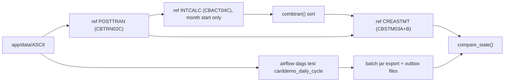
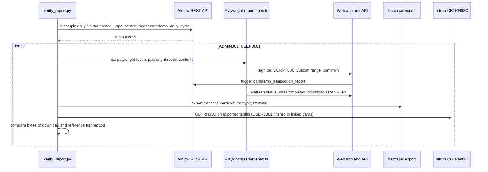

# Cycle, data, and report checks

Active contributors: factory-aj-pahl

Three scripts extend [batch parity](batch-parity.md) beyond single jobs. `verify_cycle.py` compares a whole Airflow daily cycle with the COBOL job chain, `verify_data.py` proves that every owed sample data file loads into SQL Server and exports back byte for byte, and `verify_report.py` drives a real report request through the browser and Airflow and compares the downloaded file with CBTRN03C output.

## Overview

| Make target | Script | Compares | Needs the stack up? |
|:--|:--|:--|:--|
| `verify-cycle` | `modernization/verification/cycle/verify_cycle.py` | End state of `carddemo_daily_cycle` vs the patched COBOL chain, two scenarios | No; uses `airflow dags test` and a scratch database |
| `verify-data` | `modernization/verification/data/verify_data.py` | Every `owed` file in `modernization/verification/data/owed-files.md` vs its export | No; uses a scratch database |
| `verify-report` | `modernization/verification/schedule/verify_report.py` | Browser-downloaded TRANREPT vs reference CBTRN03C, for ADMIN001 and USER0001 | Yes (`make up`) |

All three reuse `refrun.py` and `compare.py` from `modernization/verification/parity/`, write `results.json` into the output directory (`OUT=dir`), and exit 1 on any finding. A step that cannot run counts as a failure.

## Cycle check (verify_cycle.py)

Scenarios (`SCENARIOS` in the script, from B-CYCLE):

| Scenario | Business date | Reference chain |
|:--|:--|:--|
| non-month-start | 2022-06-10 | POSTTRAN -> CREASTMT |
| month-start | 2022-07-01 | POSTTRAN -> INTCALC (PARM `YYYYMMDD00`) -> COMBTRAN sort -> CREASTMT |

- **Reference side.** Each patched COBOL step reads the files the previous step wrote. COBOL POSTTRAN must end with RC 0 or 4, INTCALC and CREASTMT with RC 0. The COMBTRAN merge is reproduced by `refrun.combtran()` (sort by TRAN-ID, backup records first on equal keys).
- **Target side.** The batch jar resets and loads a fresh database (`CARDDEMO_DB_PARITY`, default `CARDDEMO_DB` or `carddemo_test`). `dailytran.txt` is copied into `<inbox>/<date>/`, `airflow db migrate` runs, then `airflow dags test carddemo_daily_cycle <date> -c {"business_date": ...}` runs the whole DAG (BACKUP, POSTTRAN, month_start, INTCALC when due, CREASTMT). The run must succeed and its log must contain `state=success`.
- **Compared.** The transaction, account, and category-balance tables exported in their legacy layouts (`transact.txt`, `acctdata.txt`, `tcatbal.txt`), the reject file `dalyrejs.txt`, and the statements (`STATEMNT.txt` and `STATEMNT.html` from the outbox, compared as `stmtfile.txt` and `htmlfile.txt`). The run-time timestamps that `compare.py` already normalizes are normalized here too; in the month-start scenario the original timestamp of interest rows (bytes 279-304, rows whose ID starts with the business date plus `00`) is normalized as well.
- **Extra assertion.** In the month-start scenario at least one interest row must exist, otherwise "INTCALC did not run on the first business day".

Prerequisites: `cobc`, the batch jar, the Airflow virtual environment at `~/.carddemo/airflow-venv`, and `CARDDEMO_DB_PASSWORD`. Airflow state goes to `$AIRFLOW_HOME` (default `~/.carddemo/airflow`), and the DAGs folder is pointed at `modernization/airflow/dags`. The output directory must be empty. See [Daily batch cycle](../features/daily-batch-cycle.md) and [Airflow](../applications/airflow.md).

## Data round trip (verify_data.py and owed-files.md)

`modernization/verification/data/owed-files.md` lists every file under `app/data/ASCII` and `app/data/EBCDIC` plus the module seed files, each with records, record length, target table, status (`owed`, `pending`, or `not-owed`), owner, and notes. At commit `467e0f0` the table has 25 rows: 13 owed, 12 not-owed (the EBCDIC twins of the ASCII files under DF-2, the duplicate `ACCDATA.PS`, the LOW-VALUES initializer, and the export file, which the CBIMPORT parity pairs cover), and no pending rows. A file in those directories with no row, or a listed file that is missing, is a failure.

What is checked, by kind of owed file:

| Files | Check |
|:--|:--|
| 9 ASCII fixed-width files (`acctdata.txt`, `carddata.txt`, `cardxref.txt`, `custdata.txt`, `dailytran.txt`, `discgrp.txt`, `tcatbal.txt`, `trancatg.txt`, `trantype.txt`) | Fresh schema (`carddemo-batch reset`), `load`, row count equals record count and the loader's `LOADED` line, `export`, then byte-for-byte comparison after only CR stripping and right-padding to the record length. `acctdata.txt` expects the RP-DATA-1 group-ID move (all 50 sample records change). `dailytran.txt` is staged and exported as `transact.txt`, since DALYTRAN stays a job input file with the TRANSACT layout |
| `app/data/EBCDIC/AWS.M2.CARDDEMO.USRSEC.PS` | 10 users. Each 80-byte cp037 record is rebuilt from `app_user` and compared except bytes 49-56, the password, which must be stored as a BCrypt hash and not the clear text (D-AUTH). The script also prints the `user_account` link count (owed-files.md expects 50, D-SEED) |
| `app/app-transaction-type-db2/ctl/DB2LTTYP.ctl`, `DB2LTCAT.ctl` | On a second fresh schema, `carddemo-batch loaddb2` loads 7 and 18 rows from the SQL text, and the export must equal the source file byte for byte with no normalization |
| `app/app-authorization-ims-db2-mq/data/EBCDIC/AWS.M2.CARDDEMO.IMSDATA.DBPAUTP0.dat` | IMS HD unload, 226 variable-length records. The one root with a non-packed key is rejected (Q-PAUDBUNL-02, Q-PAUDBLOD-07), so 21 summaries and 202 details load; the expected export is the source minus that root, with the trailer's root count changed to 21 |

It also checks five signed zoned (overpunch) spot values directly in the database, for example `0000009190}` in `dailytran.txt` must read back as -919.00 and `00150{` in `discgrp.txt` as 15.00 (entities.md DF-02, DF-03).

Prerequisites: the batch jar, `sqlcmd` (default `/opt/mssql-tools18/bin/sqlcmd`), and `CARDDEMO_DB_PASSWORD`; the database is `CARDDEMO_DB_PARITY` (default `carddemo_test`). The final line reads `data round trip: N/13 owed files matched`. See [Data migration](../features/data-migration.md) and [Schema and migration](../modules/schema-and-migration.md).

## Report check (verify_report.py, report.spec.ts)

This is "schedule-cycle part c": a report requested on the CORPT00C screen, run by the real Airflow, must be identical to what COBOL CBTRN03C produces from the same data.

Details from `modernization/verification/schedule/verify_report.py`:

- **History.** If none of the 300 transaction IDs of `app/data/ASCII/dailytran.txt` are in `card_transaction`, the script copies the file into the inbox for `--business-date` (default 2022-06-10), unpauses `carddemo_daily_cycle` (it is created paused), triggers a run through `/api/v2/dags/carddemo_daily_cycle/dagRuns`, polls for up to 15 minutes, and pauses the DAG again if it was paused before. The Airflow token comes from `/auth/token` with the generated simple-auth-manager password file.
- **Range.** Defaults to the first and last processing dates in the database; `--start` and `--end` override.
- **Browser.** `modernization/e2e/verification/report.spec.ts` signs on as `REPORT_USER`, opens CORPT00C (menu option 9 for a user; a direct URL for the admin, since the admin menu has no report option), fills the Custom range, confirms with `Y`, clicks "Refresh status" until the run state is Completed or Failed (default timeout 300 seconds), and saves the download to `REPORT_OUT`. Run ID and states seen go to `REPORT_META`.
- **Reference.** The tables are exported with the batch jar, and CBTRN03C runs on them with the same range in `dateparm.txt`. For a non-admin user the reference TRANSACT keeps only transactions on cards of the user's linked accounts (D-REPORT); `scope.json` records how many were kept.
- **Verdict.** The downloaded file must equal the reference `tranrept.txt` byte for byte. When it does not, `compare.compare_file` reports the differing records.

`modernization/e2e/playwright.report.config.ts` points at `./verification`, one worker, no retries, `acceptDownloads: true`, base URL `http://127.0.0.1:${CARDDEMO_WEB_PORT:-5173}`. It starts no servers: the stack must already be running. Prerequisites: the environment from `modernization/ops/stack-env.sh` (the Makefile target sources it), `cobc`, the batch jar, and `modernization/e2e/node_modules`. See [Transaction reports](../features/transaction-reports.md).

## Key source files

| File | Purpose |
|:--|:--|
| `modernization/verification/cycle/verify_cycle.py` | Airflow cycle vs COBOL chain |
| `modernization/verification/data/verify_data.py` | Load and export round trip |
| `modernization/verification/data/owed-files.md` | Owed data files and the round-trip rules |
| `modernization/verification/schedule/verify_report.py` | Browser report vs CBTRN03C |
| `modernization/e2e/verification/report.spec.ts` | The browser half of the report check |
| `modernization/e2e/playwright.report.config.ts` | Playwright config for the report check |

Related: [Verification](index.md), [Reporting module](../modules/reporting.md), [Cycle module](../modules/cycle.md).
