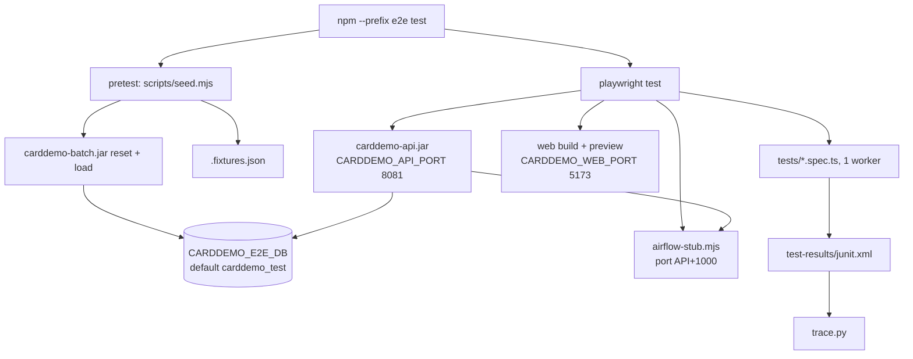

# End-to-end suite

Active contributors: factory-aj-pahl

`modernization/e2e/` is a Playwright project that exercises every web screen in a real Chromium browser against a freshly started API and web app on a seeded database. Test titles start with spec rule IDs, so the JUnit report doubles as traceability evidence. The same project also holds a smoke flow for the running stack and the browser half of the report check.

## Directory layout

```
modernization/e2e/
  package.json                  pretest = node scripts/seed.mjs; test = playwright test; typecheck = tsc -p .
  playwright.config.ts          main suite: starts Airflow stub, API, web app
  playwright.smoke.config.ts    smoke flow against the running stack
  playwright.report.config.ts   report check against the running stack (see cycle-data-and-report)
  scripts/seed.mjs              resets and loads the e2e database, writes .fixtures.json
  scripts/airflow-stub.mjs      stand-in for the Airflow 3 REST API
  tests/*.spec.ts               the main suite (11 spec files)
  tests/support.ts              fixtures from .fixtures.json, re-exports support-core.ts
  tests/support-core.ts         sign-on, message and program assertions, axe check
  tests/screen-walks.ts         keyboard-only walks of all 21 BMS maps
  smoke/smoke.spec.ts           two smoke tests
  verification/report.spec.ts   driven by verify_report.py
```

`test-results/`, `playwright-report/`, `node_modules/`, and `.fixtures.json` are git-ignored (`modernization/e2e/.gitignore`). Dependencies are `@playwright/test`, `@axe-core/playwright`, `typescript`, and `@types/node` (`modernization/e2e/package.json`).

## How a run works



### playwright.config.ts

- `testDir: './tests'`, `fullyParallel: false`, `workers: 1`, `retries: 0`, Chromium only (Desktop Chrome), trace kept on failure.
- Reporters: `list` and `junit` to `test-results/junit.xml`, which `modernization/verification/trace.py` reads by default.
- Three `webServer` entries, each started fresh (`reuseExistingServer: false`):
  1. `node scripts/airflow-stub.mjs` on `CARDDEMO_AIRFLOW_STUB_PORT` (default API port + 1000, so 9081), health URL `/health`, with an outbox under the OS temp directory.
  2. `java -jar ../backend/app/target/carddemo-api.jar` on `CARDDEMO_API_PORT` (default 8081), health URL `/actuator/health`, with `CARDDEMO_DB` set to the e2e database and `AIRFLOW_BASE_URL` pointed at the stub.
  3. `npm --prefix ../web run build && npm --prefix ../web run preview` on `CARDDEMO_WEB_PORT` (default 5173), with `CARDDEMO_API_URL` pointing at the API.

Because the suite starts its own servers on the stack's default ports, run it with the stack down or set other ports (the Makefile comment on `test-e2e` says the same). Setting different ports lets parallel worktrees run their own copies.

### scripts/seed.mjs

Runs before every `npm test`. It needs `CARDDEMO_DB_PASSWORD`. It calls the batch jar with `reset`, then `load` of `app/data/ASCII` with the USRSEC users and the IMS pending-authorization unload, then loads `dailytran.txt` a second time as `transact.txt` so the transaction screens have the 300 records their spec assumes. It then queries the database with `sqlcmd` for fixture values and writes them to `.fixtures.json`: two USER0001-linked accounts with a positive balance, one unlinked account, all USER0001 accounts and their card count, and three transaction IDs (lowest overall, lowest of a USER0001 card, lowest of a card USER0001 cannot see). Specs read these through `fixtures` in `modernization/e2e/tests/support.ts`, so they stay independent of run order.

### scripts/airflow-stub.mjs

A small Node HTTP server that stands in for the Airflow 3 REST API. It serves `/health`, issues a fixed bearer token on `POST /auth/token`, accepts `POST /api/v2/dags/carddemo_transaction_report/dagRuns` (rejecting bad or duplicate run IDs with 409), writes a one-line `TRANREPT.txt` into `<outbox>/reports/<runId>/`, and reports every run as `success` on `GET .../dagRuns/<id>`. Other paths answer 404 or 405. The report output is therefore a placeholder; real report content is checked by `verify-report` (see [Cycle, data, and report checks](cycle-data-and-report.md)).

## Spec files

Counts are `test(...)` calls in each file at commit `467e0f0`; the accessibility and capture files generate tests in a loop over `WALKS`.

| File | Tests | What it covers |
|:--|--:|:--|
| `modernization/e2e/tests/slice.spec.ts` | 14 | Sign-on (COSGN00C), main and admin menus and roles, bill payment (COBIL00C) including the receipt |
| `modernization/e2e/tests/account.spec.ts` | 12 | Account view (COACTVWC) and account update (COACTUPC), masking and scoping |
| `modernization/e2e/tests/cards.spec.ts` | 13 | Card list (COCRDLIC), view (COCRDSLC), update (COCRDUPC) |
| `modernization/e2e/tests/transaction.spec.ts` | 22 | Transaction list (COTRN00C) including a user with nothing in scope, view (COTRN01C), add (COTRN02C) |
| `modernization/e2e/tests/users.spec.ts` | 17 | User list, add, update, delete (COUSR00C-03C), creating and removing user `E2EUSR01` |
| `modernization/e2e/tests/trantype.spec.ts` | 14 | Transaction type list (COTRTLIC) and maintenance (COTRTUPC), including concurrent-change rejection |
| `modernization/e2e/tests/authorizations.spec.ts` | 6 | Pending authorization list (COPAUS0C) and details (COPAUS1C) on the IMS sample for USER0002 |
| `modernization/e2e/tests/reports.spec.ts` | 6 | Report request screen (CORPT00C) validation, confirmation, and a monthly report run and download via the stub |
| `modernization/e2e/tests/headers.spec.ts` | 8 | Header titles, transaction and program IDs, and the date and time on the first send and after ENTER, for eight screens |
| `modernization/e2e/tests/accessibility.spec.ts` | 43 generated | Per BMS map: an axe scan with no serious or critical violations and Tab reach in the initial, validation-error, and populated states, plus a keyboard-only flow; one final test asserts every owed state (63) and flow (21) was checked |
| `modernization/e2e/tests/capture.spec.ts` | 22 generated | Screenshots of every map's states for UI review plus an `INDEX.md`; skipped unless `CAPTURE_DIR` is set |

That is 112 hand-written tests plus 65 generated ones in the main suite. The accessibility suite writes `a11y-coverage.txt` and `a11y-owed.md` into `test-results/`.

### Helpers

| File | What it provides |
|:--|:--|
| `modernization/e2e/tests/support-core.ts` | `MSG` (verbatim COBOL message texts, trailing spaces included), `expectMessage` (exact message-line text), `expectProgram` (transaction and program shown and `main[data-ready]` visible), `open`, `signOn` (uses the demo password documented in the root README.md), `expectNoSeriousA11yViolations` (axe) |
| `modernization/e2e/tests/support.ts` | Re-exports `support-core.ts` and adds `fixtures` from `.fixtures.json`. The smoke and report specs import `support-core.ts` directly because they run without the seed |
| `modernization/e2e/tests/screen-walks.ts` | `ScreenWalk` objects (`map`, `program`, `flowIds`, `states`, `flow`) for all 21 BMS maps, using only a typed URL and the keyboard (Tab, typing, Enter, F-keys). Shared by the accessibility and capture specs; the user add, change, and delete walks depend on each other, so both specs run serially |

## Smoke flow

`make -C modernization smoke` runs `modernization/e2e/smoke/smoke.spec.ts` with `modernization/e2e/playwright.smoke.config.ts` (`testDir: './smoke'`, one worker, JUnit to `test-results/smoke-junit.xml`). It starts and seeds nothing; it uses the stack database (`CARDDEMO_DB`, default `carddemo`). Two serial tests: USER0001 views a linked account with a positive balance (SSN masked) and pays it off, after which the script checks the balance and the new transaction row with `sqlcmd`; and ADMIN001 lists the users. The account is looked up fresh each time, so the smoke can be repeated until every linked account is paid off.

## Rule IDs in test titles

`trace.py` does not read TypeScript. It reads the JUnit XML, takes the last segment of each test case name after ` › ` (the test title, without the describe prefix), and collects every token that matches its ID pattern: `BR-`, `VR-`, `NAV-`, `ERR-`, `Q-`, or `TS-` followed by a member and a number, or a `B-`/`C-` convention such as `C-MASK`. Examples:

```ts
test('TS-COACTVWC-02 BR-COACTVWC-01 C-MASK a linked account shows its details with SSN and government ID masked', ...)
test('BR-COSGN00C-07 the sign-on screen header shows the titles, CC00, COSGN00C, date, and time on every send', ...)
```

The accessibility flows put `walk.flowIds` at the front of their titles, so the NAV rules of each map are covered by the keyboard flow. Tokens the pattern does not match carry no evidence: `D-SEC-EXTRAS`, `D-RECEIPT`, `A-2`, and IDs without a number such as `VR-COSGN00C` in `slice.spec.ts` are descriptive only. A passed test covers all IDs in its title; a skipped test with IDs counts against the run. See [Traceability](traceability.md).

## Prerequisites

The API and batch jars built (`make -C modernization setup` or `backend`), `npm --prefix e2e ci`, Playwright's Chromium, SQL Server with `sqlcmd`, and `CARDDEMO_DB_PASSWORD` in the environment. `make -C modernization test-web` type-checks this project with `tsc -p .`.

## Key source files

| File | Purpose |
|:--|:--|
| `modernization/e2e/playwright.config.ts` | Main suite configuration and servers |
| `modernization/e2e/scripts/seed.mjs` | Database seed and fixtures |
| `modernization/e2e/scripts/airflow-stub.mjs` | Airflow REST stand-in |
| `modernization/e2e/tests/screen-walks.ts` | Keyboard walks of all maps |
| `modernization/e2e/tests/accessibility.spec.ts` | Owed accessibility states and flows |
| `modernization/e2e/smoke/smoke.spec.ts` | Smoke flow |

Related: [Testing](../how-to-contribute/testing.md), [Web app](../applications/web-app.md), [Screen API](../api/screen-api.md).
