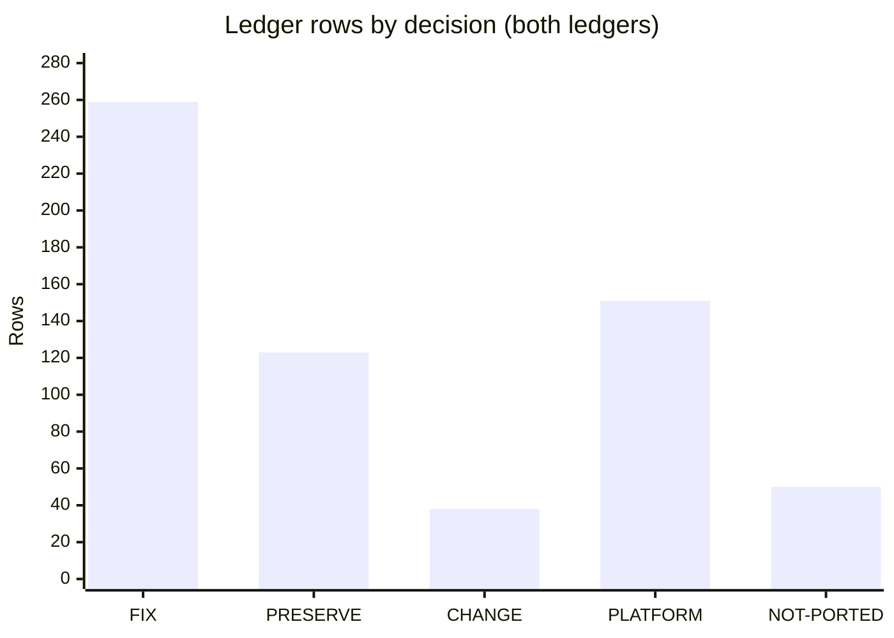

# Fidelity ledger

Active contributors: factory-aj-pahl

`modernization/decisions/` holds the fidelity ledger: one decision for every quirk (Q- ID) in the [specification](specification.md), plus the user decisions, recorded defaults, shared conventions, and reference patches that those rows cite. Any behavior not listed as FIX or CHANGE is preserved exactly as the spec describes it (`modernization/decisions/README.md`).

## Directory layout

```
modernization/decisions/
  README.md              D- user decisions, DF- defaults, decision values, classification policy, row format
  ledger-online.md       Q- rows for base online programs (CO*C) and CSUTLDTC, C- conventions (226 rows)
  ledger-batch-data.md   Q- rows for batch programs, entities.md, jobs.md, all module programs,
                         B- conventions, reference patches RP-* (395 rows)
```

## Decisions and defaults

`modernization/decisions/README.md` records 24 user decisions dated 2026-10-28 (`D-` IDs) and 13 recorded defaults (`DF-` IDs) that need no user decision. The ones most often cited:

| ID | Decision |
|:--|:--|
| D-FIDELITY | Same behavior as the COBOL, except the approved fixes in the ledger |
| D-FIX-SEC | Fix security defects: hashed passwords, server-side role checks, no password echo, masking on screens |
| D-FIX-DATA | Fix data-corruption and concurrency defects |
| D-FIX-FUNC | Fix clear functional bugs (interest skips last account, report totals, paging skips) |
| D-COSMETIC | Cosmetic quirks are not fixed: message and label text stays verbatim |
| D-USER-ACCT | Regular users see only their linked accounts and what hangs off them (see [Account scoping](../features/account-scoping.md)) |
| D-CYCLE, D-INTEREST | Batch cycle in runbook order; interest monthly on the first business day |
| D-BATCH-WINDOW | Online stays available during the batch cycle |
| D-PII-FILES | Export, import, and unload files keep full PII as a data-interchange contract, written mode 600 |
| DF-1 | Transaction types and categories are seeded from the base ASCII sample |
| DF-2 | The ASCII sample set is the migration baseline where ASCII and EBCDIC disagree |

## Decision values

| Value | Meaning |
|:--|:--|
| FIX | The target behaves as the row's "Target behavior" says, not as the COBOL does |
| PRESERVE | The target reproduces the COBOL behavior (verbatim cosmetic text and business choices included) |
| CHANGE | Behavior changes because of a user decision; the row must cite a D- ID |
| PLATFORM | An artifact of CICS, BMS, VSAM, JCL, or z/OS with no target counterpart; the row names the modern equivalent |
| NOT-PORTED | Dead or unreachable code, or unused definitions, with no observable behavior |

## Classification policy

The README fixes how a quirk is classified, so decisions are predictable:

1. Security (credentials, authorization, PII exposure, injection, secrets) -> FIX (D-FIX-SEC).
2. Data corruption, lost updates, races, non-atomic updates, ID collisions -> FIX (D-FIX-DATA).
3. Clear functional bug where the code contradicts its own intent -> FIX (D-FIX-FUNC).
4. Cosmetic (typos, truncated labels, spacing) -> PRESERVE (D-COSMETIC).
5. Plausible business or design choice (pay full balance only, DEFAULT disclosure-group fallback, interest truncation) -> PRESERVE, category business-choice.
6. 3270/CICS/JCL/z/OS artifacts (cursor placement, MDT, COMMAREA size, CEE3ABD, file open/close, GDGs) -> PLATFORM.
7. Dead code -> NOT-PORTED.
8. Quirks settled by a user decision -> CHANGE with the D- ID.

When a FIX touches a batch program whose output is compared with GnuCOBOL, the row's "Reference patch" column names the minimal COBOL change that makes the reference produce the fixed output.

## Row format

Both ledgers use one row per Q- ID, grouped under a heading per program (or per spec file for `entities.md` and `jobs.md`):

```
| Q ID | Summary | Category | Decision | Target behavior | Reference patch |
```

- **Category** is one of `security`, `data-corruption`, `concurrency`, `functional-defect`, `cosmetic`, `business-choice`, `platform`, `dead-code`, `user-decision` (the list in `modernization/verification/ledger_check.py`).
- **Decision** is a value above, optionally followed by cited IDs in parentheses, for example `CHANGE (D-USER-ACCT)`.
- **Target behavior** quotes message text verbatim in backticks; text marked **NEW** does not exist in the COBOL.
- **Reference patch** is an RP- ID, `n/a`, or a short note.

Example rows:

| Q ID | Decision | Target behavior (shortened) | Reference patch |
|:--|:--|:--|:--|
| Q-COBIL00C-01 | FIX | The same locked shared counter as Q-COTRN02C-01; concurrent payments never collide | n/a |
| Q-CBACT04C-01 | FIX | The last account receives its interest and its cycle totals are reset | RP-CBACT04C-1 |
| Q-CBTRN02C-07 | FIX | B-UOW: one database transaction per daily record; restart reruns the remaining records | none needed (error path) |

Each ledger also ends with "Business choices preserved", "New behavior introduced", and "Counts" sections. `ledger-batch-data.md` adds "Reference patches" and "Resolved questions" (which closes with "Still open: none.").

## Counts by decision

Computed from the `| Q-` rows of each file at commit `467e0f0`; they match the "Counts" tables in the files.

| Ledger | FIX | PRESERVE | CHANGE | PLATFORM | NOT-PORTED | Rows |
|:--|--:|--:|--:|--:|--:|--:|
| `modernization/decisions/ledger-online.md` | 103 | 60 | 6 | 37 | 20 | 226 |
| `modernization/decisions/ledger-batch-data.md` | 156 | 63 | 32 | 114 | 30 | 395 |
| Total | 259 | 123 | 38 | 151 | 50 | 621 |



The 297 FIX and CHANGE rows are the Q- IDs that [traceability](traceability.md) owes a test for (259 + 38). PRESERVE rows are covered through the BR/VR/NAV/ERR/TS rules they describe.

## Cross-cutting conventions (C- and B-)

Rules that many rows share are defined once and cited by ID. `trace.py` treats them as "CONVENTION" entries that can resolve an exclusion only when a passing test covers the convention itself.

Online conventions, defined in `modernization/decisions/ledger-online.md` and applied to the module screens too:

| ID | Meaning in one line |
|:--|:--|
| C-ROLE | The role comes from the server-side session; admin endpoints answer 403 to a USER, and the UI shows the main menu with the COBOL "Admin Only" message |
| C-SCOPE | A USER sees only linked accounts and their cards, transactions, and payments; an out-of-scope key gets the program's own not-found message |
| C-MASK | The server never sends a full card number, SSN, government ID, CVV, or password; card numbers show as twelve asterisks plus the last 4 |
| C-SESSION | The COMMAREA is replaced by the server session plus explicit request parameters; navigation never changes the signed-on user |
| C-RENDER | One request returns the final screen state of the COBOL task (the last SEND); intermediate SENDs are not reproduced |
| C-KEYLEN | Account numbers are typed as 11 digits and card and transaction IDs as 16; input is never left-padded |
| C-AUDIT | Defines the audit record and which events are audited (sign-on, user, account, and card changes) |
| C-SHORTREAD | CLEAR and PA1-PA3 are answered as the program's other non-accepted keys; the web UI offers no such key |

Batch conventions, defined in `modernization/decisions/ledger-batch-data.md`:

| ID | Meaning in one line |
|:--|:--|
| B-ABEND | A COBOL abend becomes job status ABENDED, abend code `U999` in the job log, and exit code 99; DISPLAY lines before it stay verbatim; the open transaction rolls back |
| B-DATE | Cycle jobs take a `YYYY-MM-DD` business date; missing or invalid stops the job with exit code 12 and a NEW message |
| B-UOW | Batch updates are database transactions: POSTTRAN commits per daily record, INTCALC per account; a failure rolls back only the current unit |
| B-MASK | No job writes a full card number, CVV, SSN, government ID, birth date, or EFT account to SYSOUT or a log |
| B-CYCLE | Daily POSTTRAN then CREASTMT; on the first business date of a month POSTTRAN, INTCALC, CREASTMT; mainframe-only steps have no target step |
| B-PARITY | Parity builds use `cobc -x -std=ibm -fsign=EBCDIC -I app/cpy`, load the ASCII sample, and patch scratch copies only |

See [Daily batch cycle](../features/daily-batch-cycle.md) for B-CYCLE in practice and [Batch parity](batch-parity.md) for B-PARITY.

## Reference patches

The "Reference patches" table in `modernization/decisions/ledger-batch-data.md` lists 22 RP- IDs. Two are implemented in Python by the harness; the other 20 are patch files in `modernization/verification/parity/patches/`. Line numbers in the table refer to the unpatched files in `app/`.

| RP | Ledger rows | Change (shortened) |
|:--|:--|:--|
| RP-BUILD-1 | Q-CBTRN02C-08 | Compile every parity build with `-fsign=EBCDIC` (no source change) |
| RP-DATA-1 | Q-ENT-02, Q-CBACT01C-07, Q-CBACT04C-05 | Move a disclosure group ID stored in the ZIP slot of `acctdata.txt` (bytes 103-112) to bytes 113-122 |
| RP-CBACT02C-1 | Q-CBACT02C-01, Q-READCARD-01 | Mask card number and CVV before `DISPLAY CARD-RECORD` |
| RP-CBACT03C-1 | Q-CBACT03C-01 | Delete the duplicate `DISPLAY CARD-XREF-RECORD` |
| RP-CBACT03C-2 | Q-CBACT03C-02, Q-READCARD-01 | Mask the card number in the xref display |
| RP-CBCUS01C-1 | Q-CBCUS01C-01 | Delete the duplicate `DISPLAY CUSTOMER-RECORD` |
| RP-CBCUS01C-2 | Q-CBCUS01C-02, Q-READCARD-01 | Mask SSN, government ID, and other PII in the customer display |
| RP-CBTRN01C-1 | Q-CBTRN01C-01 | Move the lookup block inside the not-end-of-file branch (one extra xref read removed) |
| RP-CBTRN01C-2 | Q-CBTRN01C-05 | Display daily records and card numbers masked |
| RP-CBTRN02C-1 | Q-CBTRN02C-11 | Widen `WS-TEMP-BAL` from `S9(09)V99` to `S9(11)V99` |
| RP-CBTRN02C-2 | Q-CBTRN02C-12 | `MOVE SPACES` before `INITIALIZE TRAN-CAT-BAL-RECORD` (space FILLER) |
| RP-CBACT04C-1 | Q-CBACT04C-01 | Update the last account after the main loop |
| RP-CBACT04C-2 | Q-CBACT04C-03 | Alternate key `WITH DUPLICATES` and accept status `02` in the xref lookup |
| RP-CBTRN03C-1 | Q-CBTRN03C-01 | Rewrite the date-range filter |
| RP-CBTRN03C-2 | Q-CBTRN03C-02, Q-CBTRN03C-03 | Write the last account totals at end of file |
| RP-CBTRN03C-3 | Q-CBTRN03C-08 | Display the transaction record with the card number masked |
| RP-CBSTM03A-1 | Q-CBSTM03A-01 | Delete the z/OS control-block walk (required to run off z/OS) |
| RP-CBSTM03A-2 | Q-CBSTM03A-04 | Enlarge the card and transaction tables (`OCCURS 51` to 500, 10 to 50) |
| RP-CBSTM03A-3 | Q-CBSTM03A-07 | Build name and address lines with trimmed parts |
| RP-CBSTM03A-4 | Q-CBSTM03A-03 | Handle an empty transaction file |
| RP-CBIMPORT-1 | Q-CBIMPORT-03 | `MOVE SPACES` before each of the five `INITIALIZE` statements |
| RP-CBIMPORT-2 | Q-CBIMPORT-04 | Widen `ERR-SEQUENCE` from `9(07)` to `9(09)` |

The patched copies are compiled in a temporary directory; `app/` is never written. `qualify_harness.py` check 3 proves each patch applies cleanly (no fuzz, no offset) and compiles, and that `git status --porcelain -- app/` is empty afterwards.

## The ledger check

`make -C modernization verify-ledger` runs `modernization/verification/ledger_check.py` (standard library only). For every `| Q-` row it checks:

- six non-empty cells; the Q- ID is a bold Q- ID in the spec and sits in the right ledger (online members are a fixed list in the script);
- the category is known and the decision matches `FIX|PRESERVE|CHANGE|PLATFORM|NOT-PORTED` with optional cited IDs;
- every cited D-/DF- ID exists in the README; CHANGE cites a D- ID; FIX and CHANGE rows have a target behavior;
- every RP- ID referenced is defined in an RP- table, and every B-/C- convention referenced is defined;
- no row or convention still asks for user confirmation, and no "Open questions for the user" section remains.

Across the files it also checks that every spec Q- ID appears exactly once, that each RP row names Q- IDs that have ledger rows, that the "Business choices preserved" list equals the PRESERVE business-choice rows, and that the "Counts" tables equal the rows. It prints per-ledger counts by decision and exits 1 on any problem.

## Entry points for modification

- **New quirk found:** add the bold Q- ID to the program's spec file, then a row in the right ledger, then update that ledger's Counts table. Run `verify-spec` and `verify-ledger`.
- **Changing a decision to FIX on a batch program:** add an RP- row and a patch file under `modernization/verification/parity/patches/`, add the patch to the program's `patches` tuple in `modernization/verification/parity/refrun.py`, and run `verify-harness` then `verify-batch`.
- **Resolving an owed rule without a test:** add a row to `modernization/verification/trace-exclusions.md` citing a PLATFORM or NOT-PORTED row or a B-/C- convention (see [Traceability](traceability.md)).

## Key source files

| File | Purpose |
|:--|:--|
| `modernization/decisions/README.md` | D- and DF- IDs, decision values, classification policy |
| `modernization/decisions/ledger-online.md` | Online Q- rows and C- conventions |
| `modernization/decisions/ledger-batch-data.md` | Batch, data, job, and module Q- rows, B- conventions, RP- table |
| `modernization/verification/ledger_check.py` | Ledger consistency check |
| `modernization/verification/parity/patches/` | The 20 reference patch files |

Related: [Design decisions](../background/design-decisions.md), [Migration context](../background/migration-context.md).
