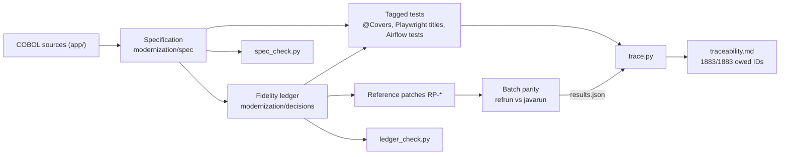
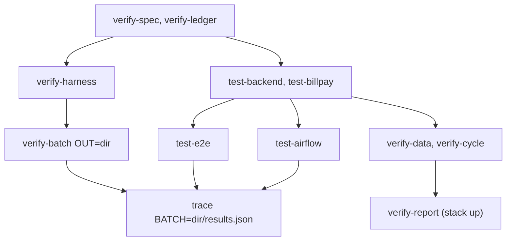

# Verification

Active contributors: factory-aj-pahl

The modernization claims to behave like the COBOL application except where an approved decision says otherwise. This section explains how that claim is backed by evidence: a specification of every COBOL rule, a ledger that decides each quirk, tests tagged with rule IDs, differential runs against the original COBOL compiled with GnuCOBOL, and a generated traceability matrix that joins them.

## Purpose

The rebuild does not trust a reviewer's reading of the Java. Every behavior the COBOL has is written down with an ID in `modernization/spec/`, every quirk is given a decision in `modernization/decisions/`, and every owed ID must end up attached to a test that ran and passed (or to an approved exclusion). For batch jobs, "behaves like the COBOL" is checked literally: the original program runs under GnuCOBOL on the same input, and the output files are compared byte for byte with the Java job's output.

## The evidence chain



1. **Specification.** Each of the 44 COBOL programs gets a structured English file with BR-, VR-, NAV-, ERR-, Q-, and TS- IDs, plus entity and job catalogs. `modernization/verification/spec_check.py` checks the spec against the COBOL tree. See [Specification](specification.md).
2. **Ledger.** Every Q- (quirk) ID gets one decision: FIX, PRESERVE, CHANGE, PLATFORM, or NOT-PORTED. FIX rows on batch programs carry a reference patch that makes the COBOL produce the fixed output, so parity can still be byte for byte. `modernization/verification/ledger_check.py` checks the ledger. See [Fidelity ledger](fidelity-ledger.md).
3. **Tests.** Java tests carry `@Covers("BR-...")`; Playwright and Airflow tests carry the IDs in their titles or names. See [End-to-end suite](e2e-suite.md) and [Testing](../how-to-contribute/testing.md).
4. **Parity.** The batch harness runs 44 owed (program, dataset) pairs on both sides and compares every output file. See [Batch parity](batch-parity.md). Three further checks cover the Airflow cycle, the data load/export round trip, and the browser-launched report. See [Cycle, data, and report checks](cycle-data-and-report.md).
5. **Traceability.** `modernization/verification/trace.py` derives the owed set from the spec and the ledger (not from the tests), joins it with test results, and writes `modernization/verification/traceability.md`. See [Traceability](traceability.md).

## Verification commands

All targets are in `modernization/Makefile` and run from the repository root as `make -C modernization <target>`. The verification targets need the secrets in the environment (`set -a; . ~/.carddemo/secrets.env; set +a`), as the Makefile header says.

| Target | Runs | What it proves |
|:--|:--|:--|
| `verify-spec` | `modernization/verification/spec_check.py` | Every program, copybook, JCL member, and user-visible message of the COBOL tree at commit `a3e87a4` appears in the spec; IDs are defined once; references resolve; each program sits in exactly one bounded context |
| `verify-ledger` | `modernization/verification/ledger_check.py` | Every spec Q- ID has exactly one valid ledger row; cited D-/DF-/RP-/B-/C- IDs exist; count tables match the rows |
| `verify-harness` | `modernization/verification/parity/qualify_harness.py` | The parity harness itself works: known COBOL outcomes reproduce, patches apply cleanly, the comparator catches planted mutations |
| `verify-batch` | `modernization/verification/parity/verify_batch.py` (builds the backend first) | Each owed Java batch job's outputs equal the patched GnuCOBOL reference on every owed dataset |
| `verify-cycle` | `modernization/verification/cycle/verify_cycle.py` (builds the backend first) | The Airflow `carddemo_daily_cycle` DAG ends in the same table and file state as the COBOL job chain, for a normal day and a month start |
| `verify-data` | `modernization/verification/data/verify_data.py` (builds the backend first) | Every owed sample data file loads into the database and exports back byte for byte |
| `verify-report` | `modernization/verification/schedule/verify_report.py` (stack must be up) | A report requested in the browser and run by the real Airflow equals CBTRN03C output on the same tables |
| `test-backend` | `mvn -f backend verify` | JUnit unit and integration tests of every Maven module, with `@Covers` tags |
| `test-billpay` | `mvn -f backend -pl billpay-service -am verify` | The standalone bill-payment service's HTTP tests |
| `test-e2e` | `npm --prefix e2e test` (seeds first) | Browser tests of every screen against a freshly started API and web app |
| `test-web` | `npm run typecheck` in `modernization/web` and `modernization/e2e` | The web app and e2e sources type-check |
| `test-airflow` | `modernization/airflow/tests/run_tests.py` | DAG and helper unit tests, with JUnit XML at `modernization/airflow/tests/junit.xml` |
| `smoke` | `npx playwright test -c playwright.smoke.config.ts` | A short browser flow works against the running stack |
| `trace` | `modernization/verification/trace.py` (optionally `BATCH=<results.json>`) | Every owed ID is covered by a passing test or resolved by an approved exclusion |

`modernization/verification/scan_secrets.py` has no Makefile target; it is run by hand (see [Traceability](traceability.md)).

## What CI does not run

`.github/workflows/ci.yml` runs only the root checks for the COBOL tooling (Python lint, type check, COBOL lint and syntax, docs check, coverage) and a gitleaks secret scan. None of the targets above run in GitHub Actions. They need SQL Server, a JDK, Node, GnuCOBOL, and an Airflow virtual environment on the machine, so the evidence in `modernization/verification/traceability.md` is produced locally and committed. Treat its header as a snapshot from the commit that regenerated it (commit `467e0f0`, "Regenerate traceability after the late review fixes").

## Suggested order



The `trace` target reads whatever result files exist when it runs, so run it after the suites whose evidence it should count. Note that `make trace` does not pass `--junit` for the Airflow results; to include them, call `python3 modernization/verification/trace.py --junit modernization/airflow/tests/junit.xml` directly.

## Directory layout

```
modernization/
  spec/                     specification (entities, jobs, components, programs/*.md)
  decisions/                fidelity ledger (README, ledger-online.md, ledger-batch-data.md)
  verification/
    spec_check.py           spec completeness check
    ledger_check.py         ledger consistency check
    trace.py                traceability matrix generator
    trace-exclusions.md     owed IDs resolved by a ledger row
    traceability.md         generated matrix
    scan_secrets.py         secret scan of tracked files
    parity/                 GnuCOBOL differential harness
    cycle/verify_cycle.py   Airflow cycle vs COBOL chain
    data/                   load/export round trip
    schedule/verify_report.py  browser report vs CBTRN03C
  e2e/                      Playwright suites
```

## Pages in this section

| Page | Covers |
|:--|:--|
| [Specification](specification.md) | `modernization/spec/` structure, ID conventions, how to read a program file |
| [Fidelity ledger](fidelity-ledger.md) | Decisions, decision values, B- and C- conventions, reference patches, counts |
| [Batch parity](batch-parity.md) | The GnuCOBOL differential harness and its qualification |
| [Cycle, data, and report checks](cycle-data-and-report.md) | `verify_cycle.py`, `verify_data.py`, `verify_report.py` |
| [End-to-end suite](e2e-suite.md) | Playwright configuration, seed, Airflow stub, spec files |
| [Traceability](traceability.md) | `trace.py`, the matrix, exclusions, `spec_check.py`, `scan_secrets.py` |

Related: [Architecture](../overview/architecture.md), [Migration context](../background/migration-context.md), [Daily batch cycle](../features/daily-batch-cycle.md).
