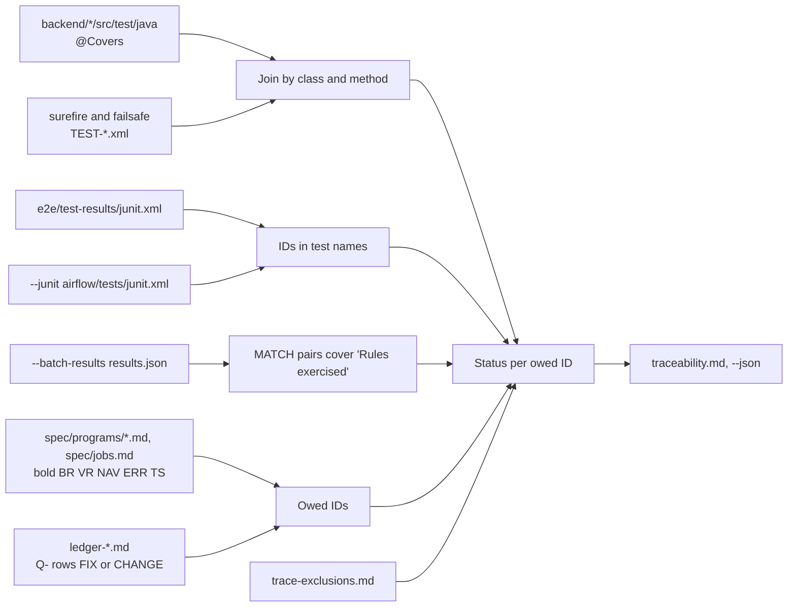

# Traceability

Active contributors: factory-aj-pahl

`modernization/verification/trace.py` builds the traceability matrix: every rule, scenario, and approved fix the spec and ledger define, joined with the tests that ran and passed. Its output, `modernization/verification/traceability.md`, reports 1883 of 1883 owed IDs covered or resolved at commit `467e0f0`. This page also covers the exclusions file, the `@Covers` annotation, and the two standalone checks `spec_check.py` and `scan_secrets.py`.

## How trace.py works



### The owed set

It is derived from the spec and ledger, never from the tests (`owed_ids()` in `modernization/verification/trace.py`):

- every bold `BR-`, `VR-`, `NAV-`, `ERR-`, and `TS-` ID in `modernization/spec/programs/*.md` and `modernization/spec/jobs.md`;
- every Q- ID whose ledger row decision is `FIX` or `CHANGE`. PRESERVE, PLATFORM, and NOT-PORTED quirks are not owed on their own.

The B- and C- convention rows of the ledgers are recorded as `CONVENTION` so that exclusions can cite them.

### Evidence

| Source | Read from | How IDs are found |
|:--|:--|:--|
| Java tests | `@Covers({...})` on a test method or class in `modernization/backend/*/src/test/java/**/*.java`, joined with `modernization/backend/*/target/surefire-reports/TEST-*.xml` and `failsafe-reports/TEST-*.xml` | By class and method name. A class-level `@Covers` applies to every method; an outer class's tags apply to nested classes. A tagged method with no JUnit result is "tagged but not run" |
| Playwright | `modernization/e2e/test-results/junit.xml` (always read when present) | IDs in the test title, the last segment of the name after ` › ` |
| Other name-tagged JUnit | `--junit <glob>`, for example `modernization/airflow/tests/junit.xml` from `make test-airflow` | IDs in the test name |
| Batch parity | `--batch-results <results.json>` from `verify_batch.py` | A `MATCH` pair covers every ID in its "Rules exercised" cell of `modernization/verification/parity/datasets.md`; ranges like `BR-CBACT04C-04..09` are expanded |

`make -C modernization trace` passes only `--batch-results` (via `BATCH=`). Add `--junit` by calling the script directly when the Airflow results should count.

### Status rules

- **covered**: at least one passing test carries the ID.
- **resolved by X**: the ID has a row in `modernization/verification/trace-exclusions.md` naming ledger row X, and X is NOT-PORTED, or X is PLATFORM or a B-/C- convention that is itself covered by a passing test. An exclusion that cites anything else is reported as a problem.
- **uncovered**: anything else.

The script exits 1 if any owed ID is uncovered, any test failed, a tagged test was skipped, a tagged method did not run, or an exclusion is malformed. Untagged skipped tests are listed in the JSON output but do not fail the run. Tags that name no spec or ledger ID are listed in their own section.

## The generated matrix

`modernization/verification/traceability.md` begins with "Generated by `verification/trace.py`; do not edit by hand." The header at commit `467e0f0` ("Regenerate traceability after the late review fixes"):

> Owed IDs covered or resolved: **1883/1883**. Tests: 1051 (1029 passed, 0 failed, 22 skipped, 0 tagged but not run).

| Type | Covered | Owed |
|:--|--:|--:|
| BR | 444 | 444 |
| VR | 171 | 171 |
| NAV | 150 | 150 |
| ERR | 287 | 287 |
| TS | 534 | 534 |
| Q | 297 | 297 |

The 297 Q- IDs are the FIX and CHANGE rows of the two ledgers (see [Fidelity ledger](fidelity-ledger.md)). Of the 1883, 1848 are covered by tests and 35 are resolved by exclusions. The 22 skipped tests carry no IDs; they are consistent with the 22 generated tests in `modernization/e2e/tests/capture.spec.ts`, which skip unless `CAPTURE_DIR` is set, but the matrix does not name them.

Sections of the file:

| Section | Content |
|:--|:--|
| By ID type | The table above |
| By program | Covered and owed per program or namespace (58 rows, including `jobs`, `CA7`, and job namespaces such as `CBPAUP0J`) |
| Uncovered (0) | "None." |
| Failed, skipped, or not-run tagged tests | Present only when there are any |
| Matrix | One row per owed ID: ID, status, up to three passing test names and a `(+N)` count |

Example matrix row (shortened): `| BR-COBIL00C-03 | covered | com.carddemo.billpay.BillPaymentScreenTest#show_balance_then_confirm_pays_the_full_balance; ... |`.

## Exclusions (trace-exclusions.md)

`modernization/verification/trace-exclusions.md` has 35 rows with three columns: owed ID, resolving ledger row, and reason. All 35 are used in the current matrix:

| Resolved by | Rows | Typical case |
|:--|--:|:--|
| B-ABEND (convention) | 6 | INTCALC and CREASTMT open and close no files, so file open and close errors have no counterpart; a table failure abends instead |
| PLATFORM Q- rows | 26 | MQ open, close, and RETRIEVE errors with no AMQP counterpart (COACCT01, CODATE01, COPAUA0C); DD-name dispatch in CBSTM03B; the z/OS control-block walk in CBSTM03A; menu programs that are no longer separately loaded |
| NOT-PORTED Q- rows | 3 | Unused message counters in COACCT01 and CODATE01; the `DUMMY` menu entries in COMEN01C |

Many reasons name the test that covers the modern equivalent, for example `CycleFailuresTest.creastmt_logs_its_input_and_output_locations_instead_of_the_dd_names` for BR-CBSTM03A-01.

## The @Covers annotation

`modernization/backend/test-support/src/main/java/com/carddemo/test/Covers.java` is a runtime-retained annotation for methods and types with one element, `String[] value()`. Its Javadoc says: "Tag only what the test's assertions check." Real usage, from `modernization/backend/billpay/src/test/java/com/carddemo/billpay/BillPaymentScreenTest.java:99-102`:

```java
@Covers({"TS-COBIL00C-01", "BR-COBIL00C-01", "BR-COBIL00C-03", "BR-COBIL00C-04", "BR-COBIL00C-05", "BR-COBIL00C-06",
    "BR-COBIL00C-08", "BR-COBIL00C-09", "NAV-COBIL00C-03", "Q-COBIL00C-01", "Q-COBIL00C-05", "Q-COBIL00C-06",
    "D-RECEIPT"})
void show_balance_then_confirm_pays_the_full_balance() {
```

`D-RECEIPT` there is documentation only: D- IDs are not owed, and the unknown-tag report considers only rule-shaped IDs.

`trace.py` does not load classes. It parses Java source text: it blanks comments and string literals to count braces, tracks nested class names, reads the quoted values inside each `@Covers(...)`, and attaches them to the following class or method declaration. At commit `467e0f0` there are 799 `@Covers` annotations in 76 Java files under `modernization/backend`. Because the join uses JUnit class and method names, a parameterized method's cases all share the method's tags.

## Spec check (spec_check.py)

`make -C modernization verify-spec` runs `modernization/verification/spec_check.py`. It owes programs, copybooks, JCL members, and user-visible messages from the COBOL tree at commit `a3e87a4`, and checks unique ID definitions, resolvable references, and bounded-context placement. Details are on the [Specification](specification.md) page. Unlike `trace.py`, it needs `git` (it reads `docs/INVENTORY.md` at the start commit with `git show`).

## Secret scan (scan_secrets.py)

`modernization/verification/scan_secrets.py` scans the content of every tracked file (`git ls-files`):

- for the exact values in the secrets file (`--secrets`, default `~/.carddemo/secrets.env`), in text and binary files;
- for eight credential patterns in text files: private key blocks, AWS access key IDs, GitHub tokens, Slack tokens, long bearer token literals, passwords in URLs, passwords in JDBC URLs, and `password|secret|api_key|token = <literal>` assignments. Placeholder and environment-reference values (for example `$VAR`, `process.env...`, `System.getenv...`, constant names) are allowed by `ALLOWED_VALUES`.

It prints `file:line` and the kind of finding, never the matched text, and exits 1 on any finding. There is no Makefile target and no CI step for it; GitHub CI runs gitleaks over history instead (`.github/workflows/ci.yml`).

## Entry points for modification

- **New test for an owed rule:** add `@Covers("<ID>")` to the Java test, or start the Playwright test title with the ID. Run the suite, then `trace`.
- **New owed rule:** add the bold ID to the spec; the next `trace` run owes it automatically.
- **Rule with no possible test:** add a `trace-exclusions.md` row citing a PLATFORM or NOT-PORTED ledger row or a convention, with the reason.
- **Batch rule:** list it in the "Rules exercised" cell of an owed pair in `modernization/verification/parity/datasets.md` and run `trace BATCH=<out>/results.json` after `verify-batch`.

## Key source files

| File | Purpose |
|:--|:--|
| `modernization/verification/trace.py` | Matrix generator |
| `modernization/verification/traceability.md` | Generated matrix |
| `modernization/verification/trace-exclusions.md` | Approved exclusions |
| `modernization/backend/test-support/src/main/java/com/carddemo/test/Covers.java` | Rule-ID annotation |
| `modernization/verification/spec_check.py` | Spec completeness check |
| `modernization/verification/scan_secrets.py` | Secret scan of tracked files |

Related: [End-to-end suite](e2e-suite.md), [Testing](../how-to-contribute/testing.md), [Schema and migration](../modules/schema-and-migration.md) (where test-support lives), [Security](../security.md).
