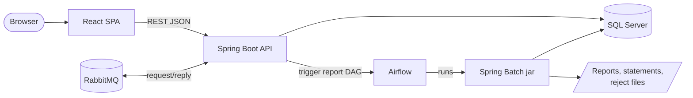
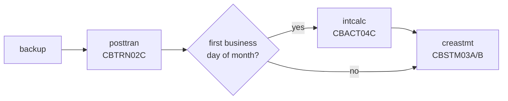

# CardDemo target architecture

Status: **approved** (2026-10-28) and being implemented. Derived from the structured specification in
`spec/` (44 programs, 36 entities, 46 jobs). Decisions referenced as D-, DF-, and Q- IDs are in
`decisions/`; where this document and a decision disagree, the decision governs.

## 1. Mapping at a glance

| Mainframe layer | Today | Target |
|:--|:--|:--|
| Green screens | 21 BMS maps, CICS pseudo-conversational programs, PF keys, COMMAREA state | React + TypeScript single-page app; one route per screen; keyboard shortcuts keep F3/F5/F7/F8/F12 meaning; state in URL and server session, not COMMAREA |
| Online logic | 18 base CICS programs (+9 in optional modules) | Spring Boot (Java 21) REST API, one module per bounded context, OpenAPI contract |
| Batch logic | 13 base batch programs | Spring Batch jobs in a separate runnable jar, same inputs and outputs (fixed-width files kept where they are interfaces) |
| JCL + CA7/Control-M | 38 base JCL members, 2 schedulers | Apache Airflow DAGs calling the batch jar; setup JCL becomes Flyway migrations and a data loader; CICS open/close jobs disappear |
| VSAM KSDS + AIX | 10 KSDS files, 3 alternate indexes | Microsoft SQL Server tables with primary keys, foreign keys, and secondary indexes |
| Db2 / IMS / MQ (optional modules) | Db2 tables, IMS HIDAM segments, MQ request/reply | SQL Server tables (IMS parent/child -> two tables); MQ request/reply moves to RabbitMQ queues with the COBOL queue names, plus equivalent REST endpoints (D-MQ) |
| Security | RACF + plaintext USRSEC passwords, no authorization checks in programs | Spring Security, BCrypt password hashes, role checks enforced on the server |

## 2. Runtime view



### Screen API

Each CICS program with a map is one resource, `/api/screens/<PROGRAM>` (for example
`/api/screens/COBIL00C`). `GET` is first entry; `POST` is one screen turn with the attention key
(`ENTER`, `PF3`, ...) and the input fields. Every response is the same envelope (C-RENDER):

```json
{ "fields": { "accountId": "00000000001", "currentBalance": "+00000000194.00" },
  "message": "Confirm to make a bill payment...", "messageColor": "RED",
  "focus": "confirm", "navigate": null }
```

The server decides what each key means, including the invalid-key message, so key handling stays in
one place. `navigate` replaces XCTL: the web app shows that program next (`EXIT` = signed off).
Message texts are the COBOL texts verbatim. Sessions are server-side (D-AUTH); the web app sends the
CSRF token from the `XSRF-TOKEN` cookie. The web app holds keys until a screen's first entry has
arrived, as a 3270 keyboard lock would. `GET /api/session` returns the signed-on user.

- The report request screen (CORPT00C) today writes JCL to the internal reader. In the target it
  calls the Airflow REST API to start the `transaction_report` DAG with the date range, and shows
  the run ID and status. The report file is downloadable from the web app.
- The batch cycle no longer closes and reopens files. Online stays available during the cycle
  (D-BATCH-WINDOW): database transactions with row locks give batch and online consistent access,
  and there is no maintenance flag or "batch window" refusal of online writes.

## 3. Bounded contexts and modules

Each context is a Maven module under `backend/` with three packages: `web` (controllers),
`internal` (services and repositories), and `api` (the published interfaces and records other
contexts may use). They run together in one Spring Boot service (`app`, a modular monolith) and can
be deployed separately because a context reaches another only through its `api` package; the
architecture test `app/.../ModuleBoundariesTest` enforces this. That is what makes **selective
conversion** possible: `billpay-service` runs bill payment alone as its own service (port 8091) on
the same modules, and `spec/components.md` lists exactly what each context needs from the rest.
Shared code without business rules (screen envelope, formatting, security principal, clock, batch
job log) is in `common`; the schema is in `schema` (Flyway), the sample-data loader and exporter in
`migration`.

| Context | COBOL programs | Owns | API (sketch) |
|:--|:--|:--|:--|
| IAM & Navigation | COSGN00C, COMEN01C, COADM01C, COUSR00C-03C | users, menu options | `POST /api/auth/login`, `GET /api/menu`, `/api/users` CRUD + paging |
| Account & Customer | COACTVWC, COACTUPC | accounts, customers | `GET /api/accounts/{id}`, `PUT /api/accounts/{id}` (account + customer in one DB transaction, optimistic version check) |
| Card | COCRDLIC, COCRDSLC, COCRDUPC | cards, card cross-reference | `GET /api/cards?acct=&card=&page=`, `GET/PUT /api/cards/{num}` |
| Transaction | COTRN00C-02C, CSUTLDTC | transactions | `GET /api/transactions?page=`, `GET /api/transactions/{id}`, `POST /api/transactions` |
| Bill Payment | COBIL00C | (uses account, xref, transaction) | `GET /api/bill-payments/{acct}` (balance), `POST /api/bill-payments` |
| Reporting | CORPT00C, CBTRN03C | report runs | `POST /api/reports` (monthly / yearly / custom), `GET /api/reports/{runId}` |
| Batch cycle | CBTRN01C, CBTRN02C, CBACT04C, CBSTM03A/B, COMBTRAN | category balances, disclosure groups, daily transactions | Spring Batch jobs `posttran`, `intcalc`, `combtran`, `creastmt`, `tranrept` |
| Reference data | TRANTYPE/TRANCATG files; optional COTRTLIC, COTRTUPC, COBTUPDT | transaction types and categories | `/api/transaction-types` CRUD (optional module) |
| Data exchange & utilities | CBEXPORT, CBIMPORT, CBACT01C-03C, CBCUS01C | export file format | batch jobs `export`, `import`, listing jobs |
| Authorizations (optional) | COPAUA0C, COPAUS0C-2C, CBPAUP0C, IMS utilities | pending auth summary + detail, fraud records | RabbitMQ request/reply plus `POST /api/authorizations`, list/detail/fraud screens, `purge` batch job |
| MQ inquiry (optional) | COACCT01, CODATE01 | none | RabbitMQ `CARD.DEMO.REQUEST.DATE` -> `CARD.DEMO.REPLY.DATE` (and the ACCT pair), plus `GET /api/inquiry/account/{id}`, `GET /api/inquiry/date` |

Screen endpoints follow the screen API above; the sketches in the last column describe the
non-screen endpoints and jobs.

Deviations in IAM and Card (with reasons):

- User update (COUSR02C) checks concurrency with a version that is a SHA-256 fingerprint of names,
  type, password hash, and account links, not a `rowversion`: the links live in `user_account`
  rows, so a `rowversion` on the user row would miss a concurrent link change.
- Card update (COCRDUPC) keeps the COBOL read-compare-rewrite: the row is read with an update lock
  and compared with the fetched CVV, name, expiry, and status (BR-COCRDUPC-06), because the spec
  makes only those fields part of the check (a change to the account ID does not block a save).
- The user screens check that linked accounts exist by reading the `account` table directly,
  since the Account context publishes no existence check yet. Move this to `account/api` when it does.
- Card components resolve `AccountScope` and `AuditLog` (implemented in IAM) per call through
  `ObjectProvider`, so contexts that depend on Card without IAM (account, transaction, cycle, ...)
  still start.
- Only the screen endpoints exist for these contexts; the `/api/users` and `/api/cards` sketches
  are not built.

Deviations in Authorizations (with reasons):

- The IMS database becomes `pending_auth_summary` (root, key account ID) and `pending_auth_detail`
  (child). The inverted-time detail key is replaced by an identity `auth_id` and the insert
  timestamp `auth_ts`; "IMS key order" is `auth_ts DESC, auth_id DESC`, so two authorizations in the
  same millisecond keep a stable order. The migration rejects the unload's all-spaces root (its key
  is not valid packed decimal), so the sample loads 21 summaries and 202 details.
- A PSB schedule is the start of a database transaction and SYNCPOINT its commit or rollback.
  Where a program shows a DL/I status the target shows the SQLSTATE of the failure, or the exception
  class name when there is none; `GE` is still shown for "not found". The batch `KFB AREA` lines show
  the account ID only (the root key), not the whole key feedback area.
- COPAUS2C messages show the SQL Server error number with the Db2 negative sign as `+9(06)` (for
  example `-000208` for a missing table) and the 5-character SQLSTATE. `auth_fraud_report` is
  keyed by card number, `auth_ts`, and `auth_id`, because two authorizations of a card can share a
  timestamp (Q-COPAUS2C-03).
- COPAUS0C and the COPAUA0C engine read the account status and limits and the customer name,
  address and phone through `account/api` `AccountProfiles`, and the cross-reference through
  `card/api` `CardDirectory`; the authorization module's SQL touches only its own tables. The
  engine's reads are plain reads inside its per-request transaction (it never updates the account).
  A USER sees only linked accounts; any other account is answered as not found in the
  cross-reference, the same text as a missing account.
- The account in view and the selected authorization (CDEMO-ACCT-ID, CDEMO-CPVS-PAU-SELECTED) are
  kept in the server session instead of the COMMAREA. Entering COPAUS0C from the menu with no
  account in the session shows the empty prompt.
- PAUDBUNL and DBUNLDGS read both tables in one SERIALIZABLE read-only transaction, so the output
  files are a consistent snapshot (SQL Server snapshot isolation is not enabled on the database).
  The NEW end-of-run count lines are `ROOT SEGMENTS UNLOADED  :` and `CHILD SEGMENTS UNLOADED :`
  (PAUDBUNL, DBUNLDGS), and `ROOT SEGMENTS INSERTED  :`, `CHILD SEGMENTS INSERTED :`,
  `DUPLICATES SKIPPED      :`, `ORPHAN CHILDREN SKIPPED :`, `INVALID KEYS REJECTED   :` (PAUDBLOD),
  each followed by a 9-digit count. CBPAUP0C prints its counters as GnuCOBOL displays a
  `PIC S9(8) COMP` field (`+00000022`).
- The batch jar runs the IMS jobs as `CBPAUP0C [sysin=...]`, `PAUDBUNL`, `DBUNLDGS`, and `PAUDBLOD`
  (`rootFile=` and `childFile=` paths); Airflow DAG `carddemo_auth_purge` runs CBPAUP0J with the
  SYSIN card built from its params. The job log replaces SYSOUT.

### Messaging (D-MQ)

RabbitMQ (vhost `carddemo`) keeps the COBOL queue names. A reply goes to the request's `reply_to`
(the fixed reply queue when absent) with `correlation_id` = the request `message_id`. Request
queues are quorum queues with a delivery limit of 3 and dead-letter to `CARD.DEMO.DLQ`; reply
queues are bounded. Queue replies keep the legacy text layouts; the REST equivalents return JSON
(decimal amounts, ISO 8601 times).

- An authorization request (COPAUA0C) is split on commas as the COBOL `UNSTRING` does: text after the
  18th field is ignored and fields the message does not reach are blank, and the request is decided and
  answered (a blank or non-numeric amount is declined `05`/`9000`, Q-COPAUA0C-12). A request of at most
  500 bytes is read byte for byte (ISO-8859-1, one character per byte), so control characters such as a
  trailing CRLF or a tab, and bytes above 0x7E, stay in their fields as received and are echoed in the
  reply; only the space padding of a field is removed. Only a request over the 500-byte buffer (the
  COBOL MQGET failure, ERR-COPAUA0C-02) is logged as M003 and dead-lettered at once, as is a request
  whose transaction fails (Q-COPAUA0C-06); any other failure is redelivered up to the delivery limit.
- `GET /api/inquiry/account/{id}` takes the account ID as the queue does: exactly 11 digits, not all
  zero (C-KEYLEN, never left-padded). Anything else is answered 400 with the queue's invalid-request
  text as `{"message": ...}`, showing the key as the queue would for `INQA` followed by the ID (a
  short ID space-padded, a longer one cut to 11 characters); a missing or out-of-scope account is
  404 with the not-found text.

## 4. Data

- Schema from `spec/entities.md`: DECIMAL for signed zoned amounts, DATE / DATETIME2 for the
  text dates and timestamps, CHAR for fixed codes, a `rowversion` column on rows edited online
  (replaces the read-compare-rewrite check in COACTUPC and COCRDUPC).
- Flyway migrations replace the IDCAMS DEFINE jobs. A loader reads the ASCII sample files,
  decodes overpunched signs, and loads every table; a reverse exporter writes the fixed-width
  layout back so the load can be checked by round-trip.
- Online transaction IDs (COBIL00C and COTRN02C) still follow "highest ID + 1", but are taken
  under a row lock on a shared counter held until the writing transaction ends, which fixes the
  race (Q-COTRN02C-01, Q-COBIL00C-01).
- GDG backups (TRANBKP) become snapshot tables written by the BACKUP step of the DAG before
  posting, so a bad run can be rolled back. BACKUP for a date whose POSTTRAN has completed (and
  was not undone by a restore) is refused with exit 8, so a repeated trigger of the cycle stops
  at BACKUP and no backup of a posted state exists. `RESTORE businessDate=<date>` therefore
  restores the latest backup for the date, the state just before its most recent posting, and
  keeps online changes made before that backup; `RESTORE backupId=<n>` restores one specific
  backup.

## 5. Batch and scheduling



- Spring Batch jobs read and write SQL Server, and still emit the same file outputs (reject
  file, transaction report, text and HTML statements, export file) in the same byte layout, so
  they can be compared with the COBOL originals.
- Batch commands run as `java -jar carddemo-batch.jar <JOB> businessDate=YYYY-MM-DD ...` with exit
  codes 0 (ok), 4 (warnings), 8 (refused, for example already completed), 12 (invalid business date,
  B-DATE), 16 (usage; for the IMS module programs CBPAUP0C, PAUDBUNL, PAUDBLOD, and DBUNLDGS also the
  program's own RETURN-CODE 16 from 9999-ABEND, `ExitCodes.PROGRAM_RC16`, told apart by the `usage:` line
  a usage error writes to stderr), 99 (abend, B-ABEND). Each daily record commits with its effects (B-UOW), so a
  failed run restarts from its last committed record. The jar also carries `load`, `export`, and
  `reset` for the data migration.
- Airflow tasks call the jar through `airflow/dags/carddemo_batch.py`: 0 and 4 succeed, every other
  code fails the task without retry. Inputs come from `$CARDDEMO_INBOX/<date>/`, outputs go to
  `$CARDDEMO_OUTBOX/<date>/`.
- Airflow DAG `carddemo_daily_cycle` follows the runbook order (the CA7 and Control-M definitions
  in the repository are inconsistent with each other and with the runbook; see `spec/jobs.md`).
  Interest runs on the first business day of each month (D-INTEREST) and inserts its transactions
  directly into the transaction table, so the COMBTRAN sort/merge and TRANBKP/TRANIDX steps disappear.
  The table keeps full history; statements cover only the current cycle (D-HISTORY).
  `carddemo_transaction_report` is triggered on demand.
- Listing jobs (READACCT etc.) become optional DAG tasks or CLI commands; CLOSEFIL/OPENFIL,
  TRANIDX, FTP, and internal-reader jobs have no target equivalent.

## 6. Verification approach

- **Batch:** differential testing (`verification/parity/`, `make -C modernization verify-batch`). The
  same dataset is run through the original COBOL under GnuCOBOL (`-std=ibm -fsign=EBCDIC`) with the
  ledger's reference patches applied to temporary copies (`refrun.py`), and through the Java job on a
  fresh database (`javarun.py`); output files, return code, SYSOUT, and exported tables must match
  record for record (`compare.py`). Owed program x dataset pairs are listed in
  `verification/parity/datasets.md`.
- **Online:** the 528 spec test scenarios become API tests and browser tests. A traceability
  matrix maps every BR, VR, NAV, and ERR rule to a test or to an approved exclusion.
- **Data:** every sample file loads; row counts and a byte-for-byte round-trip export match.
- **Schedule:** a full Airflow run of the daily cycle produces the same end state as the GnuCOBOL
  run of the same chain.
- **Independent review** of the spec against the COBOL and of the delivered app against the spec.
