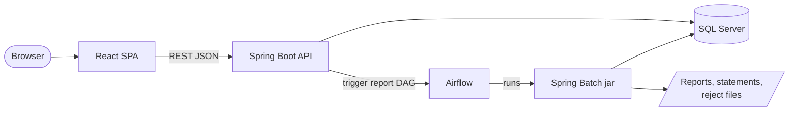
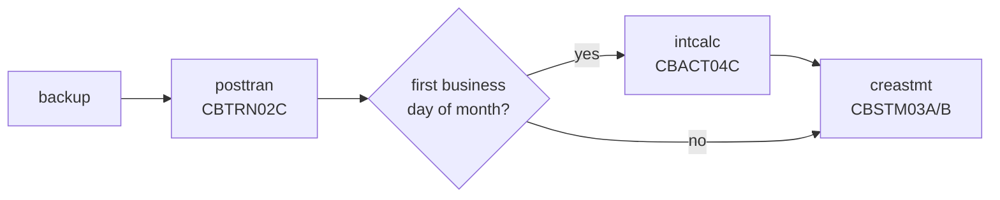

# CardDemo target architecture (proposal)

Status: **proposal for review**. Derived from the structured specification in `spec/`
(44 programs, 36 entities, 46 jobs). Nothing here is binding until the mission promise
is approved.

## 1. Mapping at a glance

| Mainframe layer | Today | Target |
|:--|:--|:--|
| Green screens | 21 BMS maps, CICS pseudo-conversational programs, PF keys, COMMAREA state | React + TypeScript single-page app; one route per screen; keyboard shortcuts keep F3/F5/F7/F8/F12 meaning; state in URL and server session, not COMMAREA |
| Online logic | 18 base CICS programs (+9 in optional modules) | Spring Boot (Java 21) REST API, one module per bounded context, OpenAPI contract |
| Batch logic | 13 base batch programs | Spring Batch jobs in a separate runnable jar, same inputs and outputs (fixed-width files kept where they are interfaces) |
| JCL + CA7/Control-M | 38 base JCL members, 2 schedulers | Apache Airflow DAGs calling the batch jar; setup JCL becomes Flyway migrations and a data loader; CICS open/close jobs disappear |
| VSAM KSDS + AIX | 10 KSDS files, 3 alternate indexes | Microsoft SQL Server tables with primary keys, foreign keys, and secondary indexes |
| Db2 / IMS / MQ (optional modules) | Db2 tables, IMS HIDAM segments, MQ request/reply | SQL Server tables (IMS parent/child -> two tables), REST endpoints in place of MQ request/reply |
| Security | RACF + plaintext USRSEC passwords, no authorization checks in programs | Spring Security, BCrypt password hashes, role checks enforced on the server |

## 2. Runtime view

- The report request screen (CORPT00C) today writes JCL to the internal reader. In the target it
  calls the Airflow REST API to start the `transaction_report` DAG with the date range, and shows
  the run ID and status. The report file is downloadable from the web app.
- The batch cycle no longer closes and reopens files. Database transactions give batch and online
  consistent access; the cycle optionally sets a maintenance flag that makes online writes return
  "system in batch window" (decision point).

## 3. Bounded contexts and modules

Each context is a Maven module with its own REST controllers, services, and repositories. They
run together in one Spring Boot service (a modular monolith) and can be split into separate
services later because they only talk to each other through published service interfaces. That
is what makes **selective conversion** possible: one context can be converted alone, and
`spec/components.md` lists exactly what each context needs from the rest of the system.

| Context | COBOL programs | Owns | API (sketch) |
|:--|:--|:--|:--|
| IAM & Navigation | COSGN00C, COMEN01C, COADM01C, COUSR00C-03C | users, menu options | `POST /api/auth/login`, `GET /api/menu`, `/api/users` CRUD + paging |
| Account & Customer | COACTVWC, COACTUPC | accounts, customers | `GET /api/accounts/{id}`, `PUT /api/accounts/{id}` (account + customer in one DB transaction, optimistic version check) |
| Card | COCRDLIC, COCRDSLC, COCRDUPC | cards, card cross-reference | `GET /api/cards?acct=&card=&page=`, `GET/PUT /api/cards/{num}` |
| Transaction | COTRN00C-02C, CSUTLDTC | transactions | `GET /api/transactions?page=`, `GET /api/transactions/{id}`, `POST /api/transactions` |
| Bill Payment | COBIL00C | (uses account, xref, transaction) | `GET /api/bill-payments/{acct}` (balance), `POST /api/bill-payments` |
| Reporting | CORPT00C, CBTRN03C | report runs | `POST /api/reports` (monthly / yearly / custom), `GET /api/reports/{runId}` |
| Batch cycle | CBTRN01C, CBTRN02C, CBACT04C, CBSTM03A/B, COMBTRAN | category balances, disclosure groups, daily transactions | Spring Batch jobs `posttran`, `intcalc`, `combtran`, `creastmt`, `tranrept` |
| Reference data | TRANTYPE/TRANCATG files; optional COTRTLIC, COTRTUPC, COBTUPDT | transaction types and categories | `/api/transaction-types` CRUD (optional module) |
| Data exchange & utilities | CBEXPORT, CBIMPORT, CBACT01C-03C, CBCUS01C | export file format | batch jobs `export`, `import`, listing jobs |
| Authorizations (optional) | COPAUA0C, COPAUS0C-2C, CBPAUP0C, IMS utilities | pending auth summary + detail, fraud records | `POST /api/authorizations` (replaces MQ), list/detail/fraud endpoints, `purge` batch job |
| MQ inquiry (optional) | COACCT01, CODATE01 | none | `GET /api/inquiry/account/{id}`, `GET /api/inquiry/date` |

## 4. Data

- Schema from `spec/entities.md`: DECIMAL for signed zoned amounts, DATE / DATETIME2 for the
  text dates and timestamps, CHAR for fixed codes, a `rowversion` column on rows edited online
  (replaces the read-compare-rewrite check in COACTUPC and COCRDUPC).
- Flyway migrations replace the IDCAMS DEFINE jobs. A loader reads the ASCII sample files,
  decodes overpunched signs, and loads every table; a reverse exporter writes the fixed-width
  layout back so the load can be checked by round-trip.
- Transaction IDs come from a database sequence instead of "highest ID + 1" (fixes a race in
  COBIL00C and COTRN02C, if approved).
- GDG backups (TRANBKP) become snapshot tables or database backups taken by the DAG before
  posting, so a bad run can be rolled back.

## 5. Batch and scheduling

- Spring Batch jobs read and write SQL Server, and still emit the same file outputs (reject
  file, transaction report, text and HTML statements, export file) in the same byte layout, so
  they can be compared with the COBOL originals.
- Airflow DAG `carddemo_daily_cycle` follows the runbook order (the CA7 and Control-M definitions
  in the repository are inconsistent with each other and with the runbook; see `spec/jobs.md`).
  Interest runs on the first business day of each month (D-INTEREST) and inserts its transactions
  directly into the transaction table, so the COMBTRAN sort/merge and TRANBKP/TRANIDX steps disappear.
  The table keeps full history; statements cover only the current cycle (D-HISTORY).
  `carddemo_transaction_report` is triggered on demand.
- Listing jobs (READACCT etc.) become optional DAG tasks or CLI commands; CLOSEFIL/OPENFIL,
  TRANIDX, FTP, and internal-reader jobs have no target equivalent.

## 6. Verification approach

- **Batch:** differential testing. The same input data is run through the original COBOL under
  GnuCOBOL (with mainframe sign semantics, `-fsign=EBCDIC`) and through the Java jobs; outputs and
  resulting table contents must match exactly, except for approved defect fixes whose expected
  difference is stated in advance.
- **Online:** the 523 spec test scenarios become API tests and browser tests. A traceability
  matrix maps every BR, VR, NAV, and ERR rule to a test or to an approved exclusion.
- **Data:** every sample file loads; row counts and a byte-for-byte round-trip export match.
- **Schedule:** a full Airflow run of the daily cycle produces the same end state as the GnuCOBOL
  run of the same chain.
- **Independent review** of the spec against the COBOL and of the delivered app against the spec.
