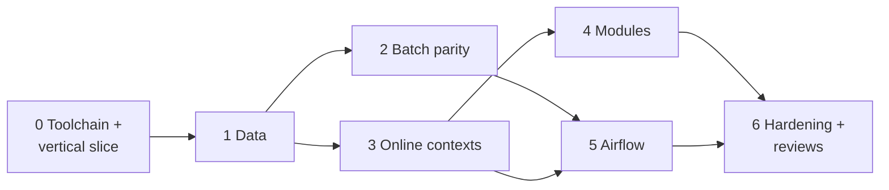

# CardDemo modernization: implementation plan

This plan describes the current approach. The obligations are in `promise.md`; this file adds none.

## Repository layout (new, under `modernization/`)

| Path | Contents |
|:--|:--|
| `spec/` | Structured natural-language specification (done in planning) |
| `decisions/` | User decisions and the fidelity ledger |
| `architecture.md` | Target architecture |
| `backend/` | Maven multi-module build: `common` (shared kernel: date validation from CSUTLDTC, money/sign codecs, masking, paging, message catalog), one module per bounded context (`iam`, `account`, `card`, `transaction`, `billpay`, `reporting`, `refdata`, `authorization`, `inquiry`), `app` (Spring Boot assembly of all contexts), `billpay-service` (standalone bill-payment microservice), `batch` (Spring Batch jobs + data loader/exporter CLI) |
| `backend/db/migration` | Flyway SQL migrations (schema, reference data) |
| `web/` | React + TypeScript (Vite) single-page app |
| `airflow/` | DAGs, Airflow config template, start/stop scripts |
| `verification/` | GnuCOBOL reference harness, reference patches (`.patch`, applied to a temp copy, never to `app/`), dataset generator, differential comparator, traceability tooling |
| `e2e/` | Playwright browser tests |
| `Makefile`, `README.md` | One-command build, migrate, load, start, test |

## Approach and sequencing

0. **Toolchain and vertical slice.** Install Playwright browsers. Build a thin end-to-end slice
   that exercises every architectural seam: Flyway schema for account, xref, transaction, users;
   loader for those files; sign-on + main menu + bill payment through React -> Spring Boot -> SQL
   Server; Spring Batch POSTTRAN with a first differential comparison against GnuCOBOL; one Airflow
   DAG invoking the batch jar; one RabbitMQ request/reply round trip. Fix architectural problems here
   before scaling out.
1. **Data.** Complete schema from `spec/entities.md` (DECIMAL amounts, DATE/DATETIME2, rowversion on
   online-edited rows, sequences for transaction ids, user_account link table). Loader for every
   sample file (overpunch sign, packed/binary fields in the IMS and export data, low-values -> NULL).
   Exporter back to the fixed-width layouts; round-trip test.
2. **Batch parity.** Reference harness compiles each runnable program with GnuCOBOL
   (`-std=ibm -fsign=EBCDIC`), applies the ledger's reference patches to a temp copy, and runs
   it on a dataset; the Java job runs on the same dataset via the loader; the comparator diffs every
   output file byte for byte and the resulting tables via the exporter. Datasets: the sample data plus
   generated edge datasets. Port order: CBTRN02C, CBACT04C, CBSTM03A/B, CBTRN03C,
   CBTRN01C, listings, CBEXPORT/CBIMPORT, then module batch (COBTUPDT, CBPAUP0C, IMS unload/load as
   table unload/load in the original flat formats).
3. **Online contexts.** Per context: service + REST controllers + API tests generated from the
   spec's TS- scenarios (test names carry the rule IDs), then the React screens and Playwright tests.
   Order: common kernel, IAM (incl. BCrypt migration of USRSEC and the user-account link), refdata,
   card, account, transaction, bill payment, reporting (report request -> Airflow REST API).
4. **Optional modules.** Transaction-type screens and batch; authorization engine as a RabbitMQ
   request/reply consumer plus REST, summary/detail/fraud screens, purge job; MQ inquiry services.
5. **Airflow.** DAGs: `carddemo_daily_cycle` (backup -> posttran -> [intcalc on the first business day
   of the month] -> creastmt; interest rows are inserted directly, so no combtran step),
   `carddemo_transaction_report` (parameterized, API-triggered), `carddemo_auth_purge`,
   `carddemo_trantype_maintenance`. The on-demand listing and export/import jobs (READACCT, READCARD,
   READCUST, READXREF, CBEXPORT, CBIMPORT) are batch-jar CLI commands, as architecture.md allows; no
   extra DAGs, since P-SCHED owes DAGs only for recurring jobs. Each task runs the batch jar
   with job parameters; failures stop the DAG like a nonzero RC stops the cycle; RC 4 maps to success
   with a warning.
6. **Hardening and reviews.** Architecture tests (module boundaries), standalone bill-payment service,
   security sweep across all endpoints, run-from-scratch check, `make check` on the old tooling,
   independent spec-fidelity, exploratory, UI, and delivery reviews; fix findings.

## Execution organization (from stage 1)

Stages 1-4 run as parallel workers, each in its own git worktree under the mission directory
(`worktrees/wN`, branch per worker) with its own database (`carddemo_wN`), ports, and Flyway
version range; shared rules are in the mission's `worker-brief.md`. Heavy runs (browser tests,
Airflow, full-reactor builds) take `~/.carddemo/heavy.lock`. The lead merges branches into
`modernization` and reruns the affected checks after each merge.

| Worker | Scope | DB | Flyway |
|:--|:--|:--|:--|
| W1 | Data round trip, CBACT01C-03C, CBCUS01C, CBEXPORT, CBIMPORT, harness qualification | carddemo_w1 | V10-V19 |
| W2 | CBTRN01C, CBACT04C, CBTRN03C, CBSTM03A/B, edge datasets, daily-cycle and report DAGs | carddemo_w2 | V20-V29 |
| W3 | COUSR00C-03C, COCRDLIC, COCRDSLC, COCRDUPC (API, screens, tests) | carddemo_w3 | V30-V39 |
| W4 | COACTVWC, COACTUPC, COTRN00C-02C, CSUTLDTC, CORPT00C (API, screens, tests) | carddemo_w4 | V40-V49 |
| Later | Optional modules (trantype, authorization, MQ inquiry), remaining DAGs, security matrix | freed DBs | V50+ |

## Key trade-offs

- **Modular monolith with extractable modules** instead of one microservice per context: bill
  payment, posting, and interest update several contexts' data atomically; a single database
  transaction keeps the COBOL semantics without sagas. Selective conversion is still real: each
  context is its own module and `billpay-service` proves a context runs alone.
- **Byte-for-byte batch outputs** keep the old fixed-width report and statement formats. This is what
  makes differential verification strong; a modern report format can be added later.
- **Reference patches instead of hand-written expected outputs** for fixed batch defects: the expected
  output still comes from COBOL, never from the Java under test.
- **Spec-derived tests for online programs**: no CICS runtime exists here, so online correctness rests
  on the spec's fidelity to the COBOL (independently reviewed) and on tests derived from the spec.

## Dependencies and known limits

- Toolchain installed during planning: JDK 21, Maven 3.8.7, SQL Server 2025 Developer (2 GB cap),
  RabbitMQ 3.12.1, Airflow 3.3.2 (venv). Node 24 is present; Playwright browsers are installed in stage 0.
- GnuCOBOL cannot run CBACT01C (assembler COBDATFT), COBSWAIT (MVSWAIT), abend paths (CEE3ABD), or any
  CICS/Db2/IMS/MQ program; those rely on spec-derived tests only.
- Memory (7 GB): SQL Server capped at 2 GB; Airflow, the API, and browser tests are not all run at peak
  simultaneously.
