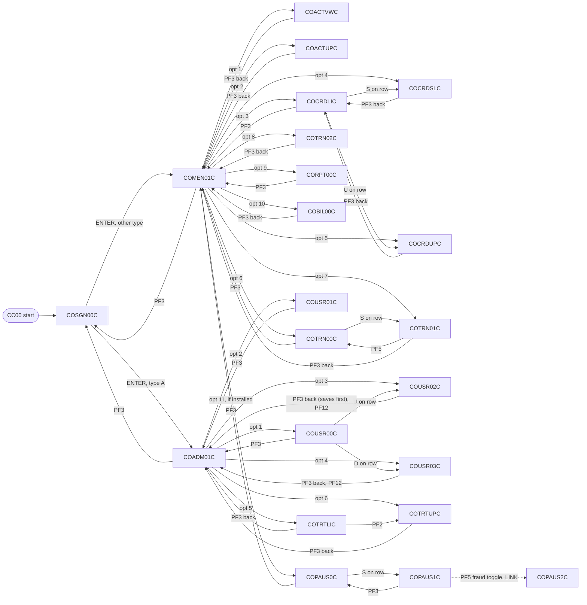
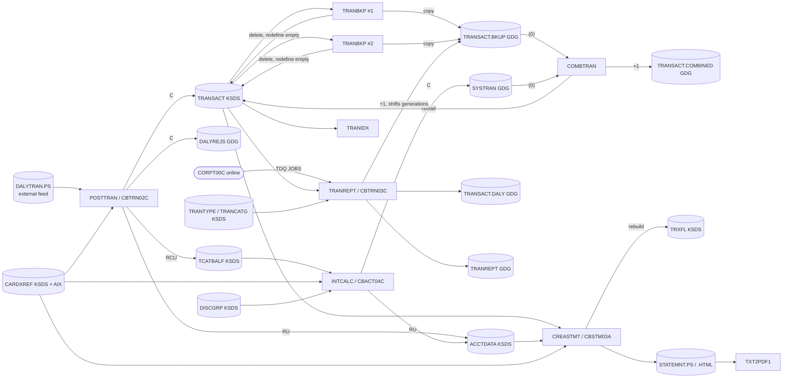

# CardDemo components: modules, bounded contexts, and interactions

This file is the synthesis layer of the specification. It does not define any new rule; every
statement points to a rule, quirk, test scenario, entity, or job defined in `entities.md`,
`jobs.md`, or `programs/<MEMBER>.md`. Where this file and a cited file disagree, the cited file wins
and this file should be corrected.

Legend used in the tables: C create (WRITE, INSERT, ISRT, MQPUT), R read by key, B browse or
sequential read, U update (REWRITE, UPDATE, REPL), D delete (DELETE, DLET), L read for update with no
following rewrite (lock only), o opened but never accessed.

---

## 1. Summary metrics

| Measure | Value | Source |
|:--|--:|:--|
| COBOL programs specified | 44 | `programs/*.md` |
| Base application programs | 31 (17 online CICS, 12 batch, 2 called subroutines: CSUTLDTC, CBSTM03B) | `app/cbl` |
| Optional module programs | 13 (authorization 8, transaction-type Db2 3, VSAM-MQ 2) | `app/app-*/cbl` |
| COBOL source lines covered | 30,181 (base 20,656; authorization 4,344; transaction-type Db2 4,037; VSAM-MQ 1,144) | program attribute tables |
| Entities | 36 (`ENT-` headings) | `entities.md` |
| JCL jobs | 46 (base 38, modules 8) | `jobs.md` section 1 |
| Base jobs by class | setup/definition 18, batch cycle 6, utility/report 9, operations 5 | `jobs.md` section 1 |
| Module jobs by class | setup/definition 5, batch 2, data synchronization 1 | `jobs.md` section 1 |
| Programs with no JCL | CBTRN01C (Q-CBTRN01C-06); CSUTLDTC and CBSTM03B are called, not run | `jobs.md` section 1 |
| Unique specification IDs | 2,191 | all spec files |
| Business rules (`BR-`) | 444 | programs |
| Validation rules (`VR-`) | 171 | programs |
| Navigation rules (`NAV-`) | 150 | programs |
| Error-handling rules (`ERR-`) | 287 | programs |
| Quirks (`Q-`) | 611 (programs 506, `entities.md` 42, `jobs.md` 63) | all spec files |
| Test scenarios (`TS-`) | 528 (programs 526, `jobs.md` 2) | all spec files |
| Quirk recommendations | fix 252, decide 170, preserve 70 (plus one "preserve or decide", Q-COPAUS1C-03); the rest are other wordings (replace, drop, do not port, treat as incomplete) or none | quirk bullets |

### Metrics by bounded context

Counts are summed from the program files assigned to each context in section 3. Quirks and test
scenarios defined in `entities.md` and `jobs.md` are not included in these rows.

| Context | Programs | Lines | BR | VR | NAV | ERR | Q | TS |
|:--|--:|--:|--:|--:|--:|--:|--:|--:|
| BC-1 IAM and Navigation | 7 | 2,623 | 59 | 22 | 41 | 33 | 67 | 93 |
| BC-2 Account and Customer | 2 | 5,177 | 33 | 38 | 14 | 23 | 41 | 45 |
| BC-3 Card | 3 | 3,906 | 41 | 24 | 19 | 16 | 49 | 62 |
| BC-4 Transaction (incl. CSUTLDTC) | 4 | 1,969 | 35 | 30 | 27 | 20 | 41 | 45 |
| BC-5 Bill Payment | 1 | 572 | 10 | 3 | 7 | 8 | 13 | 11 |
| BC-6 Reporting | 2 | 1,298 | 22 | 18 | 7 | 11 | 24 | 23 |
| BC-7 Batch Posting and Cycle | 5 | 3,031 | 41 | 6 | 0 | 33 | 48 | 42 |
| BC-8 Reference Data (Db2 module) | 3 | 4,037 | 57 | 17 | 14 | 34 | 54 | 61 |
| BC-9 Data Exchange and Utilities | 7 | 2,080 | 38 | 1 | 0 | 28 | 46 | 42 |
| BC-10 Authorizations (IMS/Db2/MQ module) | 8 | 4,344 | 82 | 7 | 19 | 59 | 90 | 73 |
| BC-11 MQ Inquiry (VSAM-MQ module) | 2 | 1,144 | 26 | 5 | 2 | 22 | 33 | 29 |
| Total | 44 | 30,181 | 444 | 171 | 150 | 287 | 506 | 526 |

The largest single programs are COACTUPC (4,236 lines, 31 quirks, 32 test scenarios), COTRTLIC
(2,098), COTRTUPC (1,702), COCRDUPC (1,560), and COCRDLIC (1,459). Together they hold about 37
percent of all source lines.

---

## 2. Entities index

Full layouts, keys, relationships, and data-format rules (DF-01 to DF-09) are in `entities.md`.
"Owner" is the bounded context (section 3) that should own the entity in a target system: the one
that creates and maintains it. Other contexts read it through the owner's interface.

| Entity | Physical store | Owner | Readers in other contexts |
|:--|:--|:--|:--|
| [ENT-ACCOUNT](entities.md#ent-account) | KSDS `ACCTDATA` (CICS `ACCTDAT`) | BC-2 | BC-5, BC-7, BC-9, BC-10, BC-11 |
| [ENT-CUSTOMER](entities.md#ent-customer) | KSDS `CUSTDATA` (CICS `CUSTDAT`) | BC-2 | BC-7, BC-9, BC-10 |
| [ENT-CARD](entities.md#ent-card) | KSDS `CARDDATA` (CICS `CARDDAT`), AIX `CARDAIX` | BC-3 | BC-9 |
| [ENT-CARD-XREF](entities.md#ent-card-xref) | KSDS `CARDXREF` (CICS `CCXREF`), AIX path `CXACAIX` | BC-3 (no online maintainer; loaded by JOB-XREFFILE) | BC-2, BC-4, BC-5, BC-6, BC-7, BC-9, BC-10 |
| [ENT-TRANSACTION](entities.md#ent-transaction) | KSDS `TRANSACT`, GDGs `TRANSACT.BKUP`, `SYSTRAN`, `TRANSACT.COMBINED`, `TRANSACT.DALY` | BC-4 (online) and BC-7 (batch) share it; see section 5(d) | BC-5, BC-6, BC-9 |
| [ENT-DAILY-TRANSACTION](entities.md#ent-daily-transaction) | PS `DALYTRAN.PS` (external feed) | BC-7 | none |
| [ENT-DAILY-REJECT](entities.md#ent-daily-reject) | GDG `DALYREJS` | BC-7 | none |
| [ENT-TRAN-CAT-BALANCE](entities.md#ent-tran-cat-balance) | KSDS `TCATBALF` | BC-7 | none online; JOB-PRTCATBL prints it |
| [ENT-DISCLOSURE-GROUP](entities.md#ent-disclosure-group) | KSDS `DISCGRP` | BC-8 (reason: reference data, loaded only by JOB-DISCGRP) | BC-7 (CBACT04C) |
| [ENT-TRAN-TYPE](entities.md#ent-tran-type) | KSDS `TRANTYPE` | BC-8 | BC-6 (CBTRN03C) |
| [ENT-TRAN-CATEGORY](entities.md#ent-tran-category) | KSDS `TRANCATG` | BC-8 | BC-6 (CBTRN03C) |
| [ENT-USER-SECURITY](entities.md#ent-user-security) | KSDS `USRSEC` | BC-1 | none |
| [ENT-STATEMENT-TRANSACTION](entities.md#ent-statement-transaction) | KSDS `TRXFL` (rebuilt each JOB-CREASTMT) | BC-7 | none |
| [ENT-EXPORT-RECORD](entities.md#ent-export-record) | KSDS `EXPORT.DATA` | BC-9 | none |
| [ENT-TRANSACTION-REPORT](entities.md#ent-transaction-report) | GDG `TRANREPT` (print) | BC-6 | none |
| [ENT-COMMAREA](entities.md#ent-commarea) | CICS COMMAREA `COCOM01Y` (160 bytes) | Shared kernel | all online programs |
| [ENT-CARD-WORK-AREA](entities.md#ent-card-work-area) | Working storage `CVCRD01Y` | Shared kernel | BC-2, BC-3, BC-8 |
| [ENT-MAIN-MENU-OPTIONS](entities.md#ent-main-menu-options) | Copybook table `COMEN02Y` | BC-1 | none |
| [ENT-ADMIN-MENU-OPTIONS](entities.md#ent-admin-menu-options) | Copybook table `COADM02Y` | BC-1 | none |
| [ENT-DATE-CONVERSION](entities.md#ent-date-conversion) | Call interface `CODATECN` | BC-9 (CBACT01C) | none |
| [ENT-DATE-TIME-WORK](entities.md#ent-date-time-work) | Working storage `CSDAT01Y` | Shared kernel | most online programs |
| [ENT-DATE-EDIT-WORK](entities.md#ent-date-edit-work) | Working storage `CSUTLDWY` with procedure copybook `CSUTLDPY` | Shared kernel | BC-2 (COACTUPC), BC-8 (COTRTUPC, `CSUTLDWY` only) |
| [ENT-LOOKUP-CODES](entities.md#ent-lookup-codes) | 88-level value sets `CSLKPCDY` | Shared kernel (reference data) | BC-2 |
| [ENT-COMMON-MESSAGES](entities.md#ent-common-messages) | Copybook `CSMSG01Y` | Shared kernel | all online programs |
| [ENT-ABEND-DATA](entities.md#ent-abend-data) | Working storage `CSMSG02Y` | Shared kernel | online programs |
| [ENT-AUTH-SUMMARY](entities.md#ent-auth-summary) | IMS `DBPAUTP0` root `PAUTSUM0` | BC-10 | none |
| [ENT-AUTH-DETAIL](entities.md#ent-auth-detail) | IMS child `PAUTDTL1` | BC-10 | none |
| [ENT-AUTH-FRAUD](entities.md#ent-auth-fraud) | Db2 `CARDDEMO.AUTHFRDS` | BC-10 | none |
| [ENT-AUTH-REQUEST](entities.md#ent-auth-request) | MQ message (comma-delimited text) | BC-10 | external requesters |
| [ENT-AUTH-RESPONSE](entities.md#ent-auth-response) | MQ message | BC-10 | external requesters |
| [ENT-AUTH-ERROR-LOG](entities.md#ent-auth-error-log) | TD queue `CSSL` | BC-10 | none |
| [ENT-IMS-PCB](entities.md#ent-ims-pcb) | PCB masks | BC-10 (not migrated) | none |
| [ENT-DB2-TRAN-TYPE](entities.md#ent-db2-tran-type) | Db2 `CARDDEMO.TRANSACTION_TYPE` | BC-8 | none (extracted by JOB-TRANEXTR) |
| [ENT-DB2-TRAN-TYPE-CATEGORY](entities.md#ent-db2-tran-type-category) | Db2 `CARDDEMO.TRANSACTION_TYPE_CATEGORY` | BC-8 | none (FK target, extracted by JOB-TRANEXTR) |
| [ENT-DB2-COMMON-WORK](entities.md#ent-db2-common-work) | Working storage for Db2 programs | BC-8 | none |
| [ENT-MQ-ACCOUNT-INQUIRY](entities.md#ent-mq-account-inquiry) | MQ request and reply messages | BC-11 | external requesters |

Two pairs are the same business concept in two stores: ENT-TRAN-TYPE (VSAM) and ENT-DB2-TRAN-TYPE
(Db2), and ENT-TRAN-CATEGORY (VSAM) and ENT-DB2-TRAN-TYPE-CATEGORY (Db2). The Db2 tables are
the maintained copy when the module is installed; JOB-TRANEXTR writes them to sequential files, and
the VSAM files change only when JOB-TRANTYPE and JOB-TRANCATG run afterwards (Q-TRANEXTR-01). A
target system should have one table for each.

---

## 3. Bounded contexts

The grouping below follows the requested grouping. Three adjustments are made, each with its
reason:

1. CSUTLDTC is counted under BC-4 (Transaction) in section 1, but it is a shared-kernel date
   validation service: its callers are COTRN02C, CORPT00C, and COACTUPC (through `CSUTLDPY`). It
   should be converted once, as a library, before any of those contexts.
2. ENT-DISCLOSURE-GROUP is owned by BC-8 (Reference Data), not BC-7, because nothing in the cycle
   writes it; CBACT04C only reads it (JOB-DISCGRP loads it).
3. JOB-CLOSEFIL, JOB-OPENFIL, JOB-TXT2PDF1, and JOB-PRTCATBL are placed in BC-7 because they exist
   only to support the cycle and statement output. JOB-DUSRSECJ is placed in BC-1 because it seeds
   the user store and carries its security quirk (Q-DUSRSECJ-01).

| ID | Context | Programs | Owned entities | Jobs | Kind |
|:--|:--|:--|:--|:--|:--|
| BC-1 | IAM and Navigation | COSGN00C, COMEN01C, COADM01C, COUSR00C, COUSR01C, COUSR02C, COUSR03C | ENT-USER-SECURITY, ENT-MAIN-MENU-OPTIONS, ENT-ADMIN-MENU-OPTIONS | JOB-DUSRSECJ, JOB-ESDSRRDS (demo) | Online |
| BC-2 | Account and Customer | COACTVWC, COACTUPC | ENT-ACCOUNT, ENT-CUSTOMER (reads ENT-CARD-XREF) | JOB-ACCTFILE, JOB-CUSTFILE, JOB-DEFCUST (obsolete) | Online |
| BC-3 | Card | COCRDLIC, COCRDSLC, COCRDUPC | ENT-CARD, ENT-CARD-XREF | JOB-CARDFILE, JOB-XREFFILE | Online |
| BC-4 | Transaction | COTRN00C, COTRN01C, COTRN02C; CSUTLDTC (shared kernel) | ENT-TRANSACTION (online writes) | JOB-TRANFILE | Online |
| BC-5 | Bill Payment | COBIL00C | none (writes ENT-TRANSACTION, updates ENT-ACCOUNT) | none | Online |
| BC-6 | Reporting | CORPT00C, CBTRN03C | ENT-TRANSACTION-REPORT | JOB-TRANREPT, JOB-REPTFILE | Online submits batch |
| BC-7 | Batch Posting and Cycle | CBTRN01C (unscheduled), CBTRN02C, CBACT04C, CBSTM03A, CBSTM03B | ENT-DAILY-TRANSACTION, ENT-DAILY-REJECT, ENT-TRAN-CAT-BALANCE, ENT-STATEMENT-TRANSACTION; ENT-TRANSACTION (batch writes) | JOB-TRANBKP, JOB-POSTTRAN, JOB-INTCALC, JOB-COMBTRAN, JOB-CREASTMT, JOB-TRANIDX, JOB-CLOSEFIL, JOB-OPENFIL, JOB-TXT2PDF1, JOB-PRTCATBL, JOB-TCATBALF, JOB-DALYREJS, JOB-DEFGDGB | Batch |
| BC-8 | Reference Data | COTRTLIC, COTRTUPC, COBTUPDT (Db2 module) | ENT-TRAN-TYPE, ENT-TRAN-CATEGORY, ENT-DISCLOSURE-GROUP, ENT-DB2-TRAN-TYPE, ENT-DB2-TRAN-TYPE-CATEGORY, ENT-DB2-COMMON-WORK | JOB-TRANTYPE, JOB-TRANCATG, JOB-DISCGRP, JOB-DEFGDGD, JOB-CREADB21, JOB-MNTTRDB2, JOB-TRANEXTR | Online and batch |
| BC-9 | Data Exchange and Utilities | CBEXPORT, CBIMPORT, CBACT01C, CBACT02C, CBACT03C, CBCUS01C, COBSWAIT | ENT-EXPORT-RECORD, ENT-DATE-CONVERSION | JOB-CBEXPORT, JOB-CBIMPORT, JOB-READACCT, JOB-READCARD, JOB-READCUST, JOB-READXREF, JOB-WAITSTEP, JOB-CBADMCDJ, JOB-INTRDRJ1, JOB-INTRDRJ2, JOB-FTPJCL | Batch |
| BC-10 | Authorizations (optional) | COPAUA0C, COPAUS0C, COPAUS1C, COPAUS2C, CBPAUP0C, PAUDBUNL, PAUDBLOD, DBUNLDGS | ENT-AUTH-SUMMARY, ENT-AUTH-DETAIL, ENT-AUTH-FRAUD, ENT-AUTH-REQUEST, ENT-AUTH-RESPONSE, ENT-AUTH-ERROR-LOG, ENT-IMS-PCB | JOB-CBPAUP0J, JOB-DBPAUTP0, JOB-UNLDPADB, JOB-LOADPADB, JOB-UNLDGSAM | MQ-triggered, online, batch |
| BC-11 | MQ Inquiry (optional) | COACCT01, CODATE01 | ENT-MQ-ACCOUNT-INQUIRY | none | MQ-triggered |
| Kernel | Shared kernel | CSUTLDTC (library) | ENT-COMMAREA, ENT-CARD-WORK-AREA, ENT-DATE-TIME-WORK, ENT-DATE-EDIT-WORK, ENT-LOOKUP-CODES, ENT-COMMON-MESSAGES, ENT-ABEND-DATA | none | Library |

Every one of the 44 programs appears in exactly one row (CSUTLDTC in BC-4 for counting, with its
kernel role stated). Every one of the 46 jobs appears in exactly one row.

---

## 4. CRUD matrix

### 4.1 Base VSAM entities

Columns: USR = ENT-USER-SECURITY, ACC = ENT-ACCOUNT, CUS = ENT-CUSTOMER, CRD = ENT-CARD,
XRF = ENT-CARD-XREF, TRN = ENT-TRANSACTION, DLY = ENT-DAILY-TRANSACTION, REJ = ENT-DAILY-REJECT,
TCB = ENT-TRAN-CAT-BALANCE, DSC = ENT-DISCLOSURE-GROUP, TTY = ENT-TRAN-TYPE, TCT = ENT-TRAN-CATEGORY,
STX = ENT-STATEMENT-TRANSACTION, EXP = ENT-EXPORT-RECORD, RPT = ENT-TRANSACTION-REPORT.

| Program | Ctx | USR | ACC | CUS | CRD | XRF | TRN | DLY | REJ | TCB | DSC | TTY | TCT | STX | EXP | RPT |
|:--|:--|:-:|:-:|:-:|:-:|:-:|:-:|:-:|:-:|:-:|:-:|:-:|:-:|:-:|:-:|:-:|
| COSGN00C | BC-1 | R | | | | | | | | | | | | | | |
| COMEN01C | BC-1 | | | | | | | | | | | | | | | |
| COADM01C | BC-1 | | | | | | | | | | | | | | | |
| COUSR00C | BC-1 | B | | | | | | | | | | | | | | |
| COUSR01C | BC-1 | C | | | | | | | | | | | | | | |
| COUSR02C | BC-1 | RU | | | | | | | | | | | | | | |
| COUSR03C | BC-1 | RD | | | | | | | | | | | | | | |
| COACTVWC | BC-2 | | R | R | | R (AIX) | | | | | | | | | | |
| COACTUPC | BC-2 | | RU | RU | | R (AIX) | | | | | | | | | | |
| COCRDLIC | BC-3 | | | | B | | | | | | | | | | | |
| COCRDSLC | BC-3 | | | | R | | | | | | | | | | | |
| COCRDUPC | BC-3 | | | | RU | | | | | | | | | | | |
| COTRN00C | BC-4 | | | | | | B | | | | | | | | | |
| COTRN01C | BC-4 | | | | | | L | | | | | | | | | |
| COTRN02C | BC-4 | | | | | R (AIX and key) | BC | | | | | | | | | |
| COBIL00C | BC-5 | | RU | | | R (AIX) | BC | | | | | | | | | |
| CORPT00C | BC-6 | | | | | | | | | | | | | | | |
| CBTRN03C | BC-6 | | | | | R | B (sorted extract) | | | | | R | R | | | C |
| CBTRN01C | BC-7 | | R | o | o | R | o | B | | | | | | | | |
| CBTRN02C | BC-7 | | RU | | | R | C (OPEN OUTPUT) | B | C | RCU | | | | | | |
| CBACT04C | BC-7 | | RU | | | R (AIX) | C (SYSTRAN GDG) | | | B | R | | | | | |
| CBSTM03A | BC-7 | | R (via CBSTM03B) | R (via CBSTM03B) | | B (via CBSTM03B) | | | | | | | | B (via CBSTM03B) | | |
| CBSTM03B | BC-7 | | R | R | | B | | | | | | | | B | | |
| CBEXPORT | BC-9 | | B | B | B | B | B | | | | | | | | C | |
| CBIMPORT | BC-9 | | C (seq) | C (seq) | C (seq, no DD) | C (seq) | C (seq) | | | | | | | | B | |
| CBACT01C | BC-9 | | B | | | | | | | | | | | | | |
| CBACT02C | BC-9 | | | | B | | | | | | | | | | | |
| CBACT03C | BC-9 | | | | | B | | | | | | | | | | |
| CBCUS01C | BC-9 | | | B | | | | | | | | | | | | |
| COPAUA0C | BC-10 | | R | R | | R | | | | | | | | | | |
| COPAUS0C | BC-10 | | R | R | | R (AIX) | | | | | | | | | | |
| COACCT01 | BC-11 | | R | | | | | | | | | | | | | |

Programs with no VSAM entity access: COMEN01C, COADM01C, CORPT00C (writes TD queue `JOBS`, see
section 5(d)), CSUTLDTC, COBSWAIT, CODATE01, the Db2 programs of BC-8, and the IMS programs of BC-10
other than COPAUA0C and COPAUS0C. Notes on specific cells:

- COTRN01C reads with UPDATE and never rewrites (Q-COTRN01C-01).
- COCRDSLC and COCRDUPC declare `CARDAIX`; only a never-performed paragraph uses it (Q-ENT-14).
- CBTRN01C opens CUSTFILE, CARDFILE, and TRANFILE without reading them (Q-CBTRN01C-04) and is not run
  by any job (Q-CBTRN01C-06).
- CBTRN02C opens TRANSACT OUTPUT, which empties or requires an empty file (Q-CBTRN02C-01).
- CBIMPORT writes sequential import files, not the VSAM masters; its card output has no DD in the JCL
  (Q-CBIMPORT-01).
- COTRN02C names `ACCTDAT`, and CORPT00C names `TRANSACT`, in working storage without accessing them.

### 4.2 Module entities

| Program | Ctx | AUTH-SUMMARY | AUTH-DETAIL | AUTH-FRAUD | AUTH-REQUEST | AUTH-RESPONSE | AUTH-ERROR-LOG | DB2-TRAN-TYPE | DB2-TRAN-TYPE-CATEGORY | MQ-ACCOUNT-INQUIRY |
|:--|:--|:-:|:-:|:-:|:-:|:-:|:-:|:-:|:-:|:-:|
| COPAUA0C | BC-10 | RCU | C | | B (MQGET) | C (MQPUT1) | C | | | |
| COPAUS0C | BC-10 | R | B | | | | | | | |
| COPAUS1C | BC-10 | R | RU | (via COPAUS2C) | | | | | | |
| COPAUS2C | BC-10 | | | CU | | | | | | |
| CBPAUP0C | BC-10 | BD | BD | | | | | | | |
| PAUDBUNL | BC-10 | B | B | | | | | | | |
| DBUNLDGS | BC-10 | B | B | | | | | | | |
| PAUDBLOD | BC-10 | RC | C | | | | | | | |
| COTRTLIC | BC-8 | | | | | | | BUD | (FK restricts delete) | |
| COTRTUPC | BC-8 | | | | | | | RCUD | (FK restricts delete) | |
| COBTUPDT | BC-8 | | | | | | | CUD | | |
| COACCT01 | BC-11 | | | | | | | | | B (request), C (reply) |
| CODATE01 | BC-11 | | | | | | | | | B (request), C (date reply) |

### 4.3 Job-level effects (utilities, not programs)

| Job | Effect on entities |
|:--|:--|
| JOB-ACCTFILE, JOB-CARDFILE, JOB-CUSTFILE, JOB-XREFFILE, JOB-TRANFILE, JOB-DUSRSECJ, JOB-TCATBALF, JOB-DISCGRP, JOB-TRANTYPE, JOB-TRANCATG | Delete, redefine, and reload the entity from its seed PS file (every existing record is lost) |
| JOB-TRANBKP | Copies ENT-TRANSACTION to `TRANSACT.BKUP(+1)`, then deletes and redefines the KSDS (Q-TRANBKP-01, Q-TRANBKP-02) |
| JOB-COMBTRAN | Sorts `TRANSACT.BKUP(0)` plus `SYSTRAN(0)` and reloads ENT-TRANSACTION (Q-COMBTRAN-01) |
| JOB-CREASTMT | Rebuilds ENT-STATEMENT-TRANSACTION from ENT-TRANSACTION (Q-ENT-40) |
| JOB-TRANIDX | Rebuilds the `TRAN-PROC-TS` alternate index of ENT-TRANSACTION, which no program uses (Q-ENT-14) |
| JOB-TRANREPT | Copies ENT-TRANSACTION to `TRANSACT.BKUP(+1)` and extracts a date range (Q-TRANREPT-02) |
| JOB-PRTCATBL | Copies ENT-TRAN-CAT-BALANCE to `TCATBALF.BKUP(+1)` and prints it (Q-PRTCATBL-02) |
| JOB-TRANEXTR | Writes ENT-DB2-TRAN-TYPE and ENT-DB2-TRAN-TYPE-CATEGORY to the seed PS files of ENT-TRAN-TYPE and ENT-TRAN-CATEGORY (Q-TRANEXTR-01) |
| JOB-CREADB21 | Creates and seeds the Db2 tables of BC-8 |

---

## 5. Interactions

### 5(a) Online navigation graph

Edges are XCTL transfers labelled with the menu option or key that triggers them. The source rules are
the `NAV-` IDs of each program file; the menu option tables are ENT-MAIN-MENU-OPTIONS and
ENT-ADMIN-MENU-OPTIONS. "back" means XCTL to `CDEMO-FROM-PROGRAM` (the caller). Programs that
receive no COMMAREA (EIBCALEN = 0) transfer to COSGN00C; those edges are omitted for readability.

Keys that act within a program (no XCTL): PF4 clears the screen in COBIL00C, COTRN01C, COTRN02C,
COUSR01C, COUSR02C, and COUSR03C (CORPT00C has no PF4); PF5 saves or confirms in COACTUPC, COCRDUPC,
COUSR02C, COUSR03C (delete), COTRTUPC (add or save), and COTRN02C (copy last transaction); PF4 deletes
in COTRTUPC; PF10 confirms in COTRTLIC; PF7 and PF8 page in every list program (COCRDLIC 7 rows,
COTRN00C 10, COUSR00C 10, COTRTLIC 7, COPAUS0C 5). The card, account, and Db2 programs fold PF13 to
PF24 onto PF1 to PF12 through `CSSTRPFY` (ENT-CARD-WORK-AREA). The menu entry for option 11 is
resolved with `INQUIRE PROGRAM`, so it works only when the authorization module is installed.

Navigation quirks that affect a target design: the admin menu is reachable only by routing, never by
a check (Q-COADM01C-01, Q-COMEN01C-01, Q-COSGN00C-07); COTRTLIC and COTRTUPC change the user type
while navigating (Q-COTRTLIC-05, Q-COTRTUPC-10); PF5 from COTRN01C to COTRN00C skips the first record
(Q-COTRN00C-01); list page counters overflow (Q-COCRDLIC-06, Q-COTRTLIC-06, Q-COPAUS0C-02).

### 5(b) COMMAREA contract (ENT-COMMAREA, `COCOM01Y`, 160 bytes)

| Field group | Set by | Read by | Contract notes |
|:--|:--|:--|:--|
| `CDEMO-FROM-TRANID`, `CDEMO-FROM-PROGRAM` | Every online program before XCTL | Every program with a "PF3 back" rule | Return address. The only reliable inter-program contract |
| `CDEMO-TO-PROGRAM`, `CDEMO-TO-TRANID` | Menu programs and list programs | Same programs (XCTL target) | Transient |
| `CDEMO-USER-ID` | COSGN00C only | No program reads it after sign-on | Not lost on menu entry: COACTVWC, COCRDSLC, COACTUPC, and COCRDUPC test `CDEMO-FROM-PROGRAM` = `COMEN01C` against their working-storage copy before it is loaded from DFHCOMMAREA, so only a direct start with no COMMAREA initializes it (Q-COACTVWC-03, Q-COCRDSLC-03; the same code in Q-COACTUPC-21, Q-COCRDUPC-10). Lost when COCRDLIC re-initializes the COMMAREA on a PF3 return (Q-COCRDLIC-11) and after a successful delete in COTRTLIC (Q-COTRTLIC-04) |
| `CDEMO-USER-TYPE` | COSGN00C sets it; forced to `U` by COACTVWC, COACTUPC, COCRDLIC, COCRDSLC, COCRDUPC, and COTRTLIC on PF2; set to `A` by COTRTLIC and COTRTUPC | COSGN00C routing and the dead check in COMEN01C | Not an authorization token (Q-COMEN01C-01, Q-COTRTLIC-05, Q-COTRTUPC-10) |
| `CDEMO-PGM-CONTEXT` | Set to 0 (first entry) by every caller before XCTL | Every online program (first entry versus re-entry) | Pseudo-conversational state flag |
| `CDEMO-CUST-ID` | COACTUPC, COACTVWC, COPAUS0C | COACTUPC, COACTVWC, COPAUS1C | |
| `CDEMO-CUST-FNAME/MNAME/LNAME` | COACTUPC only | No reader | Dead data |
| `CDEMO-ACCT-ID` | COACTUPC, COACTVWC, COCRDLIC, COCRDSLC, COCRDUPC, COPAUS0C (COTRTUPC zeroes it) | COACTVWC, COCRDLIC, COCRDSLC, COCRDUPC, COPAUS0C, COPAUS1C | Carries the selected account between card and account screens |
| `CDEMO-CARD-NUM` | COACTVWC, COACTUPC, COCRDLIC, COCRDSLC, COCRDUPC, COPAUS0C | COCRDLIC, COCRDSLC, COCRDUPC | Full card number in session state (Q-ENT-33) |
| `CDEMO-LAST-MAP`, `CDEMO-LAST-MAPSET` | Card, account, and Db2 programs | Same programs | Screen re-send |
| Program extensions after byte 160 | COBIL00C and COTRN* (218 bytes total), COUSR00C (194), COCRDLIC and COTRTLIC (2,000) | The owning program only | COCRDLIC, COCRDSLC, and COCRDUPC copy their extension from beyond EIBCALEN on entry from another program (Q-COCRDLIC-14, Q-COCRDSLC-06, Q-COCRDUPC-11); the COBIL00C extension is unused (Q-COBIL00C-10) |

Target guidance: replace the COMMAREA with a server-side session (user id, roles from an identity
provider) plus explicit request parameters (selected account, selected card). The only state that
must cross screens is the return address and the selected account and card keys.

### 5(c) Batch dataflow

Job to dataset to job, consistent with `jobs.md` sections 2 and 14 (runbook cycle plus the on-demand
report). Solid arrows are writes or reads by a job; datasets are cylinders.

The online files must be closed before the cycle (JOB-CLOSEFIL) and reopened after it (JOB-OPENFIL).
CREASTMT also reads ENT-CUSTOMER (omitted above). The schedulers implement partial versions of this
flow (Q-CA7-02, Q-CA7-03, Q-CA7-04, Q-CONTROLM-01, Q-COMBTRAN-02); the runbook is the intended
sequence (`jobs.md` section 2).

### 5(d) Online and batch coupling points

| # | Coupling | Online side | Batch side | Consequence | IDs |
|:--|:--|:--|:--|:--|:--|
| 1 | Shared transaction master | COTRN02C and COBIL00C write TRANSACT; COTRN00C and COTRN01C read it | JOB-TRANBKP empties it twice per cycle; JOB-COMBTRAN reloads only this cycle | Online history disappears from the online list after each cycle | Q-TRANBKP-02, Q-CBTRN02C-01 |
| 2 | Report submission | CORPT00C writes JCL to TD queue `JOBS` (internal reader) | JOB-TRANREPT runs immediately, writes `TRANSACT.BKUP(+1)` | A report during the cycle shifts the backup generation COMBTRAN reads | Q-TRANREPT-02, Q-CORPT00C-02 |
| 3 | Bill payment outside the posting rules | COBIL00C updates the balance and writes a transaction | CBTRN02C maintains TCATBAL and cycle credit; CBACT04C charges interest on TCATBAL | Payments never reach category balances or cycle totals; signs differ from batch credits | Q-COBIL00C-05, Q-COBIL00C-06 |
| 4 | Account group id | COACTUPC rewrites the account with a shifted layout | CBACT04C looks up DISCGRP by `ACCT-GROUP-ID` | Every lookup falls back to `DEFAULT` | Q-ENT-01, Q-ENT-02, Q-COACTUPC-01, Q-CBACT04C-05 |
| 5 | Transaction id generation | COTRN02C and COBIL00C use highest key + 1 | Feed supplies ids; CBACT04C uses a fixed PARM date + counter | Collisions within online, and between interest runs at COMBTRAN | Q-ENT-07, Q-COBIL00C-01, Q-COTRN02C-01, Q-INTCALC-01, Q-COMBTRAN-01 |
| 6 | Cycle totals | COACTUPC lets a user edit balance and cycle totals | CBTRN02C uses cycle totals for the limit check; CBACT04C resets them | Online edits bypass the ledger; interest frequency changes the limit check | Q-COACTUPC-15, Q-CBTRN02C-02, Q-RUNBOOK-01 |
| 7 | File availability | CICS files ACCTDAT, CARDDAT, CUSTDAT, CCXREF, TRANSACT, and others | JOB-CLOSEFIL and JOB-OPENFIL bracket the cycle | No online access during the cycle; TRANSACT AIX absent between TRANBKP and TRANIDX | Q-CONTROLM-01, `jobs.md` JOB-CLOSEFIL |
| 8 | No recoverability | All 8 file definitions in `app/csd` specify RECOVERY(NONE); SYNCPOINT ROLLBACK does not undo VSAM rewrites | Batch has no unit of work | Partial updates on failure, online and batch | Q-COACTUPC-03, Q-CBTRN02C-07, Q-COBIL00C-02 |
| 9 | Authorization credit balance | COPAUA0C adds approvals to `PA-CREDIT-BALANCE` | CBPAUP0C purges details without rewriting the summary; base batch never reduces it | Available credit only shrinks | Q-COPAUA0C-05, Q-CBPAUP0C-01 |
| 10 | Base schedule depends on a module | none | CA7 chain A runs JOB-CBPAUP0J before POSTTRAN | Base cycle cannot run without the IMS module | Q-CA7-04 |
| 11 | Reference data in two stores | COTRTLIC and COTRTUPC maintain Db2 | CBTRN03C reads VSAM TRANTYPE/TRANCATG | Db2 changes reach the report only after a manual reload | Q-TRANEXTR-01 |
| 12 | Card and cross-reference | COCRDUPC rewrites `CARD-ACCT-ID` from the screen | All xref readers (posting, interest, bill pay, authorization) use CARDXREF, which is not updated | Card and xref disagree about the owning account | Q-COCRDUPC-02 |

### 5(e) Cross-context dependencies

What each context needs from the others if it is converted alone while the rest stays on the
mainframe (or stays in its current form).

| Context | Reads from | Writes into another context's data | Provided to others | Needs if converted alone |
|:--|:--|:--|:--|:--|
| BC-1 IAM and Navigation | none | none | Sign-on identity and routing to every online program (ENT-COMMAREA) | A session bridge that hands user id and type to the remaining CICS programs (COMMAREA producer), or a front-end that calls CICS through a gateway; menu entries for programs not yet converted. Must decide Q-COSGN00C-01 and Q-ENT-17 first (password migration) |
| BC-2 Account and Customer | BC-3 (ENT-CARD-XREF by account) | none | ENT-ACCOUNT to BC-5, BC-7, BC-9, BC-10, BC-11; ENT-CUSTOMER to BC-7, BC-9, BC-10 | Synchronous replication of ENT-ACCOUNT and ENT-CUSTOMER back to VSAM (batch posting, interest, statements, and bill payment still update or read them); read access to CARDXREF; fix Q-ENT-01 before any data sync |
| BC-3 Card | BC-2 (account id typed on screen, not validated, Q-COCRDUPC-02) | none | ENT-CARD to BC-9; ENT-CARD-XREF to almost every context | CARDXREF must stay authoritative or be replicated both ways; card number and CVV handling decided (Q-ENT-33, Q-COCRDUPC-01) |
| BC-4 Transaction | BC-3 (xref by card and by account) | none (owns online writes to ENT-TRANSACTION) | Transaction list and detail | A single transaction store shared with BC-5 and BC-7, or a write-through to TRANSACT; a central id generator (Q-ENT-07); CSUTLDTC replacement |
| BC-5 Bill Payment | BC-2 (account, update), BC-3 (xref by account) | ENT-ACCOUNT (balance), ENT-TRANSACTION | none | Atomic update of account plus transaction in whichever store owns them; decide sign and ledger rules (Q-COBIL00C-05, Q-COBIL00C-06); the same id generator as BC-4 |
| BC-6 Reporting | BC-4/BC-7 (ENT-TRANSACTION), BC-3 (xref), BC-8 (type, category) | `TRANSACT.BKUP` generation (side effect, Q-TRANREPT-02) | Report output | A job-submission API instead of the internal reader; read-only access to transactions and reference data; drop the BKUP side effect |
| BC-7 Batch Posting and Cycle | BC-3 (xref), BC-2 (customer), BC-8 (disclosure group) | ENT-ACCOUNT (balance, cycle totals), ENT-TRANSACTION | Posted transactions, statements | Exclusive access to ENT-ACCOUNT and ENT-TRANSACTION during the run (today CLOSEFIL); a decision on the cycle model (Q-TRANBKP-02, Q-RUNBOOK-01); reproduce the sample-run reject count (TS-POSTTRAN-01, Q-CBTRN02C-08) |
| BC-8 Reference Data | none | none | Type and category descriptions to BC-6; disclosure groups to BC-7 | Keep JOB-TRANEXTR plus JOB-TRANTYPE/JOB-TRANCATG as a sync until BC-6 reads the target store (Q-TRANEXTR-01); admin role from BC-1 (Q-COTRTLIC-05) |
| BC-9 Data Exchange and Utilities | Every base master (read) | Import files only (sequential) | Branch export file | Read access to all masters; masking for listings (Q-CBACT02C-01, Q-CBCUS01C-02); can be retired or converted last |
| BC-10 Authorizations | BC-3 (xref by card), BC-2 (account limits, customer) | none in base data | Pending authorizations, fraud flags | Read access to CARDXREF, ACCTDATA, CUSTDAT; MQ (or replacement) contract ENT-AUTH-REQUEST/RESPONSE; decide credit-balance model (Q-COPAUA0C-05); remove JOB-CBPAUP0J from the base schedule (Q-CA7-04) |
| BC-11 MQ Inquiry | BC-2 (ENT-ACCOUNT) | none | Account and date replies | Read access to ENT-ACCOUNT; authentication (Q-COACCT01-15); request/reply conventions (Q-COACCT01-02, Q-COACCT01-03) |

Dependency summary: ENT-CARD-XREF (BC-3) and ENT-ACCOUNT (BC-2) are the hubs; seven contexts read
the cross-reference and six read the account. ENT-TRANSACTION is written by three contexts (BC-4,
BC-5, BC-7) and is the main contention point. BC-1 has no data dependency but every online context
depends on it for identity.

---

## 6. Cross-cutting concerns

| Concern | Current behavior | Where specified | Target guidance |
|:--|:--|:--|:--|
| Authentication | Plain-text 8-character passwords in USRSEC, case-insensitive compare, no lockout, audit, or timeout | Q-COSGN00C-01, Q-ENT-17, Q-COSGN00C-04, Q-COSGN00C-05, Q-COSGN00C-08, Q-DUSRSECJ-01 | External identity provider; never migrate passwords |
| Authorization | Only sign-on routing on type `A`; no program checks the user type; some programs change it | Q-COADM01C-01, Q-COMEN01C-01, Q-COSGN00C-07, Q-COTRTLIC-05, Q-COTRTUPC-10, Q-COCRDUPC-17, Q-COACTUPC-28, Q-COACCT01-15 | Role checks on every operation, including MQ requests |
| Session state | 160-byte COMMAREA plus per-program extensions; PF3 forces user type `U`; a direct start without COMMAREA clears identity | Section 5(b), ENT-COMMAREA | Server-side session |
| Sensitive data | PAN, CVV, SSN, government id in clear; printed by listing programs; CVV overwritten on card save | Q-ENT-33, Q-CBACT02C-01, Q-CBCUS01C-02, Q-CBTRN01C-05, Q-CBEXPORT-01, Q-COCRDUPC-01, rule CD070 in `AGENTS.md` | Do not migrate CVV; tokenize PAN; encrypt SSN; mask in logs |
| Identifier generation | Three TRAN-ID generators; online highest key + 1 | Q-ENT-07, Q-COBIL00C-01, Q-COTRN02C-01, Q-INTCALC-01 | One sequence service |
| Transactions and recovery | RECOVERY(NONE) files; no unit of work in batch; error flags not tested | Q-COACTUPC-03, Q-CBTRN02C-07, Q-COBIL00C-02, Q-COPAUA0C-06 | One database transaction per business operation; idempotent batch steps |
| Concurrency control | Mixed: COACTUPC and COCRDUPC compare before rewrite; COTRTUPC and COUSR02C do not; COTRN01C locks without updating | Q-COTRTUPC-17, Q-COUSR02C-02, Q-COTRN01C-01 | Optimistic locking with a version column everywhere |
| Dates and times | CSUTLDTC (CEEDAYS) and `CSUTLDPY` validation; at least four timestamp formats in TRANSACT; 2-digit years in authorization keys | DF-05, DF-06, Q-ENT-08, Q-ENT-27, Q-ENT-41, Q-CSUTLDTC-05, Q-CORPT00C-02 | One date library; ISO timestamps with time zone; parse legacy variants during migration |
| Numeric formats | Zoned overpunch, packed, binary; truncation where fields are narrower than `S9(10)V99` | DF-01 to DF-04, Q-CBTRN02C-08, Q-COBIL00C-07, Q-CBTRN02C-11, Q-ENT-26, Q-COACTVWC-08, Q-COACTUPC-30 | DECIMAL(12,2) end to end; decode by copybook before code-page conversion |
| Encoding | ASCII sample files carry EBCDIC overpunch graphics; the sample posting run gives 43 rejects under ASCII sign rules and 38 under EBCDIC rules | DF-03, DF-09, Q-CBTRN02C-08, TS-POSTTRAN-01, TS-CBTRN02C-01 | Treat 38 as the reference result; convert data with the EBCDIC sign convention |
| Error messages and abends | `CSMSG01Y` common messages; abend data block; many file-status branches fall through | ENT-COMMON-MESSAGES, ENT-ABEND-DATA, `ERR-` rules of each program | Structured errors; never report success after a failed write (Q-COTRTUPC-02, Q-COACTUPC-02) |
| Key handling and paging | `CSSTRPFY` PF13-24 folding; one-digit page counters; fixed page sizes | ENT-CARD-WORK-AREA, Q-COCRDLIC-06, Q-COTRTLIC-06, Q-COPAUS0C-02 | Cursor-based paging in the API |
| Reference value sets | Area codes, states, and ZIP prefixes as 88-level lists | ENT-LOOKUP-CODES | Reference tables |
| Scheduling | Runbook, CA7, and Control-M disagree; fixed sleeps between jobs | `jobs.md` sections 6 and 14, Q-CA7-02, Q-CA7-03, Q-CONTROLM-01, Q-COBSWAIT-05 | One DAG from the runbook edge list in `jobs.md` section 14 |
| Audit trail | None for sign-on, user maintenance, account, card, or reference changes | Q-COSGN00C-05, Q-COCRDUPC-17, Q-COACTUPC-28 | Audit events for every change |

---

## 7. Quirk triage

Selection: the quirks that change data, security, or results across contexts, plus representative
examples of the cosmetic and dead-code categories. The recommendation column repeats the
recommendation written in the cited quirk; "none" means the quirk states no recommendation. The
remaining quirks are triaged in their own files.

| # | ID | One-line summary | Category | Spec recommendation |
|--:|:--|:--|:--|:--|
| 1 | Q-COSGN00C-01 | Passwords stored and compared in plain text; demo password published | security | fix |
| 2 | Q-ENT-17 | Clear 8-character passwords, upper-cased compare, user type not validated on add | security | fix |
| 3 | Q-DUSRSECJ-01 | Seed job loads clear-text passwords | security | fix |
| 4 | Q-COSGN00C-04 | Different messages for unknown user and wrong password allow enumeration | security | fix |
| 5 | Q-COSGN00C-05 | No lockout, throttling, audit, expiry, or idle timeout | security | fix |
| 6 | Q-COSGN00C-08 | Password echoed back in the outbound map on error | security | fix |
| 7 | Q-COUSR02C-03 | Stored password sent to the terminal on fetch | security | fix |
| 8 | Q-COADM01C-01 | Admin menu and user maintenance never check user type | security | fix |
| 9 | Q-COMEN01C-01 | Admin-only menu check is dead and tests `U` explicitly | security | fix |
| 10 | Q-COSGN00C-07 | Any type other than `A` signs on as a regular user | security | fix |
| 11 | Q-COTRTLIC-05 | Db2 list never checks user type and sets itself to admin | security | fix |
| 12 | Q-COTRTUPC-10 | Db2 update never checks user type; PF3 sets admin | security | fix |
| 13 | Q-ENT-33 | CVV, PAN, SSN, and government id stored in clear | security | fix |
| 14 | Q-CBACT02C-01 | Card listing prints card number and CVV to SYSOUT | security | fix |
| 15 | Q-CBCUS01C-02 | Customer listing prints SSN and other PII twice per record | security | fix |
| 16 | Q-CBEXPORT-01 | Export file carries PAN, CVV, SSN, and government id in clear | security | decide |
| 17 | Q-COACCT01-15 | MQ account inquiry has no authentication or authorization | security | fix |
| 18 | Q-COACTUPC-28 | SSN and government id editable by any user with no audit | security | decide |
| 19 | Q-COCRDUPC-17 | Any user can change any card; no audit record | security | decide |
| 20 | Q-FTPJCL-01 | FTP host, user, and password hard-coded in clear | security | fix |
| 21 | Q-ENT-01 | Account rewrite layout shifts group id into the ZIP slot | data-corruption | fix |
| 22 | Q-ENT-02 | All sample accounts already have the shifted shape | data-corruption | decide |
| 23 | Q-COCRDUPC-01 | Every card save overwrites the CVV | data-corruption | fix |
| 24 | Q-COCRDUPC-02 | Card save re-parents the card to an unvalidated account; xref not updated | data-corruption | fix |
| 25 | Q-COCRDUPC-06 | Expiry day kept when month changes, producing invalid dates | data-corruption | fix |
| 26 | Q-COBIL00C-02 | Payment continues after failed lookups, so the write and balance update use stale data | data-corruption | fix |
| 27 | Q-CBTRN02C-06 | Non-`23` read errors reuse the previous record; posts to the wrong account | data-corruption | fix |
| 28 | Q-CBACT04C-01 | Last account in TCATBAL never receives its interest or cycle reset | data-corruption | fix |
| 29 | Q-TRANBKP-01 | Transaction master deleted even if the backup step failed | data-corruption | fix |
| 30 | Q-CA7-03 | CA7 chain B reloads TCATBALF from seed, wiping balances | data-corruption | do not port as-is |
| 31 | Q-CBPAUP0C-02 | Purge tests approved count twice; deletes summaries with declined children (same as Q-ENT-42) | data-corruption | fix |
| 32 | Q-CBPAUP0C-03 | Purge age from YYDDD difference is wrong across year and century ends (see Q-ENT-27) | data-corruption | fix |
| 33 | Q-CBSTM03A-04 | Statement table overflows past 51 cards or 10 transactions per card | data-corruption | fix |
| 34 | Q-COUSR02C-02 | User key not pinned; PF5 overwrites whichever user id is on screen | data-corruption | fix |
| 35 | Q-COUSR03C-01 | PF5 deletes whichever user id is on screen, with no confirmation | data-corruption | fix |
| 36 | Q-COPAUA0C-03 | Account not found reuses previous account limits in the summary | data-corruption | fix |
| 37 | Q-CBTRN02C-11 | Temporary balance narrower than account amounts; overflow can pass the limit check | data-corruption | fix |
| 38 | Q-COACTUPC-30 | Displayed amounts lose the top digit; re-entry saves a different value | data-corruption | fix |
| 39 | Q-CBTRN02C-08 | Overpunch sample data decodes differently under ASCII and EBCDIC rules (43 versus 38 rejects) | data-corruption | decide |
| 40 | Q-ENT-07 | Three TRAN-ID generators; online highest key + 1 collides | concurrency | replace |
| 41 | Q-COBIL00C-01 | Payment id highest key + 1 without lock | concurrency | fix |
| 42 | Q-COTRN02C-01 | Added transaction id highest key + 1 without lock | concurrency | fix |
| 43 | Q-INTCALC-01 | Fixed PARM date makes every interest run reuse the same ids | concurrency | fix |
| 44 | Q-COACTUPC-03 | Account and customer rewrites are not atomic (RECOVERY(NONE)) | concurrency | fix |
| 45 | Q-CBTRN02C-07 | No unit of work; abend after account and TCATBAL were updated | concurrency | fix |
| 46 | Q-COPAUA0C-06 | MQ request consumed and reply sent before IMS is updated | concurrency | decide |
| 47 | Q-COTRTUPC-17 | No optimistic locking; a concurrently deleted row is re-inserted | concurrency | fix |
| 48 | Q-TRANREPT-02 | Online report shifts the backup GDG generations used by the cycle | concurrency | fix |
| 49 | Q-COTRN01C-01 | View-only screen holds a record lock | concurrency | fix |
| 50 | Q-CBTRN02C-01 | Posting opens the transaction master OUTPUT (empties or requires empty) | functional-defect | decide |
| 51 | Q-TRANBKP-02 | Each cycle leaves only this cycle's transactions in TRANSACT | functional-defect | decide |
| 52 | Q-CBTRN02C-02 | Credit-limit test uses cycle credit minus negative cycle debit | functional-defect | decide |
| 53 | Q-RUNBOOK-01 | Interest daily in runbook, monthly in Control-M; rate formula is monthly | functional-defect | decide |
| 54 | Q-CONTROLM-01 | Control-M daily flow backs up and empties TRANSACT without posting | functional-defect | treat the schedule as incomplete |
| 55 | Q-CA7-02 | CA7 posting chain has no TRANBKP, INTCALC, COMBTRAN, or TRANIDX | functional-defect | none |
| 56 | Q-CA7-04 | Base CA7 chain includes the IMS module purge job | functional-defect | none |
| 57 | Q-COBIL00C-05 | Payment stored with a positive amount, opposite to batch credits | functional-defect | decide |
| 58 | Q-COBIL00C-06 | Payment bypasses TCATBAL, cycle credit, and account status checks | functional-defect | decide |
| 59 | Q-COPAUA0C-05 | Authorization credit balance only grows | functional-defect | decide |
| 60 | Q-CBPAUP0C-01 | Purge never rewrites the summary, so its counts and balance stay overstated | functional-defect | decide |
| 61 | Q-CBACT04C-02 | Interest truncated and charged on negative balances | functional-defect | decide |
| 62 | Q-CBACT04C-05 | Every disclosure-group lookup falls back to `DEFAULT` with sample data | functional-defect | decide |
| 63 | Q-CBTRN03C-02 | Last transaction amount added twice to page and grand totals | functional-defect | fix |
| 64 | Q-CBTRN03C-03 | Last card's account total never printed | functional-defect | fix |
| 65 | Q-CBIMPORT-01 | Import opens a card output file with no DD; the job cannot complete | functional-defect | fix |
| 66 | Q-COTRTUPC-02 | Db2 save failures reported as success | functional-defect | fix |
| 67 | Q-COACTUPC-02 | Customer lock failure reported as "Changes committed" | functional-defect | fix |
| 68 | Q-COACTVWC-03 | PF3 forces user type `U`, so an admin returns as a regular user; direct start without COMMAREA clears the session fields | functional-defect | fix |
| 69 | Q-COTRN00C-01 | Return from detail with PF5 skips the first record | functional-defect | fix |
| 70 | Q-COCRDLIC-06 | One-digit page number shows page 10 as 0 | functional-defect | fix |
| 71 | Q-COPAUS0C-02 | Paging past page 20 overwrites COMMAREA fields | functional-defect | fix |
| 72 | Q-ENT-32 | Accounts with several cards fail the online xref lookup (DUPKEY) and abend interest calculation (CBACT04C) (see Q-COBIL00C-11) | functional-defect | decide |
| 73 | Q-CORPT00C-02 | Two-digit report year accepted as year 0022 | functional-defect | fix |
| 74 | Q-CSUTLDTC-05 | Callers accept CEEDAYS range error 2513 as valid | functional-defect | decide |
| 75 | Q-ENT-29 | Active-status and indicator fields never enforced | functional-defect | decide |
| 76 | Q-COACTUPC-15 | Amounts accept negative limits and direct balance edits | functional-defect | decide |
| 77 | Q-COACTVWC-08 | Display picture drops the top digit of large amounts | cosmetic | fix |
| 78 | Q-COTRTUPC-03 | SQL messages include binary length bytes and duplicated text | cosmetic | fix |
| 79 | Q-COTRTLIC-02 | Duplicate empty WHEN for PF7 on the first page | cosmetic | fix |
| 80 | Q-CSUTLDTC-01 | 88-level `FC-INVALID-DATE` means the date is valid | cosmetic | rename |
| 81 | Q-ENT-40 | Statement sort copies 50 of 52 timestamp bytes; not printed | cosmetic | none |
| 82 | Q-ENT-14 | Unused access paths: TRANSACT AIX, CARDAIX paragraph | dead-code | do not migrate |
| 83 | Q-COBIL00C-10 | Copied COMMAREA extension unused | dead-code | remove |
| 84 | Q-COTRTLIC-03 | Unreachable WHEN branches in the main EVALUATE | dead-code | drop |
| 85 | Q-CSUTLDTC-04 | Lilian day number computed but never returned | dead-code | preserve |
| 86 | Q-CBTRN01C-06 | Verification program not run by any job | dead-code | decide |

Category totals for this list: security 20, data-corruption 19, concurrency 10, functional-defect 27,
cosmetic 5, dead-code 5 (86 rows).

---

## 8. Selective conversion guide

Recommended order: shared kernel, BC-8, BC-1, BC-3, BC-2, BC-4 with BC-5, BC-7, BC-6, BC-10,
BC-11, BC-9. The order follows the dependency table in 5(e): reference data and identity have no
inbound data dependencies; the card cross-reference and account are hubs that most contexts read;
the transaction store must move together with every writer of it (BC-4, BC-5, BC-7).

| Context | Prerequisites | Seams for an incremental cut-over | Decide before coding | Verify with |
|:--|:--|:--|:--|:--|
| Shared kernel | none | Library replacing CSUTLDTC, `CSUTLDPY`, `CSSTRPFY`, `CSMSG01Y`, ENT-LOOKUP-CODES | Q-CSUTLDTC-05 (pre-1582 dates), DF-06 timestamp format | TS-CSUTLDTC-01 to -06 |
| BC-8 Reference Data | Shared kernel; admin role design | Db2 tables already relational; keep JOB-TRANEXTR and the VSAM reload until BC-6 moves | Q-COTRTLIC-05, Q-COTRTUPC-10 (authorization), Q-COTRTUPC-17 (locking), Q-COTRTUPC-02 (false success), Q-COBTUPDT-03 (one unit of work) | TS-COTRTLIC-01 to -23, TS-COTRTUPC-01 to -24, TS-COBTUPDT-01 to -14 |
| BC-1 IAM and Navigation | Identity provider | Replace sign-on and menus with a front end; route unconverted options to CICS through a gateway that builds ENT-COMMAREA | Q-COSGN00C-01, Q-ENT-17, Q-COADM01C-01, Q-COMEN01C-01, Q-COUSR02C-02, Q-COUSR03C-01 | TS-COSGN00C-01 to -13, TS-COMEN01C-01 to -12, TS-COADM01C-01 to -09, TS-COUSR00C-01 to -17, TS-COUSR01C-01 to -14, TS-COUSR02C-01 to -16, TS-COUSR03C-01 to -12 |
| BC-3 Card | BC-1 session; decision on PAN and CVV storage | Card API in front of CARDDAT and CARDXREF; batch keeps reading CARDXREF until BC-7 moves | Q-ENT-33, Q-COCRDUPC-01, Q-COCRDUPC-02, Q-COCRDUPC-06, Q-COCRDUPC-17, Q-COCRDLIC-06 | TS-COCRDLIC-01 to -21, TS-COCRDSLC-01 to -14, TS-COCRDUPC-01 to -27 |
| BC-2 Account and Customer | BC-3 (xref by account); data repair for Q-ENT-01 | Account API; replicate account and customer to VSAM while batch, bill pay, and authorizations still read them | Q-ENT-01, Q-ENT-02, Q-COACTUPC-03, Q-COACTUPC-15, Q-COACTUPC-28, Q-ENT-24, Q-ENT-25, Q-ENT-32 | TS-COACTVWC-01 to -13, TS-COACTUPC-01 to -32 |
| BC-4 Transaction and BC-5 Bill Payment | BC-2, BC-3; one transaction store and id service | Move together: both write ENT-TRANSACTION with the same id scheme, and BC-5 updates ENT-ACCOUNT | Q-ENT-07, Q-COBIL00C-01, Q-COBIL00C-02, Q-COBIL00C-05, Q-COBIL00C-06, Q-COTRN02C-01, Q-COTRN00C-01, Q-COTRN01C-01 | TS-COTRN00C-01 to -13, TS-COTRN01C-01 to -11, TS-COTRN02C-01 to -15, TS-COBIL00C-01 to -11 |
| BC-7 Batch Posting and Cycle | BC-2, BC-3, BC-4 data in the target store; cycle model decided | Replace the runbook DAG (`jobs.md` section 14 edge list); retire TRANBKP/COMBTRAN if the target keeps full history | Q-TRANBKP-02, Q-CBTRN02C-01, Q-CBTRN02C-02, Q-RUNBOOK-01, Q-CBACT04C-01, Q-CBACT04C-02, Q-CBTRN02C-08, Q-CBSTM03A-04 | TS-CBTRN02C-01 to -10 (38 rejects with EBCDIC sign rules), TS-POSTTRAN-01, TS-CBACT04C-01 to -09, TS-CBSTM03A-01 to -12, TS-CBSTM03B-01 to -06 |
| BC-6 Reporting | BC-4/BC-7 transaction store; BC-8 reference data | Report service called directly instead of TD queue `JOBS`; remove the BKUP copy step | Q-TRANREPT-02, Q-CBTRN03C-02 (parity mode), Q-CBTRN03C-03, Q-CORPT00C-02, Q-CORPT00C-06, Q-ENT-16 | TS-CORPT00C-01 to -15, TS-CBTRN03C-01 to -08 |
| BC-10 Authorizations | BC-2 and BC-3 read APIs; message transport | Self-contained; remove JOB-CBPAUP0J from the base schedule first (Q-CA7-04) | Q-COPAUA0C-05, Q-CBPAUP0C-01, Q-CBPAUP0C-02, Q-CBPAUP0C-03, Q-COPAUA0C-03, Q-COPAUA0C-06, Q-COPAUS0C-02 | TS-COPAUA0C-01 to -12, TS-COPAUS0C-01 to -13, TS-COPAUS1C-01 to -10, TS-COPAUS2C-01 to -05, TS-CBPAUP0C-01 to -08 |
| BC-11 MQ Inquiry | BC-2 read API | Replace with an authenticated HTTP or message endpoint | Q-COACCT01-15, Q-COACCT01-02, Q-COACCT01-03, Q-CODATE01-03 | TS-COACCT01-01 to -15, TS-CODATE01-01 to -14 |
| BC-9 Data Exchange and Utilities | All masters in the target store | Most programs become queries or are retired; CBEXPORT/CBIMPORT kept only if branch migration is a product feature (`jobs.md` open question 11) | Q-CBEXPORT-01, Q-CBIMPORT-01, Q-CBIMPORT-08, Q-CBACT02C-01, Q-CBCUS01C-02, Q-COBSWAIT-05 | TS-CBEXPORT-01 to -09, TS-CBIMPORT-01 to -08, TS-CBACT01C-01 to -08 |

Contexts that cannot be converted alone without a data bridge: BC-5 (writes BC-2 and BC-4 data),
BC-7 (writes BC-2 and BC-4 data), and BC-6 (reads BC-4/BC-7 and BC-8 data and has a side effect on
the cycle's GDGs). BC-8, BC-10, and BC-11 can be converted alone with read-only access to base data.
