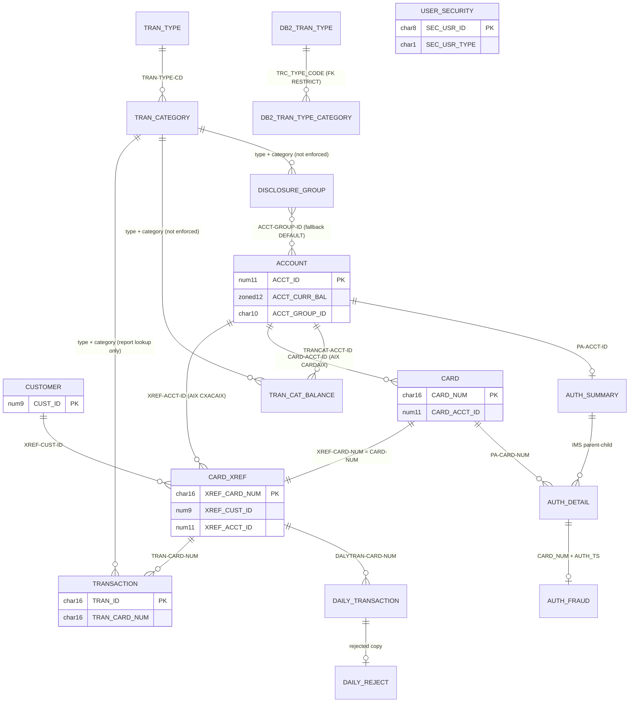

# CardDemo data dictionary (`entities.md`)

This file is the data dictionary of the CardDemo intermediate representation. It restates every
record layout (copybook), every VSAM dataset, every Db2 table, every IMS segment, and every
message layout, together with the keys, relationships, data-format rules, and integrity rules
that the COBOL programs actually enforce. It follows the conventions in
`modernization/spec/README.md`: entities are `ENT-<NAME>`, quirks are `Q-ENT-nn` (stable,
append-only), and sources are cited as `path:line-range (PARAGRAPH-NAME)`.

The dictionary describes what the source does, including defects. Target-schema content is
confined to the "Proposed SQL Server type" column of each field table and to the section
[Proposed relational schema notes](#proposed-relational-schema-notes), both of which are
**proposals**, not descriptions of the legacy system.

## Conventions used in this file

| Item | Convention |
|:--|:--|
| Offset | Zero-based byte offset inside the record. VSAM `KEYS(length offset)` uses the same zero-based offset. |
| Length | Bytes on disk (not digits). |
| USAGE | `DISPLAY` unless stated. `COMP`/`BINARY` = big-endian two's-complement binary. `COMP-3` = packed decimal (two digits per byte, sign in the low nibble). |
| Signed zoned (`S9(n)V99` DISPLAY) | Sign is overpunched in the last byte (see [Overpunch encoding](#rule-df-03-signed-zoned-decimal-overpunch)). `V` is an implied decimal point: no byte is stored for it. |
| `9(n)` DISPLAY | Unsigned zoned digits, stored as characters `0`-`9`, zero-padded on the left. |
| `X(n)` | Fixed-length character, padded on the right with spaces (unless the writer moved LOW-VALUES). |
| PII | Examples never show real-looking card numbers, SSNs, or user credentials. Card numbers appear masked as `4111********1111`. |
| Sample data | `app/data/ASCII/*.txt` (one record per line, ASCII, sign overpunch kept as ASCII characters) and `app/data/EBCDIC/*` (binary, code page 037). |

## Entity index

| ID | Copybook / object | Kind | Physical store | Primary key | Rec len |
|:--|:--|:--|:--|:--|--:|
| [ENT-ACCOUNT](#ent-account) | `app/cpy/CVACT01Y.cpy` | Master | VSAM KSDS `AWS.M2.CARDDEMO.ACCTDATA.VSAM.KSDS`, CICS file `ACCTDAT` | `ACCT-ID` | 300 |
| [ENT-CARD](#ent-card) | `app/cpy/CVACT02Y.cpy` | Master | VSAM KSDS `...CARDDATA.VSAM.KSDS` + AIX on account, CICS `CARDDAT`, `CARDAIX` | `CARD-NUM` | 150 |
| [ENT-CARD-XREF](#ent-card-xref) | `app/cpy/CVACT03Y.cpy` | Association | VSAM KSDS `...CARDXREF.VSAM.KSDS` + AIX on account, CICS `CCXREF`, `CXACAIX` | `XREF-CARD-NUM` | 50 |
| [ENT-CUSTOMER](#ent-customer) | `app/cpy/CVCUS01Y.cpy`, `app/cpy/CUSTREC.cpy` | Master | VSAM KSDS `...CUSTDATA.VSAM.KSDS`, CICS `CUSTDAT` | `CUST-ID` | 500 |
| [ENT-TRANSACTION](#ent-transaction) | `app/cpy/CVTRA05Y.cpy` | Ledger | VSAM KSDS `...TRANSACT.VSAM.KSDS` + AIX on `TRAN-PROC-TS`, CICS `TRANSACT` | `TRAN-ID` | 350 |
| [ENT-DAILY-TRANSACTION](#ent-daily-transaction) | `app/cpy/CVTRA06Y.cpy` | Input feed | Sequential `AWS.M2.CARDDEMO.DALYTRAN.PS` | none (sequential) | 350 |
| [ENT-DAILY-REJECT](#ent-daily-reject) | inline in `app/cbl/CBTRN02C.cbl:176-182` | Output feed | GDG `AWS.M2.CARDDEMO.DALYREJS(+1)` | none | 430 |
| [ENT-TRAN-CAT-BALANCE](#ent-tran-cat-balance) | `app/cpy/CVTRA01Y.cpy` | Balance | VSAM KSDS `...TCATBALF.VSAM.KSDS` | account + type + category | 50 |
| [ENT-DISCLOSURE-GROUP](#ent-disclosure-group) | `app/cpy/CVTRA02Y.cpy` | Reference | VSAM KSDS `...DISCGRP.VSAM.KSDS` | group + type + category | 50 |
| [ENT-TRAN-TYPE](#ent-tran-type) | `app/cpy/CVTRA03Y.cpy` | Reference | VSAM KSDS `...TRANTYPE.VSAM.KSDS`; Db2 `CARDDEMO.TRANSACTION_TYPE` in optional module | `TRAN-TYPE` | 60 |
| [ENT-TRAN-CATEGORY](#ent-tran-category) | `app/cpy/CVTRA04Y.cpy` | Reference | VSAM KSDS `...TRANCATG.VSAM.KSDS`; Db2 `CARDDEMO.TRANSACTION_TYPE_CATEGORY` | type + category | 60 |
| [ENT-USER-SECURITY](#ent-user-security) | `app/cpy/CSUSR01Y.cpy` (`UNUSED1Y` duplicate) | Security | VSAM KSDS `...USRSEC.VSAM.KSDS`, CICS `USRSEC` | `SEC-USR-ID` | 80 |
| [ENT-STATEMENT-TRANSACTION](#ent-statement-transaction) | `app/cpy/COSTM01.CPY` | Work file | VSAM KSDS `...TRXFL.VSAM.KSDS` | card + tran ID | 350 |
| [ENT-EXPORT-RECORD](#ent-export-record) | `app/cpy/CVEXPORT.cpy` | Interchange | VSAM KSDS `AWS.M2.CARDDEMO.EXPORT.DATA` | `EXPORT-SEQUENCE-NUM` | 500 |
| [ENT-TRANSACTION-REPORT](#ent-transaction-report) | `app/cpy/CVTRA07Y.cpy` | Report lines | GDG `AWS.M2.CARDDEMO.TRANREPT(+1)` | none | 133 max |
| [ENT-COMMAREA](#ent-commarea) | `app/cpy/COCOM01Y.cpy` | CICS state | COMMAREA | n/a | 160 |
| [ENT-CARD-WORK-AREA](#ent-card-work-area) | `app/cpy/CVCRD01Y.cpy` | Working storage | n/a | n/a | 213 |
| [ENT-MAIN-MENU-OPTIONS](#ent-main-menu-options) | `app/cpy/COMEN02Y.cpy` | Constant table | n/a | option number | 508 |
| [ENT-ADMIN-MENU-OPTIONS](#ent-admin-menu-options) | `app/cpy/COADM02Y.cpy` | Constant table | n/a | option number | 272 |
| [ENT-DATE-CONVERSION](#ent-date-conversion) | `app/cpy/CODATECN.cpy` | Call interface | n/a | n/a | 80 |
| [ENT-DATE-TIME-WORK](#ent-date-time-work) | `app/cpy/CSDAT01Y.cpy` | Working storage | n/a | n/a | 58 |
| [ENT-DATE-EDIT-WORK](#ent-date-edit-work) | `app/cpy/CSUTLDWY.cpy` + `app/cpy/CSUTLDPY.cpy` | Validation routine | n/a | n/a | n/a |
| [ENT-LOOKUP-CODES](#ent-lookup-codes) | `app/cpy/CSLKPCDY.cpy` | Reference constants | n/a | n/a | n/a |
| [ENT-COMMON-MESSAGES](#ent-common-messages) | `app/cpy/CSMSG01Y.cpy`, `app/cpy/COTTL01Y.cpy` | Constants | n/a | n/a | 100 / 120 |
| [ENT-ABEND-DATA](#ent-abend-data) | `app/cpy/CSMSG02Y.cpy` | Working storage | n/a | n/a | 134 |
| [ENT-AUTH-SUMMARY](#ent-auth-summary) | `app-authorization-ims-db2-mq/cpy/CIPAUSMY.cpy` | IMS root segment | IMS HIDAM `DBPAUTP0`, segment `PAUTSUM0` | `PA-ACCT-ID` | 100 |
| [ENT-AUTH-DETAIL](#ent-auth-detail) | `app-authorization-ims-db2-mq/cpy/CIPAUDTY.cpy` | IMS child segment | `DBPAUTP0`, segment `PAUTDTL1` | `PA-AUTHORIZATION-KEY` under parent | 200 |
| [ENT-AUTH-FRAUD](#ent-auth-fraud) | `app-authorization-ims-db2-mq/ddl/AUTHFRDS.ddl`, `dcl/AUTHFRDS.dcl` | Db2 table | `CARDDEMO.AUTHFRDS` | (`CARD_NUM`, `AUTH_TS`) | n/a |
| [ENT-AUTH-REQUEST](#ent-auth-request) | `app-authorization-ims-db2-mq/cpy/CCPAURQY.cpy` | MQ message | request queue (comma-delimited text) | n/a | variable |
| [ENT-AUTH-RESPONSE](#ent-auth-response) | `app-authorization-ims-db2-mq/cpy/CCPAURLY.cpy` | MQ message | reply queue (comma-delimited text) | n/a | variable |
| [ENT-AUTH-ERROR-LOG](#ent-auth-error-log) | `app-authorization-ims-db2-mq/cpy/CCPAUERY.cpy` | Log record | CICS TD queue / log | n/a | 122 |
| [ENT-IMS-PCB](#ent-ims-pcb) | `PADFLPCB.CPY`, `PASFLPCB.CPY`, `PAUTBPCB.CPY`, `IMSFUNCS.cpy` | IMS interface | n/a | n/a | n/a |
| [ENT-DB2-TRAN-TYPE](#ent-db2-tran-type) | `app-transaction-type-db2/ddl/TRNTYPE.ddl`, `dcl/DCLTRTYP.dcl` | Db2 table | `CARDDEMO.TRANSACTION_TYPE` | `TR_TYPE` | n/a |
| [ENT-DB2-TRAN-TYPE-CATEGORY](#ent-db2-tran-type-category) | `app-transaction-type-db2/ddl/TRNTYCAT.ddl`, `dcl/DCLTRCAT.dcl` | Db2 table | `CARDDEMO.TRANSACTION_TYPE_CATEGORY` | (`TRC_TYPE_CODE`, `TRC_TYPE_CATEGORY`) | n/a |
| [ENT-DB2-COMMON-WORK](#ent-db2-common-work) | `app-transaction-type-db2/cpy/CSDB2RWY.cpy`, `CSDB2RPY.cpy` | Working storage / procedure | n/a | n/a | n/a |
| [ENT-MQ-ACCOUNT-INQUIRY](#ent-mq-account-inquiry) | inline in `app-vsam-mq/cbl/COACCT01.cbl`, `CODATE01.cbl` | MQ message | `CARD.DEMO.REPLY.ACCT`, `CARD.DEMO.REPLY.DATE`, `CARD.DEMO.ERROR` | n/a | 1000 |

Entity count: 36 entities (`ENT-` IDs above). The procedure-only copybooks `CSSETATY`, `CSSTRPFY`,
`CSUTLDPY`, `CSDB2RPY`, and `IMSFUNCS` are documented inside the entity that owns their data
(see [Procedure copybooks](#procedure-copybooks)).

---

## Core VSAM entities

### ENT-ACCOUNT

Credit card account: balances, limits, lifecycle dates, and the disclosure (interest) group.

| Attribute | Value |
|:--|:--|
| Copybook | `app/cpy/CVACT01Y.cpy:4-17` (01 `ACCOUNT-RECORD`), header says "RECLN 300" |
| Dataset | `AWS.M2.CARDDEMO.ACCTDATA.VSAM.KSDS`, defined in `app/jcl/ACCTFILE.jcl:36-48`: `KEYS(11 0)`, `RECORDSIZE(300 300)`, `SHAREOPTIONS(2 3)`, `INDEXED` |
| Load source | `AWS.M2.CARDDEMO.ACCTDATA.PS` (sample `app/data/ASCII/acctdata.txt`, `app/data/EBCDIC/AWS.M2.CARDDEMO.ACCTDATA.PS`; `ACCDATA.PS` in the EBCDIC folder is a byte-identical duplicate) |
| CICS file | `ACCTDAT` in `app/csd/CARDDEMO.CSD` (ADD, BROWSE, DELETE, READ, UPDATE = YES) |
| Online users | COACTVWC (read), COACTUPC (read for update, rewrite), COBIL00C (read update, rewrite), COTRN02C (read), COPAUA0C (read), COPAUS0C (read), COACCT01 (MQ, read). CODATE01 only declares the literal `LIT-ACCTFILENAME` = `'ACCTDAT '` (`app/app-vsam-mq/cbl/CODATE01.cbl:115-116`) and never reads the file. |
| Batch users | CBTRN01C (read), CBTRN02C (random read, rewrite), CBACT01C (sequential list and extracts), CBACT04C (random read, rewrite), CBSTM03A via CBSTM03B (read), CBEXPORT (read), CBIMPORT (write) |

| Lvl | Field | PIC / USAGE | Off | Len | Meaning | Proposed SQL Server type |
|:--|:--|:--|--:|--:|:--|:--|
| 05 | `ACCT-ID` | `9(11)` | 0 | 11 | Account number, zero-padded. Primary key. | `BIGINT NOT NULL` (format as 11 digits with leading zeros) |
| 05 | `ACCT-ACTIVE-STATUS` | `X(01)` | 11 | 1 | Active flag. Online update accepts `Y`/`N` (COACTUPC 1220-EDIT-YESNO). No 88-levels. | `CHAR(1)` CHECK IN ('Y','N') |
| 05 | `ACCT-CURR-BAL` | `S9(10)V99` | 12 | 12 | Current balance; positive = amount owed. Signed zoned, 2 implied decimals. | `DECIMAL(12,2)` |
| 05 | `ACCT-CREDIT-LIMIT` | `S9(10)V99` | 24 | 12 | Credit limit. | `DECIMAL(12,2)` |
| 05 | `ACCT-CASH-CREDIT-LIMIT` | `S9(10)V99` | 36 | 12 | Cash-advance limit. Never used in a decision. | `DECIMAL(12,2)` |
| 05 | `ACCT-OPEN-DATE` | `X(10)` | 48 | 10 | Open date `YYYY-MM-DD`. | `DATE` |
| 05 | `ACCT-EXPIRAION-DATE` | `X(10)` | 58 | 10 | Expiration date `YYYY-MM-DD` (name misspelled in source, Q-ENT-03). Used by CBTRN02C reject 103. | `DATE` |
| 05 | `ACCT-REISSUE-DATE` | `X(10)` | 68 | 10 | Reissue date `YYYY-MM-DD`. | `DATE` |
| 05 | `ACCT-CURR-CYC-CREDIT` | `S9(10)V99` | 78 | 12 | Sum of non-negative posted amounts in the current cycle. | `DECIMAL(12,2)` |
| 05 | `ACCT-CURR-CYC-DEBIT` | `S9(10)V99` | 90 | 12 | Sum of negative posted amounts in the current cycle; stored as a negative number (Q-ENT-09). | `DECIMAL(12,2)` |
| 05 | `ACCT-ADDR-ZIP` | `X(10)` | 102 | 10 | Account billing ZIP. Only CBEXPORT/CBIMPORT move it; the online update overwrites it with the group ID (Q-ENT-01). | `VARCHAR(10) NULL` |
| 05 | `ACCT-GROUP-ID` | `X(10)` | 112 | 10 | Disclosure group (interest-rate group) key into ENT-DISCLOSURE-GROUP. Blank in all sample records (Q-ENT-02). | `VARCHAR(10) NULL` (FK, see notes) |
| 05 | `FILLER` | `X(178)` | 122 | 178 | Unused; spaces in sample. | not migrated |

Field usage notes:
- `ACCT-ACTIVE-STATUS` is displayed and edited online but never tested by posting (CBTRN02C), interest (CBACT04C), bill payment (COBIL00C), or authorization (COPAUA0C). It is compared only as a change-detection field in `app/cbl/COACTUPC.cbl:4109-4160 (9700-CHECK-CHANGE-IN-REC)`. See Q-ENT-29.
- Balance update rules are in [Integrity rules by program](#integrity-and-business-rules-by-program).

### ENT-CARD

A plastic card issued against an account.

| Attribute | Value |
|:--|:--|
| Copybook | `app/cpy/CVACT02Y.cpy:4-11` (01 `CARD-RECORD`), "RECLN 150" |
| Dataset | `AWS.M2.CARDDEMO.CARDDATA.VSAM.KSDS`, `app/jcl/CARDFILE.jcl:50-62`: `KEYS(16 0)`, `RECORDSIZE(150 150)`, `SHAREOPTIONS(2 3)` |
| Alternate index | `AWS.M2.CARDDEMO.CARDDATA.VSAM.AIX`, `app/jcl/CARDFILE.jcl:83-92`: `RELATE(...CARDDATA.VSAM.KSDS)`, `KEYS(11 16)` (= `CARD-ACCT-ID`), `NONUNIQUEKEY`; path `...CARDDATA.VSAM.AIX.PATH` (`CARDFILE.jcl:100-101`) |
| CICS files | `CARDDAT` (base), `CARDAIX` (path) |
| Online users | COCRDLIC (browse), COCRDSLC (read), COCRDUPC (read update, rewrite), COACTVWC and COACTUPC (declare `CARDAIX` but read via xref), COPAUA0C, COPAUS0C |
| Batch users | CBTRN01C (open, random read), CBACT02C (sequential list), CBEXPORT, CBIMPORT |

| Lvl | Field | PIC / USAGE | Off | Len | Meaning | Proposed SQL Server type |
|:--|:--|:--|--:|--:|:--|:--|
| 05 | `CARD-NUM` | `X(16)` | 0 | 16 | Card number (PAN), 16 digits stored as characters. Primary key. Example `4111********1111`. | `CHAR(16) NOT NULL` (tokenize or encrypt; PCI) |
| 05 | `CARD-ACCT-ID` | `9(11)` | 16 | 11 | Owning account. AIX key. | `BIGINT NOT NULL` FK -> account |
| 05 | `CARD-CVV-CD` | `9(03)` | 27 | 3 | Card verification value, stored in clear (Q-ENT-33). | do not migrate in clear; see notes |
| 05 | `CARD-EMBOSSED-NAME` | `X(50)` | 30 | 50 | Name printed on the card. COCRDUPC accepts letters and spaces only. | `NVARCHAR(50)` |
| 05 | `CARD-EXPIRAION-DATE` | `X(10)` | 80 | 10 | Expiration `YYYY-MM-DD` (misspelled name). COCRDUPC edits month 1-12, year 1950-2099; the day part is carried unchanged. | `DATE` |
| 05 | `CARD-ACTIVE-STATUS` | `X(01)` | 90 | 1 | `Y`/`N` (COCRDUPC 1240-EDIT-CARDSTATUS). Not enforced in posting or authorization. | `CHAR(1)` CHECK IN ('Y','N') |
| 05 | `FILLER` | `X(59)` | 91 | 59 | Unused. | not migrated |

Note: the `CARDAIX` path is referenced only by `app/cbl/COCRDSLC.cbl:779-810 (9150-GETCARD-BYACCT)`, a paragraph that no statement PERFORMs; the other programs declare the literal without using it (Q-ENT-14).

### ENT-CARD-XREF

Association card -> customer -> account. In every program that needs "the account of a card" or "the cards of an account", this file is the join path.

| Attribute | Value |
|:--|:--|
| Copybook | `app/cpy/CVACT03Y.cpy:4-8` (01 `CARD-XREF-RECORD`), "RECLN 50" |
| Dataset | `AWS.M2.CARDDEMO.CARDXREF.VSAM.KSDS`, `app/jcl/XREFFILE.jcl:39-51`: `KEYS(16 0)`, `RECORDSIZE(50 50)` |
| Alternate index | `...CARDXREF.VSAM.AIX`, `app/jcl/XREFFILE.jcl:72-82`: `KEYS(11,25)` (= `XREF-ACCT-ID`), `NONUNIQUEKEY`; path `...CARDXREF.VSAM.AIX.PATH` (`XREFFILE.jcl:90-91`) |
| CICS files | `CCXREF` (base), `CXACAIX` (path) |
| Online users | COACTVWC and COACTUPC (read by account via `CXACAIX`, e.g. `app/cbl/COACTUPC.cbl:3650-3700 (9200-GETCARDXREF-BYACCT)`), COBIL00C (`READ-CXACAIX-FILE`, `app/cbl/COBIL00C.cbl:408-440`), COTRN02C (both paths, `app/cbl/COTRN02C.cbl:576-641`), COPAUA0C (`5100-READ-XREF-RECORD`), COPAUS0C |
| Batch users | CBTRN01C (`2000-LOOKUP-XREF`), CBTRN02C (`1500-A-LOOKUP-XREF`, `app/cbl/CBTRN02C.cbl:380-392`), CBTRN03C (`1500-A-LOOKUP-XREF`), CBACT03C (list), CBACT04C (by account through AIX path, `app/cbl/CBACT04C.cbl:393-414 (1110-GET-XREF-DATA)`; DD points at `...CARDXREF.VSAM.AIX.PATH`, `app/jcl/INTCALC.jcl:32`), CBSTM03A (sequential driver), CBEXPORT, CBIMPORT |

| Lvl | Field | PIC / USAGE | Off | Len | Meaning | Proposed SQL Server type |
|:--|:--|:--|--:|--:|:--|:--|
| 05 | `XREF-CARD-NUM` | `X(16)` | 0 | 16 | Card number. Primary key. | `CHAR(16) NOT NULL` PK, FK -> card |
| 05 | `XREF-CUST-ID` | `9(09)` | 16 | 9 | Customer who holds the card. | `INT NOT NULL` FK -> customer |
| 05 | `XREF-ACCT-ID` | `9(11)` | 25 | 11 | Account the card belongs to. AIX key. | `BIGINT NOT NULL` FK -> account |
| 05 | `FILLER` | `X(14)` | 36 | 14 | Unused. ASCII sample lines are trimmed to 36 bytes; EBCDIC has 14 spaces. | not migrated |

### ENT-CUSTOMER

Card holder demographics.

| Attribute | Value |
|:--|:--|
| Copybooks | `app/cpy/CVCUS01Y.cpy:4-23` (01 `CUSTOMER-RECORD`), "RECLN 500"; `app/cpy/CUSTREC.cpy:4-23` is the same layout with one field renamed (Q-ENT-05) |
| Dataset | `AWS.M2.CARDDEMO.CUSTDATA.VSAM.KSDS`, `app/jcl/CUSTFILE.jcl:46-58`: `KEYS(9 0)`, `RECORDSIZE(500 500)`, `SHAREOPTIONS(2 3)` |
| Legacy definition | `app/jcl/DEFCUST.jcl:35-45` defines `AWS.CUSTDATA.CLUSTER` with `KEYS(10 0)`, `SHAREOPTIONS(1 4)`, which does not match the 9-byte key (Q-ENT-15) |
| CICS file | `CUSTDAT` |
| Online users | COACTVWC (read), COACTUPC (read update, rewrite), COPAUA0C (`5300-READ-CUST-RECORD`), COPAUS0C |
| Batch users | CBTRN01C, CBCUS01C (list), CBSTM03A (with `CUSTREC`), CBEXPORT, CBIMPORT |

| Lvl | Field | PIC / USAGE | Off | Len | Meaning | Proposed SQL Server type |
|:--|:--|:--|--:|--:|:--|:--|
| 05 | `CUST-ID` | `9(09)` | 0 | 9 | Customer number. Primary key. | `INT NOT NULL` |
| 05 | `CUST-FIRST-NAME` | `X(25)` | 9 | 25 | First name (COACTUPC: alphabetic, required). | `NVARCHAR(25)` |
| 05 | `CUST-MIDDLE-NAME` | `X(25)` | 34 | 25 | Middle name (optional, alphabetic). | `NVARCHAR(25) NULL` |
| 05 | `CUST-LAST-NAME` | `X(25)` | 59 | 25 | Last name (required, alphabetic). | `NVARCHAR(25)` |
| 05 | `CUST-ADDR-LINE-1` | `X(50)` | 84 | 50 | Street line 1 (required alphanumeric). | `NVARCHAR(50)` |
| 05 | `CUST-ADDR-LINE-2` | `X(50)` | 134 | 50 | Street line 2 (optional). | `NVARCHAR(50) NULL` |
| 05 | `CUST-ADDR-LINE-3` | `X(50)` | 184 | 50 | Used as the city by the account screens (Q-ENT-04). | `NVARCHAR(50)` (rename to `city`) |
| 05 | `CUST-ADDR-STATE-CD` | `X(02)` | 234 | 2 | US state code, validated against `VALID-US-STATE-CODE` online. | `CHAR(2)` |
| 05 | `CUST-ADDR-COUNTRY-CD` | `X(03)` | 236 | 3 | Country code; `USA` in all sample records. | `CHAR(3)` |
| 05 | `CUST-ADDR-ZIP` | `X(10)` | 239 | 10 | ZIP `99999` or `99999-9999`. | `VARCHAR(10)` |
| 05 | `CUST-PHONE-NUM-1` | `X(15)` | 249 | 15 | Phone, stored `(aaa)bbb-cccc` (13 characters + 2 spaces). | `VARCHAR(15)` |
| 05 | `CUST-PHONE-NUM-2` | `X(15)` | 264 | 15 | Second phone, same format. | `VARCHAR(15) NULL` |
| 05 | `CUST-SSN` | `9(09)` | 279 | 9 | US SSN, 9 digits, in clear (Q-ENT-33). | `CHAR(9)` encrypted (Always Encrypted) |
| 05 | `CUST-GOVT-ISSUED-ID` | `X(20)` | 288 | 20 | Government ID (20 digits in sample). | `VARCHAR(20)` encrypted |
| 05 | `CUST-DOB-YYYY-MM-DD` | `X(10)` | 308 | 10 | Date of birth `YYYY-MM-DD`. Named `CUST-DOB-YYYYMMDD` in `CUSTREC`. | `DATE` |
| 05 | `CUST-EFT-ACCOUNT-ID` | `X(10)` | 318 | 10 | Bank account for electronic funds transfer (10 digits in sample). | `VARCHAR(10)` |
| 05 | `CUST-PRI-CARD-HOLDER-IND` | `X(01)` | 328 | 1 | Primary card holder `Y`/`N` (COACTUPC 1220-EDIT-YESNO). | `CHAR(1)` |
| 05 | `CUST-FICO-CREDIT-SCORE` | `9(03)` | 329 | 3 | FICO score; online edit requires 300-850. | `SMALLINT` CHECK 300-850 (see data findings) |
| 05 | `FILLER` | `X(168)` | 332 | 168 | Unused (spaces in sample). | not migrated |

`CUSTREC` differences (`app/cpy/CUSTREC.cpy:19,23`): field at offset 308 is named `CUST-DOB-YYYYMMDD` although it holds `YYYY-MM-DD`, and the FILLER is indented one column further (no effect). Only CBSTM03A copies `CUSTREC`.

### ENT-TRANSACTION

Posted transaction ledger.

| Attribute | Value |
|:--|:--|
| Copybook | `app/cpy/CVTRA05Y.cpy:4-18` (01 `TRAN-RECORD`), "RECLN = 350" |
| Dataset | `AWS.M2.CARDDEMO.TRANSACT.VSAM.KSDS`, `app/jcl/TRANFILE.jcl:49-61` (also redefined by `app/jcl/TRANBKP.jcl:54-66`): `KEYS(16 0)`, `RECORDSIZE(350 350)`, `SHAREOPTIONS(2 3)` |
| Alternate index | `...TRANSACT.VSAM.AIX`, `app/jcl/TRANFILE.jcl:82-91` and `app/jcl/TRANIDX.jcl:25-34`: `KEYS(26 304)` (= `TRAN-PROC-TS`), `NONUNIQUEKEY`; path `...TRANSACT.VSAM.AIX.PATH`. No CICS file and no program uses this path (Q-ENT-14). |
| Initial load | `app/jcl/TRANFILE.jcl:67-72` REPROs `AWS.M2.CARDDEMO.DALYTRAN.PS.INIT` into the KSDS. In the sample data that dataset is a single 350-byte record of X'00' (Q-ENT-31). |
| CICS file | `TRANSACT` |
| Online users | COTRN00C (browse), COTRN01C (read), COTRN02C (browse for last ID, write), COBIL00C (browse for last ID, write), CORPT00C (submits report job) |
| Batch users | CBTRN02C (write, `2900-WRITE-TRANSACTION-FILE`), CBACT04C (writes interest transactions to `SYSTRAN(+1)`, `app/jcl/INTCALC.jcl:41`), COMBTRAN job (SORT backup + SYSTRAN by `TRAN-ID`, REPRO to KSDS, `app/jcl/COMBTRAN.jcl:22-46`), CBTRN03C (reads `TRANSACT.DALY(+1)` sorted by card, `app/jcl/TRANREPT.jcl:37-66`), CREASTMT job (re-keys into ENT-STATEMENT-TRANSACTION), CBEXPORT, CBIMPORT |

| Lvl | Field | PIC / USAGE | Off | Len | Meaning | Proposed SQL Server type |
|:--|:--|:--|--:|--:|:--|:--|
| 05 | `TRAN-ID` | `X(16)` | 0 | 16 | Transaction ID. Primary key. Three generators with different formats (Q-ENT-07). | `CHAR(16) NOT NULL` |
| 05 | `TRAN-TYPE-CD` | `X(02)` | 16 | 2 | Transaction type, FK to ENT-TRAN-TYPE (not enforced on write). | `CHAR(2)` |
| 05 | `TRAN-CAT-CD` | `9(04)` | 18 | 4 | Category within type; with type, FK to ENT-TRAN-CATEGORY. | `SMALLINT` (or `CHAR(4)`, see notes) |
| 05 | `TRAN-SOURCE` | `X(10)` | 22 | 10 | Origin: `POS TERM`, `OPERATOR` (daily feed), `System` (interest), `POS TERM` (bill pay), user-entered (COTRN02C). | `VARCHAR(10)` |
| 05 | `TRAN-DESC` | `X(100)` | 32 | 100 | Free-text description. | `NVARCHAR(100)` |
| 05 | `TRAN-AMT` | `S9(09)V99` | 132 | 11 | Amount, signed. Positive = charge (increases balance); negative = credit/return/payment reversal. | `DECIMAL(11,2)` |
| 05 | `TRAN-MERCHANT-ID` | `9(09)` | 143 | 9 | Merchant number (`999999999` for bill pay, `0` for interest). | `INT` |
| 05 | `TRAN-MERCHANT-NAME` | `X(50)` | 152 | 50 | Merchant name. | `NVARCHAR(50)` |
| 05 | `TRAN-MERCHANT-CITY` | `X(50)` | 202 | 50 | Merchant city. | `NVARCHAR(50)` |
| 05 | `TRAN-MERCHANT-ZIP` | `X(10)` | 252 | 10 | Merchant ZIP. | `VARCHAR(10)` |
| 05 | `TRAN-CARD-NUM` | `X(16)` | 262 | 16 | Card used; FK to ENT-CARD-XREF. Sort key for reports and statements. | `CHAR(16)` |
| 05 | `TRAN-ORIG-TS` | `X(26)` | 278 | 26 | Origination timestamp text; format varies by writer (Q-ENT-08). | `DATETIME2(6)` + raw `VARCHAR(26)` during migration |
| 05 | `TRAN-PROC-TS` | `X(26)` | 304 | 26 | Processing timestamp text; AIX key. Format varies by writer. | `DATETIME2(6)` |
| 05 | `FILLER` | `X(20)` | 330 | 20 | Unused. | not migrated |

### ENT-DAILY-TRANSACTION

The daily feed of transactions to post. Same layout as ENT-TRANSACTION with prefix `DALYTRAN-`.

| Attribute | Value |
|:--|:--|
| Copybook | `app/cpy/CVTRA06Y.cpy:4-18` (01 `DALYTRAN-RECORD`), offsets identical to ENT-TRANSACTION |
| Dataset | Sequential `AWS.M2.CARDDEMO.DALYTRAN.PS` (`app/jcl/POSTTRAN.jcl:31`), sample `app/data/ASCII/dailytran.txt` |
| Users | CBTRN01C (reads and validates, no update), CBTRN02C (posts) |

Field table: identical to ENT-TRANSACTION (`DALYTRAN-ID` @0 X(16) ... `DALYTRAN-PROC-TS` @304 X(26), `FILLER` @330 X(20)). CBTRN02C moves every `DALYTRAN-*` field to the matching `TRAN-*` field and replaces `TRAN-PROC-TS` with the batch timestamp (`app/cbl/CBTRN02C.cbl:424-445 (2000-POST-TRANSACTION)`).

### ENT-DAILY-REJECT

| Attribute | Value |
|:--|:--|
| Layout | inline `app/cbl/CBTRN02C.cbl:176-182` (`REJECT-RECORD`, `WS-VALIDATION-TRAILER`) |
| Dataset | GDG `AWS.M2.CARDDEMO.DALYREJS(+1)` (`app/jcl/POSTTRAN.jcl:38`); GDG base `app/jcl/DALYREJS.jcl:24-26` `LIMIT(5)` |
| Writer | CBTRN02C `2500-WRITE-REJECT-REC` (`app/cbl/CBTRN02C.cbl:446-466`) |

| Lvl | Field | PIC | Off | Len | Meaning |
|:--|:--|:--|--:|--:|:--|
| 05 | `REJECT-TRAN-DATA` | `X(350)` | 0 | 350 | The rejected ENT-DAILY-TRANSACTION record, unchanged |
| 05 | `VALIDATION-TRAILER` | `X(80)` | 350 | 80 | Copy of `WS-VALIDATION-TRAILER` |
| (10) | `WS-VALIDATION-FAIL-REASON` | `9(04)` | 350 | 4 | Reason code `0100`, `0101`, `0102`, `0103` |
| (10) | `WS-VALIDATION-FAIL-REASON-DESC` | `X(76)` | 354 | 76 | Reason text (verbatim list in integrity rules) |

Proposed SQL Server table: `posting_reject(reject_id BIGINT IDENTITY, run_id, tran_payload VARCHAR(350) or parsed columns, reason_code SMALLINT, reason_desc VARCHAR(76))`.

### ENT-TRAN-CAT-BALANCE

Running balance per account, transaction type, and category; input to interest calculation.

| Attribute | Value |
|:--|:--|
| Copybook | `app/cpy/CVTRA01Y.cpy:4-10` (01 `TRAN-CAT-BAL-RECORD`), "RECLN = 50" |
| Dataset | `AWS.M2.CARDDEMO.TCATBALF.VSAM.KSDS`, `app/jcl/TCATBALF.jcl:36-48`: `KEYS(17 0)`, `RECORDSIZE(50 50)`; backup GDG `TCATBALF.BKUP` (`app/jcl/DEFGDGB.jcl:42-44`, `LIMIT(5)`) |
| Users | CBTRN02C (random read, write new, rewrite; `app/cbl/CBTRN02C.cbl:467-544`), CBACT04C (sequential driver, `app/cbl/CBACT04C.cbl:325-349`) |

| Lvl | Field | PIC | Off | Len | Meaning | Proposed SQL Server type |
|:--|:--|:--|--:|--:|:--|:--|
| 05 | `TRAN-CAT-KEY` | group | 0 | 17 | Composite primary key | PK (3 columns) |
| 10 | `TRANCAT-ACCT-ID` | `9(11)` | 0 | 11 | Account | `BIGINT` FK -> account |
| 10 | `TRANCAT-TYPE-CD` | `X(02)` | 11 | 2 | Transaction type | `CHAR(2)` |
| 10 | `TRANCAT-CD` | `9(04)` | 13 | 4 | Category | `SMALLINT` |
| 05 | `TRAN-CAT-BAL` | `S9(09)V99` | 17 | 11 | Balance for this bucket (sum of posted amounts) | `DECIMAL(11,2)` |
| 05 | `FILLER` | `X(22)` | 28 | 22 | Unused; ASCII sample holds `0` characters, not spaces (Q-ENT-12) | not migrated |

### ENT-DISCLOSURE-GROUP

Interest rate per disclosure group, transaction type, and category.

| Attribute | Value |
|:--|:--|
| Copybook | `app/cpy/CVTRA02Y.cpy:4-10` (01 `DIS-GROUP-RECORD`), "RECLN = 50" |
| Dataset | `AWS.M2.CARDDEMO.DISCGRP.VSAM.KSDS`, `app/jcl/DISCGRP.jcl:36-48`: `KEYS(16 0)`, `RECORDSIZE(50 50)`; backup GDG `DISCGRP.BKUP` (`app/jcl/DEFGDGD.jcl:73-75`, `LIMIT(5)`) |
| Users | CBACT04C `1200-GET-INTEREST-RATE` and `1200-A-GET-DEFAULT-INT-RATE` (`app/cbl/CBACT04C.cbl:415-461`) |

| Lvl | Field | PIC | Off | Len | Meaning | Proposed SQL Server type |
|:--|:--|:--|--:|--:|:--|:--|
| 05 | `DIS-GROUP-KEY` | group | 0 | 16 | Composite primary key | PK (3 columns) |
| 10 | `DIS-ACCT-GROUP-ID` | `X(10)` | 0 | 10 | Group (`A000000000`, `DEFAULT`, `ZEROAPR` in sample) | `VARCHAR(10)` |
| 10 | `DIS-TRAN-TYPE-CD` | `X(02)` | 10 | 2 | Transaction type | `CHAR(2)` |
| 10 | `DIS-TRAN-CAT-CD` | `9(04)` | 12 | 4 | Category | `SMALLINT` |
| 05 | `DIS-INT-RATE` | `S9(04)V99` | 16 | 6 | Annual percentage rate, e.g. `00150{` = 15.00 % (S9(04)V99: digits `001500`; corrected from 1.50, see `programs/CBACT04C.md` BR-CBACT04C-02) | `DECIMAL(6,2)` |
| 05 | `FILLER` | `X(28)` | 22 | 28 | `0` characters in ASCII sample (Q-ENT-12) | not migrated |

The group `DEFAULT` is a reserved key: when the account's group is not found (status `23`), CBACT04C re-reads with `DIS-ACCT-GROUP-ID = 'DEFAULT'` (`app/cbl/CBACT04C.cbl:437`).

### ENT-TRAN-TYPE

| Attribute | Value |
|:--|:--|
| Copybook | `app/cpy/CVTRA03Y.cpy:4-7` (01 `TRAN-TYPE-RECORD`), "RECLN = 60" |
| Dataset | `AWS.M2.CARDDEMO.TRANTYPE.VSAM.KSDS`, `app/jcl/TRANTYPE.jcl:36-48`: `KEYS(2 0)`, `RECORDSIZE(60 60)`, `SHAREOPTIONS(1 4)`; backup GDG `TRANTYPE.BKUP` (`app/jcl/DEFGDGD.jcl:27-29`) |
| Users | CBTRN03C `1500-B-LOOKUP-TRANTYPE` (`app/cbl/CBTRN03C.cbl:494-503`); optional module extracts Db2 to this file (`app/app-transaction-type-db2/jcl/TRANEXTR.jcl`) |

| Lvl | Field | PIC | Off | Len | Meaning | Proposed SQL Server type |
|:--|:--|:--|--:|--:|:--|:--|
| 05 | `TRAN-TYPE` | `X(02)` | 0 | 2 | Type code `01`-`07`. Primary key. | `CHAR(2)` PK |
| 05 | `TRAN-TYPE-DESC` | `X(50)` | 2 | 50 | Description | `NVARCHAR(50)` |
| 05 | `FILLER` | `X(08)` | 52 | 8 | `00000000` in ASCII sample (Q-ENT-12) | not migrated |

Sample domain (`app/data/ASCII/trantype.txt`): `01` Purchase, `02` Payment, `03` Credit, `04` Authorization, `05` Refund, `06` Reversal, `07` Adjustment.

### ENT-TRAN-CATEGORY

| Attribute | Value |
|:--|:--|
| Copybook | `app/cpy/CVTRA04Y.cpy:4-9` (01 `TRAN-CAT-RECORD`), "RECLN = 60" |
| Dataset | `AWS.M2.CARDDEMO.TRANCATG.VSAM.KSDS`, `app/jcl/TRANCATG.jcl:36-48`: `KEYS(6 0)`, `RECORDSIZE(60 60)`, `SHAREOPTIONS(2 3)`; backup GDG `TRANCATG.PS.BKUP` (`app/jcl/DEFGDGD.jcl:50-52`) |
| Users | CBTRN03C `1500-C-LOOKUP-TRANCATG` (`app/cbl/CBTRN03C.cbl:504-513`) |

| Lvl | Field | PIC | Off | Len | Meaning | Proposed SQL Server type |
|:--|:--|:--|--:|--:|:--|:--|
| 05 | `TRAN-CAT-KEY` | group | 0 | 6 | Composite key | PK |
| 10 | `TRAN-TYPE-CD` | `X(02)` | 0 | 2 | Type, FK -> ENT-TRAN-TYPE | `CHAR(2)` |
| 10 | `TRAN-CAT-CD` | `9(04)` | 2 | 4 | Category number | `SMALLINT` |
| 05 | `TRAN-CAT-TYPE-DESC` | `X(50)` | 6 | 50 | Description | `NVARCHAR(50)` |
| 05 | `FILLER` | `X(04)` | 56 | 4 | `0000` in ASCII sample | not migrated |

Sample domain (`app/data/ASCII/trancatg.txt`, 18 rows): 01/0001 Regular Sales Draft, 01/0002 Regular Cash Advance, 01/0003 Convenience Check Debit, 01/0004 ATM Cash Advance, 01/0005 Interest Amount, 02/0001 Cash payment, 02/0002 Electronic payment, 02/0003 Check payment, 03/0001 Credit to Account, 03/0002 Credit to Purchase balance, 03/0003 Credit to Cash balance, 04/0001 Zero dollar authorization, 04/0002 Online purchase authorization, 04/0003 Travel booking authorization, 05/0001 Refund credit, 06/0001 Fraud reversal, 06/0002 Non-fraud reversal, 07/0001 Sales draft credit adjustment.

Note that COBIL00C writes type `02` category `2` (Electronic payment) and CBACT04C writes type `01` category `05` (Interest Amount); both exist in the reference data.

### ENT-USER-SECURITY

Sign-on users of the online application.

| Attribute | Value |
|:--|:--|
| Copybook | `app/cpy/CSUSR01Y.cpy:17-23` (01 `SEC-USER-DATA`); `app/cpy/UNUSED1Y.cpy:1-7` is an identical layout (`UNUSED-*`) that no program copies (Q-ENT-18) |
| Dataset | `AWS.M2.CARDDEMO.USRSEC.VSAM.KSDS`, `app/jcl/DUSRSECJ.jcl:64-73`: `KEYS(8,0)`, `RECORDSIZE(80,80)`, `REUSE`; loaded from 10 in-stream records in the same job. `app/jcl/ESDSRRDS.jcl:65-106` also defines ESDS and RRDS copies `USRSEC.VSAM.ESDS` / `.RRDS` (80 bytes) that no program reads. |
| CICS file | `USRSEC` |
| Users | COSGN00C (`READ-USER-SEC-FILE`, `app/cbl/COSGN00C.cbl:209-...`), COUSR00C (browse), COUSR01C (write, `app/cbl/COUSR01C.cbl:238-278`), COUSR02C (read update, rewrite), COUSR03C (read update, delete), COADM01C, COMEN01C (user type from COMMAREA) |

| Lvl | Field | PIC | Off | Len | Meaning | Proposed SQL Server type |
|:--|:--|:--|--:|--:|:--|:--|
| 05 | `SEC-USR-ID` | `X(08)` | 0 | 8 | User ID; sign-on upper-cases input before reading. Primary key. | `VARCHAR(8)` PK |
| 05 | `SEC-USR-FNAME` | `X(20)` | 8 | 20 | First name | `NVARCHAR(20)` |
| 05 | `SEC-USR-LNAME` | `X(20)` | 28 | 20 | Last name | `NVARCHAR(20)` |
| 05 | `SEC-USR-PWD` | `X(08)` | 48 | 8 | Password in clear text, compared after upper-casing input (Q-ENT-17) | replace with external IdP; do not migrate |
| 05 | `SEC-USR-TYPE` | `X(01)` | 56 | 1 | `A` admin / `U` user (88-levels live in `COCOM01Y` `CDEMO-USRTYP-ADMIN`/`-USER`) | `CHAR(1)` CHECK IN ('A','U') -> role |
| 05 | `SEC-USR-FILLER` | `X(23)` | 57 | 23 | Unused | not migrated |

Sample: 10 users, 5 of type `A` and 5 of type `U` (`app/jcl/DUSRSECJ.jcl` in-stream data and `app/data/EBCDIC/AWS.M2.CARDDEMO.USRSEC.PS`, 10 x 80 bytes). User names and passwords are not reproduced here.

### ENT-STATEMENT-TRANSACTION

Transactions re-keyed by card for statement generation.

| Attribute | Value |
|:--|:--|
| Copybook | `app/cpy/COSTM01.CPY:20-36` (01 `TRNX-RECORD`) |
| Dataset | `AWS.M2.CARDDEMO.TRXFL.VSAM.KSDS`, `app/jcl/CREASTMT.JCL:29-39`: `KEYS(32 0)`, `RECORDSIZE(350 350)`; built by SORT `app/jcl/CREASTMT.JCL:44-54` from the TRANSACT KSDS |
| Users | CBSTM03A (`4000-TRNXFILE-GET`), CBSTM03B (file I/O subroutine) |

| Lvl | Field | PIC | Off | Len | Meaning |
|:--|:--|:--|--:|--:|:--|
| 05 | `TRNX-KEY` | group | 0 | 32 | Key = card + transaction ID |
| 10 | `TRNX-CARD-NUM` | `X(16)` | 0 | 16 | Card number (from `TRAN-CARD-NUM`) |
| 10 | `TRNX-ID` | `X(16)` | 16 | 16 | Transaction ID |
| 10 | `TRNX-TYPE-CD` | `X(02)` | 32 | 2 | Type |
| 10 | `TRNX-CAT-CD` | `9(04)` | 34 | 4 | Category |
| 10 | `TRNX-SOURCE` | `X(10)` | 38 | 10 | Source |
| 10 | `TRNX-DESC` | `X(100)` | 48 | 100 | Description |
| 10 | `TRNX-AMT` | `S9(09)V99` | 148 | 11 | Amount |
| 10 | `TRNX-MERCHANT-ID` | `9(09)` | 159 | 9 | Merchant |
| 10 | `TRNX-MERCHANT-NAME` | `X(50)` | 168 | 50 | |
| 10 | `TRNX-MERCHANT-CITY` | `X(50)` | 218 | 50 | |
| 10 | `TRNX-MERCHANT-ZIP` | `X(10)` | 268 | 10 | |
| 10 | `TRNX-ORIG-TS` | `X(26)` | 278 | 26 | |
| 10 | `TRNX-PROC-TS` | `X(26)` | 304 | 26 | Last 2 bytes lost by the SORT OUTREC (Q-ENT-40) |
| 10 | `FILLER` | `X(20)` | 330 | 20 | |

The SORT control `SORT FIELDS=(263,16,CH,A,1,16,CH,A)` and `OUTREC FIELDS=(1:263,16,17:1,262,279:279,50)` (`app/jcl/CREASTMT.JCL:53-54`, 1-based positions) move card number to the front, then transaction bytes 1-262, then only 50 of the 52 timestamp bytes. Not a target-schema entity: in the target this is a query (`ORDER BY card_num, tran_id`).

### ENT-EXPORT-RECORD

Multi-record interchange format used to migrate a branch's data (CBEXPORT writes, CBIMPORT reads).

| Attribute | Value |
|:--|:--|
| Copybook | `app/cpy/CVEXPORT.cpy:9-100` (01 `EXPORT-RECORD`, 500 bytes, five REDEFINES of `EXPORT-RECORD-DATA`) |
| Dataset | `AWS.M2.CARDDEMO.EXPORT.DATA`, `app/jcl/CBEXPORT.jcl:30-38`: `INDEXED`, `KEYS(4 27)` (= `EXPORT-SEQUENCE-NUM`, binary), `RECORDSIZE(500 500)`, `SHAREOPTIONS(2 3)` |
| Writer | CBEXPORT: record types set at `app/cbl/CBEXPORT.cbl:277` (`C`), `:346` (`A`), `:410` (`X`), `:465` (`T`), `:530` (`D`) |
| Reader | CBIMPORT `2200-PROCESS-RECORD-BY-TYPE` (`app/cbl/CBIMPORT.cbl:273-290`) and per-type paragraphs `:291-427`; unknown type -> `2700-PROCESS-UNKNOWN-RECORD` |
| Sample | `app/data/EBCDIC/AWS.M2.CARDDEMO.EXPORT.DATA.PS`: 500 records (C 50, A 50, X 50, T 300, D 50) |

Header (all record types):

| Lvl | Field | PIC / USAGE | Off | Len | Meaning |
|:--|:--|:--|--:|--:|:--|
| 05 | `EXPORT-REC-TYPE` | `X(1)` | 0 | 1 | `C` customer, `A` account, `X` card xref, `T` transaction, `D` card |
| 05 | `EXPORT-TIMESTAMP` | `X(26)` | 1 | 26 | Export run timestamp, sample `2025-09-28 22:53:40.000000` |
| 05 | `EXPORT-TIMESTAMP-R` | REDEFINES | 1 | 26 | `EXPORT-DATE` X(10) @1, `EXPORT-DATE-TIME-SEP` X(1) @11, `EXPORT-TIME` X(15) @12 |
| 05 | `EXPORT-SEQUENCE-NUM` | `9(9) COMP` | 27 | 4 | Sequence number, unsigned binary fullword. KSDS key. Sample values 1-509 (not contiguous). |
| 05 | `EXPORT-BRANCH-ID` | `X(4)` | 31 | 4 | Branch, sample `0001` |
| 05 | `EXPORT-REGION-CODE` | `X(5)` | 35 | 5 | Region, sample `NORTH` |
| 05 | `EXPORT-RECORD-DATA` | `X(460)` | 40 | 460 | Payload, redefined per type below |

Customer payload `EXPORT-CUSTOMER-DATA` (type `C`):

| Field | PIC / USAGE | Off | Len |
|:--|:--|--:|--:|
| `EXP-CUST-ID` | `9(09) COMP` | 40 | 4 |
| `EXP-CUST-FIRST-NAME` / `-MIDDLE-NAME` / `-LAST-NAME` | `X(25)` each | 44 / 69 / 94 | 25 each |
| `EXP-CUST-ADDR-LINE` | `X(50)` OCCURS 3 | 119 | 150 |
| `EXP-CUST-ADDR-STATE-CD` | `X(02)` | 269 | 2 |
| `EXP-CUST-ADDR-COUNTRY-CD` | `X(03)` | 271 | 3 |
| `EXP-CUST-ADDR-ZIP` | `X(10)` | 274 | 10 |
| `EXP-CUST-PHONE-NUM` | `X(15)` OCCURS 2 | 284 | 30 |
| `EXP-CUST-SSN` | `9(09)` | 314 | 9 |
| `EXP-CUST-GOVT-ISSUED-ID` | `X(20)` | 323 | 20 |
| `EXP-CUST-DOB-YYYY-MM-DD` | `X(10)` | 343 | 10 |
| `EXP-CUST-EFT-ACCOUNT-ID` | `X(10)` | 353 | 10 |
| `EXP-CUST-PRI-CARD-HOLDER-IND` | `X(01)` | 363 | 1 |
| `EXP-CUST-FICO-CREDIT-SCORE` | `9(03) COMP-3` | 364 | 2 |
| `FILLER` | `X(134)` | 366 | 134 |

Account payload `EXPORT-ACCOUNT-DATA` (type `A`):

| Field | PIC / USAGE | Off | Len |
|:--|:--|--:|--:|
| `EXP-ACCT-ID` | `9(11)` | 40 | 11 |
| `EXP-ACCT-ACTIVE-STATUS` | `X(01)` | 51 | 1 |
| `EXP-ACCT-CURR-BAL` | `S9(10)V99 COMP-3` | 52 | 7 |
| `EXP-ACCT-CREDIT-LIMIT` | `S9(10)V99` (zoned) | 59 | 12 |
| `EXP-ACCT-CASH-CREDIT-LIMIT` | `S9(10)V99 COMP-3` | 71 | 7 |
| `EXP-ACCT-OPEN-DATE` / `-EXPIRAION-DATE` / `-REISSUE-DATE` | `X(10)` each | 78 / 88 / 98 | 10 each |
| `EXP-ACCT-CURR-CYC-CREDIT` | `S9(10)V99` (zoned) | 108 | 12 |
| `EXP-ACCT-CURR-CYC-DEBIT` | `S9(10)V99 COMP` | 120 | 8 |
| `EXP-ACCT-ADDR-ZIP` | `X(10)` | 128 | 10 |
| `EXP-ACCT-GROUP-ID` | `X(10)` | 138 | 10 |
| `FILLER` | `X(352)` | 148 | 352 |

Transaction payload `EXPORT-TRANSACTION-DATA` (type `T`):

| Field | PIC / USAGE | Off | Len |
|:--|:--|--:|--:|
| `EXP-TRAN-ID` | `X(16)` | 40 | 16 |
| `EXP-TRAN-TYPE-CD` | `X(02)` | 56 | 2 |
| `EXP-TRAN-CAT-CD` | `9(04)` | 58 | 4 |
| `EXP-TRAN-SOURCE` | `X(10)` | 62 | 10 |
| `EXP-TRAN-DESC` | `X(100)` | 72 | 100 |
| `EXP-TRAN-AMT` | `S9(09)V99 COMP-3` | 172 | 6 |
| `EXP-TRAN-MERCHANT-ID` | `9(09) COMP` | 178 | 4 |
| `EXP-TRAN-MERCHANT-NAME` / `-CITY` | `X(50)` each | 182 / 232 | 50 each |
| `EXP-TRAN-MERCHANT-ZIP` | `X(10)` | 282 | 10 |
| `EXP-TRAN-CARD-NUM` | `X(16)` | 292 | 16 |
| `EXP-TRAN-ORIG-TS` / `-PROC-TS` | `X(26)` each | 308 / 334 | 26 each |
| `FILLER` | `X(140)` | 360 | 140 |

Card xref payload `EXPORT-CARD-XREF-DATA` (type `X`): `EXP-XREF-CARD-NUM` X(16) @40; `EXP-XREF-CUST-ID` 9(09) zoned @56 (9); `EXP-XREF-ACCT-ID` 9(11) COMP @65 (8); `FILLER` X(427) @73.

Card payload `EXPORT-CARD-DATA` (type `D`): `EXP-CARD-NUM` X(16) @40; `EXP-CARD-ACCT-ID` 9(11) COMP @56 (8); `EXP-CARD-CVV-CD` 9(03) COMP @64 (2); `EXP-CARD-EMBOSSED-NAME` X(50) @66; `EXP-CARD-EXPIRAION-DATE` X(10) @116; `EXP-CARD-ACTIVE-STATUS` X(01) @126; `FILLER` X(373) @127.

The mix of COMP, COMP-3, and zoned fields has no pattern (Q-ENT-19). Target equivalent: a JSON or CSV export API, not a table.

### ENT-TRANSACTION-REPORT

Print lines of the daily transaction report written by CBTRN03C to `TRANREPT(+1)` (`app/jcl/TRANREPT.jcl:80`).

| Record | Source | Length | Content |
|:--|:--|--:|:--|
| `REPORT-NAME-HEADER` | `app/cpy/CVTRA07Y.cpy:4-13` | 115 | `REPT-SHORT-NAME` X(38) `'DALYREPT'`, `REPT-LONG-NAME` X(41) `'Daily Transaction Report'`, `REPT-DATE-HEADER` X(12) `'Date Range: '`, `REPT-START-DATE` X(10), `' to '`, `REPT-END-DATE` X(10) |
| `TRANSACTION-DETAIL-REPORT` | `:15-31` | 114 | `TRAN-REPORT-TRANS-ID` X(16), sp, `TRAN-REPORT-ACCOUNT-ID` X(11), sp, `TRAN-REPORT-TYPE-CD` X(02), `'-'`, `TRAN-REPORT-TYPE-DESC` X(15), sp, `TRAN-REPORT-CAT-CD` 9(04), `'-'`, `TRAN-REPORT-CAT-DESC` X(29), sp, `TRAN-REPORT-SOURCE` X(10), 4 sp, `TRAN-REPORT-AMT` `-ZZZ,ZZZ,ZZZ.ZZ` (15), 2 sp |
| `TRANSACTION-HEADER-1` | `:33-46` | 114 | Column titles `'Transaction ID'`, `'Account ID'`, `'Transaction Type'`, `'Tran Category'`, `'Tran Source'`, `'        Amount'` |
| `TRANSACTION-HEADER-2` | `:48` | 133 | 133 dashes |
| `REPORT-PAGE-TOTALS` | `:50-54` | 112 | `'Page Total'` + 86 dots + `+ZZZ,ZZZ,ZZZ.ZZ` |
| `REPORT-ACCOUNT-TOTALS` | `:56-60` | 112 | `'Account Total'` + 84 dots + `+ZZZ,ZZZ,ZZZ.ZZ` |
| `REPORT-GRAND-TOTALS` | `:62-66` | 112 | `'Grand Total'` + 86 dots + `+ZZZ,ZZZ,ZZZ.ZZ` |

Descriptions are truncated to 15 (type) and 29 (category) characters. The detail amount edit picture places a leading minus only for negatives; totals use a leading `+`/`-` sign.

---

## Shared working-storage and interface entities

### ENT-COMMAREA

CICS COMMAREA passed on every XCTL and RETURN TRANSID (`app/cpy/COCOM01Y.cpy:19-44`, 01 `CARDDEMO-COMMAREA`, 160 bytes). Programs append their own program-specific area after it (for example `WS-THIS-PROGCOMMAREA`), documented in each `programs/<MEMBER>.md`.

| Lvl | Field | PIC | Off | Len | Meaning / 88-levels |
|:--|:--|:--|--:|--:|:--|
| 10 | `CDEMO-FROM-TRANID` | `X(04)` | 0 | 4 | Calling transaction |
| 10 | `CDEMO-FROM-PROGRAM` | `X(08)` | 4 | 8 | Calling program (used for PF3 return) |
| 10 | `CDEMO-TO-TRANID` | `X(04)` | 12 | 4 | Target transaction |
| 10 | `CDEMO-TO-PROGRAM` | `X(08)` | 16 | 8 | Target program |
| 10 | `CDEMO-USER-ID` | `X(08)` | 24 | 8 | Signed-on user |
| 10 | `CDEMO-USER-TYPE` | `X(01)` | 32 | 1 | 88 `CDEMO-USRTYP-ADMIN` = `'A'`, 88 `CDEMO-USRTYP-USER` = `'U'` |
| 10 | `CDEMO-PGM-CONTEXT` | `9(01)` | 33 | 1 | 88 `CDEMO-PGM-ENTER` = 0 (first entry), 88 `CDEMO-PGM-REENTER` = 1 |
| 10 | `CDEMO-CUST-ID` | `9(09)` | 34 | 9 | Selected customer |
| 10 | `CDEMO-CUST-FNAME` / `-MNAME` / `-LNAME` | `X(25)` each | 43 / 68 / 93 | 25 each | Selected customer name |
| 10 | `CDEMO-ACCT-ID` | `9(11)` | 118 | 11 | Selected account |
| 10 | `CDEMO-ACCT-STATUS` | `X(01)` | 129 | 1 | Selected account status |
| 10 | `CDEMO-CARD-NUM` | `9(16)` | 130 | 16 | Selected card; numeric here but `X(16)` in every file (Q-ENT-06) |
| 10 | `CDEMO-LAST-MAP` | `X(7)` | 146 | 7 | Last map sent |
| 10 | `CDEMO-LAST-MAPSET` | `X(7)` | 153 | 7 | Last mapset sent |

Target mapping: server-side session or a signed token (user ID, role) plus route parameters (account, card); not a table.

### ENT-CARD-WORK-AREA

`app/cpy/CVCRD01Y.cpy:1-42` (01 `CC-WORK-AREAS`, 213 bytes), used by the card and account programs.

| Lvl | Field | PIC | Off | Len | Meaning |
|:--|:--|:--|--:|--:|:--|
| 10 | `CCARD-AID` | `X(5)` | 0 | 5 | Normalized attention key. 88s: `CCARD-AID-ENTER` `'ENTER'`, `-CLEAR` `'CLEAR'`, `-PA1` `'PA1  '`, `-PA2` `'PA2  '`, `-PFK01`..`-PFK12` `'PFK01'`..`'PFK12'` |
| 10 | `CCARD-NEXT-PROG` | `X(8)` | 5 | 8 | Next program |
| 10 | `CCARD-NEXT-MAPSET` | `X(7)` | 13 | 7 | Next mapset |
| 10 | `CCARD-NEXT-MAP` | `X(7)` | 20 | 7 | Next map |
| 10 | `CCARD-ERROR-MSG` | `X(75)` | 27 | 75 | Error message line |
| 10 | `CCARD-RETURN-MSG` | `X(75)` | 102 | 75 | Info message; 88 `CCARD-RETURN-MSG-OFF` = LOW-VALUES |
| 10 | `CC-ACCT-ID` | `X(11)` | 177 | 11 | Account input; `CC-ACCT-ID-N` REDEFINES `9(11)` |
| 10 | `CC-CARD-NUM` | `X(16)` | 188 | 16 | Card input; `CC-CARD-NUM-N` REDEFINES `9(16)` |
| 10 | `CC-CUST-ID` | `X(09)` | 204 | 9 | Customer input; `CC-CUST-ID-N` REDEFINES `9(9)`. Not referenced by any program. |

Commented-out fields (`CCARD-LAST-PROG`, `CCARD-RETURN-TO-PROG`, `CCARD-RETURN-FLAG`, `CCARD-FUNCTION`) occupy no storage. `CSSTRPFY` (`app/cpy/CSSTRPFY.cpy:17-85`, paragraph `YYYY-STORE-PFKEY`) maps `EIBAID` to `CCARD-AID`, folding PF13-PF24 onto PFK01-PFK12.

### ENT-MAIN-MENU-OPTIONS

`app/cpy/COMEN02Y.cpy:19-98` (01 `CARDDEMO-MAIN-MENU-OPTIONS`). `CDEMO-MENU-OPT-COUNT` `9(02)` = 11. Each entry is 46 bytes: `CDEMO-MENU-OPT-NUM` 9(02), `CDEMO-MENU-OPT-NAME` X(35), `CDEMO-MENU-OPT-PGMNAME` X(08), `CDEMO-MENU-OPT-USRTYPE` X(01). The REDEFINES declares `OCCURS 12 TIMES` over 11 initialized entries (Q-ENT-21).

| # | Name (verbatim, trailing spaces trimmed) | Program | User type |
|--:|:--|:--|:--|
| 1 | `Account View` | COACTVWC | U |
| 2 | `Account Update` | COACTUPC | U |
| 3 | `Credit Card List` | COCRDLIC | U |
| 4 | `Credit Card View` | COCRDSLC | U |
| 5 | `Credit Card Update` | COCRDUPC | U |
| 6 | `Transaction List` | COTRN00C | U |
| 7 | `Transaction View` | COTRN01C | U |
| 8 | `Transaction Add` | COTRN02C | U |
| 9 | `Transaction Reports` | CORPT00C | U |
| 10 | `Bill Payment` | COBIL00C | U |
| 11 | `Pending Authorization View` | COPAUS0C | U |

### ENT-ADMIN-MENU-OPTIONS

`app/cpy/COADM02Y.cpy:19-59` (01 `CARDDEMO-ADMIN-MENU-OPTIONS`). `CDEMO-ADMIN-OPT-COUNT` = 6 (a commented line shows the earlier value 4). Entry = `CDEMO-ADMIN-OPT-NUM` 9(02) + `-NAME` X(35) + `-PGMNAME` X(08) = 45 bytes; REDEFINES `OCCURS 9 TIMES` over 6 entries.

| # | Name | Program |
|--:|:--|:--|
| 1 | `User List (Security)` | COUSR00C |
| 2 | `User Add (Security)` | COUSR01C |
| 3 | `User Update (Security)` | COUSR02C |
| 4 | `User Delete (Security)` | COUSR03C |
| 5 | `Transaction Type List/Update (Db2)` | COTRTLIC |
| 6 | `Transaction Type Maintenance (Db2)` | COTRTUPC |

### ENT-DATE-CONVERSION

`app/cpy/CODATECN.cpy:17-52` (01 `CODATECN-REC`, 80 bytes): interface to the date-format conversion routine called by CBACT01C.

| Lvl | Field | PIC | Off | Len | Meaning |
|:--|:--|:--|--:|--:|:--|
| 10 | `CODATECN-TYPE` | `X` | 0 | 1 | Input format: 88 `YYYYMMDD-IN` = `"1"`, 88 `YYYY-MM-DD-IN` = `"2"` |
| 10 | `CODATECN-INP-DATE` | `X(20)` | 1 | 20 | Input date |
| 10 | `CODATECN-1INP` (REDEFINES) | | 1 | 20 | `CODATECN-1YYYY` X(4), `CODATECN-1MM` XX, `CODATECN-1DD` XX, `CODATECN-1FIL` X(12) |
| 10 | `CODATECN-2INP` (REDEFINES) | | 1 | 20 | `CODATECN-1O-YYYY` X(4), `CODATECN-1I-S1` X, `CODATECN-1MM` XX, `CODATECN-1I-S2` X, `CODATECN-2YY` XX (holds the day), `CODATECN-2FIL` X(10) |
| 10 | `CODATECN-OUTTYPE` | `X` | 21 | 1 | Output format: 88 `YYYY-MM-DD-OP` = `"1"`, 88 `YYYYMMDD-OP` = `"2"` |
| 10 | `CODATECN-0UT-DATE` | `X(20)` | 22 | 20 | Output date (the name uses digit zero `0UT`) |
| 10 | `CODATECN-1OUT` (REDEFINES) | | 22 | 20 | `CODATECN-1O-YYYY`, `-1O-S1`, `-1O-MM`, `-1O-S2`, `-1O-DD`, `CODATECN-1OFIl` X(10) |
| 10 | `CODATECN-2OUT` (REDEFINES) | | 22 | 20 | `CODATECN-2O-YYYY`, `-2O-MM`, `-2O-DD`, `CODATECN-2OFIl` X(12) |
| 05 | `CODATECN-ERROR-MSG` | `X(38)` | 42 | 38 | Error text |

See Q-ENT-20 for the naming collisions.

### ENT-DATE-TIME-WORK

`app/cpy/CSDAT01Y.cpy:17-55` (01 `WS-DATE-TIME`, 58 bytes). Online programs move `FUNCTION CURRENT-DATE` into `WS-CURDATE-DATA` for screen headers; COBIL00C fills `WS-TIMESTAMP` from CICS FORMATTIME.

| Field | PIC | Off | Len | Format |
|:--|:--|--:|--:|:--|
| `WS-CURDATE` (`-YEAR` 9(4), `-MONTH` 9(2), `-DAY` 9(2)); `WS-CURDATE-N` REDEFINES 9(8) | | 0 | 8 | `YYYYMMDD` |
| `WS-CURTIME` (`-HOURS`, `-MINUTE`, `-SECOND`, `-MILSEC` 9(2) each); `WS-CURTIME-N` 9(8) | | 8 | 8 | `HHMMSShh` (hundredths, despite the name `MILSEC`) |
| `WS-CURDATE-MM-DD-YY` | | 16 | 8 | `MM/DD/YY` (screen header) |
| `WS-CURTIME-HH-MM-SS` | | 24 | 8 | `HH:MM:SS` (screen header) |
| `WS-TIMESTAMP` | | 32 | 26 | `YYYY-MM-DD HH:MM:SS.ffffff` (`WS-TIMESTAMP-TM-MS6` 9(06)) |

### ENT-DATE-EDIT-WORK

`app/cpy/CSUTLDWY.cpy:4-85` (working storage, level 10 items to be nested by the including program) with the procedure copybook `app/cpy/CSUTLDPY.cpy:18-370`. Used by COACTUPC (both) and COTRTUPC (`CSUTLDWY` only).

Working fields: `WS-EDIT-DATE-CCYYMMDD` (`WS-EDIT-DATE-CC` X(2) with 88 `THIS-CENTURY` = 20, `LAST-CENTURY` = 19; `WS-EDIT-DATE-YY` X(2); `WS-EDIT-DATE-MM` X(2) with 88 `WS-VALID-MONTH` 1-12, `WS-31-DAY-MONTH` 1,3,5,7,8,10,12, `WS-FEBRUARY` 2; `WS-EDIT-DATE-DD` X(2) with 88 `WS-VALID-DAY` 1-31, `WS-DAY-31`, `WS-DAY-30`, `WS-DAY-29`, `WS-VALID-FEB-DAY` 1-28), numeric REDEFINES of each, `WS-EDIT-DATE-BINARY` S9(9) BINARY, `WS-CURRENT-DATE-YYYYMMDD` X(8), flags `WS-EDIT-DATE-FLGS` (88 `WS-EDIT-DATE-IS-VALID` = LOW-VALUES, `WS-EDIT-DATE-IS-INVALID` = `'000'`; per-part flags with 88 `FLG-*-ISVALID` LOW-VALUES / `FLG-*-NOT-OK` `'0'` / `FLG-*-BLANK` `'B'`), `WS-DATE-FORMAT` `'YYYYMMDD'`, and the 80-byte `WS-DATE-VALIDATION-RESULT` that receives the result of `CALL 'CSUTLDTC'` (severity, `'Mesg Code:'`, message number, result text, `'TstDate:'`, date, `'Mask used:'`, mask).

Rules implemented by `CSUTLDPY` (paragraphs `EDIT-YEAR-CCYY` `:25-88`, `EDIT-MONTH` `:91-145`, `EDIT-DAY` `:150-205`, `EDIT-DAY-MONTH-YEAR` `:209-280`, `EDIT-DATE-LE` `:284-323`, `EDIT-DATE-OF-BIRTH` `:341-370`): see [Rule DF-05](#rule-df-05-date-validation-csutldpy).

### ENT-LOOKUP-CODES

`app/cpy/CSLKPCDY.cpy` (1318 lines) holds three reference lists as 88-level value sets. In a target system they become reference tables.

| Item | Source line | Values |
|:--|:--|:--|
| `WS-US-PHONE-AREA-CODE-TO-EDIT` X(3), 88 `VALID-PHONE-AREA-CODE` | 24, 30 | 490 codes = general purpose list + easy-recognizable list |
| 88 `VALID-GENERAL-PURP-CODE` | 521 | 410 North American general-purpose area codes (first value `'201'`) |
| 88 `VALID-EASY-RECOG-AREA-CODE` | 931 | 80 codes of the form N00, N11, NNN: `'200'`, `'211'`, ... `'999'` |
| `US-STATE-CODE-TO-EDIT` X(2), 88 `VALID-US-STATE-CODE` | 1012-1013 | 56 codes: 50 states, `DC`, `AS`, `GU`, `MP`, `PR`, `VI` |
| `US-STATE-ZIPCODE-TO-EDIT` (state X(2) + first two ZIP digits X(2)), 88 `VALID-US-STATE-ZIP-CD2-COMBO` | 1071-1073 | 240 state + ZIP-prefix pairs, including `AA`, `AE`, `AP`, `FM`, `MH`, `PW` that are not in the state list |

COACTUPC tests the area code against `VALID-GENERAL-PURP-CODE` only, not `VALID-PHONE-AREA-CODE` (Q-ENT-22).

### ENT-COMMON-MESSAGES

| Copybook | Field | PIC | Value (verbatim) |
|:--|:--|:--|:--|
| `app/cpy/CSMSG01Y.cpy:17-21` | `CCDA-MSG-THANK-YOU` | X(50) | `'Thank you for using CardDemo application...      '` |
| | `CCDA-MSG-INVALID-KEY` | X(50) | `'Invalid key pressed. Please see below...         '` |
| `app/cpy/COTTL01Y.cpy:17-24` | `CCDA-TITLE01` | X(40) | `'      AWS Mainframe Modernization       '` |
| | `CCDA-TITLE02` | X(40) | `'              CardDemo                  '` (an earlier value `'  Credit Card Demo Application (CCDA)   '` is commented out) |
| | `CCDA-THANK-YOU` | X(40) | `'Thank you for using CCDA application... '` |

### ENT-ABEND-DATA

`app/cpy/CSMSG02Y.cpy:21-29` (01 `ABEND-DATA`, 134 bytes; the header comment calls the member `CABENDD.CPY`): `ABEND-CODE` X(4) @0, `ABEND-CULPRIT` X(8) @4, `ABEND-REASON` X(50) @12, `ABEND-MSG` X(72) @62, all `VALUE SPACES`. Used by the online programs' `ABEND-ROUTINE` before `EXEC CICS ABEND`.

### Procedure copybooks

| Copybook | Content | Used by |
|:--|:--|:--|
| `app/cpy/CSSETATY.cpy:17-27` | Template with placeholders `(TESTVAR1)`, `(SCRNVAR2)`, `(MAPNAME3)`: on re-entry, if the field's flag is NOT-OK or BLANK, set the screen field color to `DFHRED`; if BLANK, also move `'*'` into the field. | COACTUPC, COTRTUPC (`COPY ... REPLACING`) |
| `app/cpy/CSSTRPFY.cpy:17-85` | `YYYY-STORE-PFKEY`: `EIBAID` -> `CCARD-AID` (PF13-24 fold to PF1-12). | COACTVWC, COACTUPC, COCRDLIC, COCRDSLC, COCRDUPC, COTRTLIC, COTRTUPC |
| `app/cpy/CSUTLDPY.cpy` | Date validation paragraphs (DF-05). | COACTUPC |
| `app/app-transaction-type-db2/cpy/CSDB2RPY.cpy` | `9998-PRIMING-QUERY`, `9999-FORMAT-DB2-MESSAGE` (see ENT-DB2-COMMON-WORK). | COTRTLIC only (`app/app-transaction-type-db2/cbl/COTRTLIC.cbl:304, 2055`). COTRTUPC includes neither `CSDB2RWY` nor `CSDB2RPY`; it builds its SQL messages from `SQLERRM OF SQLCA` directly (`app/app-transaction-type-db2/cbl/COTRTUPC.cbl:1495-1508, 1567-1577, 1608-1617, 1638-1661`). |
| `app/app-authorization-ims-db2-mq/cpy/IMSFUNCS.cpy:17-27` | DL/I function codes `'GU  '`, `'GHU '`, `'GN  '`, `'GHN '`, `'GNP '`, `'GHNP'`, `'REPL'`, `'ISRT'`, `'DLET'`; `PARMCOUNT` S9(05) COMP-5 = +4. | IMS programs |

---

## Optional module entities

### ENT-AUTH-SUMMARY

Pending-authorization summary per account; IMS root segment.

| Attribute | Value |
|:--|:--|
| Copybook | `app/app-authorization-ims-db2-mq/cpy/CIPAUSMY.cpy:19-31` (05-level fields, 100 bytes) |
| IMS | DBD `app/app-authorization-ims-db2-mq/ims/DBPAUTP0.dbd:18-37`: `ACCESS=(HIDAM,VSAM)`, segment `PAUTSUM0` `PARENT=0`, `BYTES=100`, `RULES=(,HERE)`, `POINTER=(TWINBWD)`; sequence field `ACCNTID` `START=1,BYTES=6,TYPE=P`, unique; `LCHILD` -> primary index `PAUTINDX` in `DBPAUTX0` (`ims/DBPAUTX0.dbd:18-31`, `ACCESS=(INDEX,VSAM,PROT)`, segment 6 bytes, `INDEX=ACCNTID`) |
| PSBs | `PSBPAUTB` `PROCOPT=AP` (`ims/PSBPAUTB.psb:17-20`), `PSBPAUTL` `PROCOPT=L` (load), `PAUTBUNL` `GOTP` (unload), `DLIGSAMP` `GOTP` + two GSAM PCBs; all `KEYLEN=14` (6-byte root key + 8-byte child key) |
| Users | COPAUA0C (`5500-READ-AUTH-SUMMRY`, `8400-UPDATE-SUMMARY` `app/app-authorization-ims-db2-mq/cbl/COPAUA0C.cbl:616-643, 798-850`), COPAUS0C/COPAUS1C (browse), CBPAUP0C (purge, `:216-243, 328-348`), PAUDBUNL/DBUNLDGS/PAUDBLOD (unload/load) |

| Lvl | Field | PIC / USAGE | Off | Len | Meaning | Proposed SQL Server type |
|:--|:--|:--|--:|--:|:--|:--|
| 05 | `PA-ACCT-ID` | `S9(11) COMP-3` | 0 | 6 | Account (segment key `ACCNTID`) | `BIGINT` PK, FK -> account |
| 05 | `PA-CUST-ID` | `9(09)` | 6 | 9 | Customer | `INT` |
| 05 | `PA-AUTH-STATUS` | `X(01)` | 15 | 1 | Not referenced by any program | drop or `CHAR(1)` |
| 05 | `PA-ACCOUNT-STATUS` | `X(02)` OCCURS 5 | 16 | 10 | Not referenced by any program | drop |
| 05 | `PA-CREDIT-LIMIT` | `S9(09)V99 COMP-3` | 26 | 6 | Copy of account credit limit | `DECIMAL(11,2)` |
| 05 | `PA-CASH-LIMIT` | `S9(09)V99 COMP-3` | 32 | 6 | Copy of cash limit | `DECIMAL(11,2)` |
| 05 | `PA-CREDIT-BALANCE` | `S9(09)V99 COMP-3` | 38 | 6 | Sum of approved pending amounts | `DECIMAL(11,2)` |
| 05 | `PA-CASH-BALANCE` | `S9(09)V99 COMP-3` | 44 | 6 | Set to 0 on create | `DECIMAL(11,2)` |
| 05 | `PA-APPROVED-AUTH-CNT` | `S9(04) COMP` | 50 | 2 | Approved count | `SMALLINT` |
| 05 | `PA-DECLINED-AUTH-CNT` | `S9(04) COMP` | 52 | 2 | Declined count | `SMALLINT` |
| 05 | `PA-APPROVED-AUTH-AMT` | `S9(09)V99 COMP-3` | 54 | 6 | Approved amount total | `DECIMAL(11,2)` |
| 05 | `PA-DECLINED-AUTH-AMT` | `S9(09)V99 COMP-3` | 60 | 6 | Declined amount total | `DECIMAL(11,2)` |
| 05 | `FILLER` | `X(34)` | 66 | 34 | Unused | not migrated |

### ENT-AUTH-DETAIL

One pending authorization; IMS child segment `PAUTDTL1` of `PAUTSUM0`.

| Attribute | Value |
|:--|:--|
| Copybook | `app/app-authorization-ims-db2-mq/cpy/CIPAUDTY.cpy:19-54` (200 bytes) |
| IMS | `ims/DBPAUTP0.dbd:36-37`: `SEGM NAME=PAUTDTL1,PARENT=((PAUTSUM0,)),BYTES=200`, sequence field `PAUT9CTS` `START=1,BYTES=8,TYPE=C` (the 8 packed bytes compared as characters), unique within parent |
| GSAM unload | `ims/PADFLDBD.DBD:22-27` `ACCESS=(GSAM,BSAM)`, `RECORD=(200)`; summary `ims/PASFLDBD.DBD` `RECORD=(100)` |
| Users | COPAUA0C (`8500-INSERT-AUTH`, `app/app-authorization-ims-db2-mq/cbl/COPAUA0C.cbl:854-935`), COPAUS0C/COPAUS1C (browse, read), COPAUS2C (fraud flag), CBPAUP0C (`4000-CHECK-IF-EXPIRED` `:277-299`, `5000-DELETE-AUTH-DTL` `:303-324`) |

| Lvl | Field | PIC / USAGE | Off | Len | Meaning / 88 | Proposed SQL Server type |
|:--|:--|:--|--:|--:|:--|:--|
| 05 | `PA-AUTHORIZATION-KEY` | group | 0 | 8 | Segment key | see notes |
| 10 | `PA-AUTH-DATE-9C` | `S9(05) COMP-3` | 0 | 3 | `99999 - YYDDD` of receipt (descending) | derive `auth_ts DATETIME2(3)` |
| 10 | `PA-AUTH-TIME-9C` | `S9(09) COMP-3` | 3 | 5 | `999999999 - (HHMMSS*1000 + ms)` | (same) |
| 05 | `PA-AUTH-ORIG-DATE` | `X(06)` | 8 | 6 | Request date `YYMMDD` as sent | `CHAR(6)` / `DATE` |
| 05 | `PA-AUTH-ORIG-TIME` | `X(06)` | 14 | 6 | Request time `HHMMSS` | `CHAR(6)` / `TIME` |
| 05 | `PA-CARD-NUM` | `X(16)` | 20 | 16 | Card | `CHAR(16)` FK -> card |
| 05 | `PA-AUTH-TYPE` | `X(04)` | 36 | 4 | Authorization type | `CHAR(4)` |
| 05 | `PA-CARD-EXPIRY-DATE` | `X(04)` | 40 | 4 | Card expiry as sent (`MMYY`) | `CHAR(4)` |
| 05 | `PA-MESSAGE-TYPE` | `X(06)` | 44 | 6 | Message type | `CHAR(6)` |
| 05 | `PA-MESSAGE-SOURCE` | `X(06)` | 50 | 6 | Message source | `CHAR(6)` |
| 05 | `PA-AUTH-ID-CODE` | `X(06)` | 56 | 6 | Authorization ID returned | `CHAR(6)` |
| 05 | `PA-AUTH-RESP-CODE` | `X(02)` | 62 | 2 | 88 `PA-AUTH-APPROVED` = `'00'`; COPAUA0C sets `'05'` for decline | `CHAR(2)` |
| 05 | `PA-AUTH-RESP-REASON` | `X(04)` | 64 | 4 | `0000` approved, `3100`, `4100`, `4200`, `4300`, `5100`, `5200`, `9000` (see rules) | `CHAR(4)` |
| 05 | `PA-PROCESSING-CODE` | `9(06)` | 68 | 6 | ISO processing code | `CHAR(6)` |
| 05 | `PA-TRANSACTION-AMT` | `S9(10)V99 COMP-3` | 74 | 7 | Requested amount | `DECIMAL(12,2)` |
| 05 | `PA-APPROVED-AMT` | `S9(10)V99 COMP-3` | 81 | 7 | Approved amount (0 when declined) | `DECIMAL(12,2)` |
| 05 | `PA-MERCHANT-CATAGORY-CODE` | `X(04)` | 88 | 4 | MCC (name misspelled) | `CHAR(4)` |
| 05 | `PA-ACQR-COUNTRY-CODE` | `X(03)` | 92 | 3 | Acquirer country | `CHAR(3)` |
| 05 | `PA-POS-ENTRY-MODE` | `9(02)` | 95 | 2 | POS entry mode | `TINYINT` |
| 05 | `PA-MERCHANT-ID` | `X(15)` | 97 | 15 | Merchant (alphanumeric here; `9(09)` in ENT-TRANSACTION) | `VARCHAR(15)` |
| 05 | `PA-MERCHANT-NAME` | `X(22)` | 112 | 22 | | `NVARCHAR(22)` |
| 05 | `PA-MERCHANT-CITY` | `X(13)` | 134 | 13 | | `NVARCHAR(13)` |
| 05 | `PA-MERCHANT-STATE` | `X(02)` | 147 | 2 | | `CHAR(2)` |
| 05 | `PA-MERCHANT-ZIP` | `X(09)` | 149 | 9 | | `VARCHAR(9)` |
| 05 | `PA-TRANSACTION-ID` | `X(15)` | 158 | 15 | Network transaction ID (not `TRAN-ID`) | `VARCHAR(15)` |
| 05 | `PA-MATCH-STATUS` | `X(01)` | 173 | 1 | 88 `PA-MATCH-PENDING` `'P'`, `PA-MATCH-AUTH-DECLINED` `'D'`, `PA-MATCH-PENDING-EXPIRED` `'E'`, `PA-MATCHED-WITH-TRAN` `'M'` | `CHAR(1)` |
| 05 | `PA-AUTH-FRAUD` | `X(01)` | 174 | 1 | 88 `PA-FRAUD-CONFIRMED` `'F'`, `PA-FRAUD-REMOVED` `'R'` | `CHAR(1) NULL` |
| 05 | `PA-FRAUD-RPT-DATE` | `X(08)` | 175 | 8 | Fraud report date `MM/DD/YY` | `DATE NULL` |
| 05 | `FILLER` | `X(17)` | 183 | 17 | Unused | not migrated |

Sample unload: `app/app-authorization-ims-db2-mq/data/EBCDIC` contains a 51,736-byte unload with 22 summary segments (21 valid and one root whose key and amounts are EBCDIC spaces, X'40') and 202 detail segments. (Correction: given as "about 23 summary and 203 detail"; counted from the unload by the migration and by CBPAUP0C TS-CBPAUP0C-01.)

### ENT-AUTH-FRAUD

Db2 table of authorizations reported as fraud (COPAUS2C).

| Attribute | Value |
|:--|:--|
| DDL | `app/app-authorization-ims-db2-mq/ddl/AUTHFRDS.ddl:1-28`; index `ddl/XAUTHFRD.ddl:1-4` `UNIQUE (CARD_NUM ASC, AUTH_TS DESC) COPY YES` |
| DCLGEN | `app/app-authorization-ims-db2-mq/dcl/AUTHFRDS.dcl` (amounts `S9(10)V99 COMP-3`, `ACCT_ID` `S9(11)` packed, `CUST_ID` `S9(9)` packed) |
| Writer | COPAUS2C `FRAUD-UPDATE` (`app/app-authorization-ims-db2-mq/cbl/COPAUS2C.cbl:89-...`): INSERT; on SQLCODE -803 (duplicate) UPDATE |

| Column | Db2 type | Null | Source field | Proposed SQL Server type |
|:--|:--|:--|:--|:--|
| `CARD_NUM` | CHAR(16) | NOT NULL (PK) | `PA-CARD-NUM` | `CHAR(16)` |
| `AUTH_TS` | TIMESTAMP | NOT NULL (PK) | built from `PA-AUTH-ORIG-DATE/TIME` via `TIMESTAMP_FORMAT(..., 'YY-MM-DD HH24.MI.SSNNNNNN')` | `DATETIME2(6)` |
| `AUTH_TYPE` | CHAR(4) | yes | `PA-AUTH-TYPE` | `CHAR(4)` |
| `CARD_EXPIRY_DATE` | CHAR(4) | yes | | `CHAR(4)` |
| `MESSAGE_TYPE` | CHAR(6) | yes | | `CHAR(6)` |
| `MESSAGE_SOURCE` | CHAR(6) | yes | | `CHAR(6)` |
| `AUTH_ID_CODE` | CHAR(6) | yes | | `CHAR(6)` |
| `AUTH_RESP_CODE` | CHAR(2) | yes | | `CHAR(2)` |
| `AUTH_RESP_REASON` | CHAR(4) | yes | | `CHAR(4)` |
| `PROCESSING_CODE` | CHAR(6) | yes | | `CHAR(6)` |
| `TRANSACTION_AMT` | DECIMAL(12,2) | yes | | `DECIMAL(12,2)` |
| `APPROVED_AMT` | DECIMAL(12,2) | yes | | `DECIMAL(12,2)` |
| `MERCHANT_CATAGORY_CODE` | CHAR(4) | yes | (misspelled) | `CHAR(4)` (`merchant_category_code`) |
| `ACQR_COUNTRY_CODE` | CHAR(3) | yes | | `CHAR(3)` |
| `POS_ENTRY_MODE` | SMALLINT | yes | | `SMALLINT` |
| `MERCHANT_ID` | CHAR(15) | yes | | `VARCHAR(15)` |
| `MERCHANT_NAME` | VARCHAR(22) | yes | | `NVARCHAR(22)` |
| `MERCHANT_CITY` | CHAR(13) | yes | | `NVARCHAR(13)` |
| `MERCHANT_STATE` | CHAR(02) | yes | | `CHAR(2)` |
| `MERCHANT_ZIP` | CHAR(09) | yes | | `VARCHAR(9)` |
| `TRANSACTION_ID` | CHAR(15) | yes | | `VARCHAR(15)` |
| `MATCH_STATUS` | CHAR(1) | yes | | `CHAR(1)` |
| `AUTH_FRAUD` | CHAR(1) | yes | `'F'` or `'R'` | `CHAR(1)` |
| `FRAUD_RPT_DATE` | DATE | yes | `CURRENT DATE` in SQL | `DATE` |
| `ACCT_ID` | DECIMAL(11) | yes | | `BIGINT` |
| `CUST_ID` | DECIMAL(9) | yes | | `INT` |

### ENT-AUTH-REQUEST

Authorization request taken from MQ by COPAUA0C. Although the copybook (`app/app-authorization-ims-db2-mq/cpy/CCPAURQY.cpy:19-36`) is a fixed layout of 153 bytes, the message on the queue is **comma-delimited text**: `UNSTRING W01-GET-BUFFER(1:W01-DATALEN) DELIMITED BY ','` into the fields in this order (`app/app-authorization-ims-db2-mq/cbl/COPAUA0C.cbl:351-379 (2100-EXTRACT-REQUEST-MSG)`).

| # | Field | PIC | Len | Meaning |
|--:|:--|:--|--:|:--|
| 1 | `PA-RQ-AUTH-DATE` | `X(06)` | 6 | `YYMMDD` |
| 2 | `PA-RQ-AUTH-TIME` | `X(06)` | 6 | `HHMMSS` |
| 3 | `PA-RQ-CARD-NUM` | `X(16)` | 16 | Card |
| 4 | `PA-RQ-AUTH-TYPE` | `X(04)` | 4 | |
| 5 | `PA-RQ-CARD-EXPIRY-DATE` | `X(04)` | 4 | |
| 6 | `PA-RQ-MESSAGE-TYPE` | `X(06)` | 6 | |
| 7 | `PA-RQ-MESSAGE-SOURCE` | `X(06)` | 6 | |
| 8 | `PA-RQ-PROCESSING-CODE` | `9(06)` | 6 | |
| 9 | (`WS-TRANSACTION-AMT-AN`) -> `PA-RQ-TRANSACTION-AMT` | `+9(10).99` | 14 | Amount text converted with `FUNCTION NUMVAL` |
| 10 | `PA-RQ-MERCHANT-CATAGORY-CODE` | `X(04)` | 4 | |
| 11 | `PA-RQ-ACQR-COUNTRY-CODE` | `X(03)` | 3 | |
| 12 | `PA-RQ-POS-ENTRY-MODE` | `9(02)` | 2 | |
| 13 | `PA-RQ-MERCHANT-ID` | `X(15)` | 15 | |
| 14 | `PA-RQ-MERCHANT-NAME` | `X(22)` | 22 | Cannot contain a comma |
| 15 | `PA-RQ-MERCHANT-CITY` | `X(13)` | 13 | |
| 16 | `PA-RQ-MERCHANT-STATE` | `X(02)` | 2 | |
| 17 | `PA-RQ-MERCHANT-ZIP` | `X(09)` | 9 | |
| 18 | `PA-RQ-TRANSACTION-ID` | `X(15)` | 15 | |

### ENT-AUTH-RESPONSE

Reply put on the MQ reply queue, built with `STRING ... ',' ... DELIMITED BY SIZE` (`app/app-authorization-ims-db2-mq/cbl/COPAUA0C.cbl:722-731 (6000-MAKE-DECISION)`), so fixed-width fields separated by commas and terminated by a trailing comma. Layout from `app/app-authorization-ims-db2-mq/cpy/CCPAURLY.cpy:19-24`: `PA-RL-CARD-NUM` X(16), `PA-RL-TRANSACTION-ID` X(15), `PA-RL-AUTH-ID-CODE` X(06), `PA-RL-AUTH-RESP-CODE` X(02), `PA-RL-AUTH-RESP-REASON` X(04), `PA-RL-APPROVED-AMT` `+9(10).99` (the STRING uses `WS-APPROVED-AMT-DIS`). Message format `MQFMT-STRING`.

### ENT-AUTH-ERROR-LOG

`app/app-authorization-ims-db2-mq/cpy/CCPAUERY.cpy:19-40` (01 `ERROR-LOG-RECORD`, 122 bytes), written by COPAUA0C `9500-LOG-ERROR` (`COPAUA0C.cbl:983-1012`).

| Field | PIC | Off | Len | 88-levels |
|:--|:--|--:|--:|:--|
| `ERR-DATE` | X(06) | 0 | 6 | |
| `ERR-TIME` | X(06) | 6 | 6 | |
| `ERR-APPLICATION` | X(08) | 12 | 8 | |
| `ERR-PROGRAM` | X(08) | 20 | 8 | |
| `ERR-LOCATION` | X(04) | 28 | 4 | |
| `ERR-LEVEL` | X(01) | 32 | 1 | `ERR-LOG` `'L'`, `ERR-INFO` `'I'`, `ERR-WARNING` `'W'`, `ERR-CRITICAL` `'C'` |
| `ERR-SUBSYSTEM` | X(01) | 33 | 1 | `ERR-APP` `'A'`, `ERR-CICS` `'C'`, `ERR-IMS` `'I'`, `ERR-DB2` `'D'`, `ERR-MQ` `'M'`, `ERR-FILE` `'F'` |
| `ERR-CODE-1` | X(09) | 34 | 9 | |
| `ERR-CODE-2` | X(09) | 43 | 9 | |
| `ERR-MESSAGE` | X(50) | 52 | 50 | |
| `ERR-EVENT-KEY` | X(20) | 102 | 20 | |

Target: structured application log (not a business table).

### ENT-IMS-PCB

PCB masks passed to the IMS batch programs (`app/app-authorization-ims-db2-mq/cpy/PAUTBPCB.CPY:17-26`, `PADFLPCB.CPY:17-26`, `PASFLPCB.CPY:17-26`). Each: DBD name X(08), segment level X(02), status code X(02), PROCOPT X(04), reserved S9(05) COMP, segment name X(08), key feedback length S9(05) COMP (named `*-KEYFB-NAME`), number of sensitive segments S9(05) COMP, key feedback area X(255) (`PAUTBPCB`, `PADFLPCB`) or X(100) (`PASFLPCB`). Not migrated.

### ENT-DB2-TRAN-TYPE

| Attribute | Value |
|:--|:--|
| DDL | `app/app-transaction-type-db2/ddl/TRNTYPE.ddl:1-4`; unique index `ddl/XTRNTYPE.ddl:1-5` `CARDDEMO.XTRAN_TYPE (TR_TYPE ASC)` |
| DCLGEN | `app/app-transaction-type-db2/dcl/DCLTRTYP.dcl` |
| Seed | `app/app-transaction-type-db2/ctl/DB2LTTYP.ctl` (7 rows, upper-case descriptions; type `06` is spelled `REVERAL`) |
| Users | COTRTLIC (list, delete), COTRTUPC (insert, update, delete), COBTUPDT (batch maintenance); TRANEXTR job unloads to the VSAM file |

| Column | Db2 type | Null | Maps to VSAM | Proposed SQL Server |
|:--|:--|:--|:--|:--|
| `TR_TYPE` | CHAR(2) | NOT NULL, PK | `TRAN-TYPE` | `CHAR(2)` PK |
| `TR_DESCRIPTION` | VARCHAR(50) | NOT NULL | `TRAN-TYPE-DESC` | `NVARCHAR(50)` |

### ENT-DB2-TRAN-TYPE-CATEGORY

| Attribute | Value |
|:--|:--|
| DDL | `app/app-transaction-type-db2/ddl/TRNTYCAT.ddl:1-7`; unique index `ddl/XTRNTYCAT.ddl:1-5` `CARDDEMO.X_TRAN_TYPE_CATG` |
| Seed | `app/app-transaction-type-db2/ctl/DB2LTCAT.ctl` (18 rows, upper case) |

| Column | Db2 type | Null | Maps to VSAM | Proposed SQL Server |
|:--|:--|:--|:--|:--|
| `TRC_TYPE_CODE` | CHAR(2) | NOT NULL, PK, FK -> `TRANSACTION_TYPE(TR_TYPE)` `ON DELETE RESTRICT` | `TRAN-TYPE-CD` | `CHAR(2)` |
| `TRC_TYPE_CATEGORY` | CHAR(4) | NOT NULL, PK | `TRAN-CAT-CD` (9(04) in VSAM) | `SMALLINT` or `CHAR(4)` (decide) |
| `TRC_CAT_DATA` | VARCHAR(50) | NOT NULL | `TRAN-CAT-TYPE-DESC` | `NVARCHAR(50)` |

Deleting a type that still has categories fails with the RESTRICT rule (SQLCODE -532). COTRTUPC reports it with its own STRING: `'Please delete associated child records first:'` + `'SQLCODE :'` + `WS-DISP-SQLCODE` + `':'` + `SQLERRM OF SQLCA` (appended twice) (`app/app-transaction-type-db2/cbl/COTRTUPC.cbl:1638-1649 (9800-DELETE-PROCESSING)`; see Q-COTRTUPC-03). It does not use `9999-FORMAT-DB2-MESSAGE`. COTRTLIC, which does use `9999-FORMAT-DB2-MESSAGE`, reports its own delete failures through DSNTIAC.

### ENT-DB2-COMMON-WORK

`app/app-transaction-type-db2/cpy/CSDB2RWY.cpy:21-46`: `WS-DISP-SQLCODE` `----9`, `WS-DUMMY-DB2-INT` S9(4) COMP-3, `WS-DB2-PROCESSING-FLAG` (88 `WS-DB2-OK` `'0'`, `WS-DB2-ERROR` `'1'`), `WS-DB2-CURRENT-ACTION` X(72), `WS-DSNTIAC-FORMATTED` (length S9(4) COMP = +720, 10 lines of X(72)), `WS-DSNTIAC-LRECL` = +72, `WS-DSNTIAC-ERROR` (`'DSNTIAC CD'` + 2-digit code). `CSDB2RPY.cpy:21-89`: `9998-PRIMING-QUERY` runs `SELECT 1 FROM SYSIBM.SYSDUMMY1` and on failure sets `WS-DB2-ERROR` with action `'Db2 access failure. '`; `9999-FORMAT-DB2-MESSAGE` calls DSNTIAC and builds `<action> SQLCODE:<code> <text>` into `WS-RETURN-MSG`.

### ENT-MQ-ACCOUNT-INQUIRY

`app/app-vsam-mq` programs read a 1000-byte request and write a 1000-byte text reply.

| Program | Request layout | Reply |
|:--|:--|:--|
| COACCT01 | `REQUEST-MSG-COPY` (`app/app-vsam-mq/cbl/COACCT01.cbl:109-111`): `WS-FUNC` X(04), `WS-KEY` 9(11). Only `WS-FUNC = 'INQA' AND WS-KEY > ZEROES` is served (`:393`). | `WS-ACCT-RESPONSE` (`:130-169`): labelled fields (`'ACCOUNT ID : '`, `'ACCOUNT STATUS : '`, `'BALANCE : '`, `'CREDIT LIMIT : '`, `'CASH LIMIT : '`, `'OPEN DATE : '`, `'EXPR DATE : '`, `'REIS DATE : '`, `'CREDIT BAL : '`, `'DEBIT BAL : '`, `'GROUP ID : '`) with amounts as signed zoned `S9(10)V99`, so the reply text carries overpunch characters. Not found: `'INVALID REQUEST PARAMETERS ACCT ID : '` + key. Bad function: same plus `'FUNCTION : '` + function. Reply queue `CARD.DEMO.REPLY.ACCT`. |
| CODATE01 | same `WS-FUNC`/`WS-KEY` copy (`CODATE01.cbl:109-111`) | `'SYSTEM DATE : '` + `MM-DD-YYYY` + time (`:355-360`); reply queue `CARD.DEMO.REPLY.DATE` |

Errors go to `CARD.DEMO.ERROR`.

---

## VSAM dataset catalog

| Dataset | Org | Key (len off) | RECSZ | SHAREOPT | Defined in | AIX / path | Entity | CICS file |
|:--|:--|:--|:--|:--|:--|:--|:--|:--|
| `AWS.M2.CARDDEMO.ACCTDATA.VSAM.KSDS` | KSDS | 11 0 | 300 | 2 3 | `app/jcl/ACCTFILE.jcl:36-48` | none | ENT-ACCOUNT | ACCTDAT |
| `AWS.M2.CARDDEMO.CARDDATA.VSAM.KSDS` | KSDS | 16 0 | 150 | 2 3 | `app/jcl/CARDFILE.jcl:50-62` | `...CARDDATA.VSAM.AIX` 11 16 NONUNIQUE, path `.AIX.PATH` (`:83-101`) | ENT-CARD | CARDDAT, CARDAIX |
| `AWS.M2.CARDDEMO.CARDXREF.VSAM.KSDS` | KSDS | 16 0 | 50 | 2 3 | `app/jcl/XREFFILE.jcl:39-51` | `...CARDXREF.VSAM.AIX` 11 25 NONUNIQUE, path (`:72-91`) | ENT-CARD-XREF | CCXREF, CXACAIX |
| `AWS.M2.CARDDEMO.CUSTDATA.VSAM.KSDS` | KSDS | 9 0 | 500 | 2 3 | `app/jcl/CUSTFILE.jcl:46-58` | none | ENT-CUSTOMER | CUSTDAT |
| `AWS.CUSTDATA.CLUSTER` (legacy) | KSDS | 10 0 | 500 | 1 4 | `app/jcl/DEFCUST.jcl:35-45` | none | ENT-CUSTOMER (mismatched key) | none |
| `AWS.M2.CARDDEMO.TRANSACT.VSAM.KSDS` | KSDS | 16 0 | 350 | 2 3 | `app/jcl/TRANFILE.jcl:49-61`, `app/jcl/TRANBKP.jcl:54-66` | `...TRANSACT.VSAM.AIX` 26 304 NONUNIQUE, path (`TRANFILE.jcl:82-100`, `TRANIDX.jcl:25-43`) | ENT-TRANSACTION | TRANSACT |
| `AWS.M2.CARDDEMO.TCATBALF.VSAM.KSDS` | KSDS | 17 0 | 50 | 2 3 | `app/jcl/TCATBALF.jcl:36-48` | none | ENT-TRAN-CAT-BALANCE | none |
| `AWS.M2.CARDDEMO.DISCGRP.VSAM.KSDS` | KSDS | 16 0 | 50 | 2 3 | `app/jcl/DISCGRP.jcl:36-48` | none | ENT-DISCLOSURE-GROUP | none |
| `AWS.M2.CARDDEMO.TRANTYPE.VSAM.KSDS` | KSDS | 2 0 | 60 | 1 4 | `app/jcl/TRANTYPE.jcl:36-48` | none | ENT-TRAN-TYPE | none |
| `AWS.M2.CARDDEMO.TRANCATG.VSAM.KSDS` | KSDS | 6 0 | 60 | 2 3 | `app/jcl/TRANCATG.jcl:36-48` | none | ENT-TRAN-CATEGORY | none |
| `AWS.M2.CARDDEMO.USRSEC.VSAM.KSDS` | KSDS | 8 0 | 80 | default | `app/jcl/DUSRSECJ.jcl:64-73` | none | ENT-USER-SECURITY | USRSEC |
| `AWS.M2.CARDDEMO.USRSEC.VSAM.ESDS` | ESDS | n/a | 80 | default | `app/jcl/ESDSRRDS.jcl:65-72` | none | ENT-USER-SECURITY (copy) | none |
| `AWS.M2.CARDDEMO.USRSEC.VSAM.RRDS` | RRDS | slot | 80 | default | `app/jcl/ESDSRRDS.jcl:99-106` | none | ENT-USER-SECURITY (copy) | none |
| `AWS.M2.CARDDEMO.TRXFL.VSAM.KSDS` | KSDS | 32 0 | 350 | 2 3 | `app/jcl/CREASTMT.JCL:29-39` | none | ENT-STATEMENT-TRANSACTION | none |
| `AWS.M2.CARDDEMO.EXPORT.DATA` | KSDS | 4 27 | 500 | 2 3 | `app/jcl/CBEXPORT.jcl:30-38` | none | ENT-EXPORT-RECORD | none |

All CICS file definitions in `app/csd/CARDDEMO.CSD` (ACCTDAT, CARDAIX, CARDDAT, CCXREF, CUSTDAT, CXACAIX, TRANSACT, USRSEC) allow ADD, BROWSE, DELETE, READ, and UPDATE, with `RECORDFORMAT(V)` although every cluster is fixed length.

### Generation data groups

| GDG base | LIMIT | Options | Defined in | Content |
|:--|--:|:--|:--|:--|
| `AWS.M2.CARDDEMO.TRANSACT.BKUP` | 5 | SCRATCH | `app/jcl/DEFGDGB.jcl:24-26` | ENT-TRANSACTION backup (REPRO of KSDS) |
| `AWS.M2.CARDDEMO.TRANSACT.DALY` | 5 | SCRATCH | `app/jcl/DEFGDGB.jcl:30-32` | Transactions sorted by card for the report |
| `AWS.M2.CARDDEMO.TRANREPT` | 5 | SCRATCH | `app/jcl/DEFGDGB.jcl:36-38` | ENT-TRANSACTION-REPORT |
| `AWS.M2.CARDDEMO.TRANREPT` | 10 | (no SCRATCH) | `app/jcl/REPTFILE.jcl:25-27` | same base defined again (Q-ENT-16) |
| `AWS.M2.CARDDEMO.TCATBALF.BKUP` | 5 | SCRATCH | `app/jcl/DEFGDGB.jcl:42-44` | ENT-TRAN-CAT-BALANCE backup |
| `AWS.M2.CARDDEMO.SYSTRAN` | 5 | SCRATCH | `app/jcl/DEFGDGB.jcl:48-50` | Interest transactions from CBACT04C |
| `AWS.M2.CARDDEMO.TRANSACT.COMBINED` | 5 | SCRATCH | `app/jcl/DEFGDGB.jcl:54-56` | Backup + SYSTRAN merged and sorted by TRAN-ID |
| `AWS.M2.CARDDEMO.TRANTYPE.BKUP` | 5 | | `app/jcl/DEFGDGD.jcl:27-29` | ENT-TRAN-TYPE backup |
| `AWS.M2.CARDDEMO.TRANCATG.PS.BKUP` | 5 | | `app/jcl/DEFGDGD.jcl:50-52` | ENT-TRAN-CATEGORY backup |
| `AWS.M2.CARDDEMO.DISCGRP.BKUP` | 5 | | `app/jcl/DEFGDGD.jcl:73-75` | ENT-DISCLOSURE-GROUP backup |
| `AWS.M2.CARDDEMO.DALYREJS` | 5 | | `app/jcl/DALYREJS.jcl:24-26` | ENT-DAILY-REJECT |

Job-level use of these datasets (steps, DISP, restart) is in `jobs.md`.

---

## Relationships

### Joins verified in code

| From | To | Join | Where the code performs it |
|:--|:--|:--|:--|
| ENT-DAILY-TRANSACTION.`DALYTRAN-CARD-NUM` | ENT-CARD-XREF.`XREF-CARD-NUM` | random READ by key | `app/cbl/CBTRN02C.cbl:380-392 (1500-A-LOOKUP-XREF)`; `app/cbl/CBTRN01C.cbl:227-240 (2000-LOOKUP-XREF)` |
| ENT-CARD-XREF.`XREF-ACCT-ID` | ENT-ACCOUNT.`ACCT-ID` | random READ | `app/cbl/CBTRN02C.cbl:393-423 (1500-B-LOOKUP-ACCT)`; `app/app-authorization-ims-db2-mq/cbl/COPAUA0C.cbl:520-564 (5200-READ-ACCT-RECORD)` |
| ENT-CARD-XREF.`XREF-CUST-ID` | ENT-CUSTOMER.`CUST-ID` | random READ | `app/cbl/COACTUPC.cbl:3752-3800 (9400-GETCUSTDATA-BYCUST)`; `COPAUA0C.cbl:568-612 (5300-READ-CUST-RECORD)`; `app/cbl/CBSTM03A.CBL:368-391 (2000-CUSTFILE-GET)` |
| ENT-ACCOUNT.`ACCT-ID` | ENT-CARD-XREF.`XREF-ACCT-ID` | READ through AIX path `CXACAIX` (first card only) | `app/cbl/COACTUPC.cbl:3650-3700 (9200-GETCARDXREF-BYACCT)`; `app/cbl/COBIL00C.cbl:408-440 (READ-CXACAIX-FILE)`; `app/cbl/COTRN02C.cbl:576-608 (READ-CXACAIX-FILE)`; `app/cbl/CBACT04C.cbl:393-414 (1110-GET-XREF-DATA)` |
| ENT-CARD.`CARD-ACCT-ID` | ENT-ACCOUNT.`ACCT-ID` | browse of CARDDAT filtered on account (COCRDLIC); card read by number then account compared (COCRDSLC, COCRDUPC) | `app/cbl/COCRDLIC.cbl`, `app/cbl/COCRDUPC.cbl:1376-1415 (9100-GETCARD-BYACCTCARD)` |
| ENT-TRANSACTION.`TRAN-CARD-NUM` | ENT-CARD-XREF | random READ | `app/cbl/CBTRN03C.cbl:484-493 (1500-A-LOOKUP-XREF)` |
| ENT-TRANSACTION.`TRAN-TYPE-CD` | ENT-TRAN-TYPE | random READ | `app/cbl/CBTRN03C.cbl:494-503 (1500-B-LOOKUP-TRANTYPE)` |
| ENT-TRANSACTION.(`TRAN-TYPE-CD`,`TRAN-CAT-CD`) | ENT-TRAN-CATEGORY | random READ | `app/cbl/CBTRN03C.cbl:504-513 (1500-C-LOOKUP-TRANCATG)` |
| ENT-TRAN-CAT-BALANCE.(`TRANCAT-ACCT-ID`,`TYPE`,`CD`) | ENT-DAILY-TRANSACTION (account from xref, type, cat) | READ, create if absent | `app/cbl/CBTRN02C.cbl:467-544 (2700-UPDATE-TCATBAL)` |
| ENT-TRAN-CAT-BALANCE.`TRANCAT-ACCT-ID` | ENT-ACCOUNT | random READ | `app/cbl/CBACT04C.cbl:372-392 (1100-GET-ACCT-DATA)` |
| ENT-ACCOUNT.`ACCT-GROUP-ID` + ENT-TRAN-CAT-BALANCE.(type, cat) | ENT-DISCLOSURE-GROUP | random READ, fallback group `DEFAULT` | `app/cbl/CBACT04C.cbl:415-461 (1200-GET-INTEREST-RATE)` |
| ENT-STATEMENT-TRANSACTION.`TRNX-CARD-NUM` | ENT-CARD-XREF.`XREF-CARD-NUM` | key-sequential match | `app/cbl/CBSTM03A.CBL:416-457 (4000-TRNXFILE-GET)` |
| ENT-AUTH-SUMMARY.`PA-ACCT-ID` | ENT-ACCOUNT.`ACCT-ID` | value copied from xref; IMS GU by account | `COPAUA0C.cbl:616-643 (5500-READ-AUTH-SUMMRY)` |
| ENT-AUTH-DETAIL | ENT-AUTH-SUMMARY | IMS parent/child | `ims/DBPAUTP0.dbd:36` |
| ENT-AUTH-DETAIL.`PA-CARD-NUM` | ENT-CARD-XREF | value from request; xref read first | `COPAUA0C.cbl:472-516 (5100-READ-XREF-RECORD)` |
| ENT-AUTH-FRAUD.(`CARD_NUM`, `AUTH_TS`) | ENT-AUTH-DETAIL | copy of one detail segment | `app/app-authorization-ims-db2-mq/cbl/COPAUS2C.cbl:89-...` |
| ENT-DB2-TRAN-TYPE-CATEGORY.`TRC_TYPE_CODE` | ENT-DB2-TRAN-TYPE.`TR_TYPE` | Db2 FK ON DELETE RESTRICT | `app/app-transaction-type-db2/ddl/TRNTYCAT.ddl:6-7` |

No program joins ENT-CUSTOMER directly to ENT-ACCOUNT or ENT-CARD; the xref is always the bridge. ENT-USER-SECURITY has no relationship to customers or accounts.

### Entity-relationship diagram

Cardinality in the sample data is strictly 1:1:1 (50 customers, 50 accounts, 50 cards, 50 xref rows, `CUST-ID` = `ACCT-ID` numerically for every row). The code allows many cards per account (non-unique AIX) and many accounts per customer, but online programs that read through `CXACAIX` use only the first xref row of an account (Q-ENT-32).

---

## Integrity and business rules by program

The legacy system has no declarative referential integrity. These are the checks the programs perform.

### CBTRN02C (daily posting, JOB-POSTTRAN)

Source: `app/cbl/CBTRN02C.cbl:370-423 (1500-VALIDATE-TRAN, 1500-A-LOOKUP-XREF, 1500-B-LOOKUP-ACCT)`.

| Code | Description (verbatim) | Condition |
|:--|:--|:--|
| `0100` | `INVALID CARD NUMBER FOUND` | `DALYTRAN-CARD-NUM` not in ENT-CARD-XREF |
| `0101` | `ACCOUNT RECORD NOT FOUND` | xref account not in ENT-ACCOUNT |
| `0102` | `OVERLIMIT TRANSACTION` | `ACCT-CREDIT-LIMIT < ACCT-CURR-CYC-CREDIT - ACCT-CURR-CYC-DEBIT + DALYTRAN-AMT` (the current balance is not part of the test) |
| `0103` | `TRANSACTION RECEIVED AFTER ACCT EXPIRATION` | `ACCT-EXPIRAION-DATE < DALYTRAN-ORIG-TS(1:10)` as a character comparison; overwrites 0102 when both apply |
| `0109` | `ACCOUNT RECORD NOT FOUND` | REWRITE of the account fails (`:554-559`); set after the transaction has already been written |

Effects for an accepted record, in order: `2700-UPDATE-TCATBAL` (`:467-544`) reads ENT-TRAN-CAT-BALANCE for (account, type, category); on status `23` creates it with the amount, otherwise adds the amount and rewrites. `2800-UPDATE-ACCOUNT-REC` (`:545-560`) adds the amount to `ACCT-CURR-BAL`, and to `ACCT-CURR-CYC-CREDIT` when amount >= 0 or to `ACCT-CURR-CYC-DEBIT` when negative. `2900-WRITE-TRANSACTION-FILE` (`:562-581`) writes ENT-TRANSACTION with `TRAN-PROC-TS` from `Z-GET-DB2-FORMAT-TIMESTAMP` (`:692-705`). The program does not check card or account active status, card expiry, or that the type/category exist. With the sample data the run processes 300 records. The number rejected (all `0102`) depends on how the signed zoned amounts are decoded: 38 with EBCDIC overpunch semantics (GnuCOBOL `-fsign=EBCDIC`, the mainframe meaning of the sample data), 43 with the GnuCOBOL default ASCII sign decoding that `AGENTS.md` and the runbook QA notes document (Q-CBTRN02C-08, TS-CBTRN02C-01, rule DF-03).

### CBACT04C (interest, JOB-INTCALC)

Source: `app/cbl/CBACT04C.cbl:325-521`. For each ENT-TRAN-CAT-BALANCE record (sequential, in key order): on account change, update the previous account (`1050-UPDATE-ACCOUNT` `:350-371`: add total interest to `ACCT-CURR-BAL`, set `ACCT-CURR-CYC-CREDIT` and `ACCT-CURR-CYC-DEBIT` to 0, REWRITE), read the new account and its first xref (AIX). Read ENT-DISCLOSURE-GROUP with (`ACCT-GROUP-ID`, type, category); on status `23` re-read with `'DEFAULT'`. If `DIS-INT-RATE` is not zero, `WS-MONTHLY-INT = (TRAN-CAT-BAL * DIS-INT-RATE) / 1200` (`:464-465`, no ROUNDED, so truncated to the receiving field's 2 decimals) and write an interest transaction (`1300-B-WRITE-TX` `:473-515`): `TRAN-ID` = `PARM-DATE` (10 characters from the JCL PARM, `'2022071800'` in `app/jcl/INTCALC.jcl:22`) + 6-digit suffix, type `'01'`, category `'05'`, source `'System'`, description `'Int. for a/c '` + account ID, merchant ID 0, merchant name/city/zip spaces, card number from the xref, both timestamps = batch timestamp. `1400-COMPUTE-FEES` is empty (`:518-520`). The last account is updated at end of file.

### COBIL00C (online bill payment)

Source: `app/cbl/COBIL00C.cbl:154-248 (PROCESS-ENTER-KEY)`. Pays the whole `ACCT-CURR-BAL`. New `TRAN-ID` = numeric value of the highest existing key (STARTBR at HIGH-VALUES, READPREV, `:441-500`) + 1. Writes type `'02'`, category 2, source `'POS TERM'`, description `'BILL PAYMENT - ONLINE'`, merchant ID 999999999, name `'BILL PAYMENT'`, city and ZIP `'N/A'`, both timestamps from `GET-CURRENT-TIMESTAMP` (`:249-267`: CICS ASKTIME/FORMATTIME with `DATESEP('-')` and `TIMESEP(':')`, fraction set to zeros) giving `YYYY-MM-DD HH:MM:SS.000000`, then subtracts the amount from `ACCT-CURR-BAL` and rewrites (`:377-407`). Cycle credit/debit and ENT-TRAN-CAT-BALANCE are not updated.

### COTRN02C (online add transaction)

Source: `app/cbl/COTRN02C.cbl:193-441 (VALIDATE-INPUT-KEY-FIELDS, VALIDATE-INPUT-DATA-FIELDS)`, `:442-470 (ADD-TRANSACTION)`. Card or account must exist in the xref; type and category are checked only for being numeric (no lookup); amount must match `-99999999.99` shape (message `'Amount should be in format -99999999.99'`); origination and processing dates are validated as `YYYY-MM-DD` through `CSUTLDTC`, accepting message number 2513 as valid. The record stores the 10-character date in the 26-character timestamp fields. `TRAN-ID` = highest key + 1, the same race as COBIL00C. Account balances are not updated.

### COACTUPC (online account and customer update)

Source: `app/cbl/COACTUPC.cbl:1429-2561` (edits), `:3888-4108 (9600-WRITE-PROCESSING)`. Field validations (summarized; verbatim messages are in `programs/COACTUPC.md`):
- Required numeric fields: messages `' must be supplied.'`, `' must be all numeric.'`, `' must not be zero.'` (`1245-EDIT-NUM-REQD` `:2109-2179`).
- Signed amounts via `FUNCTION TEST-NUMVAL-C`, message `' is not valid'` (`1250-EDIT-SIGNED-9V2` `:2180-2224`).
- SSN part 1 must not be 000, 666, or 900-999, message `': should not be 000, 666, or between 900 and 999'`; parts 2 and 3 only numeric and non-zero (`1265-EDIT-US-SSN` `:2431-2492`).
- State code in `VALID-US-STATE-CODE`, message `': is not a valid state code'` (`:2493-2513`); state + first 2 ZIP digits in `VALID-US-STATE-ZIP-CD2-COMBO`, message `'Invalid zip code for state'` (`:2536-2561`).
- FICO 300-850, message `': should be between 300 and 850'` (`:2514-2535`).
- Phone area code in `VALID-GENERAL-PURP-CODE`, prefix and line numeric and non-zero (`1260-EDIT-US-PHONE-NUM` `:2225-2430`).
- Dates through `CSUTLDPY`; date of birth must not be in the future.

Write effects: READ UPDATE account and customer, compare with the values fetched earlier (`9700-CHECK-CHANGE-IN-REC` `:4109-...`, upper/lower-case-insensitive comparisons such as `FUNCTION LOWER-CASE (ACCT-GROUP-ID)` at `:4139`), then REWRITE both from the program's own layouts `ACCT-UPDATE-RECORD` (`:418-433`) and `CUST-UPDATE-RECORD` (`:434-...`). Phone numbers are stored as `(aaa)bbb-cccc`; dates as `YYYY-MM-DD`. Q-ENT-01 applies.

### COCRDUPC (online card update)

`app/cbl/COCRDUPC.cbl:641-945`: account 11 digits, card 16 digits, name letters and spaces only (`'Card name not provided'`, `'Card name can only contain alphabets and spaces'`), status `Y`/`N`, expiry month 1-12, year 1950-2099. REWRITE after change check (`9200-WRITE-PROCESSING` `:1420-1494`).

### COSGN00C, COUSR01C-03C (security)

COSGN00C upper-cases user ID and password, reads ENT-USER-SECURITY by ID, compares the password in clear; messages `'Wrong Password. Try again ...'` and `'User not found. Try again ...'`. COUSR01C requires all fields (`'User Type can NOT be empty...'` etc.) and rejects duplicates (`'User ID already exist...'`) but does not restrict the type to `A`/`U`.

### COPAUA0C (authorization decision)

`app/app-authorization-ims-db2-mq/cbl/COPAUA0C.cbl:657-734 (6000-MAKE-DECISION)`: if a summary exists, available = `PA-CREDIT-LIMIT - PA-CREDIT-BALANCE`, otherwise `ACCT-CREDIT-LIMIT - ACCT-CURR-BAL`; decline (`'05'`) when the amount exceeds available, else approve (`'00'`). Reason codes: `3100` card/account not found, `4100` insufficient funds, `4200`/`4300`/`5100`/`5200` declared but their flags are never set (unreachable), `9000` other. `8400-UPDATE-SUMMARY` (`:798-850`) creates or updates the summary (limits copied from the account into narrower fields, approved amount added to `PA-CREDIT-BALANCE`, `PA-CASH-BALANCE` 0, counters). `8500-INSERT-AUTH` (`:854-935`) builds the inverted key (`:874-875`) and inserts the detail.

### CBPAUP0C (purge expired authorizations)

`app/app-authorization-ims-db2-mq/cbl/CBPAUP0C.cbl:277-299 (4000-CHECK-IF-EXPIRED)`: age in days = `CURRENT-YYDDD` - (`99999 - PA-AUTH-DATE-9C`); if age >= expiry days (PARM, default 5) the detail qualifies for delete and the in-storage summary counters are reduced (approved: `PA-APPROVED-AUTH-CNT` - 1 and `PA-APPROVED-AUTH-AMT` - `PA-APPROVED-AMT`; otherwise the declined counter and `PA-DECLINED-AUTH-AMT` - `PA-TRANSACTION-AMT`), then `5000-DELETE-AUTH-DTL` (`:303-324`) issues DLET. After the details of one summary, the summary is deleted when `PA-APPROVED-AUTH-CNT <= 0 AND PA-APPROVED-AUTH-CNT <= 0` (`:156-158`, `6000-DELETE-AUTH-SUMMARY` `:328-348`; Q-ENT-42). Checkpoint after every `P-CHKP-FREQ` summaries (`9000-TAKE-CHECKPOINT`).

### CBTRN03C (report), CBSTM03A (statements), CBIMPORT

CBTRN03C abends when a transaction's xref, type, or category is not found (`1500-A/B/C` `:484-513`), so referential integrity of ENT-TRANSACTION is enforced only at report time. CBIMPORT writes each record type to its file without cross-checking references; `3000-VALIDATE-IMPORT` (`app/cbl/CBIMPORT.cbl:452-457`) performs no validation.

---

## Data-format rules

### Rule DF-01: Unsigned zoned numerics (`9(n)`)

Stored as `n` digit characters, left zero-padded. In ASCII files they are `0x30`-`0x39`; in EBCDIC `0xF0`-`0xF9`. Keys such as `ACCT-ID` `00000000001` must be zero-padded when formed from user input (programs move numeric input to `9(11)` fields, which pads).

### Rule DF-02: Implied decimals

`V99` stores no decimal point. `S9(10)V99` value `00000001940{` = 0000000194.0 + sign = **+194.00**. Divide the integer by 100.

### Rule DF-03: Signed zoned decimal (overpunch)

The sign is combined with the last digit. In EBCDIC the zone nibble of the last byte is `C` (positive) or `D` (negative); the ASCII sample files keep the EBCDIC graphic of that byte:

| Last digit | Positive ASCII char | EBCDIC byte | Negative ASCII char | EBCDIC byte |
|--:|:--|:--|:--|:--|
| 0 | `{` | `C0` | `}` | `D0` |
| 1 | `A` | `C1` | `J` | `D1` |
| 2 | `B` | `C2` | `K` | `D2` |
| 3 | `C` | `C3` | `L` | `D3` |
| 4 | `D` | `C4` | `M` | `D4` |
| 5 | `E` | `C5` | `N` | `D5` |
| 6 | `F` | `C6` | `O` | `D6` |
| 7 | `G` | `C7` | `P` | `D7` |
| 8 | `H` | `C8` | `Q` | `D8` |
| 9 | `I` | `C9` | `R` | `D9` |

Examples from `app/data/ASCII/dailytran.txt` (`TRAN-AMT S9(09)V99`): `0000005047G` = +504.77; `0000009190}` = -919.00; `0000000567P` = -56.77. A plain `F` zone (unsigned positive) can also appear in EBCDIC data written by non-COBOL tools and must be accepted as positive.

### Rule DF-04: Packed decimal (`COMP-3`) and binary (`COMP`)

Packed: `ceil((digits + 1) / 2)` bytes, sign nibble `C`/`F` positive, `D` negative (e.g. FICO 300 as `9(03) COMP-3` = X'300F' in the export sample). Binary: 1-4 digits = 2 bytes, 5-9 = 4 bytes, 10-18 = 8 bytes, big-endian. These bytes must not be code-page translated; convert field by field from the copybook (Q-ENT-19).

### Rule DF-05: Date validation (`CSUTLDPY`)

Year: required (`' : Year must be supplied.'`), 4 numeric digits (`' must be 4 digit number.'`), century 19 or 20 only (`' : Century is not valid.'`). Month: 1-12 (`': Month must be a number between 1 and 12.'`). Day: 1-31 (`':day must be a number between 1 and 31.'`). Combination: day 31 in a 30-day month `':Cannot have 31 days in this month.'`; day 30 in February `':Cannot have 30 days in this month.'`; day 29 in February when not leap `':Not a leap year.Cannot have 29 days in this month.'`, where the leap test divides the 4-digit year by 400 if `YY = 00`, else by 4 (correct for 1900-2099). Then `CALL 'CSUTLDTC'` (LE `CEEDAYS`) validates the full date. Date of birth must be earlier than today. Structural defects (EDIT-DAY sets the valid flag before testing; `WS-VALID-MONTH` is tested before the numeric check) are recorded in `programs/COACTUPC.md`.

### Rule DF-06: Date and timestamp formats in data

| Field | Format written | Writer |
|:--|:--|:--|
| `ACCT-*-DATE`, `CARD-EXPIRAION-DATE`, `CUST-DOB-YYYY-MM-DD` | `YYYY-MM-DD` | sample data, COACTUPC, COCRDUPC |
| `DALYTRAN-ORIG-TS` | `YYYY-MM-DD HH:MM:SS.ffffff` (all 300 sample records `2022-06-10 19:27:53.000000`) | external feed |
| `DALYTRAN-PROC-TS` | spaces | external feed |
| `TRAN-PROC-TS` (batch), interest `TRAN-ORIG-TS` | `YYYY-MM-DD-HH.MM.SS.hh0000` (hundredths of a second then `0000`) | CBTRN02C, CBACT04C `Z-GET-DB2-FORMAT-TIMESTAMP` |
| `TRAN-ORIG-TS`/`TRAN-PROC-TS` (bill pay) | `YYYY-MM-DD HH:MM:SS.000000` (CICS FORMATTIME into `CSDAT01Y` `WS-TIMESTAMP`; fraction always zero) | COBIL00C `app/cbl/COBIL00C.cbl:249-267` |
| `TRAN-ORIG-TS`/`TRAN-PROC-TS` (online add) | `YYYY-MM-DD` + 16 spaces | COTRN02C |
| `PA-AUTH-ORIG-DATE` / `-TIME` | `YYMMDD` / `HHMMSS` | MQ request |
| `PA-AUTH-DATE-9C` / `-TIME-9C` | 99999 - `YYDDD`; 999999999 - `HHMMSSmmm` | COPAUA0C |
| `PA-FRAUD-RPT-DATE` | `MM/DD/YY` | COPAUS2C |
| `AUTH_TS` (Db2) | from `'YY-MM-DD HH.MI.SSsss000'` via `TIMESTAMP_FORMAT` | COPAUS2C |
| Screen headers | `MM/DD/YY`, `HH:MM:SS` | all online programs |

Character comparisons on these fields (for example CBTRN02C's expiration test) work only because `YYYY-MM-DD` sorts chronologically.

### Rule DF-07: Character fields and padding

`X(n)` fields are space-padded. Some writers leave LOW-VALUES (X'00') instead: the TRANSACT initial record (Q-ENT-31) and the export account group in the EBCDIC sample. The target loader must treat both spaces and X'00' as empty and trim trailing spaces. Names and addresses are upper/mixed case as entered; COACTUPC compares case-insensitively but stores as typed.

### Rule DF-08: Phone and identifier formats

Phones are stored as `(aaa)bbb-cccc` in a 15-byte field. SSN is 9 digits without dashes; the screen shows `999-99-9999`. Card numbers are 16 digits in a character field; no Luhn check exists anywhere in the code.

### Rule DF-09: File encodings and line structure

EBCDIC files are fixed-length binary records in code page 037 (no delimiters). ASCII sample files are one record per line; most use LF, `trancatg.txt` uses CRLF, and `tcatbal.txt` and `trantype.txt` mix CRLF and LF. ASCII lines are not always padded to the full record length (`cardxref.txt` lines are 36 bytes; `trancatg.txt` 60 bytes + CR). The loader in `tools/carddemo/batch.py` pads lines to the record length.

---

## Sample data findings

| File (ASCII) | Records | Findings |
|:--|--:|:--|
| `acctdata.txt` | 50 | Length 300. IDs 1-50. Status all `Y`. All amounts positive (`{` overpunch). Balances 2.00-843.00; credit limits 120.00-9,750.00; cash limits 93.00-6,582.00. Open dates 2009-2019; expiration and reissue dates 2023-2025 and reissue = expiration in every record. Offset 102 (`ACCT-ADDR-ZIP`) holds `A000000000` in all 50 records and offset 112 (`ACCT-GROUP-ID`) is blank in all 50 (Q-ENT-02). |
| `carddata.txt` | 50 | One card per account; all active `Y`; card expiration = account expiration; embossed name = customer first + last name; CVV 3 digits. |
| `cardxref.txt` | 50 | Lines 36 bytes (filler trimmed). Card, customer, and account IDs pair 1:1:1 with customer ID = account ID; every reference resolves. |
| `custdata.txt` | 50 | Country `USA`; ZIP `99999` or `99999-9999`; phones `(999)999-9999`; DOB 1960-2001; primary holder `Y`; FICO values range from 001 to 793, so some are below the online minimum of 300. Only 45 of 50 state codes are in `VALID-US-STATE-CODE` (sample includes codes such as `FM`, `MH`, `PW`, `AP`); only 2 of 50 state + ZIP pairs pass the combination list; 55 of 100 phone area codes are in the general-purpose list; 4 SSNs fail the part-1 rule. These records could not be saved unchanged through COACTUPC (Q-ENT-37). |
| `dailytran.txt` | 300 | 250 records type `01` category `0001`, source `POS TERM`, positive, description `Purchase at ...`; 50 records type `03` category `0001`, source `OPERATOR`, negative, `Return item at ...`. Six records for each of the 50 cards. Merchant ID `800000000` on all. `ORIG-TS` identical on all; `PROC-TS` blank. |
| `discgrp.txt` | 51 | 17 rows each for `A000000000`, `DEFAULT`, `ZEROAPR`. Rates 0.00, 15.00, 25.00 (all positive; `00150{` and `00250{` under S9(04)V99, corrected from 1.50 and 2.50). FILLER is 28 `0` characters. |
| `tcatbal.txt` | 50 | One row per account, type `01` category `0001`, balance 0; FILLER zeros; mixed line endings. |
| `trancatg.txt` | 18 | Mixed-case descriptions; FILLER `0000`; CRLF. |
| `trantype.txt` | 7 | `Reversal` spelled correctly; FILLER `00000000`. |

EBCDIC-only findings (`app/data/EBCDIC`): `ACCDATA.PS` duplicates `ACCTDATA.PS`; `USRSEC.PS` 10 x 80; `EXPORT.DATA.PS` 500 records whose account snapshot differs from the ASCII account file (different dates and balances, blank ZIP, LOW-VALUES group); account 49 has `ZEROAPR` at offset 102 where ASCII has `A000000000`; the `DEFAULT`/`07`/`0001` disclosure rate is 15.00 in EBCDIC (`00150{`, corrected from 1.50) and 0.00 in ASCII (Q-ENT-13). `DALYTRAN.PS.INIT` is one record of 350 X'00' bytes.

---

## Quirks

- **Q-ENT-01**: COACTUPC rewrites the account from its own layout `ACCT-UPDATE-RECORD`, which omits `ACCT-ADDR-ZIP` and ends with `FILLER X(188)`. `ACCT-UPDATE-GROUP-ID` therefore lands at offset 102 (the ZIP slot) and offset 112 (`ACCT-GROUP-ID` in `CVACT01Y`) receives FILLER content that the program never sets. After any online account update, every other program reads the group ID as blank or garbage and the ZIP as the group ID. Consequence: CBACT04C falls back to the `DEFAULT` rate; COACTVWC shows a blank group. Recommendation: fix (use `CVACT01Y` layout); migrate data with the decision in Q-ENT-02. Source: `app/cbl/COACTUPC.cbl:418-433`, `:4002`, `:3888-4108 (9600-WRITE-PROCESSING)`.
- **Q-ENT-02**: All 50 ASCII sample accounts already have the Q-ENT-01 shape: `A000000000` at offset 102 and spaces at offset 112. With this data CBACT04C never finds group `A000000000`, so all interest uses the `DEFAULT` group. Recommendation: decide whether the migrated group ID comes from offset 102 or 112. Source: `app/data/ASCII/acctdata.txt`, `app/cbl/CBACT04C.cbl:415-461`.
- **Q-ENT-03**: Misspelled names are part of the contract: `ACCT-EXPIRAION-DATE`, `CARD-EXPIRAION-DATE`, `EXP-*-EXPIRAION-DATE`, `PA-MERCHANT-CATAGORY-CODE`, Db2 `MERCHANT_CATAGORY_CODE`, `CODATECN-0UT-DATE` (zero). Recommendation: fix names in the target, keep a mapping. Source: `app/cpy/CVACT01Y.cpy:11`, `CVACT02Y.cpy:9`, `CIPAUDTY.cpy:36`, `AUTHFRDS.ddl:14`, `CODATECN.cpy:39`.
- **Q-ENT-04**: `CUST-ADDR-LINE-3` is used as the city on the account screens; there is no city field. Recommendation: rename to city in the target. Source: `app/cpy/CVCUS01Y.cpy:11`, COACTVWC/COACTUPC screen mapping.
- **Q-ENT-05**: `CUSTREC` names the DOB field `CUST-DOB-YYYYMMDD` while the data is `YYYY-MM-DD`; otherwise identical to `CVCUS01Y`. Recommendation: collapse into one entity. Source: `app/cpy/CUSTREC.cpy:19`.
- **Q-ENT-06**: `CDEMO-CARD-NUM` is `9(16)` in the COMMAREA but `X(16)` in every file; a non-numeric card value moved through the COMMAREA is not preserved. Recommendation: use a string type everywhere. Source: `app/cpy/COCOM01Y.cpy:41`.
- **Q-ENT-07**: `TRAN-ID` has three generators: the daily feed supplies IDs; online programs use highest key + 1 as a 16-digit number (two concurrent users can compute the same ID; the second WRITE fails with a duplicate key); interest uses `PARM-DATE` + 6-digit counter (for example `2022071800000001`), which can collide with feed or online IDs. Recommendation: replace with a database sequence and keep the legacy ID as an attribute. Source: `app/cbl/COBIL00C.cbl:441-500`, `app/cbl/COTRN02C.cbl:642-710`, `app/cbl/CBACT04C.cbl:473-480`.
- **Q-ENT-08**: `TRAN-ORIG-TS` and `TRAN-PROC-TS` contain at least four formats (rule DF-06). The TRANSACT AIX on `TRAN-PROC-TS` therefore does not sort chronologically across writers. Recommendation: parse all variants into `DATETIME2` and keep the raw text during migration. Source: `app/cbl/CBTRN02C.cbl:692-705`, `app/cbl/COBIL00C.cbl:249-272`, `app/cbl/COTRN02C.cbl:442-470`.
- **Q-ENT-09**: Negative amounts are added to `ACCT-CURR-CYC-DEBIT`, so the debit total is stored as a negative number, and the over-limit test `CYC-CREDIT - CYC-DEBIT + AMT` adds the magnitude of returns to the used credit instead of subtracting it. Recommendation: decide (sign convention and limit formula). Source: `app/cbl/CBTRN02C.cbl:403-413, 545-553`.
- **Q-ENT-10**: Category codes are `9(04)` in VSAM (`TRAN-CAT-CD`, `TRANCAT-CD`, `DIS-TRAN-CAT-CD`) but `CHAR(4)` in Db2 `TRC_TYPE_CATEGORY`. Recommendation: one type in the target (proposal: `SMALLINT` with 4-digit display). Source: `app/cpy/CVTRA04Y.cpy:7`, `app/app-transaction-type-db2/ddl/TRNTYCAT.ddl:3`.
- **Q-ENT-11**: Interest is computed with truncation (no ROUNDED) and on negative category balances produces negative interest (a credit). Recommendation: decide. Source: `app/cbl/CBACT04C.cbl:464-465`.
- **Q-ENT-12**: FILLER in the ASCII reference files is `0` characters, not spaces (`discgrp.txt`, `tcatbal.txt`, `trantype.txt`, `trancatg.txt`). Harmless to COBOL; a loader that validates FILLER as blank would reject them. Recommendation: ignore FILLER. Source: `app/data/ASCII/discgrp.txt`.
- **Q-ENT-13**: ASCII and EBCDIC sample sets drift: account 49 group/ZIP slot, `DEFAULT` 07/0001 rate, export account snapshot values. Recommendation: decide which set is the migration baseline. Source: `app/data/ASCII/acctdata.txt`, `app/data/EBCDIC/`.
- **Q-ENT-14**: Defined but unused access paths: the TRANSACT AIX on `TRAN-PROC-TS` has no CICS file and no program; `CARDAIX` is used only by the never-performed `9150-GETCARD-BYACCT`; `TRANFILE.jcl` closes and reopens CICS file `CXACAIX` around redefining TRANSACT rather than its own files. Recommendation: do not migrate the unused indexes unless a new query needs them. Source: `app/jcl/TRANFILE.jcl:22,82-100,116`, `app/cbl/COCRDSLC.cbl:779-810`.
- **Q-ENT-15**: `DEFCUST.jcl` defines `AWS.CUSTDATA.CLUSTER` with a 10-byte key (customer ID is 9) and deletes a differently named cluster `AWS.CCDA.CUSTDATA.CLUSTER`. Legacy; not used by the current jobs. Recommendation: ignore. Source: `app/jcl/DEFCUST.jcl:35-45`.
- **Q-ENT-16**: GDG `AWS.M2.CARDDEMO.TRANREPT` is defined in two jobs with `LIMIT(5) SCRATCH` and `LIMIT(10)`; whichever runs first wins and the second fails. Recommendation: decide report retention (proposal: 10). Source: `app/jcl/DEFGDGB.jcl:36-38`, `app/jcl/REPTFILE.jcl:25-27`.
- **Q-ENT-17**: Passwords are 8-character clear text, compared after upper-casing input, so sign-on is case-insensitive and stored lower-case passwords can never match. User type is not validated on add. Recommendation: fix (external identity provider; roles). Source: `app/cpy/CSUSR01Y.cpy:21`, `app/cbl/COSGN00C.cbl:108-144`, `app/cbl/COUSR01C.cbl:115-164`.
- **Q-ENT-18**: `UNUSED1Y` duplicates the user-security layout and is copied by no program. Recommendation: drop. Source: `app/cpy/UNUSED1Y.cpy:1-7`.
- **Q-ENT-19**: `CVEXPORT` mixes zoned, COMP, and COMP-3 without a pattern (customer ID binary, SSN zoned, FICO packed; account balance packed, limit zoned, cycle debit binary; xref customer zoned, account binary). An EBCDIC-to-ASCII code-page conversion of the whole record corrupts the binary and packed fields; the binary sequence key also sorts differently from a character key. Recommendation: convert with a copybook-driven converter or replace with JSON. Source: `app/cpy/CVEXPORT.cpy:16,25,41,50-57,72,87,95-96`.
- **Q-ENT-20**: `CODATECN` input type `'1'` means `YYYYMMDD` but output type `'1'` means `YYYY-MM-DD`; `CODATECN-2INP` reuses names from other groups (`CODATECN-1O-YYYY`, a second `CODATECN-1MM`) and calls the day `CODATECN-2YY`. Programs must qualify names. Recommendation: replace with a library date formatter. Source: `app/cpy/CODATECN.cpy:20-51`.
- **Q-ENT-21**: Menu tables declare more `OCCURS` entries than are initialized (main 12 vs 11, admin 9 vs 6); loops are bounded by the count field, so the extra slots are never read. Recommendation: menu configuration table. Source: `app/cpy/COMEN02Y.cpy:21,94`, `app/cpy/COADM02Y.cpy:22,56`.
- **Q-ENT-22**: COACTUPC validates the phone area code against `VALID-GENERAL-PURP-CODE` only (the broader `VALID-PHONE-AREA-CODE` is unused), and the state/ZIP list includes military and freely associated state codes that the state list rejects, so those addresses can never pass. Recommendation: decide. Source: `app/cpy/CSLKPCDY.cpy:30,521,1013,1073`.
- **Q-ENT-23**: Date edits accept only centuries 19 and 20. Recommendation: preserve for DOB, revisit for expiry dates. Source: `app/cpy/CSUTLDWY.cpy:9-10`, `app/cpy/CSUTLDPY.cpy:25-88`.
- **Q-ENT-24**: SSN parts 2 and 3 are only checked for numeric and non-zero although comments describe range rules. Recommendation: decide. Source: `app/cbl/COACTUPC.cbl:2431-2492`.
- **Q-ENT-25**: The blank-phone check tests the area-code part twice and never the line-number part. Source: `app/cbl/COACTUPC.cbl:2238-2239`. Precisely: the third clause is `NUMA EQUAL SPACES OR NUMC EQUAL LOW-VALUES`, so the line number is tested for LOW-VALUES but not for spaces; because blank input arrives as LOW-VALUES the outcome matches the intended test. Same finding as Q-COACTUPC-10, which also describes the stored value of a blank phone.
- **Q-ENT-26**: `PA-CREDIT-LIMIT`/`PA-CASH-LIMIT` are `S9(09)V99` but are filled from `S9(10)V99` account limits, silently truncating values of 1,000,000,000.00 or more; `WS-AVAILABLE-AMT` is also `S9(9)V99` while the request amount is `S9(10)V99`. Recommendation: use `DECIMAL(12,2)` throughout. Source: `CIPAUSMY.cpy:23-26`, `COPAUA0C.cbl:798-850`.
- **Q-ENT-27**: Authorization keys use a 2-digit year (`YYDDD`), inverted for descending order. The purge age `current YYDDD - (99999 - key)` is wrong across a year boundary (for example 25001 - 24365 = 636, so it deletes too early; it also mis-orders across a century). Recommendation: store a real timestamp. Source: `COPAUA0C.cbl:868-875`, `CBPAUP0C.cbl:277-299`.
- **Q-ENT-28**: `AUTH_TS` is reconstructed from a 2-digit year string with `TIMESTAMP_FORMAT('YY-MM-DD HH24.MI.SSNNNNNN')`; `PA-FRAUD-RPT-DATE` is set to `MM/DD/YY` in the segment while Db2 `FRAUD_RPT_DATE` uses `CURRENT DATE`, so the two can differ. Recommendation: one timestamp source. Source: `app/app-authorization-ims-db2-mq/cbl/COPAUS2C.cbl:89-...`.
- **Q-ENT-29**: Status and indicator fields that nothing enforces: `ACCT-ACTIVE-STATUS`, `CARD-ACTIVE-STATUS` (not tested in posting, interest, bill pay, or authorization); `PA-AUTH-STATUS`, `PA-ACCOUNT-STATUS`, `CC-CUST-ID`, `SEC-USR-FILLER` never referenced. Recommendation: decide whether inactive accounts/cards must be blocked. Source: `app/cbl/CBTRN02C.cbl:370-423`, `COPAUA0C.cbl:657-734`.
- **Q-ENT-30**: `ACCT-ADDR-ZIP` is read or written only by CBEXPORT and CBIMPORT (`app/cbl/CBEXPORT.cbl:364`, `app/cbl/CBIMPORT.cbl:341`); no screen shows it. Recommendation: confirm whether an account-level ZIP is needed.
- **Q-ENT-31**: TRANSACT is initialized from `DALYTRAN.PS.INIT`, a single record of 350 X'00' bytes, so the file always contains a record whose key is LOW-VALUES and whose amount is not valid zoned data. Any browse that starts at the beginning of the file reaches it first; if it were the only record, the "highest key + 1" logic of COBIL00C/COTRN02C would read it as the highest key. Recommendation: do not migrate this record. Source: `app/jcl/TRANFILE.jcl:67-72`.
- **Q-ENT-32**: Online programs that need an account's card read the xref through the non-unique AIX and take the first match only; with more than one card per account the others are invisible to bill payment and account view. Recommendation: decide (primary card flag). Source: `app/cbl/COBIL00C.cbl:408-440`, `app/cbl/COACTUPC.cbl:3650-3700`.
- **Q-ENT-33**: CVV (`CARD-CVV-CD`), full card numbers, SSNs, and government IDs are stored in clear. Storing CVV after authorization is prohibited by PCI DSS. Recommendation: fix (do not migrate CVV; tokenize PAN; encrypt SSN and government ID). Source: `app/cpy/CVACT02Y.cpy:7`, `app/cpy/CVCUS01Y.cpy:17-18`.
- **Q-ENT-34**: The Db2 seed for transaction type `06` reads `REVERAL` and all Db2 seeds are upper case, while the VSAM file has `Reversal` and mixed case; extracting Db2 to VSAM (TRANEXTR) would change report text. Recommendation: fix the seed. Source: `app/app-transaction-type-db2/ctl/DB2LTTYP.ctl`.
- **Q-ENT-35**: The `CUST-UPDATE-RECORD` comment says "RECLN 300" but the layout is 500 bytes and matches `CVCUS01Y`. Comment only. Source: `app/cbl/COACTUPC.cbl:434-437`.
- **Q-ENT-36**: Authorization decline reasons `4200`, `4300`, `5100`, `5200` are unreachable because their flags are never set. Recommendation: decide which checks (card status, account status, fraud, expiry) to implement. Source: `COPAUA0C.cbl:657-734`.
- **Q-ENT-37**: Sample customers violate the online edits (FICO below 300, state codes outside the list, state/ZIP mismatches, SSN part-1 values in the forbidden ranges), so an operator cannot save an unchanged sample customer through COACTUPC. Recommendation: migration must not re-run online validation on legacy rows; flag them instead. Source: `app/data/ASCII/custdata.txt`.
- **Q-ENT-38**: `ESDSRRDS.jcl` defines ESDS and RRDS copies of USRSEC that nothing reads; its step comments are copied from another job. Recommendation: ignore. Source: `app/jcl/ESDSRRDS.jcl:65-106`.
- **Q-ENT-39**: CICS file definitions declare `RECORDFORMAT(V)` for fixed-length clusters. No functional effect. Source: `app/csd/CARDDEMO.CSD`.
- **Q-ENT-40**: The CREASTMT SORT `OUTREC` copies only 50 of the 52 timestamp bytes (`279:279,50`), so the last 2 characters of `TRNX-PROC-TS` are lost and FILLER is not copied. Statements do not print the processing timestamp, so there is no visible effect. Source: `app/jcl/CREASTMT.JCL:53-54`.
- **Q-ENT-41**: `WS-CURTIME-MILSEC` in `CSDAT01Y` actually holds hundredths of a second (`FUNCTION CURRENT-DATE` positions 15-16); the batch timestamp pads hundredths with `0000`; COBIL00C sets the fraction to `000000`. No writer produces real microseconds. Source: `app/cpy/CSDAT01Y.cpy:28`, `app/cbl/CBTRN02C.cbl:692-705`, `app/cbl/COBIL00C.cbl:266`.
- **Q-ENT-42**: The purge job tests `PA-APPROVED-AUTH-CNT <= 0` twice and never tests `PA-DECLINED-AUTH-CNT`. A summary whose approved count reaches zero is deleted even if declined details remain, and an IMS DLET of a root segment also deletes all its remaining child segments, including details that are not yet expired. Recommendation: fix (test both counters, or delete only when no details remain). Source: `app/app-authorization-ims-db2-mq/cbl/CBPAUP0C.cbl:156-158, 277-299`.

---

## Encoding findings that affect migration

1. Signed zoned amounts in every core file use overpunch (rule DF-03). The ASCII files carry the EBCDIC graphic (`{`, `A`-`I`, `}`, `J`-`R`) in the last position, so a loader must decode the last character to digit + sign and divide by 100.
2. Packed and binary fields exist only in CVEXPORT, the IMS segments, and Db2 host variables. They must be decoded from the copybook before any code-page conversion (rule DF-04, Q-ENT-19).
3. EBCDIC files are code page 037 fixed-length records without delimiters; ASCII files are line-delimited with mixed CRLF/LF and sometimes truncated trailing filler (rule DF-09).
4. Timestamps come in at least four textual formats (rule DF-06, Q-ENT-08); dates are `YYYY-MM-DD` text; authorization keys use inverted `YYDDD` (Q-ENT-27).
5. LOW-VALUES appear in character fields (TRANSACT initial record, export group ID) and must map to NULL/empty (rule DF-07, Q-ENT-31).
6. The account ZIP/group slot shift (Q-ENT-01, Q-ENT-02) means the account group ID must be read from offset 102 for the current sample data.
7. Lookup sort order: VSAM keys sort in EBCDIC order (digits after letters); SQL Server collations sort digits before letters. Mixed alphanumeric keys (`DIS-ACCT-GROUP-ID`, `SEC-USR-ID`, `TRAN-ID` with interest prefixes) will browse in a different order unless a binary collation is used.

---

## Proposed relational schema notes

**This section is a proposal for the SQL Server target. It does not describe the legacy system.**

1. Tables: `customer`, `account`, `card`, `card_account_xref` (or fold into `card` with `customer_id`, since the xref card key equals the card key), `transaction`, `transaction_type`, `transaction_category`, `transaction_category_balance`, `disclosure_group_rate`, `app_user` (or external IdP), `posting_reject`, `pending_auth_summary`, `pending_auth_detail`, `auth_fraud_report`. Daily transactions become a staging table `daily_transaction_staging` loaded by an Airflow task.
2. Keys: keep natural keys (`account_id BIGINT`, `customer_id INT`, `card_number CHAR(16)`) as unique business keys; add surrogate `BIGINT IDENTITY` only where the natural key changes (transactions: surrogate PK + unique legacy `tran_id CHAR(16)`).
3. Declare the foreign keys the code implies: card -> account, xref -> card/customer/account, transaction -> card (via xref), transaction -> transaction_category (type, category), tcat balance -> account, disclosure rate -> category. Because legacy data may violate them (Q-ENT-37, Q-ENT-31), load with `NOCHECK` and run a reconciliation report first.
4. `disclosure_group_rate(group_id, type_code, category_code, rate DECIMAL(6,2))`; `account.group_id` FK to a `disclosure_group` table with a row `DEFAULT`. The fallback rule stays in application code.
5. Money: `DECIMAL(12,2)` for all account and authorization amounts (removes Q-ENT-26), `DECIMAL(11,2)` for `TRAN-AMT` if the legacy range is kept. Decide the cycle-debit sign (Q-ENT-09) before migration and convert stored values.
6. Dates `DATE`; timestamps `DATETIME2(6)` in UTC with the legacy text in a `*_raw` column for one release. Authorization detail key becomes `auth_ts DATETIME2(3)` + `account_id`, ordered `DESC` by index.
7. Sensitive data: no CVV column; card number tokenized (keep last 4 in clear); SSN and government ID with Always Encrypted; passwords not migrated.
8. Optimistic concurrency: add `rowversion` to `account`, `customer`, `card`, `transaction_type`, replacing the read-compare-rewrite pattern of COACTUPC/COCRDUPC (`9700-CHECK-CHANGE-IN-REC`).
9. Reference tables from constants: `us_state`, `us_state_zip_prefix`, `phone_area_code` (from `CSLKPCDY`), `menu_option` (from `COMEN02Y`/`COADM02Y`).
10. Use a binary or `Latin1_General_BIN2` collation on legacy alphanumeric keys if EBCDIC browse order must be preserved (encoding finding 7).

## Open questions

1. Where does the account group ID belong: offset 102 or offset 112? Should COACTUPC's layout be fixed, and which slot is authoritative for migration (Q-ENT-01, Q-ENT-02)?
2. What is the intended sign convention for `ACCT-CURR-CYC-DEBIT`, and is the over-limit formula intended to ignore `ACCT-CURR-BAL` (Q-ENT-09)?
3. Which `TRAN-ORIG-TS`/`TRAN-PROC-TS` format is canonical, and should online-added transactions get a full timestamp (Q-ENT-08)?
4. Is the ASCII or the EBCDIC sample set the migration baseline (Q-ENT-13)?
5. Is the TRANSACT AIX on `TRAN-PROC-TS` used by any process outside this repository (Q-ENT-14)?
6. Should inactive accounts and cards be blocked in posting and authorization, and which unreachable decline reasons should be implemented (Q-ENT-29, Q-ENT-36)?
7. Can account limits reach 1,000,000,000.00 (Q-ENT-26)?
8. How should the purge job compute age across year boundaries, and how long must authorizations be retained (Q-ENT-27)?
9. Should online transaction IDs move to a sequence, and must legacy 16-character IDs remain visible (Q-ENT-07)?
10. Which TRANREPT retention (5 or 10 generations) is in force (Q-ENT-16)?
11. Should category codes be numeric or character in the target (Q-ENT-10)?
12. Is a multi-card-per-account model in scope, and if so which card is primary (Q-ENT-32)?
