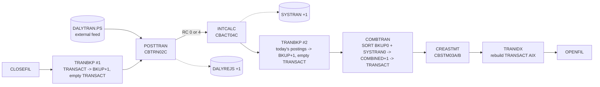

# Jobs, procedures, control cards, and schedules

This file restates every JCL member, cataloged procedure, and control card in CardDemo, plus the
CA7 and Control-M schedule definitions, as structured English. It follows the job entry template
in `README.md` of this directory. It records what the JCL does, including defects; suspected
defects are flagged as `Q-` items with a recommendation.

Target architecture assumed by the "Modern equivalent" lines: VSAM files become SQL Server tables,
recurring batch becomes Apache Airflow DAG tasks that invoke Java batch jobs, and one-time data
definition becomes schema and seed migrations (for example Flyway or Liquibase).

## Conventions used in this file

- `HLQ` means the dataset prefix `AWS.M2.CARDDEMO`. Datasets with another prefix are written in full.
  Note that several infrastructure jobs use the misspelled prefix `AWS.M2.CARDEMO` (one `D`); it is
  kept verbatim.
- DISP is written as `(status,normal,abnormal)`. `SHR` alone means `DISP=SHR`.
- "RC" is the step or job condition code. `COND=(4,LT)` means "bypass this step if 4 is less than
  the RC of any earlier step", that is, run only when every earlier step ended with RC 4 or lower.
  `COND=(0,NE)` means "bypass if any earlier step ended with a non-zero RC".
- IDCAMS `IF MAXCC LE 08 THEN SET MAXCC = 0` turns "not found" (RC 8) into RC 0 so that a
  delete of a missing cluster does not fail the step. `SET MAXCC = 0` resets unconditionally.
- SDSF steps issue MVS `MODIFY` commands (`/F CICSAWSA,'CEMT ...'`) to the CICS region whose job
  name is `CICSAWSA`. `CLO` closes and `OPE` opens a CICS file (FCT entry).
- CICS file names map to datasets per `app/csd/CARDDEMO.CSD`: ACCTDAT = ACCTDATA.VSAM.KSDS,
  CARDDAT = CARDDATA.VSAM.KSDS, CARDAIX = CARDDATA.VSAM.AIX.PATH, CUSTDAT = CUSTDATA.VSAM.KSDS,
  CCXREF = CARDXREF.VSAM.KSDS, CXACAIX = CARDXREF.VSAM.AIX.PATH, TRANSACT = TRANSACT.VSAM.KSDS,
  USRSEC = USRSEC.VSAM.KSDS (`app/csd/CARDDEMO.CSD:1-89`). There is no CICS file for
  TRANSACT.VSAM.AIX.PATH, TCATBALF, DISCGRP, TRANTYPE, or TRANCATG.
  All CICS files are defined with `RECOVERY(NONE)` (no CICS backout or forward recovery).
- Entity references use the copybook name in parentheses, for example ENT-ACCOUNT (`CVACT01Y`), so
  they can be reconciled with `entities.md`. Program references point at `programs/<MEMBER>.md`.

### Classification legend

| Class | Meaning | Becomes in the target |
|:--|:--|:--|
| (a) | One-time setup, data definition, or data migration | DB schema migration, seed data migration, or a one-off ETL tool; not scheduled |
| (b) | Recurring business batch | Airflow task calling a Java batch job |
| (c) | Utility, listing, or operational housekeeping | Not needed (explained per job), or a small ad hoc SQL/report |
| (d) | Infrastructure (FTP, PDF, internal reader, CICS resource definition) | Platform service or library inside the Java job |

## 1. Inventory

Base application members are in `app/jcl`; module members are listed after them. "Sched" lists where
the job appears: `C7` = `app/scheduler/CardDemo.ca7`, `CM` = `app/scheduler/CardDemo.controlm`,
`RB` = `docs/runbooks/batch-operations.md`, `RM` = README "Running Batch Jobs" (`README.md:208-234`),
`SH` = `scripts/run_full_batch.sh`.

| ID | Member (job name if different) | Class | Programs / utilities | Sched | One-line purpose | Modern equivalent |
|:--|:--|:--|:--|:--|:--|:--|
| JOB-ACCTFILE | ACCTFILE | (a) | IDCAMS | RM SH, RB rollback | Delete, define, and load account KSDS from ACCTDATA.PS | `account` table DDL + seed migration |
| JOB-CARDFILE | CARDFILE | (a) | SDSF, IDCAMS | RM SH | Close CICS card files, define and load card KSDS + AIX on account ID, reopen | `card` table + non-unique index on `acct_id` + seed |
| JOB-CUSTFILE | CUSTFILE | (a) | SDSF, IDCAMS | RM SH | Close CICS CUSTDAT, define and load customer KSDS, reopen | `customer` table + seed |
| JOB-XREFFILE | XREFFILE | (a) | IDCAMS | RM SH | Define and load card cross-reference KSDS + AIX on account ID | `card_xref` table (or FK columns) + index on `acct_id` + seed |
| JOB-TRANFILE | TRANFILE | (a) | SDSF, IDCAMS | none | Define and load transaction KSDS from DALYTRAN.PS.INIT + AIX on processed timestamp | `transaction` table + index on `proc_ts` + seed |
| JOB-DUSRSECJ | DUSRSECJ | (a) | IEFBR14, IEBGENER, IDCAMS | RM SH | Create user security PS from in-stream data, define and load USRSEC KSDS | `user_security` table + seed (hashed passwords) |
| JOB-TCATBALF | TCATBALF | (a) | IDCAMS | C7 RM SH, RB rollback | Define and load transaction category balance KSDS | `tran_cat_balance` table + seed |
| JOB-DISCGRP | DISCGRP | (a) | IDCAMS | CM RM SH | Define and load disclosure group (interest rate) KSDS | `disclosure_group` table + seed |
| JOB-TRANTYPE | TRANTYPE | (a) | IDCAMS | C7 RM SH | Define and load transaction type KSDS | `transaction_type` table + seed |
| JOB-TRANCATG | TRANCATG | (a) | IDCAMS | C7 RM | Define and load transaction category KSDS | `transaction_category` table + seed |
| JOB-DEFCUST | DEFCUST | (a) | IDCAMS | none | Obsolete customer cluster definition under other HLQs | Retire |
| JOB-DEFGDGB | DEFGDGB | (a) | IDCAMS | RB (setup) | Define six GDG bases used by the batch cycle | Retire (replace with snapshot/run tables) |
| JOB-DEFGDGD | DEFGDGD | (a) | IDCAMS, IEBGENER | none | Define reference-data GDG bases and their first generations | Retire (reference-data history table if wanted) |
| JOB-DALYREJS | DALYREJS | (a) | IDCAMS | none | Define the DALYREJS GDG base | `daily_reject` table DDL |
| JOB-REPTFILE | REPTFILE | (a) | IDCAMS | none | Define the TRANREPT GDG base (limit 10) | Retire (report archive storage) |
| JOB-ESDSRRDS | ESDSRRDS | (a) | IEFBR14, IEBGENER, IDCAMS | none | Demo: user security data as ESDS and RRDS | Retire |
| JOB-CBEXPORT | CBEXPORT | (a) | IDCAMS, CBEXPORT | none | Export customer, account, xref, transaction, card into one multi-record KSDS | One-off migration/export tool (or retire) |
| JOB-CBIMPORT | CBIMPORT | (a) | CBIMPORT | none | Split the export file into normalized sequential files | One-off migration/import tool (or retire) |
| JOB-TRANBKP | TRANBKP | (b) | REPROC (IDCAMS), IDCAMS | CM RB RM SH | Back up TRANSACT to TRANSACT.BKUP(+1), then delete and redefine TRANSACT empty | DB snapshot / pre-run backup task; truncation decision required |
| JOB-POSTTRAN | POSTTRAN | (b) | CBTRN02C | C7 RB RM SH | Validate and post daily transactions; update accounts and category balances; write rejects | Airflow task `post_daily_transactions` (Java) |
| JOB-INTCALC | INTCALC | (b) | CBACT04C | CM RB RM SH | Compute interest per category balance; update accounts; write interest transactions | Airflow task `compute_interest` (Java) |
| JOB-COMBTRAN | COMBTRAN | (b) | SORT, IDCAMS | CM RB RM SH | Merge backed-up transactions with system (interest) transactions and reload TRANSACT | Not needed as a separate step if interest inserts directly into `transaction`; else Airflow task |
| JOB-CREASTMT | CREASTMT | (b) | IDCAMS, SORT, IEFBR14, CBSTM03A/CBSTM03B | C7 RB RM | Produce account statements (text and HTML) | Airflow task `generate_statements` (Java) |
| JOB-TRANREPT | TRANREPT | (b) | REPROC, SORT, CBTRN03C | none (on demand from CICS CR00) | Transaction detail report for a date range | On-demand Airflow DAG run (REST-triggered) calling Java report |
| JOB-TRANIDX | TRANIDX | (c) | IDCAMS | RB RM SH | Rebuild TRANSACT alternate index on processed timestamp | Not needed (SQL index maintained automatically) |
| JOB-PRTCATBL | PRTCATBL | (c) | IEFBR14, REPROC, SORT | C7 | Print category balance file as a formatted listing | SQL report / optional Airflow task |
| JOB-READACCT | READACCT | (c) | IEFBR14, CBACT01C | C7 | List account file and write three demo output formats | Not needed (SQL query); keep only if a downstream consumer exists |
| JOB-READCARD | READCARD | (c) | CBACT02C | C7 | List card file to SYSOUT | Not needed (SQL query) |
| JOB-READCUST | READCUST | (c) | CBCUS01C | C7 | List customer file to SYSOUT | Not needed (SQL query) |
| JOB-READXREF | READXREF | (c) | CBACT03C | C7 | List cross-reference file to SYSOUT | Not needed (SQL query) |
| JOB-CLOSEFIL | CLOSEFIL (also CA7 CLOSEFIL1, CLOSEFIL2) | (c) | SDSF | C7 CM RB RM SH | Close CICS files so batch gets exclusive access | Not needed (DB concurrency); optional "batch window" flag |
| JOB-OPENFIL | OPENFIL | (c) | SDSF | C7 CM RB RM SH | Reopen CICS files | Not needed |
| JOB-WAITSTEP | WAITSTEP | (c) | COBSWAIT | C7 CM RM | Sleep 36 seconds | Not needed (Airflow dependencies) |
| JOB-CBADMCDJ | CBADMCDJ | (d) | DFHCSDUP | none | Define CICS resources (stale list) | Application deployment configuration |
| JOB-INTRDRJ1 | INTRDRJ1 | (d) | IDCAMS, IEBGENER to INTRDR | none | Demo: copy a file, then submit INTRDRJ2 via internal reader | Airflow `TriggerDagRunOperator` / task dependency |
| JOB-INTRDRJ2 | INTRDRJ2 | (d) | IDCAMS | none | Demo: copy a file (submitted by INTRDRJ1) | Same as above |
| JOB-TXT2PDF1 | TXT2PDF1 | (d) | IKJEFT1B + REXX TXT2PDF | C7 | Convert STATEMNT.PS to PDF | PDF rendering inside the statement Java job |
| JOB-FTPJCL | FTPJCL (job name FTPJCLS) | (d) | FTP | none | Demo: FTP PUT a mainframe file to a server | SFTP/managed file transfer task (Airflow SFTPOperator) |
| JOB-CBPAUP0J | CBPAUP0J | (b) | DFSRRC00 BMP CBPAUP0C | C7, RM | Purge expired pending authorizations (IMS) | Airflow task `purge_expired_authorizations` (Java + SQL DELETE) |
| JOB-DBPAUTP0 | DBPAUTP0 | (a) | IEFBR14, DFSURGU0 | none | IMS HD unload of DBPAUTP0 | One-off IMS-to-SQL migration extract |
| JOB-UNLDPADB | UNLDPADB | (a) | IEFBR14, DFSRRC00 DLI PAUDBUNL | none | Unload pending-auth IMS DB to two flat files | One-off migration extract |
| JOB-LOADPADB | LOADPADB | (a) | DFSRRC00 BMP PAUDBLOD | none | Load pending-auth IMS DB from two flat files | One-off migration load (becomes SQL bulk insert) |
| JOB-UNLDGSAM | UNLDGSAM | (a) | DFSRRC00 DLI DBUNLDGS | none | Unload pending-auth IMS DB to two GSAM files | One-off migration extract |
| JOB-CREADB21 | CREADB21 (job name CREADB2) | (a) | IKJEFT01 + DSNTIAD, DSNTEP4 | none | Create Db2 database, tablespaces, tables; load type/category rows | Schema + seed migration |
| JOB-MNTTRDB2 | MNTTRDB2 | (b) | IKJEFT01 + COBTUPDT | CM (weekly) | Apply add/update/delete records to Db2 TRANSACTION_TYPE | Airflow task or admin API (Java) |
| JOB-TRANEXTR | TRANEXTR | (c) | IEBGENER, IEFBR14, DSNTIAUL | CM (weekly) | Extract Db2 type/category tables to TRANTYPE.PS / TRANCATG.PS | Not needed (one SQL Server table is the single source) |

Counts. Base `app/jcl` (38 members): (a) 18, (b) 6, (c) 9, (d) 5. Modules (8 members): (a) 5,
(b) 2, (c) 1. Total 46 members.

Programs with no JCL in the repository: CBTRN01C (`app/cbl/CBTRN01C.cbl`, a daily-transaction
verification reader) is not run by any job or schedule; CSUTLDTC is a called subroutine.

## 2. The batch cycle at a glance

The authoritative business sequence is the one in the runbook (`docs/runbooks/batch-operations.md:12-22`)
and `docs/architecture.md:55-61`. The schedulers implement different, partial versions of it (see
section 6). Data flow of the canonical cycle:



Key behavioral facts that a re-implementation must decide on:

1. CBTRN02C opens TRANSACT with `OPEN OUTPUT` (`app/cbl/CBTRN02C.cbl:256`). On z/OS an OUTPUT open
   of a KSDS that is not empty and not defined with REUSE fails, so TRANBKP must empty TRANSACT
   first. CBACT04C writes its interest transactions to a sequential GDG, not to TRANSACT
   (`app/cbl/CBACT04C.cbl:309`, `app/jcl/INTCALC.jcl:37-41`).
2. Consequence of (1) and of the second TRANBKP: after COMBTRAN, TRANSACT contains only the
   transactions posted in this cycle plus this cycle's interest transactions. Everything that was in
   TRANSACT before the cycle (earlier postings, and transactions added online by COTRN02C and
   COBIL00C) is preserved only in TRANSACT.BKUP generations, which roll off after 5 generations
   (`app/jcl/DEFGDGB.jcl:24-28`). See Q-TRANBKP-02.
3. CBACT04C adds interest to the account balance and resets the cycle credit and debit totals to zero
   (`app/cbl/CBACT04C.cbl:352-356`). Those cycle totals drive the POSTTRAN over-limit check
   (`app/cbl/CBTRN02C.cbl:403-411`). Running INTCALC daily (runbook) and monthly (Control-M) therefore
   produce different business results. The interest formula divides an annual rate by 1200
   (`app/cbl/CBACT04C.cbl:464-465`), which is a monthly charge. See Q-RUNBOOK-01.

---

## 3. Job entries: one-time setup and data definition (class a)

### JOB-ACCTFILE: Delete, define, and load the account master

| Attribute | Value |
|:--|:--|
| Source | `app/jcl/ACCTFILE.jcl` (65 lines) |
| Job card | `ACCTFILE JOB 'Delete define Account Data',CLASS=A,MSGCLASS=0,NOTIFY=&SYSUID` (lines 1-2) |
| Classification | (a) setup / data definition. Also used by the runbook to restore balances (rollback step 3) |
| Entity | ENT-ACCOUNT (`CVACT01Y`) |

Purpose: replace the account VSAM file with a fresh copy of the sequential seed file.

| Step | Program | Control statements | DD -> dataset (DISP) |
|:--|:--|:--|:--|
| STEP05 (22-28) | IDCAMS | `DELETE HLQ.ACCTDATA.VSAM.KSDS CLUSTER`; `IF MAXCC LE 08 THEN SET MAXCC = 0` | SYSPRINT SYSOUT |
| STEP10 (33-50) | IDCAMS | `DEFINE CLUSTER (NAME(HLQ.ACCTDATA.VSAM.KSDS) CYLINDERS(1 5) VOLUMES(AWSHJ1) KEYS(11 0) RECORDSIZE(300 300) SHAREOPTIONS(2 3) ERASE INDEXED) DATA(NAME(...KSDS.DATA)) INDEX(NAME(...KSDS.INDEX))` | SYSPRINT SYSOUT |
| STEP15 (54-62) | IDCAMS | `REPRO INFILE(ACCTDATA) OUTFILE(ACCTVSAM)` | ACCTDATA -> HLQ.ACCTDATA.PS (SHR); ACCTVSAM -> HLQ.ACCTDATA.VSAM.KSDS (SHR) |

- Key: account ID, bytes 1-11; fixed 300-byte records.
- Condition codes: no COND parameters. Every step runs regardless of earlier RCs.
- Datasets deleted: ACCTDATA.VSAM.KSDS (with its DATA/INDEX components). Created: same.
- GDG usage: none.
- Restart: rerunnable from the top (idempotent replace), provided CICS file ACCTDAT is closed.
- Schedule: not in CA7 or Control-M. README and `run_full_batch.sh` run it after CLOSEFIL as a data
  refresh; runbook uses it for rollback.
- **Q-ACCTFILE-01**: The job does not close ACCTDAT in CICS (unlike CARDFILE/CUSTFILE). If CICS has
  it open, STEP05 fails with RC 12 (not reset), STEP10 then fails with a duplicate-name RC 12, and
  STEP15 still runs and REPROs into the existing, populated cluster, producing duplicate-key errors.
  Recommendation: in the target, irrelevant; for the mainframe, run CLOSEFIL first.
- **Q-ACCTFILE-02**: Rollback use (runbook step 3) reloads the original seed file, discarding all
  account changes since installation, because no job writes a newer ACCTDATA.PS. See section 8.
- Modern equivalent: `account` table DDL migration plus a seed-data migration from
  `app/data/ASCII/acctdata.txt`. Never re-run as part of a cycle.

### JOB-CARDFILE: Define and load the card master and its account-ID alternate index

| Attribute | Value |
|:--|:--|
| Source | `app/jcl/CARDFILE.jcl` (128 lines) |
| Job card | `CARDFILE JOB 'Delete define card data',CLASS=A,MSGCLASS=0,NOTIFY=&SYSUID` |
| Classification | (a) |
| Entity | ENT-CARD (`CVACT02Y`) |

| Step | Program | Control statements | DD -> dataset (DISP) |
|:--|:--|:--|:--|
| CLCIFIL (22-28) | SDSF | `/F CICSAWSA,'CEMT SET FIL(CARDDAT ) CLO'`; `/F CICSAWSA,'CEMT SET FIL(CARDAIX ) CLO'` | ISFOUT, CMDOUT SYSOUT; ISFIN in-stream |
| STEP05 (33-42) | IDCAMS | `DELETE HLQ.CARDDATA.VSAM.KSDS CLUSTER`; reset if <=8; `DELETE HLQ.CARDDATA.VSAM.AIX ALTERNATEINDEX`; reset if <=8 | SYSPRINT |
| STEP10 (47-64) | IDCAMS | `DEFINE CLUSTER (NAME(HLQ.CARDDATA.VSAM.KSDS) CYLINDERS(1 5) VOLUMES(AWSHJ1) KEYS(16 0) RECORDSIZE(150 150) SHAREOPTIONS(2 3) ERASE INDEXED)` + DATA/INDEX names | SYSPRINT |
| STEP15 (68-76) | IDCAMS | `REPRO INFILE(CARDDATA) OUTFILE(CARDVSAM)` | CARDDATA -> HLQ.CARDDATA.PS (SHR); CARDVSAM -> HLQ.CARDDATA.VSAM.KSDS (SHR) |
| STEP40 (80-93) | IDCAMS | `DEFINE ALTERNATEINDEX (NAME(HLQ.CARDDATA.VSAM.AIX) RELATE(HLQ.CARDDATA.VSAM.KSDS) KEYS(11 16) NONUNIQUEKEY UPGRADE RECORDSIZE(150,150) VOLUMES(AWSHJ1) CYLINDERS(5,1)) DATA(...AIX.DATA) INDEX(...AIX.INDEX)` | SYSPRINT |
| STEP50 (97-103) | IDCAMS | `DEFINE PATH (NAME(HLQ.CARDDATA.VSAM.AIX.PATH) PATHENTRY(HLQ.CARDDATA.VSAM.AIX))` | SYSPRINT |
| STEP60 (107-113) | IDCAMS | `BLDINDEX INDATASET(HLQ.CARDDATA.VSAM.KSDS) OUTDATASET(HLQ.CARDDATA.VSAM.AIX)` | SYSPRINT |
| OPCIFIL (118-124) | SDSF | `CEMT SET FIL(CARDDAT ) OPE`; `CEMT SET FIL(CARDAIX ) OPE` | as CLCIFIL |

- Primary key: card number, bytes 1-16. Alternate key: account ID, 11 bytes at offset 16
  (bytes 17-27), non-unique, upgraded on every base update.
- Condition codes: none. A null statement `//` at line 125 ends the job.
- Restart: rerunnable from the top.
- Schedule: README/`run_full_batch.sh` data refresh only.
- **Q-CARDFILE-01**: Deleting a cluster also deletes its related AIX and path, so the second DELETE
  normally returns RC 8 (reset to 0). Harmless.
- Modern equivalent: `card` table with primary key `card_num` and a non-unique index on `acct_id`;
  seed from `app/data/ASCII/carddata.txt`.

### JOB-CUSTFILE: Define and load the customer master

| Attribute | Value |
|:--|:--|
| Source | `app/jcl/CUSTFILE.jcl` (84 lines) |
| Job card | `CUSTFILE JOB 'DEFINE CUSTOMER FILE',CLASS=A,MSGCLASS=0,NOTIFY=&SYSUID` |
| Classification | (a) |
| Entity | ENT-CUSTOMER (`CVCUS01Y`) |

| Step | Program | Control statements | DD -> dataset (DISP) |
|:--|:--|:--|:--|
| CLCIFIL (22-27) | SDSF | `CEMT SET FIL(CUSTDAT ) CLO` | |
| STEP05 (32-38) | IDCAMS | `DELETE HLQ.CUSTDATA.VSAM.KSDS CLUSTER`; reset if <=8 | |
| STEP10 (43-60) | IDCAMS | `DEFINE CLUSTER (NAME(HLQ.CUSTDATA.VSAM.KSDS) CYLINDERS(1 5) VOLUMES(AWSHJ1) KEYS(9 0) RECORDSIZE(500 500) SHAREOPTIONS(2 3) ERASE INDEXED)` | |
| STEP15 (64-72) | IDCAMS | `REPRO INFILE(CUSTDATA) OUTFILE(CUSTVSAM)` | CUSTDATA -> HLQ.CUSTDATA.PS (SHR); CUSTVSAM -> HLQ.CUSTDATA.VSAM.KSDS (SHR) |
| OPCIFIL (76-81) | SDSF | `CEMT SET FIL(CUSTDAT ) OPE` | |

- Key: customer ID, bytes 1-9; 500-byte records. No COND logic. Rerunnable.
- Modern equivalent: `customer` table + seed from `app/data/ASCII/custdata.txt`.

### JOB-XREFFILE: Define and load the card cross-reference and its account-ID alternate index

| Attribute | Value |
|:--|:--|
| Source | `app/jcl/XREFFILE.jcl` (106 lines) |
| Job card | `XREFFILE JOB 'Delete define cross ref file',CLASS=A,MSGCLASS=0,NOTIFY=&SYSUID` |
| Classification | (a) |
| Entity | ENT-CARD-XREF (`CVACT03Y`) |

| Step | Program | Control statements | DD -> dataset (DISP) |
|:--|:--|:--|:--|
| STEP05 (22-31) | IDCAMS | `DELETE HLQ.CARDXREF.VSAM.KSDS CLUSTER`; reset; `DELETE HLQ.CARDXREF.VSAM.AIX ALTERNATEINDEX`; reset | |
| STEP10 (36-53) | IDCAMS | `DEFINE CLUSTER (NAME(HLQ.CARDXREF.VSAM.KSDS) CYLINDERS(1 5) VOLUMES(AWSHJ1) KEYS(16 0) RECORDSIZE(50 50) SHAREOPTIONS(2 3) ERASE INDEXED)` | |
| STEP15 (57-65) | IDCAMS | `REPRO INFILE(XREFDATA) OUTFILE(XREFVSAM)` | XREFDATA -> HLQ.CARDXREF.PS (SHR); XREFVSAM -> HLQ.CARDXREF.VSAM.KSDS (SHR) |
| STEP20 (69-83) | IDCAMS | `DEFINE ALTERNATEINDEX (NAME(HLQ.CARDXREF.VSAM.AIX) RELATE(HLQ.CARDXREF.VSAM.KSDS) KEYS(11,25) NONUNIQUEKEY UPGRADE RECORDSIZE(50,50) FREESPACE(10,20) VOLUMES(AWSHJ1) CYLINDERS(5,1))` | |
| STEP25 (87-93) | IDCAMS | `DEFINE PATH (NAME(HLQ.CARDXREF.VSAM.AIX.PATH) PATHENTRY(HLQ.CARDXREF.VSAM.AIX))` | |
| STEP30 (97-103) | IDCAMS | `BLDINDEX INDATASET(HLQ.CARDXREF.VSAM.KSDS) OUTDATASET(HLQ.CARDXREF.VSAM.AIX)` | |

- Primary key: card number (bytes 1-16). Alternate key: account ID, 11 bytes at offset 25
  (bytes 26-36), non-unique. Used online as CXACAIX and by INTCALC (DD XREFFIL1).
- No COND logic. Rerunnable.
- **Q-XREFFILE-01**: Unlike CARDFILE/CUSTFILE, this job does not close CCXREF and CXACAIX in CICS
  even though it deletes both datasets. It depends on CLOSEFIL having run. Recommendation: irrelevant
  in the target.
- Modern equivalent: `card_xref` (card_num PK, cust_id, acct_id) with index on `acct_id`; or fold
  into `card` as foreign keys (decision for components.md). Seed from `cardxref.txt`.

### JOB-TRANFILE: Define and initially load the transaction master

| Attribute | Value |
|:--|:--|
| Source | `app/jcl/TRANFILE.jcl` (125 lines) |
| Job card | `TRANFILE JOB 'DEFINE TRANSACTION MASTER',CLASS=A,MSGCLASS=0,NOTIFY=&SYSUID` |
| Classification | (a) |
| Entity | ENT-TRANSACTION (`CVTRA05Y`) |

| Step | Program | Control statements | DD -> dataset (DISP) |
|:--|:--|:--|:--|
| CLCIFIL (22-28) | SDSF | `CEMT SET FIL(TRANSACT ) CLO`; `CEMT SET FIL(CXACAIX ) CLO` | |
| STEP05 (32-41) | IDCAMS | `DELETE HLQ.TRANSACT.VSAM.KSDS CLUSTER`; reset; `DELETE HLQ.TRANSACT.VSAM.AIX ALTERNATEINDEX`; reset | |
| STEP10 (46-63) | IDCAMS | `DEFINE CLUSTER (NAME(HLQ.TRANSACT.VSAM.KSDS) CYLINDERS(1 5) VOLUMES(AWSHJ1) KEYS(16 0) RECORDSIZE(350 350) SHAREOPTIONS(2 3) ERASE INDEXED)` | |
| STEP15 (67-75) | IDCAMS | `REPRO INFILE(TRANSACT) OUTFILE(TRANVSAM)` | TRANSACT -> HLQ.DALYTRAN.PS.INIT (SHR); TRANVSAM -> HLQ.TRANSACT.VSAM.KSDS (SHR) |
| STEP20 (79-92) | IDCAMS | `DEFINE ALTERNATEINDEX (NAME(HLQ.TRANSACT.VSAM.AIX) RELATE(HLQ.TRANSACT.VSAM.KSDS) KEYS(26 304) NONUNIQUEKEY UPGRADE RECORDSIZE(350,350) VOLUMES(AWSHJ1) CYLINDERS(5,1))` | |
| STEP25 (96-102) | IDCAMS | `DEFINE PATH (NAME(HLQ.TRANSACT.VSAM.AIX.PATH) PATHENTRY(HLQ.TRANSACT.VSAM.AIX))` | |
| STEP30 (106-112) | IDCAMS | `BLDINDEX INDATASET(HLQ.TRANSACT.VSAM.KSDS) OUTDATASET(HLQ.TRANSACT.VSAM.AIX)` | |
| OPCIFIL (116-122) | SDSF | `CEMT SET FIL(TRANSACT ) OPE`; `CEMT SET FIL(CXACAIX ) OPE` | |

- Primary key: TRAN-ID (bytes 1-16). Alternate key: TRAN-PROC-TS, 26 bytes at offset 304
  (bytes 305-330), non-unique.
- The initial content is DALYTRAN.PS.INIT, a daily-transaction-format file loaded as if it were
  posted transactions (both layouts are 350 bytes).
- No COND logic. Rerunnable; destroys all transaction history.
- Schedule: none. README's ordered list uses TRANBKP for "Creates Transaction database"
  (`README.md:219`) rather than TRANFILE.
- **Q-TRANFILE-01**: CLCIFIL/OPCIFIL close and open CXACAIX, which is the CARDXREF alternate-index
  path (`app/csd/CARDDEMO.CSD:63-65`), not a TRANSACT index. No CICS file references
  TRANSACT.VSAM.AIX.PATH. Probable copy error; harmless except that it briefly disables the online
  account-to-card lookup. Recommendation: ignore in the target.
- **Q-TRANFILE-02**: The TRANSACT alternate index (processed timestamp) has no consumer anywhere in
  the repository (no CICS file, no batch DD). Recommendation: create the SQL index only if a query
  needs it (CORPT00C/CBTRN03C filter on processed date, so an index on `proc_ts` is reasonable).
- Modern equivalent: `transaction` table DDL + seed from the INIT file (not present in
  `app/data/ASCII`; EBCDIC copy at `app/data/EBCDIC/AWS.M2.CARDDEMO.DALYTRAN.PS.INIT`).

### JOB-DUSRSECJ: Create and load the user security file

| Attribute | Value |
|:--|:--|
| Source | `app/jcl/DUSRSECJ.jcl` (92 lines) |
| Job card | `DUSRSECJ JOB 'DEF USRSEC FILE',REGION=8M,CLASS=A,MSGCLASS=H,NOTIFY=&SYSUID` |
| Classification | (a) |
| Entity | ENT-USER-SECURITY (`CSUSR01Y`) |

| Step | Program | Control statements | DD -> dataset (DISP / DCB) |
|:--|:--|:--|:--|
| PREDEL (23-26) | IEFBR14 | none | DD01 -> HLQ.USRSEC.PS (MOD,DELETE,DELETE): deletes it if present |
| STEP01 (32-52) | IEBGENER | SYSIN DUMMY (straight copy) | SYSUT1 in-stream 10 records (35-44); SYSUT2 -> HLQ.USRSEC.PS (NEW,CATLG,DELETE), DCB=(LRECL=80,RECFM=FB,DSORG=PS,BLKSIZE=0), UNIT=SYSAD, SPACE=(TRK,(10,5),RLSE) |
| STEP02 (58-74) | IDCAMS | `DELETE HLQ.USRSEC.VSAM.KSDS`; `SET MAXCC = 0`; `DEFINE CLUSTER (NAME(HLQ.USRSEC.VSAM.KSDS) KEYS(8,0) RECORDSIZE(80,80) REUSE INDEXED TRACKS(45,15) FREESPACE(10,15) CISZ(8192)) DATA(NAME(...KSDS.DAT)) INDEX(NAME(...KSDS.IDX))` | |
| STEP03 (80-88) | IDCAMS | `REPRO INFILE(IN) OUTFILE(OUT)` | IN -> HLQ.USRSEC.PS (SHR); OUT -> HLQ.USRSEC.VSAM.KSDS (SHR) |

Seed rows (80-byte records: user ID 1-8, first name 9-28, last name 29-48, password 49-56,
user type 57, filler 58-80). The password field holds the demo password documented in
`README.md:204-205` for every row.

| User ID | First name | Last name | Type |
|:--|:--|:--|:--|
| ADMIN001 | MARGARET | GOLD | A (admin) |
| ADMIN002 | RUSSELL | RUSSELL | A |
| ADMIN003 | RAYMOND | WHITMORE | A |
| ADMIN004 | EMMANUEL | CASGRAIN | A |
| ADMIN005 | GRANVILLE | LACHAPELLE | A |
| USER0001 | LAWRENCE | THOMAS | U (regular) |
| USER0002 | AJITH | KUMAR | U |
| USER0003 | LAURITZ | ALME | U |
| USER0004 | AVERARDO | MAZZI | U |
| USER0005 | LEE | TING | U |

- No COND logic. A null statement `//` at line 89 ends the job. Rerunnable from the top.
- **Q-DUSRSECJ-01**: Passwords are stored and seeded in clear text. Recommendation: fix in the target
  (hash at seed time; force change on first sign-on).
- **Q-DUSRSECJ-02**: `UNIT=SYSAD` (line 49) is probably a typo for the usual esoteric `SYSDA`; it works
  only if the site defines SYSAD. Same in ESDSRRDS and READACCT.
- **Q-DUSRSECJ-03**: The job does not close the CICS USRSEC file before deleting the cluster. CLOSEFIL
  does close USRSEC.
- Modern equivalent: `user_security` table + seed migration with hashed passwords.

### JOB-TCATBALF: Define and load the transaction category balance file

| Attribute | Value |
|:--|:--|
| Source | `app/jcl/TCATBALF.jcl` (65 lines) |
| Job card | `TCATBALF JOB 'DEFINE TRANCAT BAL',CLASS=A,MSGCLASS=0,NOTIFY=&SYSUID` |
| Classification | (a). Scheduled by CA7 (see Q-CA7-03) and used by the runbook for rollback |
| Entity | ENT-TRAN-CAT-BALANCE (`CVTRA01Y`) |

| Step | Program | Control statements | DD -> dataset (DISP) |
|:--|:--|:--|:--|
| STEP05 (22-28) | IDCAMS | `DELETE HLQ.TCATBALF.VSAM.KSDS CLUSTER`; `SET MAXCC = 0` | |
| STEP10 (33-50) | IDCAMS | `DEFINE CLUSTER (NAME(HLQ.TCATBALF.VSAM.KSDS) CYLINDERS(1 5) VOLUMES(AWSHJ1) KEYS(17 0) RECORDSIZE(50 50) SHAREOPTIONS(2 3) ERASE INDEXED)` | |
| STEP15 (54-62) | IDCAMS | `REPRO INFILE(TCATBAL) OUTFILE(TCATBALV)` | TCATBAL -> HLQ.TCATBALF.PS (SHR); TCATBALV -> HLQ.TCATBALF.VSAM.KSDS (OLD) |

- Key: 17 bytes = account ID (11) + type code (2) + category code (4).
- No COND. Rerunnable. Destroys all accumulated category balances.
- Modern equivalent: `tran_cat_balance` table (composite PK acct_id, type_cd, cat_cd) + seed from
  `app/data/ASCII/tcatbal.txt`.

### JOB-DISCGRP: Define and load the disclosure group (interest rate) file

| Attribute | Value |
|:--|:--|
| Source | `app/jcl/DISCGRP.jcl` (65 lines) |
| Job card | `DISCGRP JOB 'DEFINE DISCLOSURE GROUP FILE',CLASS=A,MSGCLASS=0,NOTIFY=&SYSUID` |
| Classification | (a). Scheduled weekly by Control-M (see Q-CONTROLM-04) |
| Entity | ENT-DISCLOSURE-GROUP (`CVTRA02Y`) |

| Step | Program | Control statements | DD -> dataset (DISP) |
|:--|:--|:--|:--|
| STEP05 (22-28) | IDCAMS | `DELETE HLQ.DISCGRP.VSAM.KSDS CLUSTER`; `SET MAXCC = 0` | |
| STEP10 (33-50) | IDCAMS | `DEFINE CLUSTER (NAME(HLQ.DISCGRP.VSAM.KSDS) CYLINDERS(1 5) VOLUMES(AWSHJ1) KEYS(16 0) RECORDSIZE(50 50) SHAREOPTIONS(2 3) ERASE INDEXED)` | |
| STEP15 (54-62) | IDCAMS | `REPRO INFILE(DISCGRP) OUTFILE(DISCVSAM)` | DISCGRP -> HLQ.DISCGRP.PS (SHR); DISCVSAM -> HLQ.DISCGRP.VSAM.KSDS (OLD) |

- Key: 16 bytes = account group ID (10) + type code (2) + category code (4).
- No COND. Rerunnable. Not a CICS file, so no close/open is needed.
- Modern equivalent: `disclosure_group` table + seed from `discgrp.txt`. Rate maintenance becomes a
  data-change process (admin UI or migration), not a weekly reload.

### JOB-TRANTYPE: Define and load the transaction type file

| Attribute | Value |
|:--|:--|
| Source | `app/jcl/TRANTYPE.jcl` (65 lines) |
| Job card | `TRANTYPE JOB 'DEFINE TRAN TYPE',CLASS=A,MSGCLASS=0,NOTIFY=&SYSUID` |
| Classification | (a). Scheduled in CA7 (chain B) |
| Entity | ENT-TRAN-TYPE (`CVTRA03Y`) |

| Step | Program | Control statements | DD -> dataset (DISP) |
|:--|:--|:--|:--|
| STEP05 (22-28) | IDCAMS | `DELETE HLQ.TRANTYPE.VSAM.KSDS CLUSTER`; `SET MAXCC = 0` | |
| STEP10 (33-50) | IDCAMS | `DEFINE CLUSTER (NAME(HLQ.TRANTYPE.VSAM.KSDS) CYLINDERS(1 5) VOLUMES(AWSHJ1) KEYS(2 0) RECORDSIZE(60 60) SHAREOPTIONS(1 4) ERASE INDEXED)` | |
| STEP15 (54-62) | IDCAMS | `REPRO INFILE(TRANTYPE) OUTFILE(TTYPVSAM)` | TRANTYPE -> HLQ.TRANTYPE.PS (SHR); TTYPVSAM -> HLQ.TRANTYPE.VSAM.KSDS (OLD) |

- Key: type code (2). `SHAREOPTIONS(1 4)` differs from every other cluster (2 3); harmless.
- When the Db2 module is installed, TRANTYPE.PS is regenerated by JOB-TRANEXTR, and this job is the
  step that pushes it into VSAM. No schedule chains TRANEXTR to TRANTYPE (Q-CONTROLM-05).
- Modern equivalent: `transaction_type` table + seed (`trantype.txt`, or DB2LTTYP rows).

### JOB-TRANCATG: Define and load the transaction category file

| Attribute | Value |
|:--|:--|
| Source | `app/jcl/TRANCATG.jcl` (65 lines) |
| Job card | `TRANCATG JOB 'DEFINE TRAN CATEGORY',CLASS=A,MSGCLASS=0,NOTIFY=&SYSUID` |
| Classification | (a). Scheduled in CA7 (chain B) |
| Entity | ENT-TRAN-CATEGORY (`CVTRA04Y`) |

| Step | Program | Control statements | DD -> dataset (DISP) |
|:--|:--|:--|:--|
| STEP05 (22-28) | IDCAMS | `DELETE HLQ.TRANCATG.VSAM.KSDS CLUSTER`; `SET MAXCC = 0` | |
| STEP10 (33-50) | IDCAMS | `DEFINE CLUSTER (NAME(HLQ.TRANCATG.VSAM.KSDS) CYLINDERS(1 5) VOLUMES(AWSHJ1) KEYS(6 0) RECORDSIZE(60 60) SHAREOPTIONS(2 3) ERASE INDEXED)` | |
| STEP15 (54-62) | IDCAMS | `REPRO INFILE(TRANCATG) OUTFILE(TCATVSAM)` | TRANCATG -> HLQ.TRANCATG.PS (SHR); TCATVSAM -> HLQ.TRANCATG.VSAM.KSDS (OLD) |

- Key: type code (2) + category code (4).
- Modern equivalent: `transaction_category` table (PK type_cd, cat_cd; FK to transaction_type)
  + seed (`trancatg.txt`, or DB2LTCAT rows).

### JOB-DEFCUST: Obsolete customer cluster definition

| Attribute | Value |
|:--|:--|
| Source | `app/jcl/DEFCUST.jcl` (47 lines) |
| Job card | `DEFCUST JOB 'Define Customer Data File',CLASS=A,MSGCLASS=0,NOTIFY=&SYSUID` |
| Classification | (a), obsolete |

| Step | Program | Control statements |
|:--|:--|:--|
| STEP05 (22-27) | IDCAMS | `DELETE AWS.CCDA.CUSTDATA.CLUSTER CLUSTER` (no MAXCC reset) |
| STEP05 (32-47) | IDCAMS | `DEFINE CLUSTER (NAME(AWS.CUSTDATA.CLUSTER) CYLINDERS(1 5) KEYS(10 0) RECORDSIZE(500 500) SHAREOPTIONS(1 4) ERASE INDEXED) DATA(NAME(AWS.CUSTDATA.CLUSTER.DATA)) INDEX(NAME(AWS.CUSTDATA.CLUSTER.INDEX))` |

- **Q-DEFCUST-01**: Two steps share the name STEP05; the delete targets a different dataset
  (`AWS.CCDA...`) than the define (`AWS.CUSTDATA...`), neither uses the HLQ, the key length is 10
  (CUSTFILE uses 9), and the comment above the define says "DELETE". No job, program, or CICS file
  uses these datasets. The delete returns RC 8 when the dataset is absent and the job ends RC 8.
  Recommendation: retire; do not migrate.

### JOB-DEFGDGB: Define GDG bases for the batch cycle

| Attribute | Value |
|:--|:--|
| Source | `app/jcl/DEFGDGB.jcl` (63 lines) |
| Job card | `DEFGDGB JOB 'DEF GDG BASES',CLASS=A,MSGCLASS=0,NOTIFY=&SYSUID` |
| Classification | (a). Runbook: "Run DEFGDGB once per environment" (`docs/runbooks/batch-operations.md:49`) |

Single step STEP05 (21-60), IDCAMS. For each base: `DEFINE GENERATIONDATAGROUP (NAME(...) LIMIT(5) SCRATCH)`
followed by `IF LASTCC=12 THEN SET MAXCC=0` (tolerate "already exists").

| GDG base | Limit | SCRATCH | Lines | Producer of (+1) | Consumer |
|:--|--:|:--|:--|:--|:--|
| HLQ.TRANSACT.BKUP | 5 | yes | 24-29 | TRANBKP, TRANREPT | COMBTRAN (0), runbook rollback (0)/(-1) |
| HLQ.TRANSACT.DALY | 5 | yes | 30-35 | TRANREPT | TRANREPT (same job) |
| HLQ.TRANREPT | 5 | yes | 36-41 | TRANREPT | people (report) |
| HLQ.TCATBALF.BKUP | 5 | yes | 42-47 | PRTCATBL | PRTCATBL (same job) |
| HLQ.SYSTRAN | 5 | yes | 48-53 | INTCALC | COMBTRAN (0) |
| HLQ.TRANSACT.COMBINED | 5 | yes | 54-59 | COMBTRAN | COMBTRAN (same job) |

- `LIMIT(5) SCRATCH`: when a sixth generation is cataloged the oldest is uncataloged and deleted.
- Rerunnable (RC 12 on existing bases is reset per base).
- **Q-DEFGDGB-01**: DALYREJS (needed by POSTTRAN) is not defined here; it needs JOB-DALYREJS. The
  runbook's advice to run only DEFGDGB is incomplete.
- **Q-DEFGDGB-02**: HLQ.TRANREPT is also defined by JOB-REPTFILE with `LIMIT(10)` and no SCRATCH.
  Whichever runs first wins; the other gets RC 12 (reset here, not reset in REPTFILE). Same finding
  as Q-ENT-16 in `entities.md`, which records the retention decision.
- Modern equivalent: none (retire). GDG roles map to: backup snapshots, run-scoped staging tables, and
  a report archive (section 8).

### JOB-DEFGDGD: Define reference-data GDG bases and first generations

| Attribute | Value |
|:--|:--|
| Source | `app/jcl/DEFGDGD.jcl` (94 lines) |
| Job card | `DEFGDGD JOB 'DEF DB2 GDG',CLASS=A,MSGCLASS=0,NOTIFY=&SYSUID` (line 2 is a commented `RESTART=STEP30`) |
| Classification | (a) |

| Step | Program | COND | Control / DDs |
|:--|:--|:--|:--|
| STEP10 (24-32) | IDCAMS | none | `DEFINE GENERATIONDATAGROUP (NAME(HLQ.TRANTYPE.BKUP) LIMIT(5) SCRATCH)` |
| STEP20 (36-43) | IEBGENER | (0,NE) | SYSUT1 -> HLQ.TRANTYPE.PS (SHR); SYSUT2 -> HLQ.TRANTYPE.BKUP(+1) (NEW,CATLG), DCB=(LRECL=60,RECFM=FB,BLKSIZE=600), SPACE=(TRK,(1,1),RLSE) |
| STEP30 (47-55) | IDCAMS | (0,NE) | `DEFINE GENERATIONDATAGROUP (NAME(HLQ.TRANCATG.PS.BKUP) LIMIT(5) SCRATCH)` |
| STEP40 (59-66) | IEBGENER | (0,NE) | SYSUT1 -> HLQ.TRANCATG.PS (SHR); SYSUT2 -> HLQ.TRANCATG.PS.BKUP(+1) (NEW,CATLG), DCB=(LRECL=60,RECFM=FB,BLKSIZE=600) |
| STEP50 (70-78) | IDCAMS | none | `DEFINE GENERATIONDATAGROUP (NAME(HLQ.DISCGRP.BKUP) LIMIT(5) SCRATCH)` |
| STEP60 (82-89) | IEBGENER | (0,NE) | SYSUT1 -> HLQ.DISCGRP.PS (SHR); SYSUT2 -> HLQ.DISCGRP.BKUP(+1) (NEW,CATLG), DCB=(LRECL=50,RECFM=FB,BLKSIZE=500) |

- Two null statements (`//`) at lines 90-91.
- **Q-DEFGDGD-01**: Not rerunnable. On a second run STEP10 ends RC 12 (no `IF LASTCC` tolerance), so
  STEP20-STEP40 and STEP60 are bypassed by `COND=(0,NE)`, while STEP50 (no COND) still runs and also
  fails RC 12. The commented `RESTART=STEP30` shows manual restarts were used.
- **Q-DEFGDGD-02**: Naming is inconsistent (`TRANCATG.PS.BKUP` vs `TRANTYPE.BKUP`); the TRANEXTR job
  uses the same names, so they must be kept together. DISCGRP.BKUP receives no later generations from
  any job.
- Modern equivalent: none, or a temporal/history table for reference data if auditing is wanted.

### JOB-DALYREJS: Define the daily reject GDG base

| Attribute | Value |
|:--|:--|
| Source | `app/jcl/DALYREJS.jcl` (32 lines) |
| Job card | `DALYREJS JOB 'DEF GDG FOR REJS',CLASS=A,MSGCLASS=0,NOTIFY=&SYSUID` |
| Classification | (a) |

- STEP05 (21-29), IDCAMS: `DEFINE GENERATIONDATAGROUP (NAME(HLQ.DALYREJS) LIMIT(5) SCRATCH)`. No RC
  tolerance: RC 12 if it exists.
- The comment (line 19) says "DELETE TRANSACATION MASTER VSAM FILE"; it is a copy-paste leftover.
- Consumer: POSTTRAN writes DALYREJS(+1) (430-byte records).
- Modern equivalent: `daily_transaction_reject` table (the 350-byte transaction plus reason code and
  description, with a `batch_run_id`).

### JOB-REPTFILE: Define the transaction report GDG base

| Attribute | Value |
|:--|:--|
| Source | `app/jcl/REPTFILE.jcl` (32 lines) |
| Job card | `REPTFILE JOB 'DEF GDG FOR REPORT FILE',CLASS=A,MSGCLASS=0,NOTIFY=&SYSUID` |
| Classification | (a) |

- STEP05 (22-29), IDCAMS: `DEFINE GENERATIONDATAGROUP (NAME(HLQ.TRANREPT) LIMIT(10))` (no SCRATCH,
  so rolled-off generations are uncataloged but not deleted). Comment at line 20 is the same leftover
  as DALYREJS. Conflicts with DEFGDGB (Q-DEFGDGB-02, Q-ENT-16).
- Modern equivalent: report archive (object storage path per run) with a retention policy.

### JOB-ESDSRRDS: Demo of ESDS and RRDS user-security files

| Attribute | Value |
|:--|:--|
| Source | `app/jcl/ESDSRRDS.jcl` (124 lines) |
| Job card | `ESDSRRDS JOB 'DEF ESDS RRDS  ',REGION=8M,CLASS=A,MSGCLASS=H,NOTIFY=&SYSUID` |
| Classification | (a), demo only |

| Step | Program | Control statements | DD -> dataset |
|:--|:--|:--|:--|
| PREDEL (24-27) | IEFBR14 | | DD01 -> HLQ.ESDSRRDS.PS (MOD,DELETE,DELETE) |
| STEP01 (33-53) | IEBGENER | SYSIN DUMMY | SYSUT1 in-stream: the same 10 user rows as DUSRSECJ (36-45); SYSUT2 -> HLQ.ESDSRRDS.PS (NEW,CATLG,DELETE) DCB=(LRECL=80,RECFM=FB,DSORG=PS,BLKSIZE=0) UNIT=SYSAD |
| STEP02 (59-73) | IDCAMS | `DELETE HLQ.USRSEC.VSAM.ESDS`; `SET MAXCC = 0`; `DEFINE CLUSTER (NAME(HLQ.USRSEC.VSAM.ESDS) RECORDSIZE(80,80) REUSE NONINDEXED TRACKS(45,15) FREESPACE(10,15) CISZ(8192)) DATA(NAME(...ESDS.DAT))` | |
| STEP03 (79-87) | IDCAMS | `REPRO INFILE(IN) OUTFILE(OUT)` | IN -> HLQ.ESDSRRDS.PS (SHR); OUT -> HLQ.USRSEC.VSAM.ESDS (SHR) |
| STEP04 (93-107) | IDCAMS | `DELETE HLQ.USRSEC.VSAM.RRDS`; `SET MAXCC = 0`; `DEFINE CLUSTER (NAME(HLQ.USRSEC.VSAM.RRDS) RECORDSIZE(80,80) REUSE NUMBERED TRACKS(45,15) FREESPACE(10,15) CISZ(8192)) DATA(NAME(...RRDS.DAT))` | |
| STEP05 (113-121) | IDCAMS | `REPRO INFILE(IN) OUTFILE(OUT)` | IN -> HLQ.ESDSRRDS.PS; OUT -> HLQ.USRSEC.VSAM.RRDS |

- A null statement at line 122 ends the job. No program reads the ESDS or RRDS. Comments at lines 30
  and 110 are copy-paste ("USER SECURITY FILE", "(ESDS)" for the RRDS copy).
- Modern equivalent: retire.

### JOB-CBEXPORT: Export customer data to a multi-record file

| Attribute | Value |
|:--|:--|
| Source | `app/jcl/CBEXPORT.jcl` (72 lines) |
| Job card | `CBEXPORT JOB 'Export Customer Data for Migration',CLASS=A,MSGCLASS=0,NOTIFY=&SYSUID` |
| Classification | (a) data migration utility |
| Program | `programs/CBEXPORT.md` |

| Step | Program | Control statements | DD -> dataset (DISP) |
|:--|:--|:--|:--|
| STEP01 (24-39) | IDCAMS | `DELETE HLQ.EXPORT.DATA CLUSTER PURGE`; `SET MAXCC = 0`; `DEFINE CLUSTER (NAME(HLQ.EXPORT.DATA) INDEXED KEYS(4 27) RECORDSIZE(500 500) CYLINDERS(10 5) FREESPACE(10 10) SHAREOPTIONS(2 3)) DATA(NAME(HLQ.EXPORT.DATA.DATA)) INDEX(NAME(HLQ.EXPORT.DATA.INDEX))` | |
| STEP02 (43-68) | CBEXPORT | | STEPLIB HLQ.LOADLIB; CUSTFILE -> CUSTDATA.VSAM.KSDS (SHR); ACCTFILE -> ACCTDATA.VSAM.KSDS (SHR); XREFFILE -> CARDXREF.VSAM.KSDS (SHR); TRANSACT -> TRANSACT.VSAM.KSDS (SHR); CARDFILE -> CARDDATA.VSAM.KSDS (SHR); EXPFILE -> HLQ.EXPORT.DATA (SHR) |

- Export key: 4 bytes at offset 27 (bytes 28-31) of the 500-byte export record (record layout in the
  CBEXPORT program spec).
- No COND. Rerunnable (cluster recreated). Reads VSAM with DISP=SHR while CICS may be updating; the
  export is not a consistent point-in-time copy unless CLOSEFIL ran.
- Modern equivalent: if branch migration is still a requirement, a Java export job over SQL inside one
  snapshot-isolation transaction; otherwise retire.

### JOB-CBIMPORT: Import the multi-record file into normalized files

| Attribute | Value |
|:--|:--|
| Source | `app/jcl/CBIMPORT.jcl` (68 lines) |
| Job card | `CBIMPORT JOB 'Import CARDDEMO Data',CLASS=A,MSGCLASS=0,NOTIFY=&SYSUID` |
| Classification | (a) data migration utility |
| Program | `programs/CBIMPORT.md` |

STEP01 (22-65), PGM=CBIMPORT, STEPLIB HLQ.LOADLIB:

| DD | Dataset | DISP | DCB / SPACE |
|:--|:--|:--|:--|
| EXPFILE | HLQ.EXPORT.DATA | SHR | |
| CUSTOUT | HLQ.CUSTDATA.IMPORT | (NEW,CATLG,DELETE) | RECFM=FB,LRECL=500; TRK (50,25) |
| ACCTOUT | HLQ.ACCTDATA.IMPORT | (NEW,CATLG,DELETE) | RECFM=FB,LRECL=300; TRK (50,25) |
| XREFOUT | HLQ.CARDXREF.IMPORT | (NEW,CATLG,DELETE) | RECFM=FB,LRECL=50; TRK (25,10) |
| TRNXOUT | HLQ.TRANSACT.IMPORT | (NEW,CATLG,DELETE) | RECFM=FB,LRECL=350; TRK (100,50) |
| ERROUT | HLQ.IMPORT.ERRORS | (NEW,CATLG,DELETE) | RECFM=FB,LRECL=132; TRK (10,5) |

- Q-CBIMPORT-01 (defined in `programs/CBIMPORT.md`; job-level view): CBIMPORT opens a seventh file, `CARD-OUTPUT ASSIGN TO CARDOUT`
  (`app/cbl/CBIMPORT.cbl:63`, opened OUTPUT at line 236), but the JCL has no CARDOUT DD. The OPEN
  fails, and the program's error path abends (CEE3ABD, line 487). The job cannot complete as written.
  Recommendation: fix (add `CARDOUT` -> `HLQ.CARDDATA.IMPORT`, LRECL=150) or retire.
- Not rerunnable without deleting the five output datasets first (NEW,CATLG); see Q-CBIMPORT-08 in
  `programs/CBIMPORT.md`.
- Modern equivalent: one-off import tool, or retire together with CBEXPORT.

---

## 4. Job entries: recurring business batch (class b)

### JOB-TRANBKP: Back up and empty the transaction master

| Attribute | Value |
|:--|:--|
| Source | `app/jcl/TRANBKP.jcl` (71 lines) |
| Job card | `TRANBKP JOB 'REPRO and Delete Transaction Master',CLASS=A,MSGCLASS=0,NOTIFY=&SYSUID` |
| JCLLIB | `//JOBLIB JCLLIB ORDER=('AWS.M2.CARDDEMO.PROC')` (line 19; label JOBLIB on a JCLLIB statement) |
| Classification | (b) |
| Entity | ENT-TRANSACTION (`CVTRA05Y`) |

| Step | Program | COND | Control statements | DD -> dataset (DISP / DCB) |
|:--|:--|:--|:--|:--|
| STEP05R (23-33) | PROC REPROC (step PRC001 = IDCAMS), `CNTLLIB=AWS.M2.CARDDEMO.CNTL` | none | SYSIN = `HLQ.CNTL(REPROCT)`: `REPRO INFILE(FILEIN) OUTFILE(FILEOUT)` | PRC001.FILEIN -> HLQ.TRANSACT.VSAM.KSDS (SHR); PRC001.FILEOUT -> HLQ.TRANSACT.BKUP(+1) (NEW,CATLG,DELETE), UNIT=SYSDA, DCB=(LRECL=350,RECFM=FB,BLKSIZE=0), SPACE=(CYL,(1,1),RLSE) |
| STEP05 (37-46) | IDCAMS | none | `DELETE HLQ.TRANSACT.VSAM.KSDS CLUSTER`; `IF MAXCC LE 08 THEN SET MAXCC = 0`; `DELETE HLQ.TRANSACT.VSAM.AIX ALTERNATEINDEX`; same reset | SYSPRINT |
| STEP10 (51-68) | IDCAMS | (4,LT) | `DEFINE CLUSTER (NAME(HLQ.TRANSACT.VSAM.KSDS) CYLINDERS(1 5) VOLUMES(AWSHJ1) KEYS(16 0) RECORDSIZE(350 350) SHAREOPTIONS(2 3) ERASE INDEXED)` + DATA/INDEX | SYSPRINT |

Effects in order:
1. Unload all TRANSACT records in key (TRAN-ID) order into a new generation of TRANSACT.BKUP.
2. Delete the TRANSACT cluster, its alternate index, and (implicitly) its path.
3. If every earlier step ended RC <= 4, define a new, empty TRANSACT cluster without an AIX.

- GDG: creates TRANSACT.BKUP(+1). After the job, that generation is (0).
- Condition codes: STEP10 is bypassed only if STEP05R or STEP05 ended RC > 4.
- Restart: rerunning creates another BKUP generation from whatever TRANSACT holds now. If STEP10 was
  bypassed, TRANSACT no longer exists; rerunning fails in STEP05R (FILEIN not found). Restart at STEP10
  instead.
- Schedule: Control-M DAILY (after CLOSEFIL, before WAITSTEP); runbook steps 2 and 5;
  `run_full_batch.sh` jobs 6 and 14; `run_interest_calc.sh` job 3. Not in CA7.
- **Q-TRANBKP-01**: STEP05 has no COND. If the backup step fails (for example RC 12 because the GDG
  base is missing), STEP05 still deletes the transaction master. Only the redefine is skipped. Result:
  data loss with no backup. Recommendation: fix in the target (backup must succeed before any
  destructive step; in SQL, never drop the table).
- **Q-TRANBKP-02**: The job empties the transaction master. In the runbook sequence, all prior
  history leaves TRANSACT at the first TRANBKP, and the second TRANBKP leaves only this cycle's postings
  for COMBTRAN to reload. The online transaction list (COTRN00C) therefore shows only the latest cycle,
  and online-added transactions (COTRN02C, COBIL00C) are removed from TRANSACT by the next cycle and
  remain only in BKUP generations (5 kept). Recommendation: decide. Most likely intent is a
  transaction table that keeps history; the truncation exists only because CBTRN02C opens TRANSACT
  for OUTPUT.
- **Q-TRANBKP-03**: The redefine omits the alternate index; TRANIDX must run later to recreate it.
- Modern equivalent: Airflow task `snapshot_before_posting` that takes a database snapshot or a
  copy-only backup (or inserts a `batch_run` checkpoint row). Do not truncate the transaction table
  unless the business confirms Q-TRANBKP-02 behavior.

### JOB-POSTTRAN: Post the daily transaction file

| Attribute | Value |
|:--|:--|
| Source | `app/jcl/POSTTRAN.jcl` (45 lines) |
| Job card | `POSTTRAN JOB 'POSTTRAN',CLASS=A,MSGCLASS=0,NOTIFY=&SYSUID` |
| Classification | (b) core business batch |
| Program | CBTRN02C (`programs/CBTRN02C.md`) |
| Entities | ENT-DAILY-TRANSACTION (`CVTRA06Y`), ENT-TRANSACTION, ENT-CARD-XREF, ENT-ACCOUNT, ENT-TRAN-CAT-BALANCE |

Single step STEP15 (23-42), PGM=CBTRN02C, no PARM:

| DD | Dataset | DISP | DCB / SPACE | Program access |
|:--|:--|:--|:--|:--|
| STEPLIB | HLQ.LOADLIB | SHR | | |
| SYSPRINT, SYSOUT | SYSOUT=* | | | counts, errors |
| TRANFILE | HLQ.TRANSACT.VSAM.KSDS | SHR | | OPEN OUTPUT (write posted transactions) |
| DALYTRAN | HLQ.DALYTRAN.PS | SHR | | OPEN INPUT (sequential) |
| XREFFILE | HLQ.CARDXREF.VSAM.KSDS | SHR | | OPEN INPUT (random by card) |
| DALYREJS | HLQ.DALYREJS(+1) | (NEW,CATLG,DELETE) | UNIT=SYSDA, DCB=(RECFM=F,LRECL=430,BLKSIZE=0), SPACE=(CYL,(1,1),RLSE) | OPEN OUTPUT (350-byte transaction + 80-byte trailer) |
| ACCTFILE | HLQ.ACCTDATA.VSAM.KSDS | SHR | | OPEN I-O (read, rewrite) |
| TCATBALF | HLQ.TCATBALF.VSAM.KSDS | SHR | | OPEN I-O (read, write, rewrite) |

- Return codes: RC 0 when no rejects; RC 4 when at least one reject (`app/cbl/CBTRN02C.cbl:229-231`);
  ABEND U999 via CEE3ABD on any unexpected file status. RC 4 is a success with warning.
- Reject reasons (runbook `docs/runbooks/batch-operations.md:32-37`): 100 invalid card, 101 account
  not found, 102 over limit, 103 transaction after account expiration.
- GDG: creates DALYREJS(+1) on every run, even when there are no rejects (empty generation).
- Preconditions: TRANSACT must be empty (TRANBKP) because of OPEN OUTPUT; CICS must not hold ACCTDAT
  or TRANSACT (CLOSEFIL); DALYTRAN.PS must be the new day's file (no job in the repo produces it; it is
  an external feed).
- Restart: not idempotent. A rerun after partial or full completion double-posts account balances and
  category balances, and TRANSACT is no longer empty, so the OPEN OUTPUT fails. Recovery is the runbook
  rollback (section 8).
- Schedule: CA7 chain A (CLOSEFIL -> CBPAUP0J -> POSTTRAN -> WAITSTEP -> OPENFIL); runbook step 3;
  README/`run_full_batch.sh` job 12 (after data refresh); `run_posting.sh` job 5. Not in Control-M.
- **TS-POSTTRAN-01**: Given ACCTFILE, XREFFILE, and TCATBALF loaded from sample data and TRANSACT
  empty, when POSTTRAN runs with `app/data/ASCII/dailytran.txt` and the signed zoned amounts are
  decoded with EBCDIC overpunch semantics (the mainframe meaning; GnuCOBOL `-fsign=EBCDIC`), then the
  job log shows `TRANSACTIONS PROCESSED :` 300 and `TRANSACTIONS REJECTED  :` 38, the RC is 4, and
  DALYREJS(+1) holds 38 records of 430 bytes, all with reason 102 `OVERLIMIT TRANSACTION`
  (TS-CBTRN02C-01).
  Finding: `make run-batch PROGRAM=CBTRN02C` with the GnuCOBOL default ASCII sign decoding reports 43
  rejects, which is the figure in `AGENTS.md` and the runbook. That figure is an artifact of decoding the
  sample data's EBCDIC-style overpunch characters as ASCII signs (Q-CBTRN02C-08, rule DF-03 in
  `entities.md`). Parity tests for the target must expect 38.
- **TS-POSTTRAN-02**: Given TRANSACT not emptied (TRANBKP skipped), when POSTTRAN runs, then the
  TRANFILE open fails and the step abends U999 with no postings.
- Modern equivalent: Airflow task `post_daily_transactions` calling the Java port of CBTRN02C. Wrap
  the whole posting in one database transaction (or in chunked transactions keyed by a `batch_run_id`
  so a restart can skip already-posted records). Map exit code 4 to "success with rejects" (Airflow
  treats non-zero as failure by default; use a wrapper or `skip_on_exit_code` and push the reject count
  to XCom). Write rejects to `daily_transaction_reject`. Add a duplicate-feed guard (hash or file ID of
  the input) to prevent the "posts the same day twice" failure (runbook line 50).

### JOB-INTCALC: Interest calculation

| Attribute | Value |
|:--|:--|
| Source | `app/jcl/INTCALC.jcl` (44 lines) |
| Job card | `INTCALC JOB 'INTEREST CALCULATOR',CLASS=A,MSGCLASS=0,NOTIFY=&SYSUID` |
| Classification | (b) |
| Program | CBACT04C (`programs/CBACT04C.md`) |
| Entities | ENT-TRAN-CAT-BALANCE, ENT-CARD-XREF, ENT-ACCOUNT, ENT-DISCLOSURE-GROUP, ENT-TRANSACTION |

Single step STEP15 (22-41), `EXEC PGM=CBACT04C,PARM='2022071800'`:

| DD | Dataset | DISP | DCB / SPACE | Program access |
|:--|:--|:--|:--|:--|
| STEPLIB | HLQ.LOADLIB | SHR | | |
| TCATBALF | HLQ.TCATBALF.VSAM.KSDS | SHR | | INPUT, sequential by account |
| XREFFILE | HLQ.CARDXREF.VSAM.KSDS | SHR | | INPUT |
| XREFFIL1 | HLQ.CARDXREF.VSAM.AIX.PATH | SHR | | alternate-index path by account ID (no SELECT for this DD name was found in the program; possibly unused) |
| ACCTFILE | HLQ.ACCTDATA.VSAM.KSDS | SHR | | I-O (rewrite balance) |
| DISCGRP | HLQ.DISCGRP.VSAM.KSDS | SHR | | INPUT (interest rate lookup, fallback group `DEFAULT`) |
| TRANSACT | HLQ.SYSTRAN(+1) | (NEW,CATLG,DELETE) | UNIT=SYSDA, DCB=(RECFM=F,LRECL=350,BLKSIZE=0), SPACE=(CYL,(1,1),RLSE) | OUTPUT: one interest transaction per category balance |

- PARM: the program receives `PARM-DATE` (10 characters) and builds each TRAN-ID as PARM-DATE followed
  by a 6-digit counter starting at 000001 (`app/cbl/CBACT04C.cbl:474-480`), for example
  `2022071800000001`. Interest transactions get type `01`, category `05`, source `System`, description
  `Int. for a/c <acct>` (lines 482-489).
- GDG: creates SYSTRAN(+1); COMBTRAN reads it as SYSTRAN(0).
- Return codes: RC 0 or ABEND U999 (CEE3ABD).
- Restart: not idempotent. Rerun adds interest to balances again and writes another SYSTRAN generation
  with the same TRAN-IDs.
- Schedule: Control-M MONTHLY (CLOSEFIL -> INTCALC -> COMBTRAN -> WAITSTEP -> OPENFIL); runbook step 4
  (daily); `run_full_batch.sh` job 13; `run_interest_calc.sh` job 2. Not in CA7.
- **Q-INTCALC-01**: PARM is a hard-coded literal date (`2022071800`). Every run generates the same
  TRAN-ID sequence, so a later COMBTRAN reload into a TRANSACT that still holds an earlier run's
  interest records hits duplicate keys. Recommendation: fix; pass the business date (Airflow `{{ ds }}`)
  and generate unique IDs.
- **Q-INTCALC-02**: Daily (runbook) versus monthly (Control-M) frequency (Q-RUNBOOK-01).
- Modern equivalent: Airflow task `compute_interest` (Java port of CBACT04C), parameterized with the
  business date, inserting interest rows directly into `transaction` and updating `account` in the same
  database transaction. This removes the need for SYSTRAN and COMBTRAN.

### JOB-COMBTRAN: Combine posted and system transactions and reload the master

| Attribute | Value |
|:--|:--|
| Source | `app/jcl/COMBTRAN.jcl` (52 lines) |
| Job card | `COMBTRAN JOB 'COMBINE TRANSACTIONS',CLASS=A,MSGCLASS=0,NOTIFY=&SYSUID` |
| Classification | (b) |
| Entity | ENT-TRANSACTION |

| Step | Program | COND | Control statements | DD -> dataset (DISP / DCB) |
|:--|:--|:--|:--|:--|
| STEP05R (22-37) | SORT | none | SYMNAMES: `TRAN-ID,1,16,CH`; SYSIN: `SORT FIELDS=(TRAN-ID,A)` | SORTIN concatenation: HLQ.TRANSACT.BKUP(0) (SHR) + HLQ.SYSTRAN(0) (SHR); SORTOUT -> HLQ.TRANSACT.COMBINED(+1) (NEW,CATLG,DELETE), UNIT=SYSDA, DCB=(*.SORTIN) (copies BKUP(0) attributes: LRECL 350, FB), SPACE=(CYL,(1,1),RLSE) |
| STEP10 (41-49) | IDCAMS | none | `REPRO INFILE(TRANSACT) OUTFILE(TRANVSAM)` | TRANSACT -> HLQ.TRANSACT.COMBINED(+1) (SHR); TRANVSAM -> HLQ.TRANSACT.VSAM.KSDS (SHR) |

- Sort semantics: ascending by the 16-byte transaction ID, character compare, no INCLUDE/OMIT, no
  OUTREC, no SUM (duplicates are kept).
- GDG: reads TRANSACT.BKUP(0) and SYSTRAN(0); creates TRANSACT.COMBINED(+1) and reads it as (+1) in
  the next step of the same job.
- Preconditions: TRANSACT must be empty (REPRO without REPLACE into a KSDS rejects duplicate keys).
  In the runbook that is guaranteed by the second TRANBKP, which also makes BKUP(0) equal to "this
  cycle's postings".
- Condition codes: STEP10 has no COND. If the sort abends, COMBINED(+1) is deleted (abnormal DISP)
  and STEP10 fails at allocation.
- Restart: rerunnable only after TRANSACT is emptied again (rerun TRANBKP, which would however change
  BKUP(0)); safest is to delete COMBINED(+1) and TRANSACT content and restart from STEP05R.
- Schedule: Control-M MONTHLY (after INTCALC); runbook step 6; `run_full_batch.sh` job 15;
  `run_interest_calc.sh` job 4. Not in CA7.
- **Q-COMBTRAN-01**: Duplicate TRAN-IDs between BKUP(0) and SYSTRAN(0) (see Q-INTCALC-01) survive the
  sort and make REPRO report duplicate-key errors (RC 8 or 12).
- **Q-COMBTRAN-02**: In the Control-M monthly flow, no TRANBKP precedes COMBTRAN, so BKUP(0) is
  whatever the last daily TRANBKP saved and TRANSACT contains whatever online users added since; the
  reload then merges into a non-empty file. See Q-CONTROLM-03.
- Modern equivalent: not needed if INTCALC inserts directly into `transaction`. If kept for
  parity, an `INSERT ... SELECT` from a staging table in one transaction.

### JOB-CREASTMT: Create account statements

| Attribute | Value |
|:--|:--|
| Source | `app/jcl/CREASTMT.JCL` (97 lines) |
| Job card | `CREASTMT JOB 'Create Statement',CLASS=A,MSGCLASS=H,MSGLEVEL=(1,1),NOTIFY=&SYSUID,TIME=1440` (TIME=1440: no CPU time limit) |
| Classification | (b) |
| Programs | CBSTM03A, which calls CBSTM03B for file I/O (`programs/CBSTM03A.md`, `programs/CBSTM03B.md`) |
| Entities | ENT-TRANSACTION, ENT-CARD-XREF, ENT-ACCOUNT, ENT-CUSTOMER; statement record `COSTM01` |

| Step | Program | COND | Control statements | DD -> dataset (DISP / DCB) |
|:--|:--|:--|:--|:--|
| DELDEF01 (22-40) | IDCAMS | none | `DELETE HLQ.TRXFL.SEQ`; `DELETE HLQ.TRXFL.VSAM.KSDS CLUSTER`; `SET MAXCC = 0`; `DEFINE CLUSTER (NAME(HLQ.TRXFL.VSAM.KSDS) KEYS(32 0) VOLUMES(TSU023) RECORDSIZE(350 350) SHAREOPTIONS(2 3) ERASE INDEXED CYL(1 5)) DATA(NAME(HLQ.TRXFL.DATA) CISZ(4096)) INDEX(NAME(HLQ.TRXFL.INDEX))` | SYSPRINT |
| STEP010 (44-55) | SORT | none | `SORT FIELDS=(263,16,CH,A,1,16,CH,A)`; `OUTREC FIELDS=(1:263,16,17:1,262,279:279,50)` | SORTIN -> HLQ.TRANSACT.VSAM.KSDS (SHR); SORTOUT -> HLQ.TRXFL.SEQ (NEW,CATLG,DELETE), UNIT=SYSDA, DCB=(LRECL=350,BLKSIZE=3500,RECFM=FB), SPACE=(CYL,(1,1),RLSE) |
| STEP020 (56-62) | IDCAMS | (0,NE) | `REPRO INFILE(INFILE) OUTFILE(OUTFILE)` | INFILE -> HLQ.TRXFL.SEQ (SHR); OUTFILE -> HLQ.TRXFL.VSAM.KSDS (SHR) |
| STEP030 (66-75) | IEFBR14 | (0,NE) | none | HTMLFILE -> HLQ.STATEMNT.HTML (MOD,DELETE,DELETE) DCB=(LRECL=80,BLKSIZE=3200,RECFM=FB); STMTFILE -> HLQ.STATEMNT.PS (MOD,DELETE,DELETE) DCB=(LRECL=80,BLKSIZE=8000,RECFM=FB) |
| STEP040 (79-96) | CBSTM03A | (0,NE) | | STEPLIB HLQ.LOADLIB; TRNXFILE -> HLQ.TRXFL.VSAM.KSDS (SHR); XREFFILE -> HLQ.CARDXREF.VSAM.KSDS (SHR); ACCTFILE -> HLQ.ACCTDATA.VSAM.KSDS (SHR); CUSTFILE -> HLQ.CUSTDATA.VSAM.KSDS (SHR); STMTFILE -> HLQ.STATEMNT.PS (NEW,CATLG,DELETE) DCB=(LRECL=80,BLKSIZE=8000,RECFM=FB); HTMLFILE -> HLQ.STATEMNT.HTML (NEW,CATLG,DELETE) DCB=(LRECL=100,BLKSIZE=800,RECFM=FB) |

Sort and reformat semantics (STEP010), using the `CVTRA05Y` layout (TRAN-ID 1-16, ..., MERCHANT-ZIP
253-262, CARD-NUM 263-278, ORIG-TS 279-304, PROC-TS 305-330, FILLER 331-350):

1. Order by card number (bytes 263-278) ascending, then transaction ID (bytes 1-16) ascending.
2. Output positions 1-16 = card number; 17-278 = input bytes 1-262 (transaction ID through merchant
   ZIP); 279-328 = input bytes 279-328 (original timestamp plus the first 24 characters of the processed
   timestamp). Positions 329-350 are not built; with DFSORT's shipped default (PAD=RC0) they are padded
   with blanks to LRECL 350. This matches the `COSTM01` TRNX layout (card 16, ID 16, rest) with the last
   two characters of TRNX-PROC-TS blank (Q-ENT-40: the OUTREC copies 50 of the 52 timestamp bytes and
   no FILLER; no visible effect because statements do not print the processing timestamp).
3. The KSDS key (32 bytes at offset 0) is card number + transaction ID.

- Condition codes: DELDEF01 always ends RC 0 (`SET MAXCC = 0`). Each later step is bypassed if any
  earlier step ended non-zero.
- Datasets deleted and recreated each run: TRXFL.SEQ, TRXFL.VSAM.KSDS, STATEMNT.PS, STATEMNT.HTML.
  No GDG: each run overwrites the previous statements.
- Restart: rerunnable from the top (all outputs are recreated). Reads TRANSACT with DISP=SHR, so run it
  after COMBTRAN and before OPENFIL to get a stable input.
- Schedule: CA7 chain C (CLOSEFIL -> CREASTMT -> TXT2PDF1 -> WAITSTEP -> OPENFIL); runbook step 7
  (after COMBTRAN, before TRANIDX); README ordered list. Not in Control-M or `run_full_batch.sh`.
- **Q-CREASTMT-01**: Line 90 reads `SPACE=(CYL,(1,1),RLSE), 00,RECFM=FB), ATA.VSAM.KSDS`. Text after the
  blank that follows the continuation comma is treated as a comment by the JCL parser, so it is
  harmless debris, but a migration parser must tolerate it.
- **Q-CREASTMT-02**: STEP030 coded DCB for STATEMNT.HTML (LRECL 80/BLKSIZE 3200) differs from STEP040
  (LRECL 100/BLKSIZE 800); DCB on a delete-only DD is ignored, so harmless.
- **Q-CREASTMT-03**: `VOLUMES(TSU023)` differs from the AWSHJ1 volume used elsewhere (site-specific).
- **Q-CREASTMT-04**: The statement covers whatever TRANSACT holds at run time. With Q-TRANBKP-02 that
  is only the latest cycle, which is consistent with a monthly statement only if the cycle is monthly.
- Modern equivalent: Airflow task `generate_statements` (Java port of CBSTM03A/B) reading
  `transaction` ordered by card number and transaction ID (SQL ORDER BY replaces the sort and the TRXFL
  KSDS), writing text, HTML, and PDF (absorbs TXT2PDF1) to object storage, one file per run or per
  account.

### JOB-TRANREPT: Transaction detail report for a date range

| Attribute | Value |
|:--|:--|
| Source | `app/jcl/TRANREPT.jcl` (84 lines); online variant generated by CORPT00C uses `app/proc/TRANREPT.prc` |
| Job card | `TRANREPT JOB 'TRANSACTION REPORT',CLASS=A,MSGCLASS=0,NOTIFY=&SYSUID` |
| JCLLIB | `//JOBLIB JCLLIB ORDER=('AWS.M2.CARDDEMO.PROC')` (line 19) |
| Classification | (b), on demand |
| Program | CBTRN03C (`programs/CBTRN03C.md`); submitted online by CORPT00C (`programs/CORPT00C.md`) |
| Entities | ENT-TRANSACTION, ENT-CARD-XREF, ENT-TRAN-TYPE, ENT-TRAN-CATEGORY |

| Step | Program | COND | Control statements | DD -> dataset (DISP / DCB) |
|:--|:--|:--|:--|:--|
| STEP05R (23-33) | PROC REPROC (IDCAMS REPRO via REPROCT), `CNTLLIB=AWS.M2.CARDDEMO.CNTL` | none | `REPRO INFILE(FILEIN) OUTFILE(FILEOUT)` | PRC001.FILEIN -> HLQ.TRANSACT.VSAM.KSDS (SHR); PRC001.FILEOUT -> HLQ.TRANSACT.BKUP(+1) (NEW,CATLG,DELETE), DCB=(LRECL=350,RECFM=FB,BLKSIZE=0), SPACE=(CYL,(1,1),RLSE) |
| STEP05R (37-55) | SORT | none | SYMNAMES: `TRAN-CARD-NUM,263,16,ZD`; `TRAN-PROC-DT,305,10,CH`; `PARM-START-DATE,C'2022-01-01'`; `PARM-END-DATE,C'2022-07-06'`. SYSIN: `SORT FIELDS=(TRAN-CARD-NUM,A)`; `INCLUDE COND=(TRAN-PROC-DT,GE,PARM-START-DATE,AND,TRAN-PROC-DT,LE,PARM-END-DATE)` | SORTIN -> HLQ.TRANSACT.BKUP(+1) (SHR); SORTOUT -> HLQ.TRANSACT.DALY(+1) (NEW,CATLG,DELETE), DCB=(*.SORTIN), SPACE=(CYL,(1,1),RLSE) |
| STEP10R (59-80) | CBTRN03C | none | | STEPLIB HLQ.LOADLIB; TRANFILE -> HLQ.TRANSACT.DALY(+1) (SHR); CARDXREF -> HLQ.CARDXREF.VSAM.KSDS (SHR); TRANTYPE -> HLQ.TRANTYPE.VSAM.KSDS (SHR); TRANCATG -> HLQ.TRANCATG.VSAM.KSDS (SHR); DATEPARM -> HLQ.DATEPARM (SHR); TRANREPT -> HLQ.TRANREPT(+1) (NEW,CATLG,DELETE), DCB=(LRECL=133,RECFM=FB,BLKSIZE=0) |

Sort semantics: keep records whose processed date (first 10 characters of TRAN-PROC-TS,
`YYYY-MM-DD`) is between the start and end dates inclusive (character compare), and order them by card
number (zoned-decimal compare). CBTRN03C applies the same date filter again from DATEPARM
(`app/cbl/CBTRN03C.cbl:173-174`); the DATEPARM record is start date (10), one separator byte, end date
(10).

Online submission path (CR00): CORPT00C writes 80-byte JCL lines to the extrapartition TDQ `JOBS`
(`app/cbl/CORPT00C.cbl:515-518`), defined with `DDNAME(INREADER)` (`app/csd/CARDDEMO.CSD:499-504`), so
the CICS region's INREADER DD (internal reader) submits it. The generated job
(`app/cbl/CORPT00C.cbl:81-125`) is:

```
//TRNRPT00 JOB 'TRAN REPORT',CLASS=A,MSGCLASS=0,
// NOTIFY=&SYSUID
//JOBLIB JCLLIB ORDER=('AWS.M2.CARDDEMO.PROC')
//STEP10 EXEC PROC=TRANREPT
//STEP05R.SYMNAMES DD *
TRAN-CARD-NUM,263,16,ZD
TRAN-PROC-DT,305,10,CH
PARM-START-DATE,C'<start yyyy-mm-dd>'
PARM-END-DATE,C'<end yyyy-mm-dd>'
/*
//STEP10R.DATEPARM DD *
<start yyyy-mm-dd> <end yyyy-mm-dd>
/*
/*EOF
```

The procedure's SYMNAMES and DATEPARM DDs are overridden in-stream with the user's dates, so the online
path does not use HLQ.DATEPARM or the hard-coded 2022 dates.

- GDG: creates TRANSACT.BKUP(+1), TRANSACT.DALY(+1), TRANREPT(+1); reads (+1) within the job.
- Restart: rerunnable from the top (each run creates new generations).
- Schedule: none of the schedulers; README lists it as "Submitted from CICS" (`README.md:344`).
- **Q-TRANREPT-01**: Two steps in the job are named STEP05R (lines 23 and 37). The JCL is accepted
  but step-level overrides and restarts cannot address the second one unambiguously.
- **Q-TRANREPT-02**: The report job writes a new generation into TRANSACT.BKUP, the same GDG that the
  cycle uses for backups. A report submitted online between the two TRANBKP runs, or between TRANBKP and
  COMBTRAN, shifts the generation numbers: COMBTRAN would read the report's copy as BKUP(0), and the
  runbook's rollback instruction "use BKUP(0) or BKUP(-1)" points at the wrong generation. It also
  consumes one of only five retained generations. Recommendation: fix in the target (reports read
  the live table; backups are separate).
- **Q-TRANREPT-03**: The batch JCL hard-codes the date range 2022-01-01 to 2022-07-06 and reads
  HLQ.DATEPARM, which no job creates (it exists in the catalog listing `app/catlg/LISTCAT.txt`, so it
  was created by hand).
- **Q-TRANREPT-04**: The sort compares card number as ZD (zoned decimal) while the field is
  `PIC X(16)`. For all-digit card numbers the order is the same as a character sort.
- Modern equivalent: on-demand Airflow DAG `carddemo_transaction_report` triggered through the
  Airflow REST API by the online report screen, with `start_date` and `end_date` as DAG-run conf;
  the Java port of CBTRN03C queries `transaction` with `proc_ts` between the dates ordered by card
  number and writes the 133-column report to object storage.

---

## 5. Job entries: utility, listing, and operational (class c)

### JOB-TRANIDX: Rebuild the transaction alternate index

| Attribute | Value |
|:--|:--|
| Source | `app/jcl/TRANIDX.jcl` (58 lines) |
| Job card | `TRANIDX JOB 'Define AIX on Transaction Master',CLASS=A,MSGCLASS=0,NOTIFY=&SYSUID` |
| Classification | (c) |

| Step | Program | Control statements |
|:--|:--|:--|
| STEP20 (22-35) | IDCAMS | `DEFINE ALTERNATEINDEX (NAME(HLQ.TRANSACT.VSAM.AIX) RELATE(HLQ.TRANSACT.VSAM.KSDS) KEYS(26 304) NONUNIQUEKEY UPGRADE RECORDSIZE(350,350) VOLUMES(AWSHJ1) CYLINDERS(5,1)) DATA(...AIX.DATA) INDEX(...AIX.INDEX)` |
| STEP25 (39-45) | IDCAMS | `DEFINE PATH (NAME(HLQ.TRANSACT.VSAM.AIX.PATH) PATHENTRY(HLQ.TRANSACT.VSAM.AIX))` |
| STEP30 (49-55) | IDCAMS | `BLDINDEX INDATASET(HLQ.TRANSACT.VSAM.KSDS) OUTDATASET(HLQ.TRANSACT.VSAM.AIX)` |

- No COND logic, no deletes. Works only after TRANBKP deleted the old AIX.
- **Q-TRANIDX-01**: If run when the AIX already exists, STEP20 and STEP25 fail RC 12 and STEP30 still
  runs a BLDINDEX into the existing populated AIX. Recommendation: irrelevant in the target.
- Schedule: runbook step 8; `run_full_batch.sh`, `run_posting.sh`, `run_interest_calc.sh`. Not in CA7
  or Control-M (so after a Control-M daily TRANBKP the AIX is never recreated).
- Why not needed: SQL Server maintains secondary indexes transactionally on every insert and update.
  Define the index once in the schema migration.

### JOB-PRTCATBL: Print the transaction category balance file

| Attribute | Value |
|:--|:--|
| Source | `app/jcl/PRTCATBL.jcl` (66 lines) |
| Job card | `PRTCATBL JOB 'Print Trasaction Category Balance File',CLASS=A,MSGCLASS=0,NOTIFY=&SYSUID` |
| JCLLIB | line 19, `AWS.M2.CARDDEMO.PROC` |
| Classification | (c) listing |

| Step | Program | Control statements | DD -> dataset (DISP / DCB) |
|:--|:--|:--|:--|
| DELDEF (21-25) | IEFBR14 | | THEFILE -> HLQ.TCATBALF.REPT (MOD,DELETE), UNIT=SYSDA, SPACE=(TRK,(1,1),RLSE) |
| STEP05R (29-39) | PROC REPROC | REPROCT: `REPRO INFILE(FILEIN) OUTFILE(FILEOUT)` | PRC001.FILEIN -> HLQ.TCATBALF.VSAM.KSDS (SHR); PRC001.FILEOUT -> HLQ.TCATBALF.BKUP(+1) (NEW,CATLG,DELETE), DCB=(LRECL=50,RECFM=FB,BLKSIZE=0) |
| STEP10R (43-63) | SORT | SYMNAMES: `TRANCAT-ACCT-ID,1,11,ZD`; `TRANCAT-TYPE-CD,12,2,CH`; `TRANCAT-CD,14,4,ZD`; `TRAN-CAT-BAL,18,11,ZD`. SYSIN: `SORT FIELDS=(TRANCAT-ACCT-ID,A,TRANCAT-TYPE-CD,A,TRANCAT-CD,A)`; `OUTREC FIELDS=(TRANCAT-ACCT-ID,X,TRANCAT-TYPE-CD,X,TRANCAT-CD,X,TRAN-CAT-BAL,EDIT=(TTTTTTTTT.TT),9X)` | SORTIN -> HLQ.TCATBALF.BKUP(+1) (SHR); SORTOUT -> HLQ.TCATBALF.REPT (NEW,CATLG,DELETE), DCB=(LRECL=40,RECFM=FB,BLKSIZE=0) |

Output line: account ID (11), blank, type code (2), blank, category code (4), blank, balance edited as
9 digits, a period, 2 digits (12 characters), then 9 blanks.

- **Q-PRTCATBL-01**: The OUTREC builds 41 bytes (11+1+2+1+4+1+12+9) but SORTOUT LRECL is 40. With
  DFSORT's shipped default (TRUNC=RC0) the last blank is truncated silently; with a site default of
  TRUNC=RC16 the step fails.
- **Q-PRTCATBL-02**: `EDIT=(TTTTTTTTT.TT)` prints no sign, so a negative category balance (credits)
  prints as positive. Recommendation: fix in the target report.
- GDG: TCATBALF.BKUP(+1) per run (the only producer of that GDG).
- Schedule: CA7 chain C, after the statements chain, under SCHID 031 (CLOSEFIL -> PRTCATBL -> WAITSTEP
  -> OPENFIL).
- Modern equivalent: an SQL query or a small Airflow reporting task over `tran_cat_balance`. The
  "backup" generation is a side effect of the unload and is not needed.

### JOB-READACCT: List the account file in three demo formats

| Attribute | Value |
|:--|:--|
| Source | `app/jcl/READACCT.jcl` (50 lines) |
| Job card | `READACCT JOB 'READACCT',REGION=8M,CLASS=A,MSGCLASS=H,NOTIFY=&SYSUID` |
| Classification | (c) |
| Program | CBACT01C (`programs/CBACT01C.md`) |

| Step | Program | DD -> dataset (DISP / DCB) |
|:--|:--|:--|
| PREDEL (22-28) | IEFBR14 | DD01 -> HLQ.ACCTDATA.PSCOMP, DD02 -> HLQ.ACCTDATA.ARRYPS, DD03 -> HLQ.ACCTDATA.VBPS, all (MOD,DELETE,DELETE) |
| STEP05 (32-50) | CBACT01C | ACCTFILE -> HLQ.ACCTDATA.VSAM.KSDS (SHR, INPUT); OUTFILE -> HLQ.ACCTDATA.PSCOMP (NEW,CATLG,DELETE) DCB=(LRECL=107,RECFM=FB,DSORG=PS); ARRYFILE -> HLQ.ACCTDATA.ARRYPS (NEW,CATLG,DELETE) DCB=(LRECL=110,RECFM=FB,DSORG=PS); VBRCFILE -> HLQ.ACCTDATA.VBPS (NEW,CATLG,DELETE) DCB=(LRECL=84,RECFM=VB,DSORG=PS); all UNIT=SYSAD, SPACE=(CYL,(1,2),RLSE) |

- Rerunnable (PREDEL removes earlier outputs). No consumer of the three outputs exists in the repo.
- Schedule: CA7 chain B (CLOSEFIL -> READACCT -> READCARD -> READCUST -> READXREF -> WAITSTEP -> OPENFIL).
- Why not needed: listing and format demonstration; a SQL query replaces it. Keep only if a
  downstream consumer of the PSCOMP/ARRYPS/VBPS formats is found (open question).

### JOB-READCARD, JOB-READCUST, JOB-READXREF: List a master file to SYSOUT

| Job | Source | Step | Program | Input DD -> dataset (SHR, INPUT) |
|:--|:--|:--|:--|:--|
| JOB-READCARD | `app/jcl/READCARD.jcl` (31 lines), job card `READCARD JOB 'READCARD',CLASS=A,MSGCLASS=0,NOTIFY=&SYSUID` | STEP05 (22-28) | CBACT02C | CARDFILE -> HLQ.CARDDATA.VSAM.KSDS |
| JOB-READCUST | `app/jcl/READCUST.jcl` (30 lines), job card `READCUST JOB 'Read Customer Data file',CLASS=A,MSGCLASS=0,NOTIFY=&SYUID` | STEP05 (21-27) | CBCUS01C | CUSTFILE -> HLQ.CUSTDATA.VSAM.KSDS |
| JOB-READXREF | `app/jcl/READXREF.jcl` (31 lines), job card `READXREF JOB 'Read Cross Ref file',CLASS=A,MSGCLASS=0,NOTIFY=&SYSUID` | STEP05 (22-28) | CBACT03C | XREFFILE -> HLQ.CARDXREF.VSAM.KSDS |

- Each has STEPLIB HLQ.LOADLIB and SYSOUT/SYSPRINT to SYSOUT. Each program DISPLAYs every record.
  No COND, no datasets created. Rerunnable. Runnable locally with `make run-batch PROGRAM=CBACT02C`
  (and CBACT03C, CBCUS01C).
- Schedule: CA7 chain B (sequence READACCT -> READCARD -> READCUST -> READXREF).
- **Q-READCUST-01**: `NOTIFY=&SYUID` (line 2) is a typo for `&SYSUID`; the symbol is undefined, so the
  notification goes nowhere or JES flags the job card, depending on site settings.
- **Q-READCARD-01**: The listing programs DISPLAY full card numbers (and the customer listing displays
  customer PII) to SYSOUT, contrary to rule CD070 for new code (`docs/data-handling.md`).
  Recommendation: do not port.
- Why not needed: listings for verification; SQL queries replace them.

### JOB-CLOSEFIL: Close CICS files for batch

| Attribute | Value |
|:--|:--|
| Source | `app/jcl/CLOSEFIL.jcl` (34 lines) |
| Job card | `CLOSEFIL JOB 'Close files in CICS',CLASS=A,MSGCLASS=0,NOTIFY=&SYSUID` |
| Classification | (c) operational |

Single step CLCIFIL (22-31), PGM=SDSF, ISFOUT/CMDOUT to SYSOUT, ISFIN in-stream:
`/F CICSAWSA,'CEMT SET FIL(TRANSACT ) CLO'`, `... FIL(CCXREF ) CLO`, `... FIL(ACCTDAT ) CLO`,
`... FIL(CXACAIX ) CLO`, `... FIL(USRSEC ) CLO`.

- RC is the SDSF RC (0 when the commands were issued); success of the CEMT commands is not checked.
  The runbook asks the operator to confirm with `CEMT I FILE(*)` (`docs/runbooks/batch-operations.md:47`).
- Files not closed: CARDDAT, CARDAIX, CUSTDAT. Batch only reads those (CREASTMT, CBEXPORT, listings),
  so DISP=SHR reads coexist with CICS.
- CA7 defines two more job names, CLOSEFIL1 and CLOSEFIL2, that run the same member
  (`app/scheduler/CardDemo.ca7:225, 252`).
- README describes CLOSEFIL/OPENFIL as IEFBR14 (`README.md:335, 340`); the JCL uses SDSF.
- Why not needed: VSAM under CICS (with `RECOVERY(NONE)` and SHAREOPTIONS 2) cannot be safely updated
  by batch while CICS has it open for update, so the files are taken away from online users. SQL Server
  provides row locking and transaction isolation, so the Java batch and the online application can run
  concurrently. If the business requires a cut-off (no online changes while posting), implement it as a
  "batch window" flag in the database that the online service checks, set and cleared by the first and
  last Airflow tasks.

### JOB-OPENFIL: Reopen CICS files after batch

| Attribute | Value |
|:--|:--|
| Source | `app/jcl/OPENFIL.jcl` (34 lines) |
| Job card | `OPENFIL JOB 'Open files in CICS',CLASS=A,MSGCLASS=0,NOTIFY=&SYSUID` |
| Classification | (c) operational |

Single step OPCIFIL (22-31), PGM=SDSF: `CEMT SET FIL(...) OPE` for TRANSACT, CCXREF, ACCTDAT, CXACAIX,
USRSEC (same list as CLOSEFIL). Why not needed: as CLOSEFIL.

### JOB-WAITSTEP: Fixed delay

| Attribute | Value |
|:--|:--|
| Source | `app/jcl/WAITSTEP.jcl` (27 lines) |
| Job card | `WAITSTEP JOB 'WAIT STEP',CLASS=A,MSGCLASS=0,NOTIFY=&SYSUID` |
| Classification | (c) operational |
| Program | COBSWAIT (`programs/COBSWAIT.md`), which ACCEPTs an 8-digit value from SYSIN and calls `MVSWAIT` |

Single step WAIT (22-27): STEPLIB HLQ.LOADLIB, SYSIN `00003600      VALUE IN CENTISECONDS` (3600
centiseconds = 36 seconds).

- Used by both schedulers between the last processing job and OPENFIL (and in CA7 between chain
  segments), apparently to let CEMT commands or JES queues settle.
- Why not needed: Airflow starts a task only after its upstream task has finished; no settling delay is
  required. If a delay is genuinely needed, use a `TimeDeltaSensor`.

---

## 6. Job entries: infrastructure (class d)

### JOB-CBADMCDJ: Define CICS resources

| Attribute | Value |
|:--|:--|
| Source | `app/jcl/CBADMCDJ.jcl` (167 lines) |
| Job card | `CBADMCDJ JOB (COBOL),'AWSCODR',CLASS=A,MSGCLASS=H,MSGLEVEL=(1,1),NOTIFY=&SYSUID,TIME=1440` |
| Classification | (d) |

- `SET HLQ=AWS.M2.CARDDEMO` (line 25). STEP1 (27-163): `PGM=DFHCSDUP,REGION=0M,PARM='CSD(READWRITE),PAGESIZE(60),NOCOMPAT'`,
  STEPLIB `OEM.CICSTS.V05R06M0.CICS.SDFHLOAD`, DFHCSD `OEM.CICSTS.DFHCSD` (SHR), SYSIN in-stream with
  `SYMBOLS=JCLONLY` so `&HLQ` resolves.
- Definitions: `LIBRARY(COM2DOLL)` with `DSNAME01(&HLQ..LOADLIB)`; mapsets COSGN00M (twice), COACT00S,
  COACTVWS, COACTUPS, COACTDES (each twice, with account and card descriptions), COTRN00S, COTRNVWS,
  COTRNVDS, COTRNATS, COBIL00S, COADM00S, COTSTP1S-COTSTP4S; programs COSGN00C (TRANSID CC00),
  COACT00C, COACTVWC, COACTUPC, COACTDEC (each twice), COTRN00C, COTRNVWC, COTRNVDC, COTRNATC,
  COBIL00C, COADM00C (TRANSID CCAD), COTSTP1C-COTSTP4C (TRANSID CCT1-CCT4); transactions CCDM ->
  COADM00C and CCT1-CCT4; `LIST GROUP(CARDDEMO)`. `DELETE GROUP(CARDDEMO)` and two TDQUEUE defines are
  commented out (lines 42, 47-48).
- **Q-CBADMCDJ-01**: The definitions are stale. Most named programs and mapsets do not exist in
  `app/cbl`/`app/bms` (COACT00C, COACTDEC, COTRNVWC, COTRNVDC, COTRNATC, COADM00C, COTSTP*), the real
  transactions (CM00, CAVW, CT00, ...) are missing, PROGRAM COADM00C names TRANSID CCAD while
  TRANSACTION CCDM points to it, and there are duplicate DEFINEs. The authoritative CICS definitions are
  in `app/csd/CARDDEMO.CSD`. Recommendation: do not migrate; derive routes from the CSD and the
  program specs.
- Modern equivalent: application deployment configuration (routes, security roles), no batch job.

### JOB-INTRDRJ1 and JOB-INTRDRJ2: Internal reader demonstration

| Attribute | JOB-INTRDRJ1 | JOB-INTRDRJ2 |
|:--|:--|:--|
| Source | `app/jcl/INTRDRJ1.JCL` (19 lines) | `app/jcl/INTRDRJ2.JCL` (14 lines) |
| Job card | `INTRDRJ1 JOB (COBOL),'KSSOMAS',CLASS=A,MSGCLASS=H,MSGLEVEL=(1,1),REGION=5M,NOTIFY=&SYSUID` | same with INTRDRJ2 |
| Classification | (d) | (d) |

INTRDRJ1:
| Step | Program | Control | DD -> dataset |
|:--|:--|:--|:--|
| IDCAMS (6-12) | IDCAMS, DYNAMNBR=200 | `REPRO IFILE(IN) OFILE(OUT)` (IFILE/OFILE are abbreviations of INFILE/OUTFILE) | IN -> AWS.M2.CARDEMO.FTP.TEST (SHR); OUT -> AWS.M2.CARDEMO.FTP.TEST.BKUP (SHR) |
| STEP01 (14-18) | IEBGENER | SYSIN DUMMY | SYSUT1 -> AWS.M2.CARDDEMO.JCL(INTRDRJ2) (SHR); SYSUT2 -> SYSOUT=(A,INTRDR), DCB=(LRECL=80,BLKSIZE=80) |

INTRDRJ2: step IDCAMS (7-13), `REPRO IFILE(IN) OFILE(OUT)`, IN -> AWS.M2.CARDEMO.FTP.TEST.BKUP (SHR),
OUT -> AWS.M2.CARDEMO.FTP.TEST.BKUP.INTRDR (SHR).

- INTRDRJ1 submits INTRDRJ2 by copying its JCL to the internal reader; there is no condition on STEP01,
  so INTRDRJ2 is submitted even if the copy failed.
- **Q-INTRDRJ2-01**: The comment says the job creates the IMS DEMODB VSAM file and index; it only copies
  a file. Output datasets must pre-exist (DISP=SHR). HLQ is the misspelled `AWS.M2.CARDEMO`.
- Modern equivalent: job chaining is an Airflow dependency or `TriggerDagRunOperator`; the online
  report submission (CORPT00C -> TDQ JOBS -> internal reader) becomes a REST call that triggers a DAG run.

### JOB-TXT2PDF1: Convert statements to PDF

| Attribute | Value |
|:--|:--|
| Source | `app/jcl/TXT2PDF1.JCL` (41 lines) |
| Job card | `TXT2PDF1 JOB (T,TEST),'TXT2PDF',MSGCLASS=X,CLASS=A,NOTIFY=&SYSUID` |
| Classification | (d) |

Single step TXT2PDF (24-40): `PGM=IKJEFT1B,DYNAMNBR=50,PARM=(''),COND=(0,NE)` (COND on the first step
has no effect); STEPLIB `AWS.M2.LBD.TXT2PDF.LOAD`; SYSEXEC `AWS.M2.LBD.TXT2PDF.EXEC` (REXX library of
the TXT2PDF tool, not in this repository); INDD -> HLQ.STATEMNT.PS (SHR); SYSTSIN:
`%TXT2PDF BROWSE Y IN DD:INDD + OUT 'AWS.M2.CARDDEMO.STATEMNT.PS.PDF'`.

- Output: HLQ.STATEMNT.PS.PDF, overwritten each run. Schedule: CA7 chain C after CREASTMT.
- Modern equivalent: PDF rendering inside the Java statement job (for example a PDF library over the
  HTML statement), no separate task.

### JOB-FTPJCL: FTP a file to a remote server

| Attribute | Value |
|:--|:--|
| Source | `app/jcl/FTPJCL.JCL` (42 lines) |
| Job card | `FTPJCLS JOB 'FTP JCL',CLASS=A,MSGCLASS=H,MSGLEVEL=(1,1),REGION=0M,NOTIFY=&SYSUID,TIME=1440` (job name differs from member name) |
| Classification | (d) |

Single step STEP1 (30-41), `PGM=FTP,REGION=2048K` (an alternative PARM is commented out at line 31).
SYSIN: server address, user ID, password, `ASCII`, `pwd`, `dir`, `cd /ftpfolder`,
`PUT 'AWS.M2.CARDEMO.FTP.TEST' welcome.txt`, `QUIT`.

- **Q-FTPJCL-01**: Host, user ID, and password are hard-coded in clear text in SYSIN (lines 33-35).
  Recommendation: fix (secrets manager / Airflow connection). Plain FTP is unencrypted.
- Modern equivalent: Airflow `SFTPOperator` (or a managed file-transfer service) with credentials in an
  Airflow connection.

---

## 7. Job entries: optional modules

### JOB-CBPAUP0J: Purge expired pending authorizations (module app-authorization-ims-db2-mq)

| Attribute | Value |
|:--|:--|
| Source | `app/app-authorization-ims-db2-mq/jcl/CBPAUP0J.jcl` (47 lines) |
| Job card | `CBPAUP0J JOB 'CARDDEMO',CLASS=A,MSGCLASS=H,MSGLEVEL=(1,1),REGION=0M,NOTIFY=&SYSUID` |
| Classification | (b) |
| Program | CBPAUP0C (`programs/CBPAUP0C.md`), IMS BMP under PSB PSBPAUTB |

STEP01 (24-47): `PGM=DFSRRC00,PARM='BMP,CBPAUP0C,PSBPAUTB'`; STEPLIB `IMS.SDFSRESL` +
`XXXXXXXX.PROD.LOADLIB` (placeholder); DFSRESLB `IMS.SDFSRESL`; PROCLIB `IMS.PROCLIB`; DFSSEL
`IMS.SDFSRESL`; IMS `IMS.PSBLIB` + `IMS.DBDLIB`; SYSIN `00,00001,00001,Y`; SYSOUX, SYSOUT, SYSABOUT,
ABENDAID, SYSPRINT, SYSUDUMP, IMSERR to SYSOUT; IEFRDER and IMSLOGR DUMMY.

SYSIN layout (`PRM-INFO`, `CBPAUP0C.cbl:98-108`): expiry days (2), comma, checkpoint frequency (5),
comma, checkpoint display frequency (5), comma, debug flag (1). Here: expiry 00 days, checkpoint every
1, display every 1, debug on.

- As a BMP it accesses the IMS database through the online IMS control region (no database DDs).
  It takes IMS checkpoints (`EXEC DLI CHKP`), so IMS can back out to the last checkpoint on failure.
- **Q-CBPAUP0J-01**: `00` is numeric, so the expiry threshold is 0 days and every authorization whose
  age is 0 days or more (all of them) is purged (`CBPAUP0C.cbl:196-199, 284`). The program's default of
  5 days applies only to non-numeric input. Recommendation: decide the intended retention.
- **Q-CBPAUP0J-02**: Debug `Y` writes account IDs for every deletion to SYSOUT.
- Schedule: CA7 chain A, triggered by CLOSEFIL and triggering POSTTRAN. README lists it last
  (`README.md:234`). This makes the base daily chain depend on an optional module (Q-CA7-04).
- Modern equivalent: Airflow task `purge_expired_authorizations`, a Java job running a set-based
  `DELETE` on the pending-authorization tables with a configurable retention, committed in batches.

### JOB-DBPAUTP0: IMS unload of the pending-authorization database

| Attribute | Value |
|:--|:--|
| Source | `app/app-authorization-ims-db2-mq/jcl/DBPAUTP0.jcl` (48 lines) |
| Job card | `DBPAUTP0 JOB 'DBPAUTP0 DB UNLOAD',CLASS=A,MSGCLASS=X,REGION=0K,TIME=30,NOTIFY=&SYSUID` |
| Classification | (a) data migration utility |

| Step | Program | DDs |
|:--|:--|:--|
| STEPDEL (7-10) | IEFBR14 | SYSUT1 -> HLQ.IMSDATA.DBPAUTP0 (MOD,DELETE), SPACE=(TRK,0) |
| UNLOAD (15-45) | `DFSRRC00,REGION=4M,PARM=(ULU,DFSURGU0,DBPAUTP0)` (HD reorganization unload utility for DBD DBPAUTP0) | STEPLIB `OEMA.IMS.IMSP.SDFSRESL` + HLQ.LOADLIB; DFSRESLB; IMS `OEM.IMS.IMSP.PSBLIB` + `DBDLIB`; DFSURGU1 -> HLQ.IMSDATA.DBPAUTP0 (NEW,CATLG,DELETE) SPACE=(32274,(600,100),RLSE) DCB=(LRECL=27990,RECFM=VB); DDPAUTP0 -> `OEM.IMS.IMSP.PAUTHDB` (SHR); DDPAUTX0 -> `OEM.IMS.IMSP.PAUTHDBX` (SHR); DFSVSAMP -> `OEMPP.IMS.V15R01MB.PROCLIB(DFSVSMDB)`; DFSCTL `SBPARM ACTIV=COND`; RECON1-3 -> `OEM.IMS.IMSP.RECON1..3`; DFSWRK01, DFSSRT01 DUMMY; SYSUDUMP SYSOUT (RECFM=FBA,LRECL=133) |

- Rerunnable. Modern equivalent: one-off extract during IMS-to-SQL migration (or use UNLDPADB's flat
  files instead).

### JOB-UNLDPADB: Unload pending authorizations to flat files

| Attribute | Value |
|:--|:--|
| Source | `app/app-authorization-ims-db2-mq/jcl/UNLDPADB.JCL` (70 lines) |
| Job card | `UNLDPADB JOB 'M2APP',CLASS=A,MSGCLASS=H,MSGLEVEL=(1,1),REGION=0M,NOTIFY=&SYSUID,TIME=1440` |
| Classification | (a) data migration utility |
| Program | PAUDBUNL (`programs/PAUDBUNL.md`), DLI batch under PSB PAUTBUNL |

| Step | Program | DDs |
|:--|:--|:--|
| STEP0 (25-36) | IEFBR14 | DD1 -> HLQ.PAUTDB.ROOT.FILEO (OLD,DELETE,DELETE); DD2 -> HLQ.PAUTDB.CHILD.FILEO (OLD,DELETE,DELETE) |
| STEP01 (38-68) | `DFSRRC00,PARM='DLI,PAUDBUNL,PAUTBUNL,,,,,,,,,,,N'` | IMS libraries as above; OUTFIL1 -> HLQ.PAUTDB.ROOT.FILEO (NEW,CATLG,DELETE) DCB=(LRECL=100,RECFM=FB) UNIT=3390 SPACE=(400,(20,20),RLSE); OUTFIL2 -> HLQ.PAUTDB.CHILD.FILEO (NEW,CATLG,DELETE) DCB=(LRECL=206,RECFM=FB); DDPAUTP0/DDPAUTX0 -> PAUTHDB/PAUTHDBX (SHR); DFSVSAMP; IMSLOGR, IEFRDER DUMMY |

- Output: root segments (authorization summary, 100 bytes) and child segments (authorization detail,
  206 bytes).
- **Q-UNLDPADB-01**: STEP0 uses `DISP=(OLD,...)`, so on the first run (files absent) the job fails with a
  JCL error; `MOD` would be needed. Recommendation: irrelevant in the target.
- Modern equivalent: one-off extract feeding the SQL load of `pending_auth_summary` and
  `pending_auth_detail`.

### JOB-LOADPADB: Load pending authorizations from flat files

| Attribute | Value |
|:--|:--|
| Source | `app/app-authorization-ims-db2-mq/jcl/LOADPADB.JCL` (52 lines) |
| Job card | `LOADPADB JOB 'M2APP',CLASS=A,MSGCLASS=H,MSGLEVEL=(1,1),REGION=0M,NOTIFY=&SYSUID,TIME=1440` |
| Classification | (a) |
| Program | PAUDBLOD (`programs/PAUDBLOD.md`), BMP under PSB PSBPAUTB |

STEP01 (26-50): `PGM=DFSRRC00,PARM='BMP,PAUDBLOD,PSBPAUTB'`; STEPLIB `OEMA.IMS.IMSP.SDFSRESL`,
`...SDFSRESL.V151`, HLQ.LOADLIB; IMS PSBLIB/DBDLIB; INFILE1 -> HLQ.PAUTDB.ROOT.FILEO (SHR);
INFILE2 -> HLQ.PAUTDB.CHILD.FILEO (SHR); DFSVSAMP; IMSLOGR, IEFRDER DUMMY. DB DDs and a JCLLIB are
commented out (lines 20, 40-43). The program inserts roots then children (`ISRT`), tolerating status
`II` (already exists).

- Typical order: UNLDPADB then LOADPADB. Rerun tolerates existing segments.
- Modern equivalent: SQL bulk insert (seed/migration) of the two tables.

### JOB-UNLDGSAM: Unload pending authorizations to GSAM files

| Attribute | Value |
|:--|:--|
| Source | `app/app-authorization-ims-db2-mq/jcl/UNLDGSAM.JCL` (54 lines) |
| Job card | `UNLDGSAM JOB 'M2APP',CLASS=A,MSGCLASS=H,MSGLEVEL=(1,1),REGION=0M,NOTIFY=&SYSUID,TIME=1440` |
| Classification | (a) |
| Program | DBUNLDGS (`programs/DBUNLDGS.md`), DLI batch under PSB DLIGSAMP |

STEP01 (26-52): `PGM=DFSRRC00,PARM='DLI,DBUNLDGS,DLIGSAMP,,,,,,,,,,,N'`; PASFILOP ->
HLQ.PAUTDB.ROOT.GSAM (OLD,KEEP,KEEP); PADFILOP -> HLQ.PAUTDB.CHILD.GSAM (OLD,KEEP,KEEP); DDPAUTP0 /
DDPAUTX0 -> PAUTHDB / PAUTHDBX (SHR); DFSVSAMP; IMSLOGR, IEFRDER DUMMY.

- The GSAM output datasets must pre-exist; they are overwritten. No job in the repo creates them.
- Modern equivalent: same as UNLDPADB (one-off extract).

### JOB-CREADB21: Create the Db2 transaction-type database (module app-transaction-type-db2)

| Attribute | Value |
|:--|:--|
| Source | `app/app-transaction-type-db2/jcl/CREADB21.jcl` (85 lines) |
| Job card | `CREADB2 JOB (DB2CR),'SNJARAO',CLASS=A,MSGCLASS=A,TIME=1440,NOTIFY=&SYSUID,TYPRUN=SCAN` |
| Classification | (a) |

Symbols: `CODER=AWS`, `LBNM=&CODER..M2.CARDDEMO` (= HLQ), `DB2S=DAZ1` (lines 28-30). JOBLIB
`OEM.DB2.DAZ1.SDSNLOAD` (twice) + `CEE.SCEERUN`.

| Step | Program | COND | Control (from `app/app-transaction-type-db2/ctl`) |
|:--|:--|:--|:--|
| FREEPLN (40-46) | IKJEFT01 | none | SYSTSIN = HLQ.CNTL(DB2FREE): `DSN SYSTEM(DAZ1)`, `FREE PLAN(CARDDEMO)`, `FREE PLAN(COTRTLIC)`, `FREE PACKAGE(COTRTLIC.*)`, `END`. Comment: ends RC 8 when they do not exist |
| CRCRDDB (52-59) | IKJEFT01 | none | SYSTSIN = HLQ.CNTL(DB2TIAD1): `DSN SYSTEM(DAZ1)` `RUN PROGRAM(DSNTIAD) PARMS('RC0')`; SYSIN = HLQ.CNTL(DB2CREAT) (DDL below) |
| LDTTYPE (64) | IEFBR14 | (0,NE) | placeholder step, does nothing |
| RUNTEP2 (65-72) | IKJEFT01 | none | SYSTSIN = HLQ.CNTL(DB2TEP41): `RUN PROGRAM(DSNTEP4) PLAN(DSNTEP4) PARMS('/ALIGN(LHS) MIXED')`; SYSIN = HLQ.CNTL(DB2LTTYP) |
| LDTCCAT (77-84) | IKJEFT01 | (0,NE) | SYSTSIN = DB2TEP41; SYSIN = HLQ.CNTL(DB2LTCAT) |

DDL (`ctl/DB2CREAT.ctl:15-105`): `SET CURRENT SQLID = 'SYSADM'`; `CREATE DATABASE CARDDEMO STOGROUP
AWST1STG BUFFERPOOL BP0 CCSID EBCDIC`; tablespace `CARDSPC1` (SEGSIZE 4, LOCKSIZE TABLE);
`CARDDEMO.TRANSACTION_TYPE (TR_TYPE CHAR(2) NOT NULL, TR_DESCRIPTION VARCHAR(50) NOT NULL, PRIMARY
KEY(TR_TYPE))` with unique index `XTRAN_TYPE`; tablespace `CARDSTTC`; `CARDDEMO.TRANSACTION_TYPE_CATEGORY
(TRC_TYPE_CODE CHAR(2) NOT NULL, TRC_TYPE_CATEGORY CHAR(4) NOT NULL, TRC_CAT_DATA VARCHAR(50) NOT NULL,
PRIMARY KEY(TRC_TYPE_CODE, TRC_TYPE_CATEGORY))` with unique index `X_TRAN_TYPE_CATG`; foreign key
`TRC_TYPE_CODE` -> `TRANSACTION_TYPE(TR_TYPE) ON DELETE RESTRICT`; grants of DBADM, USE, and
DELETE/INSERT/SELECT/UPDATE to PUBLIC.

Seed rows: `ctl/DB2LTTYP.ctl:17-23`: 01 PURCHASE, 02 PAYMENT, 03 CREDIT, 04 AUTHORIZATION, 05 REFUND,
06 `REVERAL` (sic), 07 ADJUSTMENT. `ctl/DB2LTCAT.ctl:20-37`: 01/0001 REGULAR SALES DRAFT, 01/0002
REGULAR CASH ADVANCE, 01/0003 CONVENIENCE CHECK DEBIT, 01/0004 ATM CASH ADVANCE, 01/0005 INTEREST
AMOUNT, 02/0001 CASH PAYMENT, 02/0002 ELECTRONIC PAYMENT, 02/0003 CHECK PAYMENT, 03/0001 CREDIT TO
ACCOUNT, 03/0002 CREDIT TO PURCHASE BALANCE, 03/0003 CREDIT TO CASH BALANCE, 04/0001 ZERO DOLLAR
AUTHORIZATION, 04/0002 ONLINE PURCHASE AUTHORIZATION, 04/0003 TRAVEL BOOKING AUTHORIZATION, 05/0001
REFUND CREDIT, 06/0001 FRAUD REVERSAL, 06/0002 NON FRAUD REVERSAL, 07/0001 SALES DRAFT CREDIT
ADJUSTMENT.

- **Q-CREADB21-01**: `TYPRUN=SCAN` on the job card means JES only checks the JCL syntax and runs
  nothing. The job must be edited before it does anything.
- **Q-CREADB21-02**: On a fresh install FREEPLN ends RC 8 (as its comment says), and LDTCCAT has
  `COND=(0,NE)`, so the category table is never loaded unless FREEPLN is removed. RUNTEP2 (no COND)
  does load the type table. The step label LDTTYPE is an IEFBR14 placeholder; RUNTEP2 is named for
  DSNTEP2 but runs DSNTEP4.
- **Q-CREADB21-03**: `RUN PROGRAM(DSNTIAD)` in DB2TIAD1 has no PLAN clause (`ctl/DB2TIAD1.ctl:16-17`);
  sites normally need `PLAN(DSNTIAxx)`.
- **Q-CREADB21-04**: Type 06 description is misspelled `REVERAL` in the seed. Recommendation: decide
  (compare with `app/data/ASCII/trantype.txt` before choosing the seed).
- Modern equivalent: SQL Server schema migration for `transaction_type` and `transaction_category`
  (same keys and FK, ON DELETE NO ACTION) plus seed migration.

### JOB-MNTTRDB2: Batch maintenance of the Db2 transaction-type table

| Attribute | Value |
|:--|:--|
| Source | `app/app-transaction-type-db2/jcl/MNTTRDB2.jcl` (30 lines) |
| Job card | `MNTTRDB2 JOB (COBOL),'MNTTRDB2',CLASS=A,MSGCLASS=H,MSGLEVEL=(1,1),NOTIFY=&SYSUID,TIME=1440` |
| Classification | (b) |
| Program | COBTUPDT (`programs/COBTUPDT.md`) |

STEP1 (21-30): `PGM=IKJEFT01,REGION=0M`; STEPLIB `OEM.DB2.DAZ1.SDSNEXIT`, `OEMA.DB2.VERSIONA.SDSNLOAD`,
HLQ.LOADLIB; DBRMLIB HLQ.DBRMLIB; INPFILE -> `INPFILE` (SHR, placeholder DSN); SYSTSIN
`DSN SYSTEM(DAZ1)` `RUN PROGRAM(COBTUPDT) PLAN(CARDDEMO)`.

Input record (job comments, lines 8-19): column 1 action `A` add, `D` delete, `U` update, `*` comment;
columns 2-3 transaction type (numeric); columns 4-53 description.

- **Q-MNTTRDB2-01**: The INPFILE DSN is the literal `INPFILE`, and SYSTSIN has no `END`; the member
  ends at line 30. It is a template. Not idempotent (an `A` record fails on rerun if the key exists).
- Schedule: Control-M WEEKLY folder (its OUTCOND releases the two weekly smart folders).
- Modern equivalent: an admin API or a small Java batch task applying a change file in one
  transaction; usually replaced by the online CTLI/CTTU screens.

### JOB-TRANEXTR: Extract Db2 reference data to sequential files

| Attribute | Value |
|:--|:--|
| Source | `app/app-transaction-type-db2/jcl/TRANEXTR.jcl` (123 lines) |
| Job card | `TRANEXTR JOB 'EXTRACT TRAN TYPE',CLASS=A,MSGCLASS=0,NOTIFY=&SYSUID` |
| Classification | (c) data synchronization (comment: "It runs once a day", lines 19-21) |

`SET HLQ=AWS.M2.CARDDEMO` (line 25).

| Step | Program | COND | Control | DD -> dataset (DISP / DCB) |
|:--|:--|:--|:--|:--|
| STEP10 (31-38) | IEBGENER | none | SYSIN DUMMY | SYSUT1 -> HLQ.TRANTYPE.PS (SHR); SYSUT2 -> HLQ.TRANTYPE.BKUP(+1) (NEW,CATLG), DCB=(LRECL=60,RECFM=FB,BLKSIZE=600) |
| STEP20 (42-49) | IEBGENER | (0,NE) | | SYSUT1 -> HLQ.TRANCATG.PS; SYSUT2 -> HLQ.TRANCATG.PS.BKUP(+1) (NEW,CATLG), same DCB |
| STEP30 (53-61) | IEFBR14 | (0,NE) | | DD01 -> HLQ.TRANTYPE.PS, DD02 -> HLQ.TRANCATG.PS, both (MOD,DELETE,DELETE) |
| STEP40 (65-91) | IKJEFT01 DSNTIAUL | (0,NE) | `SELECT CAST(CONCAT(CONCAT(TR_TYPE, CAST(TR_DESCRIPTION AS CHAR(50))), REPEAT('0',8)) AS CHAR(60)) FROM CARDDEMO.TRANSACTION_TYPE ORDER BY TR_TYPE;` run by `RUN PROGRAM(DSNTIAUL) PLAN(DSNTIAUL) PARMS('SQL')` | SYSREC00 -> HLQ.TRANTYPE.PS (NEW,CATLG,DELETE) SPACE=(TRK,(1,1),RLSE); SYSPUNCH DUMMY |
| STEP50 (95-122) | IKJEFT01 DSNTIAUL | (4,LT) | `SELECT CAST(TRC_TYPE_CODE || TRC_TYPE_CATEGORY || CAST(TRC_CAT_DATA AS CHAR(50)) || REPEAT('0',4) AS CHAR(60)) FROM CARDDEMO.TRANSACTION_TYPE_CATEGORY ORDER BY TRC_TYPE_CODE, TRC_TYPE_CATEGORY;` | SYSREC00 -> HLQ.TRANCATG.PS (NEW,CATLG,DELETE) |

- Output layouts match `CVTRA03Y` (type 2, description 50, filler 8 filled with `0`) and `CVTRA04Y`
  (type 2, category 4, description 50, filler 4 filled with `0`).
- **Q-TRANEXTR-01**: The job refreshes only the sequential files. The VSAM files that CBTRN03C reads
  are refreshed only when JOB-TRANTYPE and JOB-TRANCATG run afterwards; no schedule links them.
- **Q-TRANEXTR-02**: Restart: if STEP30 deleted the PS files and STEP40 or STEP50 failed, a rerun from
  the top fails in STEP10 (input missing). Restart at STEP40. The STEP50 comment says "TRANSACTION
  TYPE TABLE" but it extracts the category table.
- Why not needed: in SQL Server there is one `transaction_type` and one `transaction_category` table,
  read by both the online and batch Java code; no extract or copy is required.

---

## 8. Procedures and control cards

### PROC REPROC (`app/proc/REPROC.prc`, 32 lines)

```
//REPROC PROC
//PRC001 EXEC PGM=IDCAMS
//SYSPRINT DD SYSOUT=*
//FILEIN  DD DISP=SHR,DSN=NULLFILE
//FILEOUT DD DISP=SHR,DSN=NULLFILE
//SYSIN   DD DISP=SHR,DSN=&CNTLLIB(REPROCT)
// PEND
```

- Generic unload/load: callers override `PRC001.FILEIN` and `PRC001.FILEOUT` and pass `CNTLLIB`
  (always `AWS.M2.CARDDEMO.CNTL`). Default DDs are `NULLFILE` (dummy). Used by TRANBKP, TRANREPT,
  PRTCATBL, and the TRANREPT procedure. Lines 21-29.
- Modern equivalent: none (a copy/backup primitive).

### PROC TRANREPT (`app/proc/TRANREPT.prc`, 82 lines)

- Same three steps as JOB-TRANREPT, named STEP01R (nested `EXEC PROC=REPROC`, lines 21-31), STEP05R
  (SORT, lines 35-53), STEP10R (CBTRN03C, lines 57-78), with identical DDs, SYMNAMES (hard-coded
  2022-01-01 to 2022-07-06), and outputs TRANSACT.BKUP(+1), TRANSACT.DALY(+1), TRANREPT(+1).
- Invoked by the JCL that CORPT00C submits (`EXEC PROC=TRANREPT`), which overrides STEP05R.SYMNAMES and
  STEP10R.DATEPARM in-stream.
- **Q-PROC-TRANREPT-01**: The PROC statement is labeled `REPROC` (line 1), not `TRANREPT`. A cataloged
  procedure is found by member name, so `EXEC PROC=TRANREPT` works, but the label collides with the real
  REPROC procedure that this procedure nests. In-stream data (`DD *`) inside a cataloged procedure
  requires z/OS 2.1 or later.

### Control card REPROCT (`app/ctl/REPROCT.ctl`, 15 lines)

- `REPRO INFILE(FILEIN) OUTFILE(FILEOUT)` (line 15), member of `AWS.M2.CARDDEMO.CNTL`. An identical copy
  is `app/app-transaction-type-db2/ctl/REPROCT.ctl`.

### Module control cards (`app/app-transaction-type-db2/ctl`)

| Member | Content | Used by |
|:--|:--|:--|
| DB2CREAT.ctl | Database, tablespaces, two tables, indexes, FK, grants (see JOB-CREADB21) | CREADB21 CRCRDDB SYSIN |
| DB2FREE.ctl | `DSN SYSTEM(DAZ1)`, FREE PLAN(CARDDEMO), FREE PLAN(COTRTLIC), FREE PACKAGE(COTRTLIC.*), END | CREADB21 FREEPLN |
| DB2TIAD1.ctl | `DSN SYSTEM(DAZ1)` `RUN PROGRAM(DSNTIAD) PARMS('RC0')` | CREADB21 CRCRDDB SYSTSIN |
| DB2TEP41.ctl | `DSN SYSTEM(DAZ1)` `RUN PROGRAM(DSNTEP4) PLAN(DSNTEP4) PARMS('/ALIGN(LHS) MIXED')` | CREADB21 RUNTEP2, LDTCCAT |
| DB2LTTYP.ctl | INSERT 7 transaction types | CREADB21 RUNTEP2 |
| DB2LTCAT.ctl | INSERT 18 transaction categories | CREADB21 LDTCCAT |
| REPROCT.ctl | Copy of the base REPROCT | none in module |

---

## 9. Schedules

### 9.1 CA7 (`app/scheduler/CardDemo.ca7`, 570 lines)

The file is a set of CA7 `LJOB,JOB=<name>,LIST=ALL` listings (report date 06.198). Each listing shows
the job's attributes and its "TRIGGERED JOBS" (jobs that CA7 submits when this job completes).

Common attributes of every listed job (for example `CardDemo.ca7:24-40`): JCL ID 255, system
`CARDDEMO`, JCLLIB `&CARDDEMOPRODJCL`, `MSGCLASS=A`, `REGION=4096K`, `CPUTM=00023`, `ELAPTM=2359`,
"JOB MARKED AS MAINT ONLY = Y" (CA7 does not track dataset creation for these jobs, so there are no
dataset-triggered requirements), "COMP TRIGGERS OTHER JOBS = Y" (except OPENFIL in its first listing,
line 138: N), "DONT SCHEDULE BEFORE 03237 AT 0000", no schedule (calendar) member and "SCHD RESOLUTION
REQUIRED = N". Every trigger has `QTM=0100` (one hour queue time), `LEADTM=0000`, and `SUBMTM=0000` or
blank (no earliest submit time). There are no calendars, times of day, or dataset triggers; the first
CLOSEFIL must be started by demand (or an external schedule not included).

Trigger edges as listed, grouped into the three chains they form:

| Chain | Edge (trigger -> triggered) | SCHID | Source lines |
|:--|:--|:--|:--|
| A (posting) | CLOSEFIL -> CBPAUP0J | 030 | 42-43 |
| A | CBPAUP0J -> POSTTRAN | 030 | 69-70 |
| A | POSTTRAN -> WAITSTEP | 030 | 96-97 |
| A | WAITSTEP -> OPENFIL | 030 | 123-124 |
| B (reference reload and listings) | CLOSEFIL -> TRANTYPE | 030 | 159-162 |
| B | TRANTYPE -> WAITSTEP | 030 | 188-189 |
| B | WAITSTEP -> CLOSEFIL1 | 031 | 215-216 |
| B | WAITSTEP -> CLOSEFIL2 | 032 | 215-217 |
| B | CLOSEFIL1 (member CLOSEFIL) -> TRANCATG | 031 | 243-244 |
| B | CLOSEFIL2 (member CLOSEFIL) -> TCATBALF | 032 | 270-271 |
| B | TRANCATG -> WAITSTEP | 031 | 297-298 |
| B | WAITSTEP -> CLOSEFIL | 030 | 300-303 |
| B | TCATBALF -> WAITSTEP | 032 | 329-330 |
| B | WAITSTEP -> CLOSEFIL | 030 | 332-335 |
| B | CLOSEFIL -> READACCT | 030 | 337-340 |
| B | READACCT -> READCARD | 030 | 366-367 |
| B | READCARD -> READCUST | 030 | 393-394 |
| B | READCUST -> READXREF | 030 | 420-421 |
| B | READXREF -> WAITSTEP | 030 | 447-448 |
| B | WAITSTEP -> OPENFIL | 030 | 450-453 |
| C (statements and category listing) | CLOSEFIL -> CREASTMT | 030 | 465-468 |
| C | CREASTMT -> TXT2PDF1 | 030 | 494-495 |
| C | TXT2PDF1 -> WAITSTEP | 030 | 521-522 |
| C | WAITSTEP -> OPENFIL | 030 | 524-527 |
| C | OPENFIL -> CLOSEFIL | 031 | 529-532 |
| C | CLOSEFIL -> PRTCATBL | 031 | 534-537 |
| C | PRTCATBL -> WAITSTEP | 031 | 563-564 |
| C | WAITSTEP -> OPENFIL | 031 | 566-569 |

Intended reading (each chain as a linear flow):

- Chain A: CLOSEFIL -> CBPAUP0J -> POSTTRAN -> WAITSTEP -> OPENFIL.
- Chain B: CLOSEFIL -> TRANTYPE -> WAITSTEP -> (CLOSEFIL1 -> TRANCATG -> WAITSTEP) and
  (CLOSEFIL2 -> TCATBALF -> WAITSTEP) in parallel -> CLOSEFIL -> READACCT -> READCARD -> READCUST ->
  READXREF -> WAITSTEP -> OPENFIL.
- Chain C: CLOSEFIL -> CREASTMT -> TXT2PDF1 -> WAITSTEP -> OPENFIL -> CLOSEFIL (SCHID 031) ->
  PRTCATBL -> WAITSTEP -> OPENFIL.

CA7 quirks:

- **Q-CA7-01**: CA7 job triggers belong to the triggering job name, so the listings combined say that
  one completion of CLOSEFIL triggers CBPAUP0J, TRANTYPE, READACCT, and CREASTMT (all SCHID 030), and
  that WAITSTEP triggers OPENFIL, CLOSEFIL1, CLOSEFIL2, and CLOSEFIL. Taken literally, the three chains
  run concurrently and WAITSTEP -> CLOSEFIL -> ... -> WAITSTEP forms a loop. The SCHID values (030, 031,
  032) only partly separate the paths. Recommendation: treat the three chains as separate DAGs (above)
  and confirm with operations.
- **Q-CA7-02**: The posting chain has no TRANBKP before POSTTRAN, so POSTTRAN's OPEN OUTPUT on a
  non-empty TRANSACT fails, and it has no INTCALC, COMBTRAN, or TRANIDX. CA7 never runs TRANBKP,
  INTCALC, COMBTRAN, or TRANIDX.
- **Q-CA7-03**: Chain B re-runs TRANTYPE, TRANCATG, and TCATBALF, which delete and reload their files
  from the seed PS files. Reloading TCATBALF wipes every category balance accumulated by POSTTRAN.
  Recommendation: do not port this schedule as-is; treat TRANTYPE/TRANCATG reloads as reference-data
  refresh and TCATBALF as setup only.
- **Q-CA7-04**: The base posting chain includes the module job CBPAUP0J, so the base cycle cannot run
  without the IMS module installed (schedule-level violation of the module separation in CD040).
- **Q-CA7-05**: OPENFIL's first listing says it triggers nothing (line 138), while chain C lists
  OPENFIL -> CLOSEFIL (SCHID 031).

### 9.2 Control-M (`app/scheduler/CardDemo.controlm`, 92 lines, XML DEFTABLE)

Common job attributes: `APPLICATION="CARD-DEMO"`, `TASKTYPE="Job"`, `MEMNAME` equals `JOBNAME`,
`CYCLIC="0"`, `CONFIRM="0"`, `RETRO="0"`, `MAXWAIT="7"` (an unsatisfied job stays in the active
environment for 7 days), `MAXRERUN="5"`, `TIMETO="23:00"` (latest submission time; no `TIMEFROM`, so
no earliest start), `RULE_BASED_CALENDARS NAME="*"`, all 12 months enabled. Conditions use
`ODATE="ODAT"` (the order date). `OUTCOND SIGN="+"` adds a condition; `SIGN="-"` deletes it.

| Folder (type) | Day rule | Job order (INCOND -> job -> OUTCOND) | Lines |
|:--|:--|:--|:--|
| DAILY-TransactionBackup (regular folder) | Jobs `DAYS="ALL"` | CLOSEFIL (+CLOSEFIL) -> TRANBKP (needs CLOSEFIL; -CLOSEFIL, +TRANBKP) -> WAITSTEP (needs TRANBKP; -TRANBKP, +WAITSTEP) -> OPENFIL (needs WAITSTEP; -WAITSTEP) | 3-25 |
| WEEKLY-TransactionTypesDBRefresh (regular folder, REAL_FOLDER_ID 2) | No DAYS on the job | MNTTRDB2 (+WEEKLY-TransactionTypesDBRefresh-MNTTRDB2) | 26-31 |
| WEEKLY-DisclosureGroupsRefresh (SMART folder, `DAYS="SA"`, `SHIFT="Ignore Job"`, PRIORITY AA, PLATFORM UNIX) | Folder `DAYS="SA"` | CLOSEFIL (needs MNTTRDB2 condition; +CLOSEFIL) -> DISCGRP (-CLOSEFIL, +DISCGRP) -> WAITSTEP (-DISCGRP, +WAITSTEP) -> OPENFIL (-WAITSTEP). Folder OUTCOND deletes the MNTTRDB2 condition on folder completion (line 55) | 32-56 |
| WEEKLY-TransactionTypesDBRefresh (SMART folder, REAL_FOLDER_ID 4, `DAYS="SA"`) | Folder `DAYS="SA"` | TRANEXTR (needs MNTTRDB2 condition). Folder OUTCOND deletes the MNTTRDB2 condition (line 62) | 57-63 |
| MONTHLY-InterestCalculation (regular folder) | No DAYS on the jobs | CLOSEFIL (+CLOSEFIL) -> INTCALC (-CLOSEFIL, +INTCALC) -> COMBTRAN (-INTCALC, +COMBTRAN) -> WAITSTEP (-COMBTRAN, +WAITSTEP) -> OPENFIL (-WAITSTEP) | 64-92 |

Control-M quirks:

- **Q-CONTROLM-01**: The DAILY folder runs CLOSEFIL -> TRANBKP -> WAITSTEP -> OPENFIL with no POSTTRAN,
  COMBTRAN, or TRANIDX. Every day it moves TRANSACT into a backup generation and reopens an empty
  TRANSACT without its alternate index, and with only 5 generations kept, transactions older than five
  days are deleted. Recommendation: treat as an incomplete schedule; do not port literally.
- **Q-CONTROLM-02**: The MONTHLY folder's jobs have no `DAYS` or `WEEKDAYS`, so Control-M would never
  order them automatically (they need a manual order). The intended day of month is unknown. Two jobs
  share `JOBISN="4"` (WAITSTEP and OPENFIL, lines 81 and 87).
- **Q-CONTROLM-03**: The monthly flow runs COMBTRAN without a preceding TRANBKP and without TRANIDX
  afterwards (Q-COMBTRAN-02), and does not run CREASTMT.
- **Q-CONTROLM-04**: The weekly disclosure-group smart folder waits on the MNTTRDB2 condition, although
  DISCGRP has no data dependency on the transaction-type table, and DISCGRP reloads rates from the seed
  file each week (overwriting any changes made since).
- **Q-CONTROLM-05**: Both weekly smart folders wait on, and on completion delete, the same MNTTRDB2
  condition. Whichever finishes first can delete the condition before the other folder's first job
  starts, leaving that job waiting until MAXWAIT expires. TRANEXTR is not followed by TRANTYPE/TRANCATG,
  so the extracted files never reach VSAM.
- **Q-CONTROLM-06**: Two folders share the name WEEKLY-TransactionTypesDBRefresh (regular and smart).
  TRANEXTR's `PARENT_FOLDER` says WEEKLY-DisclosureGroupsRefresh and the disclosure smart folder's
  `PARENT_FOLDER` says WEEKLY-TransactionTypesDBRefresh (swapped). Smart folders claim
  `JOBS_IN_GROUP="00001"` while one holds four jobs, and they declare `PLATFORM="UNIX"` for z/OS jobs.
  `DAYS="SA"` is assumed to mean Saturday; standard Control-M puts weekdays in `WEEKDAYS`, so the engine
  may reject or misread it.
- **Q-CONTROLM-07**: The weekly regular folder's MNTTRDB2 job has no DAYS either, so the weekly chain
  starts only if MNTTRDB2 is ordered manually.

### 9.3 Runbook, README, and scripts

| Source | Sequence |
|:--|:--|
| Runbook (`docs/runbooks/batch-operations.md:12-22`) | CLOSEFIL, TRANBKP, POSTTRAN, INTCALC, TRANBKP, COMBTRAN, CREASTMT, TRANIDX, OPENFIL (stop on RC > 4 or abend; POSTTRAN RC 4 expected with rejects) |
| Architecture (`docs/architecture.md:55-61`) | Same as runbook |
| README (`README.md:212-234`) | CLOSEFIL, ACCTFILE, CARDFILE, XREFFILE, CUSTFILE, TRANBKP, TRANEXTR, TRANCATG, TRANTYPE, DISCGRP, TCATBALF, DUSRSECJ, POSTTRAN, INTCALC, TRANBKP, COMBTRAN, CREASTMT, TRANIDX, OPENFIL, WAITSTEP, CBPAUP0J |
| `scripts/run_full_batch.sh` | CLOSEFIL, (sleep 5), ACCTFILE, CARDFILE, XREFFILE, CUSTFILE, TRANBKP, DISCGRP, TCATBALF, TRANTYPE, DUSRSECJ, POSTTRAN, (sleep 10), INTCALC, (sleep 5), TRANBKP, COMBTRAN, (sleep 5), TRANIDX, (sleep 5), OPENFIL. Jobs are FTP-submitted to JES (`quote site filetype=JES`) without waiting for completion or checking RCs |
| `scripts/run_posting.sh` | CLOSEFIL, ACCTFILE, TCATBALF, TRANBKP, POSTTRAN, TRANIDX, OPENFIL |
| `scripts/run_interest_calc.sh` | CLOSEFIL, INTCALC, TRANBKP, COMBTRAN, TRANIDX, OPENFIL |

- **Q-RUNBOOK-01**: Interest frequency conflict: daily in the runbook and scripts, monthly in
  Control-M; the rate formula (annual rate / 1200) is monthly, and INTCALC resets the cycle
  credit/debit totals used by the posting over-limit check. Recommendation: decide (most likely
  monthly, at cycle end).
- **Q-RUNBOOK-02**: README and `run_full_batch.sh` reload every master file from seed data before
  posting (a demo reset, not an operational daily cycle). The scripts' asynchronous FTP submission means
  jobs can overlap; the sleeps are the only ordering.
- **Q-RUNBOOK-03**: README calls CLOSEFIL/OPENFIL IEFBR14 jobs and lists TRANBKP as "Creates
  Transaction database"; neither the scripts nor the runbook run TRANFILE.

### 9.4 Comparison matrix

| Job | Runbook daily | CA7 | Control-M | run_full_batch.sh |
|:--|:--|:--|:--|:--|
| CLOSEFIL | 1 | start of chains A, B, C (and CLOSEFIL1/2) | start of DAILY, weekly smart, MONTHLY | 1 |
| Data refresh (ACCTFILE, CARDFILE, XREFFILE, CUSTFILE, DISCGRP, TCATBALF, TRANTYPE, DUSRSECJ) | no (rollback only: ACCTFILE, TCATBALF) | TRANTYPE, TRANCATG, TCATBALF (chain B) | DISCGRP (weekly) | yes |
| TRANBKP (before posting) | 2 | no | DAILY (no posting follows) | yes |
| CBPAUP0J | no | chain A, before POSTTRAN | no | no |
| POSTTRAN | 3 | chain A | no | yes |
| INTCALC | 4 (daily) | no | MONTHLY | yes |
| TRANBKP (before combine) | 5 | no | no | yes |
| COMBTRAN | 6 | no | MONTHLY | yes |
| CREASTMT | 7 | chain C | no | no |
| TXT2PDF1 | no | chain C | no | no |
| TRANIDX | 8 | no | no | yes |
| PRTCATBL | no | chain C (SCHID 031) | no | no |
| READACCT/CARD/CUST/XREF | no | chain B | no | no |
| MNTTRDB2, TRANEXTR | no | no | WEEKLY | no |
| WAITSTEP | no | between segments | before each OPENFIL | no |
| OPENFIL | 9 | end of chains | end of folders | last |
| TRANREPT | on demand | no | no | no |

---

## 10. Dataset catalogue

All names are under `AWS.M2.CARDDEMO` unless written in full. "Seed" means loaded from `app/data` by
the installer, not produced by any job. Access codes: R read, W create/write, U update in place,
D delete, L load (replace contents).

### 10.1 VSAM clusters, alternate indexes, and paths

| Dataset | Org / key | Producer jobs | Consumer jobs (access) | Online (CICS file) | Target table |
|:--|:--|:--|:--|:--|:--|
| ACCTDATA.VSAM.KSDS | KSDS 300, key 11@0 | ACCTFILE (D, W, L) | POSTTRAN (U), INTCALC (U), CREASTMT (R), CBEXPORT (R), READACCT (R) | ACCTDAT | account |
| CARDDATA.VSAM.KSDS | KSDS 150, key 16@0 | CARDFILE (D, W, L) | CBEXPORT (R), READCARD (R) | CARDDAT | card |
| CARDDATA.VSAM.AIX / .AIX.PATH | AIX 11@16 non-unique | CARDFILE (D, W, BLDINDEX) | none in batch | CARDAIX (path) | index on card.acct_id |
| CUSTDATA.VSAM.KSDS | KSDS 500, key 9@0 | CUSTFILE (D, W, L) | CREASTMT (R), CBEXPORT (R), READCUST (R) | CUSTDAT | customer |
| CARDXREF.VSAM.KSDS | KSDS 50, key 16@0 | XREFFILE (D, W, L) | POSTTRAN (R), INTCALC (R), CREASTMT (R), TRANREPT (R), CBEXPORT (R), READXREF (R) | CCXREF | card_xref |
| CARDXREF.VSAM.AIX / .AIX.PATH | AIX 11@25 non-unique | XREFFILE (D, W, BLDINDEX) | INTCALC (DD XREFFIL1, R) | CXACAIX (path) | index on card_xref.acct_id |
| TRANSACT.VSAM.KSDS | KSDS 350, key 16@0 | TRANFILE (D, W, L from DALYTRAN.PS.INIT), TRANBKP (D, W empty), POSTTRAN (W, OPEN OUTPUT), COMBTRAN (L) | TRANBKP (R), CREASTMT (R), TRANREPT and PROC TRANREPT (R), CBEXPORT (R) | TRANSACT | transaction |
| TRANSACT.VSAM.AIX / .AIX.PATH | AIX 26@304 non-unique | TRANFILE, TRANIDX (W, BLDINDEX); TRANBKP (D) | none | none | index on transaction.proc_ts (optional) |
| TCATBALF.VSAM.KSDS | KSDS 50, key 17@0 | TCATBALF (D, W, L) | POSTTRAN (U, also inserts), INTCALC (R), PRTCATBL (R) | none | tran_cat_balance |
| DISCGRP.VSAM.KSDS | KSDS 50, key 16@0 | DISCGRP (D, W, L) | INTCALC (R) | none | disclosure_group |
| TRANTYPE.VSAM.KSDS | KSDS 60, key 2@0 | TRANTYPE (D, W, L) | TRANREPT (R) | none | transaction_type |
| TRANCATG.VSAM.KSDS | KSDS 60, key 6@0 | TRANCATG (D, W, L) | TRANREPT (R) | none | transaction_category |
| USRSEC.VSAM.KSDS | KSDS 80, key 8@0, REUSE | DUSRSECJ (D, W, L) | none in batch | USRSEC | user_security |
| USRSEC.VSAM.ESDS | ESDS 80, REUSE | ESDSRRDS (D, W, L) | none | none | none (retire) |
| USRSEC.VSAM.RRDS | RRDS 80, REUSE | ESDSRRDS (D, W, L) | none | none | none (retire) |
| TRXFL.VSAM.KSDS | KSDS 350, key 32@0 | CREASTMT DELDEF01 (D, W), STEP020 (L) | CREASTMT STEP040 (R) | none | none (ORDER BY) |
| EXPORT.DATA | KSDS 500, key 4@27 | CBEXPORT (D, W) | CBIMPORT (R) | none | none (migration) |
| AWS.CCDA.CUSTDATA.CLUSTER | KSDS | DEFCUST (D) | none | none | none |
| AWS.CUSTDATA.CLUSTER | KSDS 500, key 10@0 | DEFCUST (W) | none | none | none |

### 10.2 Sequential datasets

| Dataset | DCB | Producer jobs | Consumer jobs | Target |
|:--|:--|:--|:--|:--|
| ACCTDATA.PS | FB 300 | seed | ACCTFILE | seed migration |
| CARDDATA.PS | FB 150 | seed | CARDFILE | seed migration |
| CUSTDATA.PS | FB 500 | seed | CUSTFILE | seed migration |
| CARDXREF.PS | FB 50 | seed | XREFFILE | seed migration |
| TCATBALF.PS | FB 50 | seed | TCATBALF | seed migration |
| DISCGRP.PS | FB 50 | seed | DISCGRP, DEFGDGD | seed migration |
| TRANTYPE.PS | FB 60 | seed; TRANEXTR (D, W via DSNTIAUL) | TRANTYPE, DEFGDGD, TRANEXTR (backup) | seed migration |
| TRANCATG.PS | FB 60 | seed; TRANEXTR (D, W) | TRANCATG, DEFGDGD, TRANEXTR (backup) | seed migration |
| DALYTRAN.PS | FB 350 | external daily feed (no job) | POSTTRAN | inbound file landing zone or staging table |
| DALYTRAN.PS.INIT | FB 350 | seed | TRANFILE | seed migration |
| USRSEC.PS | FB 80 | DUSRSECJ (D, W from in-stream) | DUSRSECJ | seed migration |
| ESDSRRDS.PS | FB 80 | ESDSRRDS (D, W) | ESDSRRDS | none |
| TRXFL.SEQ | FB 350 | CREASTMT (D, W) | CREASTMT | none |
| STATEMNT.PS | FB 80 | CREASTMT (D, W) | TXT2PDF1 | statement output (object storage) |
| STATEMNT.HTML | FB 100 | CREASTMT (D, W) | people | statement output |
| STATEMNT.PS.PDF | (TXT2PDF) | TXT2PDF1 (W) | people | statement output |
| TCATBALF.REPT | FB 40 | PRTCATBL (D, W) | people | report output |
| ACCTDATA.PSCOMP | FB 107 | READACCT (D, W) | none | none |
| ACCTDATA.ARRYPS | FB 110 | READACCT (D, W) | none | none |
| ACCTDATA.VBPS | VB 84 | READACCT (D, W) | none | none |
| DATEPARM | 80 | none (created manually; in `app/catlg/LISTCAT.txt`) | TRANREPT batch JCL (R); overridden in-stream by CORPT00C jobs | DAG-run conf |
| CUSTDATA.IMPORT, ACCTDATA.IMPORT, CARDXREF.IMPORT, TRANSACT.IMPORT | FB 500/300/50/350 | CBIMPORT (W) | none | none |
| IMPORT.ERRORS | FB 132 | CBIMPORT (W) | people | none |
| IMSDATA.DBPAUTP0 | VB 27990 | DBPAUTP0 (D, W) | none in repo (IMS reload) | migration extract |
| PAUTDB.ROOT.FILEO / PAUTDB.CHILD.FILEO | FB 100 / FB 206 | UNLDPADB (D, W) | LOADPADB | migration extract |
| PAUTDB.ROOT.GSAM / PAUTDB.CHILD.GSAM | GSAM | pre-allocated outside repo; UNLDGSAM (W) | none | migration extract |
| AWS.M2.CARDEMO.FTP.TEST | | external | FTPJCL (PUT), INTRDRJ1 | none |
| AWS.M2.CARDEMO.FTP.TEST.BKUP | | INTRDRJ1 (L; must pre-exist) | INTRDRJ2 | none |
| AWS.M2.CARDEMO.FTP.TEST.BKUP.INTRDR | | INTRDRJ2 (L; must pre-exist) | none | none |

### 10.3 Generation data groups

| GDG base | Limit / SCRATCH | Defined by | Writers (+1) | Readers | Target |
|:--|:--|:--|:--|:--|:--|
| TRANSACT.BKUP | 5 / yes | DEFGDGB | TRANBKP, TRANREPT (job and PROC) | COMBTRAN (0); TRANREPT (+1 same job); runbook rollback (0)/(-1) | DB snapshot / backup; not needed for reports |
| SYSTRAN | 5 / yes | DEFGDGB | INTCALC | COMBTRAN (0) | none (direct insert) or staging table keyed by batch_run_id |
| TRANSACT.COMBINED | 5 / yes | DEFGDGB | COMBTRAN | COMBTRAN (+1 same job) | none |
| TRANSACT.DALY | 5 / yes | DEFGDGB | TRANREPT | TRANREPT (+1 same job) | none (SQL WHERE) |
| TRANREPT | 5 / yes (DEFGDGB) or 10 / no (REPTFILE), Q-ENT-16 | DEFGDGB, REPTFILE | TRANREPT | people | report archive |
| TCATBALF.BKUP | 5 / yes | DEFGDGB | PRTCATBL | PRTCATBL (+1 same job) | none |
| DALYREJS | 5 / yes | DALYREJS | POSTTRAN | operators (runbook) | daily_transaction_reject table |
| TRANTYPE.BKUP | 5 / yes | DEFGDGD | DEFGDGD (first), TRANEXTR | none | optional history table |
| TRANCATG.PS.BKUP | 5 / yes | DEFGDGD | DEFGDGD (first), TRANEXTR | none | optional history table |
| DISCGRP.BKUP | 5 / yes | DEFGDGD | DEFGDGD (first only) | none | optional history table |

### 10.4 Libraries and external stores

HLQ.LOADLIB (STEPLIB of every program step, CICS LIBRARY), HLQ.PROC (JCLLIB), HLQ.CNTL (REPROCT and
module control cards), HLQ.JCL (INTRDRJ1 source), HLQ.DBRMLIB (MNTTRDB2), TXT2PDF libraries
`AWS.M2.LBD.TXT2PDF.LOAD/.EXEC`, IMS system libraries and databases `OEM.IMS.IMSP.PAUTHDB`/`PAUTHDBX`
and RECONs, Db2 subsystem DAZ1 with tables `CARDDEMO.TRANSACTION_TYPE` and
`CARDDEMO.TRANSACTION_TYPE_CATEGORY` (created and loaded by CREADB21, maintained by MNTTRDB2 and the
CTLI/CTTU screens, read by TRANEXTR).

---

## 11. Restart and recovery semantics

### 11.1 What the mainframe provides

| Mechanism | Where | Behavior |
|:--|:--|:--|
| Step DISP `(NEW,CATLG,DELETE)` | All created outputs | A failed step deletes its new generation or dataset, so a rerun does not collide; a successful step that is followed by a failure leaves its output cataloged |
| GDG relative generations | TRANBKP, INTCALC, COMBTRAN, TRANREPT, PRTCATBL, POSTTRAN | Each run appends a generation; (0) is the latest. Generations are the only point-in-time copies of TRANSACT. Limit 5 with SCRATCH: the sixth run deletes the oldest |
| IDCAMS delete/define/REPRO | Setup jobs, TRANBKP, COMBTRAN | Rebuild-from-source is the recovery model for every master file: delete, define, reload from a sequential copy |
| CICS `RECOVERY(NONE)` | All CICS files | Online updates are not logged; there is no CICS backout or forward recovery. A batch failure mid-update leaves VSAM partially updated |
| Program error handling | CB* programs | Unexpected file status -> DISPLAY then CEE3ABD (ABEND U999). No commit points, checkpoints, or restart logic in any VSAM batch program |
| IMS checkpoints | CBPAUP0C | `CHKP` every N summaries; IMS backs out uncommitted work on abend |
| Scheduler reruns | Control-M `MAXRERUN="5"`, CA7 manual restart | No automatic step restart is coded; reruns are whole-job |

### 11.2 Runbook rollback (`docs/runbooks/batch-operations.md:43-63`)

1. CLOSEFIL.
2. Restore TRANSACT: `REPRO INDATASET(HLQ.TRANSACT.BKUP(0)) OUTDATASET(HLQ.TRANSACT.VSAM.KSDS) REPLACE`
   (use BKUP(-1) if the second TRANBKP of the cycle already ran).
3. Restore balances by rerunning ACCTFILE and TCATBALF from the last known-good sequential copies
   (the sample environment reloads `ACCTDATA.PS` and `TCATBALF.PS`).
4. TRANIDX, OPENFIL; resume at POSTTRAN once the input is corrected.

Gaps in that procedure:

- No job ever writes a newer ACCTDATA.PS or TCATBALF.PS, and nothing backs up ACCTDATA before POSTTRAN
  or INTCALC. Step 3 therefore restores balances to the original seed, losing every earlier cycle
  (Q-ACCTFILE-02). TCATBALF.BKUP generations exist only if PRTCATBL ran, and the runbook does not
  mention them.
- Generation arithmetic breaks if TRANREPT ran during the cycle (Q-TRANREPT-02).
- Restoring BKUP(0) after the first TRANBKP while TRANSACT already contains POSTTRAN output requires
  REPLACE (as written) but leaves POSTTRAN's records in place; a clean restore needs TRANBKP-style
  delete/define first.
- Online updates made between the backup and the failure are lost (RECOVERY(NONE), no journal).

### 11.3 Mapping to a database world

| Mainframe concept | Target equivalent |
|:--|:--|
| CLOSEFIL / OPENFIL exclusive access | Not needed. SQL Server row locks and isolation. Use READ COMMITTED SNAPSHOT for online reads; batch updates in short transactions. Optional `batch_window` flag if the business wants online updates blocked during posting |
| TRANBKP backup generation | Pre-run database snapshot (SQL Server database snapshot, or a copy-only backup, or point-in-time restore from the log). Record `batch_run` row with start LSN/time |
| TRANBKP truncation + OPEN OUTPUT | Do not truncate. Posting inserts new rows; history stays in `transaction` (pending decision Q-TRANBKP-02) |
| SYSTRAN, TRANSACT.COMBINED, COMBTRAN | Interest rows inserted directly into `transaction` by the interest job, in the same transaction as the account update |
| DALYREJS GDG | `daily_transaction_reject` rows tagged with `batch_run_id` |
| TRANSACT.DALY, TRXFL, sort steps | SQL `WHERE` and `ORDER BY`; no intermediate copies |
| TRANREPT / STATEMNT outputs | Files in object storage under a run-specific path; retention policy instead of GDG limit |
| Rollback by REPRO + reload | Either (1) the posting job's own transaction rollback on failure, or (2) restore from the pre-run snapshot, or (3) compensating delete of rows with the failed `batch_run_id` plus reversal of balance deltas recorded per run |
| Rerun after failure | Idempotent jobs keyed by business date and input-file identity: `batch_run(business_date, step, input_hash, status)`. Posting skips input records already posted for that run (unique constraint on source transaction ID), and balance updates happen in the same transaction as the insert, so a retry after a crash neither double-posts nor misses records |
| ABEND U999 on bad file status | Java exception -> task failure -> Airflow retry policy (retries=0 for posting and interest unless idempotency is in place; retries allowed for read-only report tasks) |
| RC 4 (rejects) | Task success with a warning metric / XCom value; optional alert when the reject count exceeds a threshold |
| MAXRERUN=5, MAXWAIT=7 | Airflow `retries`, `dagrun_timeout`, and sensor `timeout` |
| IMS CHKP in CBPAUP0C | Batched `DELETE TOP (n)` loops committed per batch |

Recommended transaction boundaries: POSTTRAN either as one transaction per input file (simplest
restart: all or nothing) or one transaction per input record or chunk with the posted-record marker
(better concurrency with the online system). INTCALC per account (interest rows + account update
together). Each choice must be recorded in the program specs.

---

## 12. Recommended Airflow mapping (summary)

| DAG | Trigger | Tasks (Java unless noted) | Replaces |
|:--|:--|:--|:--|
| `carddemo_daily_posting` | Daily, after the DALYTRAN feed lands (FileSensor or dataset-aware scheduling); time window from the business (Control-M only says "submit by 23:00") | `wait_for_daily_feed` -> `snapshot_before_posting` -> `post_daily_transactions` (RC 4 = success with rejects) -> `publish_reject_summary` | CLOSEFIL, TRANBKP, POSTTRAN, TRANIDX, WAITSTEP, OPENFIL |
| `carddemo_cycle_close` | Monthly (or daily, per Q-RUNBOOK-01), after `carddemo_daily_posting` for that date | `snapshot_before_interest` -> `compute_interest` (inserts interest transactions, updates accounts) -> `generate_statements` (text, HTML, PDF) -> optional `category_balance_report` | INTCALC, TRANBKP, COMBTRAN, CREASTMT, TXT2PDF1, PRTCATBL |
| `carddemo_transaction_report` | On demand via REST API from the report screen, conf `{start_date, end_date}` | `transaction_report` | CORPT00C TDQ submission, TRANREPT |
| `carddemo_auth_purge` (module) | Daily | `purge_expired_authorizations` (retention parameter) | CBPAUP0J |
| `carddemo_reference_maintenance` (module) | On demand or weekly | `apply_transaction_type_changes` | MNTTRDB2 (TRANEXTR, TRANTYPE/TRANCATG reloads, DISCGRP reload not needed) |
| Schema and seed migrations | Deployment pipeline | Flyway/Liquibase scripts | All class (a) jobs |

---

## 13. Open questions

1. Is the transaction master meant to hold only the current cycle (literal behavior, Q-TRANBKP-02) or
   full history (likely intent)?
2. Is interest computed daily (runbook) or monthly (Control-M), and on which day of the month
   (Q-RUNBOOK-01, Q-CONTROLM-02)?
3. Which scheduler definition, if any, is authoritative? Neither CA7 nor Control-M implements the
   runbook cycle (Q-CA7-02, Q-CONTROLM-01).
4. Where does DALYTRAN.PS come from, when does it arrive, and how is a duplicate or missing feed
   detected? No job in the repository produces it.
5. Must online updates be blocked while posting runs (the business reason behind CLOSEFIL), or may
   online and batch run concurrently?
6. What retention is intended for pending authorizations (SYSIN `00` purges everything, Q-CBPAUP0J-01)?
7. Should INTCALC's TRAN-ID scheme (PARM date + 6-digit counter) be preserved, given the hard-coded
   PARM (Q-INTCALC-01)?
8. Are the READACCT output formats (PSCOMP, ARRYPS, VBPS) consumed by anything outside the repository?
9. Should the weekly DISCGRP reload (Control-M) remain, which would overwrite rate changes made since
   the last seed?
10. What is the required retention of statements and reports (GDG limits 5 and 10 conflict for TRANREPT,
    Q-DEFGDGB-02, Q-ENT-16)?
11. Should CBEXPORT/CBIMPORT survive as a product feature (branch migration) or be retired?

---

## 14. Whole-schedule dependency graph

Solid arrows are scheduler or runbook edges as defined; dashed arrows are data dependencies that the
schedulers do not enforce. Node names prefixed `rb_`, `c7_`, `cm_` distinguish occurrences of the same
member in different flows.

```mermaid
flowchart TB
    subgraph RB["Runbook daily cycle (authoritative intent)"]
        rb_close[CLOSEFIL] --> rb_bkp1[TRANBKP #1] --> rb_post[POSTTRAN] --> rb_int[INTCALC] --> rb_bkp2[TRANBKP #2] --> rb_comb[COMBTRAN] --> rb_stmt[CREASTMT] --> rb_idx[TRANIDX] --> rb_open[OPENFIL]
    end

    subgraph C7A["CA7 chain A (SCHID 030)"]
        c7a_close[CLOSEFIL] --> c7a_pau[CBPAUP0J] --> c7a_post[POSTTRAN] --> c7a_wait[WAITSTEP] --> c7a_open[OPENFIL]
    end

    subgraph C7B["CA7 chain B"]
        c7b_close[CLOSEFIL] --> c7b_ttyp[TRANTYPE] --> c7b_wait1[WAITSTEP]
        c7b_wait1 -->|031| c7b_cf1[CLOSEFIL1] --> c7b_tcat[TRANCATG] --> c7b_wait2[WAITSTEP 031]
        c7b_wait1 -->|032| c7b_cf2[CLOSEFIL2] --> c7b_tcb[TCATBALF] --> c7b_wait3[WAITSTEP 032]
        c7b_wait2 --> c7b_close2[CLOSEFIL]
        c7b_wait3 --> c7b_close2
        c7b_close2 --> c7b_racct[READACCT] --> c7b_rcard[READCARD] --> c7b_rcust[READCUST] --> c7b_rxref[READXREF] --> c7b_wait4[WAITSTEP] --> c7b_open[OPENFIL]
    end

    subgraph C7C["CA7 chain C"]
        c7c_close[CLOSEFIL] --> c7c_stmt[CREASTMT] --> c7c_pdf[TXT2PDF1] --> c7c_wait[WAITSTEP] --> c7c_open[OPENFIL]
        c7c_open -->|031| c7c_close2[CLOSEFIL] --> c7c_prt[PRTCATBL] --> c7c_wait2[WAITSTEP 031] --> c7c_open2[OPENFIL 031]
    end

    subgraph CMD["Control-M DAILY-TransactionBackup (DAYS=ALL, by 23:00)"]
        cmd_close[CLOSEFIL] --> cmd_bkp[TRANBKP] --> cmd_wait[WAITSTEP] --> cmd_open[OPENFIL]
    end

    subgraph CMW["Control-M weekly (smart folders DAYS=SA)"]
        cmw_mnt[MNTTRDB2] -->|cond MNTTRDB2| cmw_close[CLOSEFIL] --> cmw_disc[DISCGRP] --> cmw_wait[WAITSTEP] --> cmw_open[OPENFIL]
        cmw_mnt -->|cond MNTTRDB2| cmw_extr[TRANEXTR]
    end

    subgraph CMM["Control-M MONTHLY-InterestCalculation (no day rule)"]
        cmm_close[CLOSEFIL] --> cmm_int[INTCALC] --> cmm_comb[COMBTRAN] --> cmm_wait[WAITSTEP] --> cmm_open[OPENFIL]
    end

    subgraph OD["On demand"]
        cics_cr00([CICS CR00 / CORPT00C]) -->|TDQ JOBS to internal reader| od_rept[TRANREPT via PROC TRANREPT]
        od_intr1[INTRDRJ1] -->|IEBGENER to INTRDR| od_intr2[INTRDRJ2]
    end

    rb_post -. DALYREJS+1 .-> rejs[(DALYREJS GDG)]
    rb_int -. SYSTRAN+1 .-> systran[(SYSTRAN GDG)]
    systran -. SYSTRAN 0 .-> rb_comb
    rb_bkp2 -. BKUP+1 .-> bkup[(TRANSACT.BKUP GDG)]
    bkup -. BKUP 0 .-> rb_comb
    od_rept -. BKUP+1 shifts generations .-> bkup
    cmw_extr -. TRANTYPE.PS / TRANCATG.PS not reloaded .-> c7b_ttyp
    cmd_bkp -. BKUP 0 .-> cmm_comb
```

Edge list of the canonical runbook DAG (for the Airflow port): CLOSEFIL -> TRANBKP#1, TRANBKP#1 ->
POSTTRAN, POSTTRAN -> INTCALC, INTCALC -> TRANBKP#2, TRANBKP#2 -> COMBTRAN, COMBTRAN -> CREASTMT,
CREASTMT -> TRANIDX, TRANIDX -> OPENFIL.
