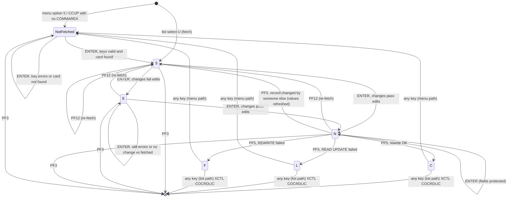

# COCRDUPC: Update a credit card's embossed name, active status, and expiry month/year, with confirmation and an optimistic concurrency check

| Attribute | Value |
|:--|:--|
| Source | `app/cbl/COCRDUPC.cbl` (1560 lines) |
| Module | base |
| Kind | Online (CICS), pseudo-conversational |
| Transaction ID / Job | CCUP |
| BMS map | mapset `COCRDUP` / map `CCRDUPA` (`app/bms/COCRDUP.bms`, symbolic map `app/cpy-bms/COCRDUP.CPY`) |
| Copybooks | `CVCRD01Y`, `COCOM01Y`, `COTTL01Y`, `COCRDUP` (symbolic map), `CSDAT01Y`, `CSMSG01Y` (unused), `CSMSG02Y` (ABEND-DATA), `CSUSR01Y` (unused), `CVACT02Y` (CARD-RECORD), `CVCUS01Y` (unused), `CSSTRPFY` (procedure code), IBM `DFHBMSCA`, `DFHAID`. Commented out: `CVACT01Y`, `CVACT03Y`. |
| Calls / XCTL targets | XCTL to `CDEMO-FROM-PROGRAM` (normally `COCRDLIC`) or `COMEN01C` when that is blank (on PF3, and automatically after a save attempt that started from the list) |
| Data stores | `CARDDAT` (ENT-CARD), key CARD-NUM: Read (fetch), Read UPDATE, then Rewrite (save). SYNCPOINT before every exit XCTL. `CARDAIX` declared, never used. |

## Purpose
Lets the user change three things on one card: the embossed name, the active flag (`Y`/`N`), and
the expiry month and year. The user reaches it from the card list (COCRDLIC, select code `U`),
with the card already chosen, or from main menu option 5 "Credit Card Update", where the user
first types an account number and a card number. Changes are edited, then shown back
protected for confirmation, and written only when the user presses F5. The save re-reads the
record with UPDATE and refuses to write if any field changed since it was fetched. The
expiry day and CVV are not shown or editable. As coded, the save also rewrites the CVV,
account id, and record filler (Q-COCRDUPC-01 to Q-COCRDUPC-03).

## Invocation and state

**Entry paths**

| Entry | How detected | Effect |
|:--|:--|:--|
| From COCRDLIC (select `U`) | `CDEMO-PGM-ENTER` and `CDEMO-FROM-PROGRAM` = `COCRDLIC`; also `CDEMO-LAST-MAPSET` = `COCRDLI` | Card fetched with CDEMO-ACCT-ID / CDEMO-CARD-NUM; details shown for editing at once |
| From main menu option 5 (`COMEN01C`, `app/cpy/COMEN02Y.cpy:48-52`) | `CDEMO-FROM-PROGRAM` = `COMEN01C` and not PGM-REENTER | CARDDEMO-COMMAREA re-initialized (Q-COCRDUPC-10); search screen asks for account and card |
| Transaction CCUP typed with no COMMAREA | EIBCALEN = 0 | Same as menu entry |
| Own pseudo-conversational turn | `CDEMO-PGM-REENTER` | Driven by the state in `CCUP-CHANGE-ACTION` |

The program never updates CDEMO-FROM-PROGRAM, CDEMO-FROM-TRANID, or CDEMO-LAST-MAPSET on its own
turns. They keep the caller's values (`COCRDLIC` / `CCLI` / `COCRDLI` from the list, blank from
the menu) until exit. The rest of this file calls the two cases "list path" and "menu path".

**CARDDEMO-COMMAREA usage**

| Field | Read | Written |
|:--|:--|:--|
| CDEMO-FROM-PROGRAM, CDEMO-FROM-TRANID | Entry path, exit target | `COCRDUPC` / `CCUP` on exit only |
| CDEMO-TO-PROGRAM, CDEMO-TO-TRANID | No | Exit target (defaults `COMEN01C` / `CM00`) |
| CDEMO-PGM-CONTEXT | Yes | REENTER after the first screen; ENTER on exit and on the reset paths |
| CDEMO-LAST-MAPSET | Yes: `COCRDLI` selects list-path exit behavior | `COCRDUP` on exit (7-byte truncation of `'COCRDUP '`) |
| CDEMO-LAST-MAP | No | `CCRDUPA` on exit |
| CDEMO-ACCT-ID, CDEMO-CARD-NUM | Yes (list entry) | From search keys; from the fetched keys on each edit turn; zeroed on exit from the list path and on the reset after a save attempt (menu path) |
| CDEMO-USER-TYPE | No | Forced to `U` on exit |

**Program-specific COMMAREA extension (`WS-THIS-PROGCOMMAREA`, 329 bytes after the 160-byte
CARDDEMO-COMMAREA; RETURN COMMAREA length 2000).** Source: `app/cbl/COCRDUPC.cbl:274-321`.

| Field | Picture | Meaning |
|:--|:--|:--|
| CCUP-CHANGE-ACTION | X(1) | State (table below) |
| CCUP-OLD-ACCTID, CCUP-OLD-CARDID | X(11), X(16) | Keys used for the fetch (the account is the one entered or passed, not the record's) |
| CCUP-OLD-CVV-CD | X(3) | CVV as fetched (used only for the concurrency check) |
| CCUP-OLD-CRDNAME | X(50) | Embossed name as fetched, converted to upper case |
| CCUP-OLD-EXPYEAR / EXPMON / EXPDAY | X(4) / X(2) / X(2) | Expiry date as fetched, split from `YYYY-MM-DD` |
| CCUP-OLD-CRDSTCD | X(1) | Active status as fetched |
| CCUP-NEW-* | same layout | Values received from the screen this turn. The NEW CVV is never filled. |
| CARD-UPDATE-RECORD | 150 bytes, CVACT02Y layout | Record image built for REWRITE |

**State machine (`CCUP-CHANGE-ACTION`)**

| Value | 88-level | Meaning | Info line | Key fields | Detail fields |
|:--|:--|:--|:--|:--|:--|
| LOW-VALUES or space | CCUP-DETAILS-NOT-FETCHED | Waiting for search keys | `Please enter Account and Card Number` | Unprotected | Protected, empty |
| `S` | CCUP-SHOW-DETAILS | Fetched values shown | `Details of selected card shown above` | Protected | Unprotected, show fetched values |
| `E` | CCUP-CHANGES-NOT-OK | Changes failed edits | `Update card details presented above.` | Protected | Unprotected, show entered values, errors red / `*` |
| `N` | CCUP-CHANGES-OK-NOT-CONFIRMED | Changes valid, awaiting F5 | `Changes validated.Press F5 to save` | Protected | Protected, show entered values; `F5=Save F12=Cancel` made bright |
| `C` | CCUP-CHANGES-OKAYED-AND-DONE | Saved | `Changes committed to database` | Protected | Protected, show saved values |
| `L` | CCUP-CHANGES-OKAYED-LOCK-ERROR | READ UPDATE failed | `Changes unsuccessful. Please try again` | Unprotected | Protected, show entered values |
| `F` | CCUP-CHANGES-OKAYED-BUT-FAILED | REWRITE failed | `Changes unsuccessful. Please try again` | Unprotected | Protected, show entered values |



## Screen
The mock-up shows the card on `app/data/ASCII/carddata.txt` line 1 in state `S`. The F5/F12
legend at (24,23) is dark (invisible) except in state `N`. EXPDAY at (15,36) is dark and
protected.

```
         1         2         3         4         5         6         7         8
12345678901234567890123456789012345678901234567890123456789012345678901234567890
 Tran: CCUP                AWS Mainframe Modernization           Date: mm/dd/yy
 Prog: COCRDUPC                    CardDemo                      Time: hh:mm:ss

                              Update Credit Card Details


                       Account Number    :   00000000050
                       Card Number       :   0500********5740


    Name on card      :  ANIYA VON

    Card Active Y/N   :  Y

    Expiry Date       :  03 / 2023  [dd hidden]


                         Details of selected card shown above

<row 23: ERRMSG, red, bright>
 ENTER=Process F3=Exit F5=Save F12=Cancel
                       ^^^^^^^^^^^^^^^^^^ dark unless state N
```

| Field | BMS name | Len | In/Out | Attributes | Meaning |
|:--|:--|:--|:--|:--|:--|
| Transaction id (1,7) | TRNNAME | 4 | Out | ASKIP, FSET, blue | `CCUP` |
| Title lines (1,21), (2,21) | TITLE01, TITLE02 | 40 | Out | ASKIP, yellow | From `COTTL01Y` |
| Date (1,71), Time (2,71) | CURDATE, CURTIME | 8 | Out | ASKIP, blue | MM/DD/YY, HH:MM:SS |
| Program (2,7) | PGMNAME | 8 | Out | ASKIP, blue | `COCRDUPC` |
| Account number (7,45) | ACCTSID | 11 | In/Out | BMS: PROT, FSET, IC, underline. Program: unprotected + MDT in not-fetched / L / F, protected + MDT otherwise; default color on the list path; red when in error; `*` red when blank on re-entry | Search key and the account written to the record |
| Card number (8,45) | CARDSID | 16 | In/Out | BMS: UNPROT, FSET, underline. Program: same protection rules as ACCTSID | Search key and record key |
| Name on card (11,25) | CRDNAME | 50 | In/Out | UNPROT, underline. Program: protected + MDT in not-fetched / N / C / L / F; red or `*` red in state E | CARD-EMBOSSED-NAME (shown upper case after fetch) |
| Card active (13,25) | CRDSTCD | 1 | In/Out | UNPROT, underline; same protection rules as CRDNAME | `Y` or `N` |
| Expiry month (15,25) | EXPMON | 2 | In/Out | UNPROT, underline, JUSTIFY=RIGHT; same protection rules | 01-12 |
| Separator (15,28) | (unnamed) | 1 | Out | default | `/` |
| Expiry year (15,30) | EXPYEAR | 4 | In/Out | UNPROT, underline, JUSTIFY=RIGHT; same protection rules | 1950-2099 |
| Expiry day (15,36) | EXPDAY | 2 | In/Out (hidden) | DRK, FSET, PROT, JUSTIFY=RIGHT; program also moves `DFHBMDAR` into its color byte | Day of month, carried unchanged into the rewrite |
| Info message (20,25) | INFOMSG | 40 | Out | PROT, neutral; program sets dark when empty, bright (`DFHBMBRY`) otherwise | State prompt |
| Error message (23,1) | ERRMSG | 80 | Out | ASKIP, BRT, FSET, red | WS-RETURN-MSG (75 bytes) |
| Key legend (24,1) | FKEYS | 21 | Out | ASKIP, yellow | `ENTER=Process F3=Exit` |
| Confirm legend (24,23) | FKEYSC | 18 | Out | ASKIP, DRK, yellow; bright only in state N | `F5=Save F12=Cancel` |

## Processing flow
1. `0000-MAIN`: HANDLE ABEND LABEL(`ABEND-ROUTINE`). Clear the work area, `WS-MISC-STORAGE` (every
   edit flag becomes space, which is its "blank" value), and the output COMMAREA. Clear the
   return message.
2. IF EIBCALEN = 0, or FROM-PROGRAM = `COMEN01C` and not PGM-REENTER: INITIALIZE
   CARDDEMO-COMMAREA and the program area, set PGM-ENTER and state not-fetched. OTHERWISE copy
   CARDDEMO-COMMAREA and the 329-byte program area from DFHCOMMAREA (Q-COCRDUPC-11).
3. Map the AID. Valid keys: ENTER; PF3; PF5 only in state `N`; PF12 only when the state is not
   not-fetched. Any other key, including PF5 or PF12 outside those states, is treated as ENTER.
4. EVALUATE, first match wins (`app/cbl/COCRDUPC.cbl:429-543`):
   1. PF3; or state `C` with LAST-MAPSET = `COCRDLI`; or state `L`/`F` with LAST-MAPSET =
      `COCRDLI`: exit (NAV-COCRDUPC-02).
   2. PGM-ENTER and FROM-PROGRAM = `COCRDLIC`; or PF12 and FROM-PROGRAM = `COCRDLIC`: set
      PGM-REENTER and both key flags valid; CC-ACCT-ID = CDEMO-ACCT-ID; CC-CARD-NUM =
      CDEMO-CARD-NUM; `9000-READ-DATA`; set state `S` (even if the read failed, Q-COCRDUPC-09);
      `3000-SEND-MAP`; return. The map is not received on this path.
   3. State not-fetched and PGM-ENTER; or FROM-PROGRAM = `COMEN01C` and not PGM-REENTER:
      INITIALIZE the program area; send the search screen; set PGM-REENTER and state
      not-fetched; return.
   4. State `C`, `L`, or `F` (menu path only, because the list path was caught in step 4.1):
      INITIALIZE the program area, `WS-MISC-STORAGE`, CDEMO-ACCT-ID, and CDEMO-CARD-NUM; set
      PGM-ENTER; send the search screen; set PGM-REENTER and state not-fetched; return. Whatever
      the user typed on the result screen is ignored.
   5. OTHERWISE: `1000-PROCESS-INPUTS` (`1100-RECEIVE-MAP`, `1200-EDIT-MAP-INPUTS`), then
      `2000-DECIDE-ACTION`, then `3000-SEND-MAP`; return.
5. `COMMON-RETURN`: RETURN TRANSID(`CCUP`) with the 2000-byte COMMAREA.

**`1100-RECEIVE-MAP`**: RECEIVE MAP into CCRDUPAI (response ignored); INITIALIZE
CCUP-NEW-DETAILS (all spaces). For each of account, card, name, status, month, and year: if the
input is `*` or spaces, use LOW-VALUES; otherwise use the input as received. Account and card go
to CC-ACCT-ID / CC-CARD-NUM and CCUP-NEW-ACCTID / CCUP-NEW-CARDID. The hidden EXPDAY input is
copied as-is to CCUP-NEW-EXPDAY. CCUP-NEW-CVV-CD stays spaces.

**`1200-EDIT-MAP-INPUTS`**
1. IF state not-fetched: `1210-EDIT-ACCOUNT` and `1220-EDIT-CARD` (both always run); clear the
   NEW card data; IF both keys are blank, set message `No input received`; exit.
2. OTHERWISE (details already fetched):
   1. Set the info flag `Details of selected card shown above` and both key flags valid.
   2. CDEMO-ACCT-ID = CCUP-OLD-ACCTID and CDEMO-CARD-NUM = CCUP-OLD-CARDID.
   3. IF UPPER-CASE(NEW name, year, month, day, status) = UPPER-CASE(OLD same): message
      `No change detected with respect to values fetched.`.
   4. IF no change was detected, or the state is `N` (or `C`): mark all detail flags valid and
      exit, so the state is unchanged.
   5. Set state `E`; run `1230-EDIT-NAME`, `1240-EDIT-CARDSTATUS`, `1250-EDIT-EXPIRY-MON`, and
      `1260-EDIT-EXPIRY-YEAR` (all always run). IF no error, set state `N`.

**`2000-DECIDE-ACTION`** (first match wins):
1. State not-fetched, or PF12: IF both key flags are valid, `9000-READ-DATA`; IF the card was
   found, set state `S`.
2. State `S`: IF there is no input error and a change was detected, set `N`. This branch is not
   reachable in practice, because step 1200 already moved such a turn to `E` or `N`.
3. State `E`: no action.
4. State `N` and PF5: `9200-WRITE-PROCESSING`, then:
   - could not lock: `L`;
   - rewrite failed: `F`;
   - record changed by someone else: `S`;
   - OTHERWISE: `C`.
5. State `N` (ENTER): no action.
6. State `C`: set `S` and, if FROM-TRANID is blank, zero the account and card and clear
   CDEMO-ACCT-STATUS. Not reachable (see Q-COCRDUPC-16).
7. OTHERWISE: perform `ABEND-ROUTINE` with `UNEXPECTED DATA SCENARIO` (ERR-COCRDUPC-06).

**`3000-SEND-MAP`**:
1. `3100-SCREEN-INIT`: header fields.
2. `3200-SETUP-SCREEN-VARS`: BR-COCRDUPC-14.
3. `3250-SETUP-INFOMSG`: info by state; PGM-ENTER takes precedence and gives the search prompt.
   The error line gets WS-RETURN-MSG.
4. `3300-SETUP-SCREEN-ATTRS`: BR-COCRDUPC-15, BR-COCRDUPC-16.
5. `3400-SEND-SCREEN`: SEND MAP CURSOR ERASE FREEKB.

**`9000-READ-DATA`**: INITIALIZE CCUP-OLD-DETAILS. OLD-ACCTID = CC-ACCT-ID and OLD-CARDID =
CC-CARD-NUM. `9100-GETCARD-BYACCTCARD` reads CARDDAT by CC-CARD-NUM. IF found:
- OLD-CVV = CARD-CVV-CD;
- convert CARD-EMBOSSED-NAME a-z to A-Z, and OLD-CRDNAME = the result;
- OLD-EXPYEAR = date(1:4), OLD-EXPMON = date(6:2), OLD-EXPDAY = date(9:2);
- OLD-CRDSTCD = CARD-ACTIVE-STATUS.

**`9200-WRITE-PROCESSING`**:
1. READ CARDDAT UPDATE by CC-CARD-NUM. IF the response is not NORMAL: input error; message
   `Could not lock record for update` (if no message yet); exit.
2. `9300-CHECK-CHANGE-IN-REC`: upper-case the record's name; compare the record's CVV, name,
   expiry year, month, and day, and status with the OLD values. IF any differ: message
   `Record changed by some one else. Please review`, replace the OLD values with the record's
   current values, and exit without writing.
3. Build CARD-UPDATE-RECORD (Data effects) and REWRITE CARDDAT from it. IF the response is not
   NORMAL: message `Update of record failed`.

## Rules
### Business rules
- **BR-COCRDUPC-01**: Fetch is by CARD-NUM only. The account number entered (menu path) or passed
  (list path) is validated for format but never compared with CARD-ACCT-ID or the
  cross-reference. It becomes CCUP-OLD-ACCTID, is displayed, and is later written to the record
  (BR-COCRDUPC-07). Source: `app/cbl/COCRDUPC.cbl:1343-1413 (9000-READ-DATA, 9100-GETCARD-BYACCTCARD)`.
- **BR-COCRDUPC-02**: The fetched name is converted to upper case before it is stored and shown.
  The fetched expiry date `YYYY-MM-DD` is split into year (1-4), month (6-7), and day (9-10).
  Source: `app/cbl/COCRDUPC.cbl:1352-1369`.
- **BR-COCRDUPC-03**: Change detection compares NEW and OLD name + year + month + day + status
  after upper-casing both sides. If they are equal, the message is
  `No change detected with respect to values fetched.`, no field edits run, and the state does not
  change. A name change that only alters letter case counts as no change. Source:
  `app/cbl/COCRDUPC.cbl:679-693 (1200-EDIT-MAP-INPUTS)`.
- **BR-COCRDUPC-04**: Field edits run only when a change is detected in state `S` or `E`. All four
  edits always run, and the state becomes `E` (any error) or `N` (no error). In state `N` the
  values are not re-edited; the fields are protected, so they come back as shown. Source:
  `app/cbl/COCRDUPC.cbl:685-714`.
- **BR-COCRDUPC-05**: Two-step save. Valid changes put the program in state `N`: all fields are
  protected, the info line is `Changes validated.Press F5 to save`, and `F5=Save F12=Cancel` is
  made bright. Only PF5 in state `N` saves. ENTER in state `N` re-displays the confirmation. PF5 in
  any other state is treated as ENTER. Source: `app/cbl/COCRDUPC.cbl:413-424`, `app/cbl/COCRDUPC.cbl:988-1007`, `app/cbl/COCRDUPC.cbl:1149-1150`, `app/cbl/COCRDUPC.cbl:1315-1317`.
- **BR-COCRDUPC-06**: Optimistic concurrency. On save, the record is re-read with UPDATE (lock).
  Save proceeds only if the current CVV, name (case-insensitive), expiry year, month, day, and
  status all equal the values fetched for display. The account id and the record filler are not
  compared. If they differ, nothing is written. The message is
  `Record changed by some one else. Please review`, the screen goes back to state `S` showing the
  current record values, and the user's edits are discarded. Source:
  `app/cbl/COCRDUPC.cbl:1420-1457`, `app/cbl/COCRDUPC.cbl:1498-1520 (9300-CHECK-CHANGE-IN-REC)`, `app/cbl/COCRDUPC.cbl:997-998`.
- **BR-COCRDUPC-07**: Record image written by REWRITE (full 150 bytes). Source:
  `app/cbl/COCRDUPC.cbl:1459-1483 (9200-WRITE-PROCESSING)`.
  - CARD-NUM = the card number on screen (the fetch key, protected).
  - CARD-ACCT-ID = the account number on screen (Q-COCRDUPC-02).
  - CARD-CVV-CD = a value derived from spaces, not the original CVV (Q-COCRDUPC-01).
  - CARD-EMBOSSED-NAME = the name as received (case preserved).
  - CARD-EXPIRAION-DATE = new year + `-` + new month + `-` + the hidden, unchanged day.
  - CARD-ACTIVE-STATUS = the new status.
  - FILLER(59) = uninitialized program storage (Q-COCRDUPC-03).
- **BR-COCRDUPC-08**: Save outcome: READ UPDATE failure gives state `L`; changed record gives
  state `S`; REWRITE failure gives state `F`; otherwise state `C` with info
  `Changes committed to database`. Source: `app/cbl/COCRDUPC.cbl:988-1001`.
- **BR-COCRDUPC-09**: After a save attempt (`C`, `L`, or `F`), the result screen is shown once.
  On the next key:
  - List path: return to the caller as for PF3 (CDEMO-ACCT-ID and CDEMO-CARD-NUM zeroed).
  - Menu path: a fresh search screen with empty keys; account and card in the COMMAREA zeroed.

  Source: `app/cbl/COCRDUPC.cbl:435-476`, `app/cbl/COCRDUPC.cbl:517-528`.
- **BR-COCRDUPC-10**: PF12 (cancel), valid once details are fetched, re-reads the card and shows
  the stored values in state `S`. On the list path the map is not received. On the menu path the
  screen is received and edited first, so an edit message from the discarded input may still show
  (Q-COCRDUPC-08). Source: `app/cbl/COCRDUPC.cbl:484-497`, `app/cbl/COCRDUPC.cbl:954-966`.
- **BR-COCRDUPC-11**: The expiry day is never shown or edited. It travels in the dark protected
  field EXPDAY and is written back unchanged. Source: `app/cbl/COCRDUPC.cbl:621`, `app/cbl/COCRDUPC.cbl:1110`, `app/cbl/COCRDUPC.cbl:1119-1123`, `app/bms/COCRDUP.bms:142-146`.
- **BR-COCRDUPC-12**: The CVV is never shown or edited. It is used only in the concurrency check.
- **BR-COCRDUPC-13**: Exit (PF3 or automatic) issues SYNCPOINT before XCTL. A successful REWRITE
  is otherwise committed when the PF5 task ends at RETURN, and the UPDATE lock is released at the
  same time. Source: `app/cbl/COCRDUPC.cbl:469-476`.
- **BR-COCRDUPC-14**: Screen values (`3200-SETUP-SCREEN-VARS`). Nothing is filled when
  PGM-ENTER is set. Otherwise the account shows CC-ACCT-ID (blank if 0) and the card shows
  CC-CARD-NUM (blank if 0). Details by state:
  - not-fetched: all blank.
  - `S`: OLD values (name upper case).
  - `E`, `N`, `C`, `L`, `F`: NEW values for name, status, month, and year; OLD day.

  Source: `app/cbl/COCRDUPC.cbl:1082-1134`.
- **BR-COCRDUPC-15**: Protection (`3300-SETUP-SCREEN-ATTRS`):
  - not-fetched, `L`, `F`: keys unprotected + MDT; name, status, month, and year protected + MDT.
  - `S`, `E`: keys protected + MDT; details unprotected + MDT.
  - `N`, `C`: everything protected + MDT.

  Source: `app/cbl/COCRDUPC.cbl:1171-1208`.
- **BR-COCRDUPC-16**: Cursor and colors. Source: `app/cbl/COCRDUPC.cbl:1210-1317`.
  - Cursor, first match wins:
    - info is `Details of selected card shown above` (state `S`) or no change detected: name;
    - account in error or blank: account;
    - card in error or blank: card;
    - name in error or blank: name;
    - status in error or blank: status;
    - month in error or blank: month;
    - year in error or blank: year;
    - otherwise: account.
  - Colors:
    - Keys use the default color on the list path.
    - A key in error is red.
    - A blank key on a re-entry turn shows `*` in red.
    - Name, status, month, and year are red when invalid, or `*` red when blank, only in state `E`.
    - The info line is bright when set and dark when empty.
- **BR-COCRDUPC-17**: User type is forced to `U` and PGM-CONTEXT to ENTER on exit. When the exit
  started on the list path, CDEMO-ACCT-ID and CDEMO-CARD-NUM are zeroed. Source:
  `app/cbl/COCRDUPC.cbl:456-467`.

### Validation rules
Search keys (state not-fetched only):
- **VR-COCRDUPC-01**: The account is required. LOW-VALUES, spaces, `*`, or all zeros give
  `Account number not provided`; the field shows `*` in red and gets the cursor. CDEMO-ACCT-ID is
  set to 0. Source: `app/cbl/COCRDUPC.cbl:721-736 (1210-EDIT-ACCOUNT)`.
- **VR-COCRDUPC-02**: The account must be numeric in all 11 positions. Otherwise
  `ACCOUNT FILTER,IF SUPPLIED MUST BE A 11 DIGIT NUMBER`; the field is red and is redisplayed
  empty (because CC-ACCT-ID-N is not numeric zero, the raw input is echoed; see Open questions).
  Source: `app/cbl/COCRDUPC.cbl:740-755`.
- **VR-COCRDUPC-03**: The card is required. Blank gives `Card number not provided` (only if no
  account message), with `*` in red. Source: `app/cbl/COCRDUPC.cbl:762-780 (1220-EDIT-CARD)`.
- **VR-COCRDUPC-04**: The card must be numeric in all 16 positions. Otherwise
  `CARD ID FILTER,IF SUPPLIED MUST BE A 16 DIGIT NUMBER` (only if no account message); the field
  is red. Source: `app/cbl/COCRDUPC.cbl:784-799`.
- **VR-COCRDUPC-05**: If both keys are blank, the message is `No input received`, replacing the
  account message. Source: `app/cbl/COCRDUPC.cbl:655-659`.
- **VR-COCRDUPC-06**: The card must exist. NOTFND gives
  `Did not find cards for this search condition`; both keys are red, the state stays
  not-fetched, and the cursor is on the account. Source: `app/cbl/COCRDUPC.cbl:1395-1401`.

Detail fields (states `S` or `E` with a change detected):
- **VR-COCRDUPC-07**: The name is required. LOW-VALUES, spaces, `*`, or all `0` characters give
  `Card name not provided`; the name shows `*` in red. Source: `app/cbl/COCRDUPC.cbl:806-820 (1230-EDIT-NAME)`.
- **VR-COCRDUPC-08**: The name may contain only the letters A-Z, a-z, and spaces. Digits,
  apostrophes, hyphens, periods, and any other character give
  `Card name can only contain alphabets and spaces`; the name is red. The check replaces every
  letter with a space and requires that the trimmed result is empty. Source:
  `app/cbl/COCRDUPC.cbl:822-839`.
- **VR-COCRDUPC-09**: The status must be `Y` or `N` (upper case only). Blank, `*`, or `0` give
  `Card Active Status must be Y or N` with `*` red. Any other value gives the same message with
  the field red. Source: `app/cbl/COCRDUPC.cbl:845-873 (1240-EDIT-CARDSTATUS)`.
- **VR-COCRDUPC-10**: The expiry month must be numeric 1 through 12. Blank, `*`, or `00` give
  `Card expiry month must be between 1 and 12` with `*` red. Any other value outside 01-12
  (including non-numeric) gives the same message with the field red. Source:
  `app/cbl/COCRDUPC.cbl:877-908 (1250-EDIT-EXPIRY-MON)`.
- **VR-COCRDUPC-11**: The expiry year must be numeric 1950 through 2099. Blank, `*`, or `0000`
  give `Invalid card expiry year` with `*` red. Any other value outside 1950-2099 gives the same
  message with the field red. Past years are accepted. Source:
  `app/cbl/COCRDUPC.cbl:913-944 (1260-EDIT-EXPIRY-YEAR)`.
- **VR-COCRDUPC-12**: Message precedence. Only the first error message is kept (order: name,
  status, month, year), but every failing field is highlighted, and the cursor goes to the first
  failing field (BR-COCRDUPC-16). Source: `app/cbl/COCRDUPC.cbl:698-708`.
- **VR-COCRDUPC-13**: No cross-field validation. The day/month combination is not checked (the
  unchanged day can make an impossible date), and expiry need not be in the future. Source:
  `app/cbl/COCRDUPC.cbl:1467-1474`.

### Navigation and keys
- **NAV-COCRDUPC-01**: AID handling. PF13-PF24 act as PF1-PF12. ENTER and PF3 are always valid;
  PF5 only in state `N`; PF12 only once details are fetched. Every other AID behaves as ENTER,
  with no message. Source: `app/cpy/CSSTRPFY.cpy:17-82`, `app/cbl/COCRDUPC.cbl:413-424`.
- **NAV-COCRDUPC-02**: PF3 in any state exits:
  - CDEMO-TO-TRANID = FROM-TRANID, or `CM00` if blank.
  - CDEMO-TO-PROGRAM = FROM-PROGRAM, or `COMEN01C` if blank.
  - FROM-TRANID = `CCUP`, FROM-PROGRAM = `COCRDUPC`.
  - If LAST-MAPSET was `COCRDLI`, CDEMO-ACCT-ID and CDEMO-CARD-NUM are zeroed.
  - User type `U`, PGM-ENTER, LAST-MAPSET `COCRDUP`, LAST-MAP `CCRDUPA`.
  - SYNCPOINT, then XCTL with CARDDEMO-COMMAREA.

  The list path returns to COCRDLIC; the menu or direct path goes to COMEN01C. Unsaved changes
  are discarded without warning. Source: `app/cbl/COCRDUPC.cbl:435-476`.
- **NAV-COCRDUPC-03**: On the list path, any key after a save attempt (`C`, `L`, `F`) exits
  exactly as PF3. COCRDLIC then receives the original AID; ENTER, for example, shows list page 1.
  Source: `app/cbl/COCRDUPC.cbl:436-440`.
- **NAV-COCRDUPC-04**: Entry from COCRDLIC fetches immediately and shows state `S`. Source:
  `app/cbl/COCRDUPC.cbl:482-497`.
- **NAV-COCRDUPC-05**: Entry from the menu, or CCUP with no COMMAREA, shows the search screen.
  Source: `app/cbl/COCRDUPC.cbl:388-394`, `app/cbl/COCRDUPC.cbl:502-511`.
- **NAV-COCRDUPC-06**: Every non-exit turn ends with RETURN TRANSID(`CCUP`) and a 2000-byte
  COMMAREA. Source: `app/cbl/COCRDUPC.cbl:546-558 (COMMON-RETURN)`.

### Error handling
- **ERR-COCRDUPC-01**: A fetch READ response other than NORMAL or NOTFND gives
  `File Error: READ     on CARDDAT   returned RESP nnnnnnnnn ,RESP2 nnnnnnnnn ` (same layout as
  COCRDLIC). The account is red and no details are shown. The state stays not-fetched on the menu
  path, or is `S` with empty details on the list path. Source: `app/cbl/COCRDUPC.cbl:133-152`, `app/cbl/COCRDUPC.cbl:1402-1411`.
- **ERR-COCRDUPC-02**: A READ UPDATE response other than NORMAL (for example NOTFND, or the record
  locked beyond the CICS wait) gives `Could not lock record for update` and state `L`. The info
  line is `Changes unsuccessful. Please try again`, the keys are unprotected, and the details are
  protected. Source: `app/cbl/COCRDUPC.cbl:1441-1449`, `app/cbl/COCRDUPC.cbl:993-994`.
- **ERR-COCRDUPC-03**: A REWRITE response other than NORMAL gives `Update of record failed` and
  state `F`, with the same info line and protection as ERR-COCRDUPC-02. Source:
  `app/cbl/COCRDUPC.cbl:1477-1492`, `app/cbl/COCRDUPC.cbl:995-996`.
- **ERR-COCRDUPC-04**: A concurrency mismatch gives `Record changed by some one else. Please review`
  and state `S` with refreshed values (BR-COCRDUPC-06). The lock from READ UPDATE is held until
  the task ends. Source: `app/cbl/COCRDUPC.cbl:1498-1520`.
- **ERR-COCRDUPC-05**: Any abend (HANDLE ABEND) goes to `ABEND-ROUTINE`. ABEND-MSG defaults to
  `UNEXPECTED ABEND OCCURRED.` and ABEND-CULPRIT is `COCRDUPC`. ABEND-DATA is sent with SEND
  FROM ... NOHANDLE ERASE, the handler is cancelled, and the task abends with `9999`. Uncommitted
  updates are backed out by the abend. Source: `app/cbl/COCRDUPC.cbl:1531-1553`.
- **ERR-COCRDUPC-06**: An unexpected state in `2000-DECIDE-ACTION` sets ABEND-CODE `0001` and
  ABEND-MSG `UNEXPECTED DATA SCENARIO`, then performs `ABEND-ROUTINE` (abend `9999`). Source:
  `app/cbl/COCRDUPC.cbl:1019-1026`.
- **ERR-COCRDUPC-07**: RECEIVE MAP and SEND MAP responses are ignored. On MAPFAIL the input fields
  keep their initial storage contents. Source: `app/cbl/COCRDUPC.cbl:578-584`, `app/cbl/COCRDUPC.cbl:1329-1336`.

## Data effects
- Only the PF5 turn in state `N` changes data:
  1. READ UPDATE of `CARDDAT` by card number. A failure means no change.
  2. Comparison with the fetched values. A mismatch means no change, and the lock is released at
     task end.
  3. REWRITE of the same record with the full 150-byte image from BR-COCRDUPC-07.

| Field (CVACT02Y) | Written value | Same as before? |
|:--|:--|:--|
| CARD-NUM X(16) | Card number on screen (protected, equals the key) | Yes |
| CARD-ACCT-ID 9(11) | Account number on screen | List path: yes. Menu path: whatever the user typed (Q-COCRDUPC-02) |
| CARD-CVV-CD 9(3) | Derived from CCUP-NEW-CVV-CD, which is always spaces (GnuCOBOL 3.1 writes three spaces; IBM Enterprise COBOL produces a non-numeric value) | No: original CVV lost (Q-COCRDUPC-01) |
| CARD-EMBOSSED-NAME X(50) | Name as received from the screen | Changed if edited; becomes upper case even if not edited (Q-COCRDUPC-04) |
| CARD-EXPIRAION-DATE X(10) | `YYYY-MM-DD` built from new year, new month, unchanged day | Day unchanged |
| CARD-ACTIVE-STATUS X(1) | New status (`Y`/`N`) | Changed if edited |
| FILLER X(59) | Uninitialized bytes from the program area | No (Q-COCRDUPC-03) |

- The transaction boundary is the PF5 task. The REWRITE commits at RETURN. SYNCPOINT is issued
  only on the exit path, after the commit.
- No other file is touched. The card cross-reference (`CXACAIX` / CARDXREF) is not updated even
  when CARD-ACCT-ID changes.

## Quirks
- **Q-COCRDUPC-01**: Every save overwrites the CVV. CCUP-NEW-CVV-CD is never loaded from the
  fetched record, so the rewrite uses a value derived from spaces. A local GnuCOBOL 3.1 check of
  the same MOVE sequence produced `'   '`. Recommendation: fix (write the fetched CVV unchanged).
  Source: `app/cbl/COCRDUPC.cbl:586`, `app/cbl/COCRDUPC.cbl:1464-1465`.
- **Q-COCRDUPC-02**: The account id written is the one on screen. On the menu path that is
  whatever 11-digit non-zero number the user typed, even if it does not exist or does not own the
  card. The save re-parents the card without updating the cross-reference, and the concurrency
  check ignores the account. Recommendation: fix (never write the account id from input; verify
  ownership on fetch). Source: `app/cbl/COCRDUPC.cbl:1346`, `app/cbl/COCRDUPC.cbl:1463`.
- **Q-COCRDUPC-03**: INITIALIZE does not touch FILLER, so the 59-byte record filler is written from
  whatever is in the program area. On the list path that area was copied from storage beyond the
  160-byte COMMAREA passed by COCRDLIC. The original filler (spaces in the sample data) is lost.
  Recommendation: fix (preserve the original record bytes). Source: `app/cbl/COCRDUPC.cbl:314-321`, `app/cbl/COCRDUPC.cbl:1461`.
- **Q-COCRDUPC-04**: The name is shown upper case after fetch, so any save (even a status-only
  change) writes the name in upper case: `Aniya Von` becomes `ANIYA VON`. A name typed in mixed
  case together with another change is saved as typed. Recommendation: decide. Source:
  `app/cbl/COCRDUPC.cbl:1356-1360`, `app/cbl/COCRDUPC.cbl:1466`.
- **Q-COCRDUPC-05**: The name edit rejects apostrophes, hyphens, and periods. Sample card line 34
  (7026********2277, `Lucious O'Connell`) cannot be saved with any change unless the name is
  altered. Recommendation: decide (likely widen the allowed set). Source: `app/cbl/COCRDUPC.cbl:822-837`.
- **Q-COCRDUPC-06**: The expiry day is kept while the month and year change, with no date
  validation. For example, card line 35 (`2025-08-29`) with month changed to `02` is written as
  `2025-02-29`, which is not a real date. Recommendation: fix (validate, or set the day to the
  last day of the month). Source: `app/cbl/COCRDUPC.cbl:1467-1474`.
- **Q-COCRDUPC-07**: Change detection ignores case. Retyping the name with a different case only
  reports `No change detected with respect to values fetched.`. Recommendation: preserve or
  decide.
- **Q-COCRDUPC-08**: On the menu path, PF12 runs the edits on the discarded input first. The
  restored screen can carry an error such as `Card name can only contain alphabets and spaces`
  or `No change detected with respect to values fetched.` with no field highlighted.
  Recommendation: fix. Source: `app/cbl/COCRDUPC.cbl:535-541`, `app/cbl/COCRDUPC.cbl:958-966`.
- **Q-COCRDUPC-09**: List entry sets state `S` even when the fetch fails (card deleted since the
  list was shown). The user sees `Did not find cards for this search condition` with editable,
  empty details, and info `Details of selected card shown above`. A later save fails with
  `Could not lock record for update`. Recommendation: fix. Source: `app/cbl/COCRDUPC.cbl:492-494`.
- **Q-COCRDUPC-10**: Menu entry INITIALIZEs CARDDEMO-COMMAREA (user id, user type, customer, and
  account context lost). Exit forces user type `U`. Recommendation: fix. Source:
  `app/cbl/COCRDUPC.cbl:388-394`, `app/cbl/COCRDUPC.cbl:464`.
- **Q-COCRDUPC-11**: On list entry only 160 bytes are passed, but 329 bytes beyond them are copied
  into the program area, including CCUP-CHANGE-ACTION. The exit tests for states `C`/`L`/`F` come
  before the list-entry test, so a stray `C`, `L`, or `F` in that byte would send the user straight
  back to the list. Recommendation: fix (use EIBCALEN; reset state on entry). Source:
  `app/cbl/COCRDUPC.cbl:395-401`, `app/cbl/COCRDUPC.cbl:435-440`.
- **Q-COCRDUPC-12**: The key fields cannot be changed after a fetch. To edit another card the user
  must exit or finish the save cycle. Recommendation: decide.
- **Q-COCRDUPC-13**: After a save attempt on the menu path, the next key throws away its input and
  shows an empty search screen. After a concurrency conflict, the user's edits are discarded.
  Recommendation: decide.
- **Q-COCRDUPC-14**: BMS and attribute oddities:
  - ERRMSG (LENGTH=80 at (23,1)) overflows into row 24 column 1.
  - `DFHBMDAR` (an attribute value) is moved into the EXPDAY color byte.
  - ACCTSID is `PROT` in the BMS but unprotected by the program in search states.

  Recommendation: fix in UI. Source: `app/bms/COCRDUP.bms:84-88`, `app/bms/COCRDUP.bms:154-157`, `app/cbl/COCRDUPC.cbl:1285`.
- **Q-COCRDUPC-15**: `F12=Cancel` is visible only in state `N`, although PF12 also works in states
  `S` and `E`. Recommendation: decide.
- **Q-COCRDUPC-16**: Dead code and unused items:
  - The `CCUP-CHANGES-OKAYED-AND-DONE` branch of `2000-DECIDE-ACTION` (lines 1011-1018) and the
    `OR CCUP-CHANGES-OKAYED-AND-DONE` test at line 687 are unreachable (state `C` is handled
    before).
  - The `WHEN CCUP-SHOW-DETAILS` body in 2000 never changes the state in practice.
  - Unused messages: `Account number must be a non zero 11 digit number`,
    `Card number if supplied must be a 16 digit number`,
    `Did not find this account in cards database`, `Error reading Card Data File`,
    `Looks Good.... so far`, `PF03 pressed.Exiting`.
  - `9300-CHECK-CHANGE-IN-REC` ends with a stray `EXIT` inside its IF (no-op). `WS-UCTRANS` and
    `CARDAIX` are unused.

  Recommendation: drop. Source: `app/cbl/COCRDUPC.cbl:171-214`, `app/cbl/COCRDUPC.cbl:1011-1018`, `app/cbl/COCRDUPC.cbl:1519`.
- **Q-COCRDUPC-17**: There is no authorization check: any signed-on user can change any card's
  status, name, or expiry. There is no audit record of the change. Recommendation: decide.
- **Q-COCRDUPC-18**: Messages contain source typos that must be kept if the text is preserved:
  `Changes validated.Press F5 to save` (no space), `Record changed by some one else. Please review`,
  and the "IF SUPPLIED" wording for mandatory keys. Recommendation: decide.
- **Q-COCRDUPC-19**: The expiry month and year fields are `JUSTIFY=RIGHT`. Whether a one-digit
  month `5` reaches the program as `05` (accepted) or ` 5` depends on BMS padding. With GnuCOBOL,
  ` 5` fails the 1-12 test, giving `Card expiry month must be between 1 and 12`. Recommendation:
  decide (accept 1-12 as integers).

## Test scenarios
Card numbers are masked first 4 + last 4; the full values are in `app/data/ASCII/carddata.txt` at
the cited line. "Record" means the CARDDAT record after the turn.

- **TS-COCRDUPC-01** (NAV-COCRDUPC-04, BR-COCRDUPC-02, BR-COCRDUPC-15): Given COCRDLIC page 1, when
  `U` is entered on row 1 (card 0500********5740, account 00000000050, line 1), then the screen
  shows:
  - Account 00000000050 and the card, both protected.
  - Name `ANIYA VON` (upper-cased), status `Y`, expiry `03` / `2023`.
  - Info `Details of selected card shown above`, empty error line, cursor on the name.
  - `F5=Save F12=Cancel` not visible.
- **TS-COCRDUPC-02** (BR-COCRDUPC-03): Given TS-COCRDUPC-01, when ENTER is pressed without changes,
  then the error is `No change detected with respect to values fetched.` and the state stays `S`.
- **TS-COCRDUPC-03** (BR-COCRDUPC-04, BR-COCRDUPC-05): Given TS-COCRDUPC-01, when the status is
  changed to `N` and ENTER is pressed, then the info line is `Changes validated.Press F5 to save`,
  all fields are protected, `F5=Save F12=Cancel` is bright, and the record is unchanged.
- **TS-COCRDUPC-04** (BR-COCRDUPC-07, BR-COCRDUPC-08, Q-COCRDUPC-01, Q-COCRDUPC-04): Given
  TS-COCRDUPC-03, when PF5 is pressed, then the info line is `Changes committed to database`.
  The record now holds CARD-NUM unchanged, CARD-ACCT-ID 00000000050, CARD-EMBOSSED-NAME
  `ANIYA VON`, CARD-EXPIRAION-DATE `2023-03-09`, and CARD-ACTIVE-STATUS `N`. CARD-CVV-CD no
  longer equals the original value from line 1 columns 28-30.
- **TS-COCRDUPC-05** (NAV-COCRDUPC-03, BR-COCRDUPC-17): Given TS-COCRDUPC-04, when ENTER is
  pressed, then XCTL goes to COCRDLIC with CDEMO-ACCT-ID = 0, CDEMO-CARD-NUM = 0,
  CDEMO-FROM-PROGRAM = `COCRDUPC`, and CDEMO-PGM-CONTEXT = 0. COCRDLIC shows page 1.
- **TS-COCRDUPC-06** (BR-COCRDUPC-05, NAV-COCRDUPC-01): Given state `N`, when ENTER is pressed,
  then the confirmation screen is shown again and nothing is written. Given state `S` with the
  status changed to `N`, when PF5 is pressed, then it acts as ENTER and only validates (state
  `N`); nothing is written.
- **TS-COCRDUPC-07** (BR-COCRDUPC-10): Given state `N` after changing the status to `N`, when PF12
  is pressed, then the stored values (`ANIYA VON`, `Y`, `03`/`2023`) are shown in state `S`.
- **TS-COCRDUPC-08** (VR-COCRDUPC-08): Given state `S` for line 1, when the name is changed to
  `Aniya Von2`, then the error is `Card name can only contain alphabets and spaces`, the name is
  red with the cursor on it, the info line is `Update card details presented above.`, and the
  state is `E`.
- **TS-COCRDUPC-09** (VR-COCRDUPC-07): Given state `S`, when the name is erased, then the error is
  `Card name not provided` and the name field shows `*` in red.
- **TS-COCRDUPC-10** (VR-COCRDUPC-09): Given state `S` with status `Y`, when the status is changed
  to `y` together with another field (for example the month), then the error is
  `Card Active Status must be Y or N`. When it is erased, the same message appears with `*` in
  the field. (Correction: `y` as the only change gives BR-COCRDUPC-03 `No change detected with
  respect to values fetched.`, because the change check compares upper-cased values,
  `app/cbl/COCRDUPC.cbl:680-683`.)
- **TS-COCRDUPC-11** (VR-COCRDUPC-10): Given state `S`, when the month is changed to `13`, then the
  error is `Card expiry month must be between 1 and 12`. With `00` the same message appears and
  the field shows `*`.
- **TS-COCRDUPC-12** (VR-COCRDUPC-11): Given state `S`, when the year is changed to `1949` or
  `2100`, then the error is `Invalid card expiry year`. With `1950` or `2099` the change validates
  (state `N`).
- **TS-COCRDUPC-13** (VR-COCRDUPC-12): Given state `S`, when the name is changed to `123` and the
  status to `X`, then the only message is `Card name can only contain alphabets and spaces`, both
  fields are red, and the cursor is on the name.
- **TS-COCRDUPC-14** (BR-COCRDUPC-06, ERR-COCRDUPC-04): Given state `N` for line 1 with the status
  changed to `N`, and another task has since changed that record's status to `N` (or its name),
  when PF5 is pressed, then nothing is written. The error is
  `Record changed by some one else. Please review`, the screen shows the record's current values
  in state `S`, and the info line is `Details of selected card shown above`.
- **TS-COCRDUPC-15** (ERR-COCRDUPC-02, BR-COCRDUPC-09): Given state `N`, and the record has been
  deleted, when PF5 is pressed, then the error is `Could not lock record for update`, the info is
  `Changes unsuccessful. Please try again`, the keys are unprotected, and the details are
  protected. On the next ENTER, the list path returns to COCRDLIC, and the menu path shows an empty
  search screen.
- **TS-COCRDUPC-16** (NAV-COCRDUPC-05, VR-COCRDUPC-05): Given main menu option 5, then the search
  screen shows info `Please enter Account and Card Number`, editable keys, and protected empty
  details. When ENTER is pressed with both keys empty, the error is `No input received` and both
  keys show `*` in red.
- **TS-COCRDUPC-17** (VR-COCRDUPC-01 to VR-COCRDUPC-04): On the search screen:
  - Account empty, card 0683********1516: `Account number not provided`.
  - Account `00000000027`, card empty: `Card number not provided`.
  - Account `27`: `ACCOUNT FILTER,IF SUPPLIED MUST BE A 11 DIGIT NUMBER`.
  - Card `0683X`: `CARD ID FILTER,IF SUPPLIED MUST BE A 16 DIGIT NUMBER`.
- **TS-COCRDUPC-18** (VR-COCRDUPC-06): On the search screen, account `00000000027` and card
  `0000000000000001` give `Did not find cards for this search condition`, both keys red, and the
  state stays not-fetched.
- **TS-COCRDUPC-19** (BR-COCRDUPC-01): On the search screen, account `00000000027` and card
  0683********1516 (line 2) show `WARD JONES`, `Y`, `07` / `2025` in state `S`.
- **TS-COCRDUPC-20** (Q-COCRDUPC-02): On the search screen, account `00000000001` and card
  0683********1516 (line 2, owned by account 00000000027) are entered. When the status is changed
  to `N` and the change is confirmed with PF5, then the record's CARD-ACCT-ID is `00000000001`,
  and `app/data` cross-reference account 27 still points to the card.
- **TS-COCRDUPC-21** (Q-COCRDUPC-05): Given card line 34 (7026********2277, account 00000000031)
  fetched, the name shows `LUCIOUS O'CONNELL`. When only the status is changed to `N`, the error is
  `Card name can only contain alphabets and spaces`.
- **TS-COCRDUPC-22** (Q-COCRDUPC-06, BR-COCRDUPC-11): Given card line 35 (7058********7752, account
  00000000043, expiry `2025-08-29`) fetched, when the month is changed to `02` and saved with PF5,
  then CARD-EXPIRAION-DATE is `2025-02-29`.
- **TS-COCRDUPC-23** (BR-COCRDUPC-03, Q-COCRDUPC-04): Given line 1 fetched (`ANIYA VON`), when the
  name is typed as `aniya von` with no other change, then the result is `No change detected...`.
  When the name is typed as `Aniya Von`, the status changed to `N`, and the change saved, then
  CARD-EMBOSSED-NAME is `Aniya Von`.
- **TS-COCRDUPC-24** (BR-COCRDUPC-09, menu path): Given a successful save on the menu path
  (`Changes committed to database`), when ENTER is pressed, then an empty search screen is shown
  with `Please enter Account and Card Number`, and CDEMO-ACCT-ID / CDEMO-CARD-NUM are 0.
- **TS-COCRDUPC-25** (NAV-COCRDUPC-02, BR-COCRDUPC-13): Given state `E` on the list path, when PF3
  is pressed, then SYNCPOINT is issued, XCTL goes to COCRDLIC with CDEMO-ACCT-ID = 0, and the
  record is unchanged.
- **TS-COCRDUPC-26** (Q-COCRDUPC-08): On the menu path in state `S`, when the name is changed to
  `123` and PF12 is pressed, then the stored values are shown in state `S`, the error line reads
  `Card name can only contain alphabets and spaces`, and no field is red.

## Open questions
- Should the target preserve the CVV, filler, and account id on update? Almost certainly yes; the
  current behavior (Q-COCRDUPC-01 to Q-COCRDUPC-03) looks unintended.
- Should the menu path verify that the card belongs to the entered account, and should regular
  users be limited to their own cards (Q-COCRDUPC-02, Q-COCRDUPC-17)?
- VR-COCRDUPC-02 echo: on a non-numeric account the program sets CDEMO-ACCT-ID to 0 but echoes
  CC-ACCT-ID (raw input) unless CC-ACCT-ID-N = 0. Whether the raw text is redisplayed depends on
  how the platform evaluates a numeric test on non-numeric data. Confirm on the target platform,
  or decide to always echo the input.
- BMS padding of partially typed input fields (spaces or nulls) decides whether a shortened name
  passes the alphabetic check, and whether one-digit months pass. The modern implementation should
  treat trailing nulls as spaces and accept 1-12 without leading zero, unless a byte-for-byte match
  is required.
- Should expiry dates in the past be rejected, and should the day be editable or re-derived?
